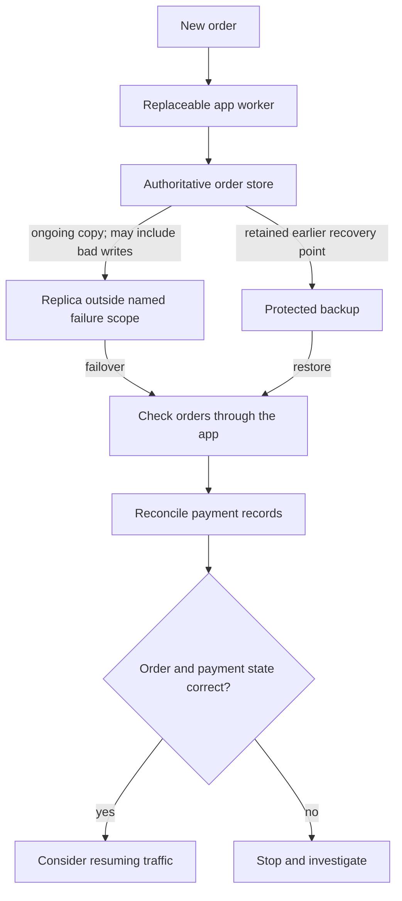

# Stateful design decision checklist

## The idea in plain language

A workload is **stateful** when the next piece of work depends on information
kept from earlier work. Before calling it ready for production, ask where
that information lives, which failures it must survive, and how you would
show that recovery works. A second running replica is useful, but it does
not answer every data-loss question.

Think of a shop's order book. Two cashiers can keep serving customers if
they both use a shared record, but a second cashier cannot restore an order
that was deleted from the record. The analogy has limits: real systems may
have several state stores and replicas; a backup may contain an earlier
version; and correctness can require application-specific checks.

AWS frames recovery around two targets. **Recovery time objective (RTO)** is
the maximum acceptable delay from service interruption to restored service.
**Recovery point objective (RPO)** is the maximum acceptable time between
the last recoverable data and the interruption: the window of recent work
that could be lost. Owners choose both from the impact of downtime and
lost data. They are targets; a recovery exercise measures one path under
its test conditions, not a permanent guarantee.[^aws-objectives][^aws-dr-test]

## Follow the state and the failure

Text alternative: an app worker writes an order to the authoritative store.
A replica receives ongoing changes and may help after a failure in a scope
it sits outside, but it may copy a bad write too. A protected backup retains
an earlier recovery point. After detecting the incident and choosing a path,
the team must fail over or restore, check orders through the application,
and reconcile them with payment records. If the result is wrong, stop and
investigate before resuming traffic. The diagram identifies possible paths; it does
not prove either is configured or meets a recovery target.[^aws-recovery-strategy]

For each important state item, write down four things:

| Question | Why the answer changes the design |
| --- | --- |
| What is the authoritative copy? | A cache can be rebuilt; the only copy of a customer order cannot. |
| Where are its live and recovery copies? | Name where failure could hit: one process, host, Availability Zone, Region, or account. Also name causes such as accidental deletion or bad application writes. |
| What is the acceptable outage and data gap? | RTO and RPO guide the choice between restore, failover, and other recovery paths. |
| What observation proves recovery? | A green backup job does not show that the application can read the right data. |

Replication and backup serve different questions. A live replica may shorten
recovery from one component failure, but a bad write can also be copied to
it. A retained backup can offer an earlier recovery point, but restoring it
takes time and may lose work since that point. These are design
possibilities, not guarantees of an AWS product or configuration.
[^aws-recovery-strategy]

## One illustrative review

Imagine an online shop with two app workers and a database of paid orders.
This is an invented workload, not an AWS deployment or recovery test.

1. The app workers are replaceable only if a paid order is committed to the
   database rather than kept in one worker's memory. That commit can
   survive a worker crash. It might still be absent from a lagging replica
   after a database failover, so a confirmed order can fall inside the
   chosen RPO window.
2. The team names the database as the authoritative **order** store and
   asks what happens if its instance or Availability Zone fails, if the
   Region is unavailable, or if an operator deletes orders. A replica in
   another zone might help with a zone failure, but an asynchronous copy
   may lag. A retained, protected recovery point may be needed after
   deletion or corruption. A Region failure requires copies and a procedure
   outside that Region; this example's zone drill does not test that path.
   [^aws-recovery-strategy][^aws-secure-backups]
3. The owners set illustrative targets of **at most one hour of outage**
   and **at most five minutes of lost orders** for the zone-failure path.
   A path relying only on snapshots every 15 minutes could lose roughly
   15 minutes of writes, or more if a snapshot failed. It cannot support
   the five-minute RPO without another recovery mechanism. Snapshot
   schedules alone also do not prove any restore will work.
   [^aws-objectives][^aws-recovery-test]
4. The team would inject a failure in an isolated exercise, restore or
   fail over by its documented procedure, and verify marker orders through
   the application. Start the clock at the simulated interruption and stop
   it when the owners would resume customer traffic after data checks and
   payment reconciliation. Include detection, decision, connection changes,
   and application validation in the measured time. An announced drill may
   detect failure faster than a real incident.[^aws-recovery-test][^aws-dr-test]

Suppose the team writes numbered marker orders every minute and records
which writes were acknowledged. In one imagined zone-failure drill, the
interruption occurs at **10:12**. The recovered copy contains every earlier
marker through **10:10**, but the acknowledged **10:11** marker is missing.
The app can read orders at **10:40**. After resolving the missing-order
payment, reconciliation finishes at **10:52**, and the team resumes customer
traffic at **10:55**. Measured service recovery is **43 minutes** from
interruption to resumed traffic; the marker-based data gap is about
**two minutes**. Both fit the invented targets in this one drill. The team
should also check actual acknowledged
orders, a common clock or clock skew, and any restored log position;
markers alone sample the data path.[^aws-rpo-validation]

The missing 10:11 order might still have a charge at the external payment
provider. The team needs a link created before failure, such as an order ID
recorded with the provider's payment, so it can find charges even if the
order row is gone. It would enumerate successful provider payments around
the data-gap window, allow for in-flight requests and clock skew, and match
them to recovered orders. It must investigate unmatched charges and orders
marked paid without a matching successful payment before declaring the shop's
state correct. For a recent incident, Stripe's Events API can list
payment-success events by event time and type, but its event-list window is
limited; the real provider's data model, retention, and reconciliation
procedure need their own review.[^stripe-list-events]

A single drill can show one observed gap, not the worst case for every
failure time. To judge whether the design can meet RPO, consider the
maximum backup interval or replication lag, monitor it, and exercise
failures at different points in the cycle. An outage in another zone or
Region, or a failure of payment reconciliation, needs its own evidence.
[^aws-rpo-validation][^aws-objectives]

For accidental deletion or corruption, the newest *safe* recovery point
may be older than the latest backup. If a bad write is copied to the replica
and noticed hours later, choosing an earlier clean point can lose legitimate
work written since then unless the team can selectively repair or replay it.
That is a different failure path from losing one database instance; it may
miss the five-minute RPO unless the team can repair or replay those writes.
[^aws-recovery-strategy]

If the database runs on Kubernetes, a StatefulSet can give Pods stable
identity and associated storage. It does not perform the database's
replication, choose a valid recovery point, or prove queries work after
failover.[^k8s-statefulset] See [stateful workloads in
Kubernetes](../../../kubernetes/core-objects/stateful-workloads.md) for that
boundary.

## Review questions before approval

- **State:** List authoritative records, derived data, caches, files,
  messages, and external services. Which can be rebuilt, and from what?
- **Failure:** Name the failure scope you are designing for. Is the copy
  outside that scope and protected from unintended deletion? Who can run a
  restore if the primary account or operator is unavailable?[^aws-secure-backups]
- **Recovery:** Record the chosen RTO and RPO and the procedure intended to
  meet them. Which dependencies must be restored before workers reconnect?
- **Correctness:** Define an application-level check, such as reading a
  known paid order. Also start from the payment provider's records to find
  charges whose order rows disappeared. What result would make you stop
  rather than resume traffic?
- **Evidence:** For each actual exercise, record the date, environment,
  simulated failure, recovery path, interruption and traffic-resumption
  times, acknowledged and recovered markers, reconciliation result, and
  unresolved gaps. Re-run after relevant changes; older evidence may no
  longer apply.

| Claim | Useful evidence | Insufficient by itself |
| --- | --- | --- |
| Recovery points exist and are retained | Inventory of recovery points and access from the recovery environment | A configured backup schedule |
| One drill's data gap fit the RPO | Acknowledged writes and recovered markers compared with the interruption time | A backup interval alone |
| RPO path has support beyond one drill | An upper-bound argument from backup or log intervals or monitored replication lag, plus drills at different failure times | One favorable drill |
| One drill's RTO was met | Time from interruption to validated data, reconciliation, and resumed traffic | A restore job marked complete |
| Recovered state is correct | Orders matched in both directions with provider payment records | One readable order |

Network flow state needs a different review. For security groups, network
ACLs, and inspection appliances, use [stateful
networking](../networking/stateful-networking.md). For the simpler
compute-versus-data model, start with [stateful vs.
stateless](stateful-vs-stateless.md).

## Check your understanding

- Why does a second app worker not protect an order stored only in the first
  worker's memory?
- What different failures might a live replica and a retained backup address?
- Why can one drill meet an RPO target even if its backup-only design could
  lose more data at another failure time?
- If a 10:11 order was charged but a restore reaches only 10:10, what
  provider-side check can find it even though the order row is missing?

## Official documentation for deeper study

- [Define recovery objectives for downtime and data loss](https://docs.aws.amazon.com/wellarchitected/latest/framework/rel_planning_for_recovery_objective_defined_recovery.html)
  explains how business impact shapes RTO and RPO.
- [Perform periodic recovery of data](https://docs.aws.amazon.com/wellarchitected/latest/framework/rel_backing_up_data_periodic_recovery_testing_data.html)
  explains why backup integrity and restoration require a recovery test.
- [Define a recovery strategy](https://docs.aws.amazon.com/wellarchitected/latest/framework/rel_planning_for_recovery_disaster_recovery.html)
  compares replica and backup paths and explains why a copied bad write
  still needs an earlier recovery point.
- [Secure backups](https://docs.aws.amazon.com/wellarchitected/latest/reliability-pillar/rel_backing_up_data_secured_backups_data.html)
  covers protection from unauthorized deletion and tampering.
- [Test the disaster recovery implementation](https://docs.aws.amazon.com/wellarchitected/latest/framework/rel_planning_for_recovery_dr_tested.html)
  explains exercising the complete recovery path.
- [List Stripe events](https://docs.stripe.com/api/events/list)
  illustrates one provider's recent event-listing window, time filter, and
  event-type filter for reconciliation.
- [Monitor and validate RPO and RTO](https://docs.aws.amazon.com/wellarchitected/latest/financial-services-industry-lens/fsirel07.html)
  describes synthetic records, replication lag, and timed recovery checks.
- [Kubernetes StatefulSets](https://kubernetes.io/docs/concepts/workloads/controllers/statefulset/)
  explains stable Pod identity and storage association.

Next, use [stateless application
patterns](stateless-application-patterns.md) to see how replaceable compute
depends on shared state, or return to the [AWS architecture index](index.md).

[^aws-objectives]: [AWS Well-Architected: Define recovery objectives](https://docs.aws.amazon.com/wellarchitected/latest/framework/rel_planning_for_recovery_objective_defined_recovery.html).
[^aws-recovery-test]: [AWS Well-Architected: Perform periodic recovery of the data](https://docs.aws.amazon.com/wellarchitected/latest/framework/rel_backing_up_data_periodic_recovery_testing_data.html).
[^aws-recovery-strategy]: [AWS Well-Architected: Use defined recovery strategies](https://docs.aws.amazon.com/wellarchitected/latest/framework/rel_planning_for_recovery_disaster_recovery.html).
[^aws-secure-backups]: [AWS Well-Architected: Secure and encrypt backups](https://docs.aws.amazon.com/wellarchitected/latest/reliability-pillar/rel_backing_up_data_secured_backups_data.html).
[^aws-dr-test]: [AWS Well-Architected: Test disaster recovery implementation](https://docs.aws.amazon.com/wellarchitected/latest/framework/rel_planning_for_recovery_dr_tested.html).
[^stripe-list-events]: [Stripe API: List events](https://docs.stripe.com/api/events/list).
[^aws-rpo-validation]: [AWS Well-Architected: Monitor and validate RPO and RTO](https://docs.aws.amazon.com/wellarchitected/latest/financial-services-industry-lens/fsirel07.html).
[^k8s-statefulset]: [Kubernetes: StatefulSets](https://kubernetes.io/docs/concepts/workloads/controllers/statefulset/).
