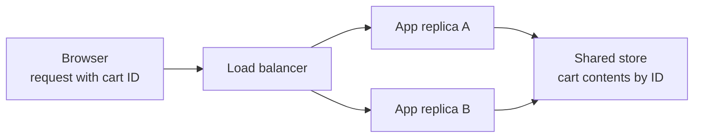

# Stateful vs. stateless on AWS

## The idea in plain language

**State** is information from an earlier request or event that a system needs
later. A shopping cart, a user session, a saved file, and a job's progress
are all state. The useful question is **where that information lives**.

A **stateless compute replica** can handle the next request without relying
on information kept only in its own memory or local disk. It may still read
or write a database, queue, or object store. A **stateful component** keeps
information whose loss or inconsistency would matter to future work. AWS's
reliability guidance recommends separating needed state from replaceable
compute when possible.[^aws-stateless]

Picture a restaurant. A waiter can leave at the end of a shift if every
order is recorded where the next waiter can find it. If the waiter alone
remembers the orders, replacing them loses essential information. The
analogy has a limit: the shared order book itself must be protected and
available; moving state does not make it disappear.

## Follow one request

Imagine two web replicas serving a shopping cart. This is an invented
example, not a deployed AWS workload.

Text alternative: the browser sends a cart ID with a request. The load
balancer may send it to replica A or B. Either replica can use the ID to read
or update that cart's contents in the shared store.

1. The browser sends "add shoes" with an opaque, hard-to-guess cart ID, for
   example in a cookie. The ID identifies a cart; it is not the cart's
   contents. In this example, anyone holding the ID could use the cart, so
   it must be protected like a session cookie.[^owasp-session-management]
2. The load balancer sends this request to replica A. A saves the shoes in
   the shared store under that ID, then replies.
3. The browser sends "view cart" with the same ID. This time the load
   balancer chooses B. B reads the shoes from the store and shows the cart.

The cart contents live in the store; the browser keeps the ID; A and B may
keep rebuildable data, but the cart is never held only in their memory. If A
is replaced after step 2, B can still find the cart **if the store and the
path to it remain healthy**.[^aws-stateless]
The store therefore needs its own availability, access control, backup, and
recovery plan. A request can still fail while the load balancer detects A's
failure and starts sending work elsewhere.

If A instead keeps the cart only in memory, step 3 can show an empty cart
even when nothing has failed. **Sticky routing** means trying to send each
customer back to the same replica; it hides the problem until that replica
is replaced by a crash, deployment, or scale-in. It does not preserve A's
private memory.

### A shared store does not settle every write

Suppose two browser tabs both read a cart containing shoes. Tab 1, through
A, saves shoes and a hat. Tab 2, through B, then writes its older view with
shoes and socks. If each writes the whole cart without checking for changes,
the hat disappears even though the shared store is healthy. This can happen
with just one replica too: the cause is overlapping read-then-write updates.
One way to prevent that **lost update** is for each tab to send back the
cart version it saw when it read. The store rejects a write if the version
has changed; the tab can then read the new cart and reapply its change
before trying again. The exact mechanism depends on the store; DynamoDB,
for example, documents versioned conditional writes.[^aws-dynamodb-concurrent-updates]

Another boundary is a lost reply. If A saves a hat but fails before its
reply reaches the browser, or the reply is lost on the network, the browser
cannot tell whether the write succeeded.
Repeating a non-idempotent "add" operation could add the hat twice. One
safe retry design gives the operation an ID that the browser sends again on
every retry; the store records that ID atomically with the cart change, so
the duplicate is recognized.[^aws-idempotent-apis] Moving data out of A's
memory did not solve either write problem.

## What changes operationally

| Question | Replaceable compute | Component holding required state |
| --- | --- | --- |
| What happens after one instance fails? | Start another and reconnect to shared state. | Recover or fail over the data and check consistency. |
| What makes scaling harder? | Usually capacity, dependencies, and startup time. | Data placement, replication, ordering, or ownership can limit how it scales. |
| What must be protected? | Reproducible code, configuration, and credentials. | Data integrity, access, backups, and recovery objectives. |

These are design tendencies, not automatic properties of an AWS service.
For example, a web process can become stateful if it keeps uploads only on
local disk. A managed database remains a stateful dependency even when AWS
operates much of its infrastructure. Replacing compute and recovering data
are different tasks.

## Decide what must survive

Before calling a component stateless, list what it holds between requests:

1. **Required state:** a cart, uploaded file, payment record, or work item
   whose loss would violate the user outcome.
2. **Rebuildable state:** a cache or derived file that can be recreated from
   another authoritative store within an acceptable time.
3. **Short-lived state:** temporary calculations used only during one
   request, provided retry behavior is understood.

Then ask: if this replica vanishes now, where would a replacement get each
required item? AWS lists databases, caches, file systems, and object storage
as ways to offload state, chosen according to the data and access
need.[^aws-stateless] For ordinary request handling in Lambda, AWS says not
to rely on an execution environment persisting between invocations;
permanent changes belong in durable services before the invocation ends.
[^aws-lambda-design]

Moving required state to a shared service introduces new questions: Is that
service available? Is data encrypted and access controlled? Can a retry
repeat an operation safely? What are the acceptable recovery time and data
loss? The answer cannot be inferred from the word “stateless” alone.

## Check your understanding

- A web server writes uploaded files only to its local disk. What happens
  when that server is replaced?
- Why can a compute replica be stateless while the whole application is
  still stateful?
- Two tabs update the same cart through one or more replicas. Why might one
  item disappear even though the replica uses a shared store?
- What extra evidence would you need before claiming that an application
  remains available after one replica fails?

## Official documentation for deeper study

- [AWS Well-Architected: make systems stateless where possible](https://docs.aws.amazon.com/wellarchitected/latest/framework/rel_mitigate_interaction_failure_stateless.html) explains separating session and user data from compute.
- [Designing Lambda applications](https://docs.aws.amazon.com/lambda/latest/dg/concepts-application-design.html) explains why functions must treat execution environments as replaceable and store permanent changes externally.
- [Handling concurrent DynamoDB updates](https://docs.aws.amazon.com/amazondynamodb/latest/developerguide/BestPractices_ImplementingVersionControl.html) illustrates one way a shared store can detect conflicting writes.
- [Making retries safe with idempotent APIs](https://aws.amazon.com/builders-library/making-retries-safe-with-idempotent-APIs/) explains why a client request ID and its effect must be recorded together.
- [OWASP session management](https://cheatsheetseries.owasp.org/cheatsheets/Session_Management_Cheat_Sheet.html) explains why browser-held identifiers must be unpredictable and protected.

Next, use [stateless application patterns](stateless-application-patterns.md)
for AWS component choices, or the [stateful design
checklist](stateful-design-decision-checklist.md) before an operational
decision. See the [AWS architecture index](index.md).

[^aws-stateless]: [Make systems stateless where possible](https://docs.aws.amazon.com/wellarchitected/latest/framework/rel_mitigate_interaction_failure_stateless.html).
[^aws-lambda-design]: [Designing Lambda applications](https://docs.aws.amazon.com/lambda/latest/dg/concepts-application-design.html).
[^aws-dynamodb-concurrent-updates]: [Best practices for handling concurrent updates in DynamoDB](https://docs.aws.amazon.com/amazondynamodb/latest/developerguide/BestPractices_ImplementingVersionControl.html).
[^aws-idempotent-apis]: [Making retries safe with idempotent APIs](https://aws.amazon.com/builders-library/making-retries-safe-with-idempotent-APIs/).
[^owasp-session-management]: [OWASP Session Management Cheat Sheet](https://cheatsheetseries.owasp.org/cheatsheets/Session_Management_Cheat_Sheet.html).
