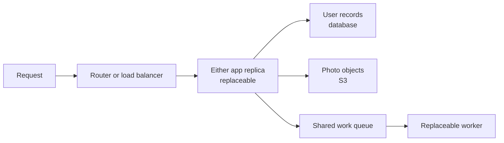

# Stateless application patterns on AWS

## The idea in plain language

A replaceable app replica should not be the only place that holds something
users still need. Move **required state** to a suitable shared system, and
let the app replica read it when handling a request. The goal is that a new
replica can take over without needing the old replica's private memory or
disk.[^aws-stateless]

“Stateless” describes the compute layer in this pattern. The whole
application still has state, and its shared systems need their own access,
availability, backup, and recovery design. Read [stateful vs.
stateless](stateful-vs-stateless.md) first for the basic distinction.

This matters during a crash, deployment, or scale change: a replacement
replica can continue only if the required information and unfinished work
survived somewhere it can reach. Moving those things introduces handoffs
between systems, where one write can succeed and the next can fail.

Think of a library desk with replaceable clerks, a shared catalog, book
shelves, and a bin of work slips. A new clerk can find a book from its
catalog record and pick up a slip left by an earlier clerk. The analogy
breaks at two useful points: shelving a book and updating its catalog record
are separate acts, and a work slip may be handed out again after an
interruption. Software must handle both cases explicitly.

## One picture of the pattern

Text alternative: a router sends a request to either replaceable app
replica. That replica can reach the user-record store and S3 objects, and
can submit work to a queue that hands messages to a replaceable worker.
Records and objects are separate stores, so a request writing both can
partly fail.
The queue may hand the same message to a worker again. The drawing is a
design model, not a deployed architecture or a guarantee of availability.

## Put each kind of information in the right place

| Information | If kept only in one replica | A possible shared pattern |
| --- | --- | --- |
| Uploaded image | It can vanish when that replica is replaced. | Store the object in S3 and keep its identifier with the user's record.[^aws-s3] |
| Login session or cart | A different replica cannot continue the interaction. | Keep the contents in a shared store and let each request carry an identifier the server can check.[^aws-stateless] |
| Background work request | A process crash can erase work that was only in memory. | Put the request in a durable queue or workflow service; design retry behavior.[^aws-lambda-design] |
| Temporary calculation | Usually safe to recompute if the request is retried. | Keep it local only when loss and recomputation are acceptable. |
| Cache copy | May disappear with the replica. | Rebuild from the authoritative store, or use a shared cache if recovery time requires it. |

These are categories, not a prescription to use every listed AWS service.
For each item, decide what must survive, how it is read, what consistency it
needs, and who can access it. A shared store can become a bottleneck or
failure point if its own design is ignored.

The server must check that a request may access the cart identified by a
browser-held ID.[^owasp-authorization] It should obtain the current price
from its own catalog rather than trusting a price sent by the browser. The
[cart example](stateful-vs-stateless.md#follow-one-request) keeps the ID
separate from the stored contents.

## Follow an upload

Imagine an app that receives one small profile photo in a server-mediated
upload. This is an invented example; no upload or AWS resource was created
for this page.

1. The app receives the photo, generates a **new unique key** itself, and
   writes the object into a protected S3 bucket. It does not use the
   browser's filename as the key. S3 is an object store; the key identifies
   this photo's bytes within the bucket.[^aws-s3]
2. The app saves that key in the user's record only after confirming the
   upload succeeded. The record decides which photo is current; S3 holds
   its bytes. This ordering is a design choice for this example, not a
   transaction spanning the record store and S3.
3. A later request may land on another app replica. That replica reads the
   user record and retrieves the object with appropriate permissions.

If the first replica disappears before confirming the S3 write, the app and
browser cannot assume the object exists; they must verify the outcome or
retry. Once the object is stored but before the record write starts, it is
unreferenced and needs eventual cleanup. During the record write, the
outcome may be unknown. If the record update committed, the new photo can
be found through the record, assuming the stores and access paths are
healthy. A lost reply can cause a retry under another new key, leaving one
object unreferenced. Replacing a photo also leaves the old object
unreferenced in the ordinary success path. A real design must decide how
to detect, retry, and clean up each case.

Using a fixed S3 key would change this failure story: a new upload could
replace what the existing key returns before the app updates the record;
S3 Versioning can retain an older version, but readers using the key see
the current one.[^aws-s3] For one replacement, a new key lets the record
continue pointing to the old photo until its update commits. Concurrent
replacements also need a rule for which record update wins.

## Replaceable workers still need careful retries

A queue can preserve a submitted work request while workers start and stop,
within its configured message-retention period.[^aws-sqs-overview] In SQS,
receiving a message hides it for a **visibility timeout**; the worker deletes
it after successful processing. If it is not deleted before the timeout
expires, another worker can receive it, even while the first is still
running. A standard queue can also deliver an extra copy during the
timeout, so no worker should assume it is the only one handling that
request.[^aws-sqs-visibility][^aws-sqs-delivery]
This is why **idempotent** processing matters: repeating the same request
should not cause an unwanted second effect. AWS gives the same design
principle for Lambda event processing.[^aws-lambda-design]

The queue can protect only work it actually received. If the app updates a
record but crashes before sending the corresponding message, no worker can
pick that task up from the queue. A real design must make this handoff
recoverable and handle repeated sends.

An illustrative payment worker could use a stable payment-operation ID,
created once before the message is sent and carried in its body, as an
**idempotency key** on every provider retry. Stripe documents this pattern;
another provider may have a different contract.[^stripe-idempotent-requests]
A local "already charged" check alone is insufficient: the worker could
charge the provider, then crash before saving its local record; a
redelivered message would pass the check and charge again. Two workers
could also both check before either records completion. A real design must
verify the provider's key lifetime against possible late retries, handle
an unknown or conflicting provider response, and use a concurrency-safe
local record. Otherwise a late replay might charge twice. The queue alone
cannot prove a payment occurred exactly once.

## What to check before claiming replaceability

- Can a new replica start from code and configuration without manual edits?
- Where are sessions, uploads, job progress, logs, and credentials stored?
- Can a request be retried or duplicated without corrupting state?
- If a replica exits during work, what resumes or compensates for it?
- Can the shared state system meet the application’s availability and
  recovery goals under the expected failure?

These questions are a design review, not evidence that a particular
deployment passed a failure test. For an operational decision, continue to
the [stateful design checklist](stateful-design-decision-checklist.md).

## Check your understanding

- Why can two interchangeable app replicas still depend on a stateful
  database or object store?
- What can go wrong between writing an S3 object and saving its key?
- Why must a worker handle a duplicate SQS standard-queue message?
- Why is a local "already charged" check insufficient if the worker can
  crash after contacting a payment provider?

## Official documentation for deeper study

- [AWS Well-Architected stateless guidance](https://docs.aws.amazon.com/wellarchitected/latest/framework/rel_mitigate_interaction_failure_stateless.html) explains why to move session and user data out of replaceable compute.
- [Amazon S3 introduction](https://docs.aws.amazon.com/AmazonS3/latest/userguide/Welcome.html) explains objects, keys, access, and storage choices.
- [SQS at-least-once delivery](https://docs.aws.amazon.com/AWSSimpleQueueService/latest/SQSDeveloperGuide/standard-queues-at-least-once-delivery.html) explains duplicate delivery for standard queues.
- [SQS visibility timeout](https://docs.aws.amazon.com/AWSSimpleQueueService/latest/SQSDeveloperGuide/sqs-visibility-timeout.html) explains when a received message becomes available again.
- [SQS overview](https://docs.aws.amazon.com/AWSSimpleQueueService/latest/SQSDeveloperGuide/welcome.html) describes message retention and deletion.
- [Designing Lambda applications](https://docs.aws.amazon.com/lambda/latest/dg/concepts-application-design.html) covers replaceable execution environments and idempotency.
- [Stripe idempotent requests](https://docs.stripe.com/api/idempotent_requests) shows one payment provider's retry contract; read the actual provider's documentation for a real design.
- [OWASP authorization guidance](https://cheatsheetseries.owasp.org/cheatsheets/Authorization_Cheat_Sheet.html) explains why access needs server-side checks on every request.

See the [AWS architecture index](index.md) for related design choices.

[^aws-stateless]: [Make systems stateless where possible](https://docs.aws.amazon.com/wellarchitected/latest/framework/rel_mitigate_interaction_failure_stateless.html).
[^aws-s3]: [What is Amazon S3?](https://docs.aws.amazon.com/AmazonS3/latest/userguide/Welcome.html).
[^aws-sqs-delivery]: [Amazon SQS at-least-once delivery](https://docs.aws.amazon.com/AWSSimpleQueueService/latest/SQSDeveloperGuide/standard-queues-at-least-once-delivery.html).
[^aws-sqs-visibility]: [Amazon SQS visibility timeout](https://docs.aws.amazon.com/AWSSimpleQueueService/latest/SQSDeveloperGuide/sqs-visibility-timeout.html).
[^aws-sqs-overview]: [What is Amazon SQS?](https://docs.aws.amazon.com/AWSSimpleQueueService/latest/SQSDeveloperGuide/welcome.html).
[^aws-lambda-design]: [Designing Lambda applications](https://docs.aws.amazon.com/lambda/latest/dg/concepts-application-design.html).
[^stripe-idempotent-requests]: [Stripe API - Idempotent requests](https://docs.stripe.com/api/idempotent_requests).
[^owasp-authorization]: [OWASP Authorization Cheat Sheet](https://cheatsheetseries.owasp.org/cheatsheets/Authorization_Cheat_Sheet.html).
