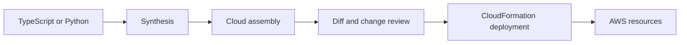

# AWS CDK fundamentals and comparisons

## Purpose

Understand why code-based infrastructure still requires declarative lifecycle review.

Sources reviewed: 2026-10-29. See the [validation record](../../../../knowledge-base-audit.md) for executed checks and unexecuted runtime labs.

## What CDK is

The AWS Cloud Development Kit (CDK) is an infrastructure framework. Application code builds a construct tree and synthesizes a CloudFormation template. CloudFormation provisions and updates the stack. A language loop runs during synthesis; it is not a continuous controller watching AWS.[^aws-cdk-v2][^cdk-constructs]

CDK helps teams compose reusable infrastructure, share conventions, and test resource properties using familiar languages. It does not eliminate IAM, service limits, deployment failure, replacement, or stateful-resource design.

| Approach | Main model | Useful when |
| --- | --- | --- |
| CloudFormation | AWS templates and stacks | Direct AWS-native declarative control. |
| AWS CDK v2 | Constructs synthesize CloudFormation | Reusable abstractions and language tooling are valuable. |
| Terraform | Provider-based plan/apply and state | A multi-provider workflow fits the team. |
| Crossplane / cloud controllers | Kubernetes APIs and reconciliation | A continuously managed platform API fits operations. |

AWS CDK is different from CDK for Kubernetes (cdk8s). This series uses CDK v2's `aws-cdk-lib`; do not mix v1 service packages into the examples.

## How work reaches AWS

## Trade-offs

High-level constructs reduce repetitive wiring but can create additional resources and IAM permissions. Library upgrades can alter synthesized output. Keep dependencies pinned, inspect generated templates, and test security properties. Use lower-level constructs when explicit control is necessary rather than bypassing review through arbitrary escape hatches.

## Related links

- [AWS CDK v2](https://docs.aws.amazon.com/cdk/v2/guide/home.html)
- [CDK constructs](https://docs.aws.amazon.com/cdk/v2/guide/constructs.html)
- [Terraform](../../../terraform/index.md)
- [Crossplane](../../../kubernetes/crossplane/index.md)
- [Back to parent index](index.md)
- [Back to major area](../../index.md)
- [Back to root index](../../../../README.md)

[^aws-cdk-v2]: [AWS CDK v2](https://docs.aws.amazon.com/cdk/v2/guide/home.html).
[^cdk-constructs]: [CDK constructs](https://docs.aws.amazon.com/cdk/v2/guide/constructs.html).
