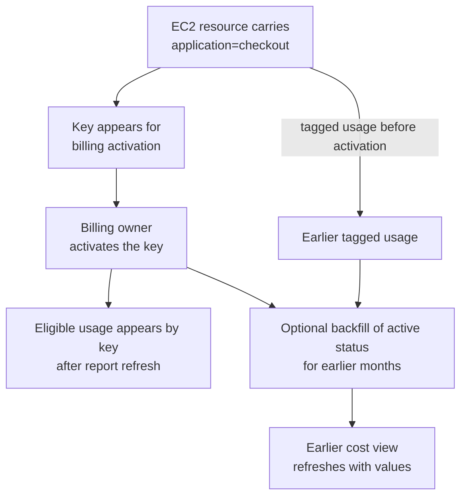

# Cost allocation tags

## Purpose

Use this page to understand why a tag visible on an AWS resource may be absent
from Cost Explorer, and how to make tagging useful for ownership reporting.
It explains the path from a resource label to a billing dimension; it does
not change an AWS account. **Cost Explorer** is AWS's view for exploring
cost and usage over time.[^aws-cost-explorer-enable]

## The simple model

An AWS **tag** is a key and value attached to a resource, such as
`application=checkout`. A **cost allocation tag** is a tag key that has also
been activated for AWS billing reports. AWS can then group eligible usage
costs by values of that key.[^aws-cost-allocation-tags][^aws-activate-tags]

Think of a label on a package and a column in a report. Putting
`application=checkout` on an instance labels the resource; activating
`application` tells AWS Billing to use that key as a reporting column.
The analogy breaks when time matters: billing data arrives later, and adding a label
today does not label usage from before the resource had that tag.

Text alternative: first, an EC2 resource receives the `application` key and
`checkout` value. The key becomes available to the billing owner, who
activates it. Eligible usage can then appear by that key after Cost Explorer
refreshes. After activation, a separate backfill request can apply the active
status to earlier months; values appear only for usage that happened while
the resource carried the tag. Usage before the tag existed has no value to
recover.

These arrows are a sequence, not an instant operation. A new user-defined
key can take up to 24 hours to appear for activation and up to another 24
hours to activate. Cost Explorer refreshes its cost data at least once every
24 hours. A resource tag is therefore not proof that today's cost view
already contains it.[^aws-activate-tags][^aws-cost-explorer-enable]

## Choose keys that answer questions

| Example key | Reader question it helps answer | Important limit |
| --- | --- | --- |
| `owner` | Who investigates this cost? | Decide whether a team or an individual is the stable owner. |
| `application` | Which product or service generated it? | One resource may serve several applications. |
| `environment` | Is this development, staging, or production cost? | Shared infrastructure may serve several environments. |
| `cost-center` | Which finance grouping receives it? | Confirm allowed values with finance before tagging. |

These are example keys, not AWS-required keys. Keep the approved keys and
values in one owned list and apply them consistently where a service supports
resource tagging. Do not place sensitive data in tags.[^aws-cost-allocation-tags]
The broader [cost allocation policy](../../../finops/cost-allocation-basics.md)
decides how to assign costs that tags cannot describe.[^finops-allocation]

## Example: a tag exists but Cost Explorer has no value

This scenario is illustrative; it is not an observed AWS bill. A team tags an
EC2 instance `application=checkout` on Monday. On Tuesday it filters Cost
Explorer by `application` and sees nothing. That result can be expected:
the key may not yet have appeared for activation, nobody may have activated
it yet, activation may still be processing, or Cost Explorer may not have
refreshed.[^aws-activate-tags][^aws-cost-explorer-enable]

There are several distinct questions to check:

1. Does the instance actually have the expected key and value? Spelling and
   capitalization matter.
2. Is the `application` key listed and active under **Billing and Cost
   Management → Cost allocation tags**? In a standard AWS Organization, the
   management account manages those activations; a standalone account can
   manage its own. AWS documents a separate bill-source path for billing
   transfer.[^aws-cost-allocation-tags][^aws-activate-tags]
3. Has the appearance, activation, and report refresh time passed? The key
   can take up to 24 hours to appear for activation and up to another 24 hours
   to activate; Cost Explorer then updates at least once every 24
   hours.[^aws-activate-tags][^aws-cost-explorer-enable]
4. Does the selected report period contain eligible usage from a resource
   that carried that tag while the key was active? For older tagged usage,
   ask the billing owner whether a backfill is needed. A new tag cannot
   create values for usage before it was assigned.[^aws-tag-backfill]

Expected result after activation and refresh: eligible usage while the key
is active can appear under `application=checkout`. Monday's tagged usage,
before activation, may still need a backfill even after the refreshed view
shows later usage. If the report still does not match the resource inventory,
inspect the specific service's tagging and billing support, the time range,
and untagged charges before changing the allocation policy.

## What backfill can and cannot do

AWS documents cost allocation tag **backfill** as a management-account
action. The request names a start month up to twelve months back and applies
the key's current activation status to every billing period from that month
to the present. If the key is active now, it can
expose a past value **only for usage that occurred while the resource carried
that value**. It cannot invent a value for usage before the resource was
tagged. If a key is now inactive, backfill can also remove it from earlier
cost views.[^aws-tag-backfill]

Backfill updates Cost Explorer, Data Exports, and Cost and Usage Reports
asynchronously. Those views refresh on a roughly daily cycle, so a successful
request does not change the visible report immediately. AWS permits one
request at a time and no more than one new request per 24 hours. Before
requesting it, confirm the historical tag coverage and intended reporting
period with the billing owner; the request changes historical cost views.
[^aws-tag-backfill]

## Where tags stop helping

Not every charge is tied to a taggable resource, and a shared resource can
benefit several teams. An AWS Support charge or shared networking cost may
need a separate owner or split rule. Tags alone therefore cannot allocate
the whole bill. Use an account mapping where appropriate and record a rule
for shared or otherwise unassigned costs. The FinOps Framework treats the
overall allocation, tagging, and shared-cost strategies as separate
decisions within its Allocation capability.[^finops-allocation]

An AWS **Cost Category** groups charges using rules. It can apply split charge
rules to shared category values. Those calculated splits appear on the Cost
Categories details page. They do **not** change Cost Explorer, Cost and Usage
Reports, or the bill. Decide the policy first in
[cost allocation basics](../../../finops/cost-allocation-basics.md),
then choose the report that can show it.[^aws-split-charges]

## Check your understanding

- What is the difference between adding `application=checkout` to an
  instance and activating `application` for billing?
- If a tag was added in June, can backfill produce that tag value for March
  when the resource had no such tag?
- Which costs in your environment need an account mapping or shared-cost rule
  instead of a resource tag?

For the first question, tagging labels the resource while activation makes
the key available to billing reports after processing. For the second, no:
backfill cannot invent a March value if the resource was not tagged until
June. For the third, shared support or networking charges are examples to
check against your own allocation policy.

## Official documentation for deeper study

- [AWS cost allocation tags](https://docs.aws.amazon.com/awsaccountbilling/latest/aboutv2/cost-alloc-tags.html) defines tag types, activation, and billing use.
- [Activating user-defined tags](https://docs.aws.amazon.com/awsaccountbilling/latest/aboutv2/activating-tags.html) gives the console path and timing.
- [Backfill cost allocation tags](https://docs.aws.amazon.com/awsaccountbilling/latest/aboutv2/cost-allocation-backfill.html) states the historical limit and refresh behavior.
- [Enabling Cost Explorer](https://docs.aws.amazon.com/cost-management/latest/userguide/ce-enable.html) states its update cadence.
- [AWS Cost Categories split charges](https://docs.aws.amazon.com/awsaccountbilling/latest/aboutv2/splitcharge-cost-categories.html) explains where shared-cost splits appear.
- [FinOps Framework: Allocation](https://framework.finops.org/framework/capabilities/allocation/) places tags inside a broader allocation strategy.

## Related links

- [Cost allocation basics](../../../finops/cost-allocation-basics.md)
- [Back to AWS FinOps](index.md)
- [Back to AWS index](../index.md)
- [Back to knowledge index](../../../index.md)

[^aws-cost-allocation-tags]: [AWS Billing - Cost allocation tags](https://docs.aws.amazon.com/awsaccountbilling/latest/aboutv2/cost-alloc-tags.html), source record `aws-cost-allocation-tags`.
[^aws-activate-tags]: [AWS Billing - Activating user-defined cost allocation tags](https://docs.aws.amazon.com/awsaccountbilling/latest/aboutv2/activating-tags.html), source record `aws-activate-tags`.
[^aws-tag-backfill]: [AWS Billing - Backfill cost allocation tags](https://docs.aws.amazon.com/awsaccountbilling/latest/aboutv2/cost-allocation-backfill.html), source record `aws-tag-backfill`.
[^aws-cost-explorer-enable]: [AWS Cost Management - Enabling Cost Explorer](https://docs.aws.amazon.com/cost-management/latest/userguide/ce-enable.html), source record `aws-cost-explorer-enable`.
[^aws-split-charges]: [AWS Billing - Splitting charges within cost categories](https://docs.aws.amazon.com/awsaccountbilling/latest/aboutv2/splitcharge-cost-categories.html), source record `aws-split-charges`.
[^finops-allocation]: [FinOps Framework - Allocation](https://framework.finops.org/framework/capabilities/allocation/), source record `finops-allocation`.
