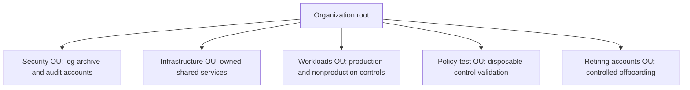

# AWS account and organizational-unit design

An AWS account is a resource, permission, billing and operational boundary. AWS Organizations groups accounts for shared governance. An organizational unit (OU) groups accounts under common controls; it is not a user group or an IAM permission grant. The organization root is a hierarchy node, distinct from an account's root user.

## Choose boundaries from operational requirements

Separate workloads when their access, lifecycle, data handling, failure impact or financial accountability needs differ. Production and disposable experiments usually need different operating controls. Account separation adds provisioning, connectivity, identity, evidence and cost-management work; use an owned account registry to make that burden visible.

AWS recommends OUs based on shared controls/functions rather than copying the reporting hierarchy.[^ou-design] This example is a starting design, not a mandatory topology:

What it does: groups accounts by lifecycle/control needs. Moving an account between OUs changes its inherited control path and needs a planned test; the diagram creates no accounts or policies.

## Protect the management boundary

Keep the management account focused on organization responsibilities and minimize routine access. Delegate supported service administration to dedicated member accounts where appropriate.[^org-practices] A delegated administrator is still a member account subject to relevant SCPs; management-account users/roles are outside SCP enforcement.[^scp] Do not put routine workloads there expecting member-account guardrails to protect them.

Maintain account ID, owner, purpose, environment, OU path, contact/recovery ownership, data classification, access model, logging destination, budget/cost owner, lifecycle and last review. Distinguish the Organizations management account, a service's delegated-administrator account, and the AFT management account; their names do not make their responsibilities interchangeable.

## Review a proposed move or new boundary

Compare current and target OU policy paths, identity assignments, network dependencies, billing ownership and Control Tower baseline/enrollment. Establish expected allowed/denied operations and a recovery principal before moving an owned test account. A successful move API response is not proof that workloads or operators still function.

Continue with [guardrail evaluation](organization-policy-guardrails.md), [account lifecycle](account-vending-and-lifecycle.md), and [human federation](identity-center-and-human-federation.md). Cleanup means removing only task-owned experiments after restoring an approved OU/control state, not deleting an account to undo an untested move.

## Evidence and limits

Official sources reviewed on 2026-11-10. These drafts describe current AWS behavior and an applied review process. No AWS account/API call, login, policy attachment, organization change, root session, account creation/closure, or user-session revocation was executed during authoring. CLI examples are source-reviewed AWS CLI v2 instructions; no AWS CLI runtime version was tested. The separate synthetic inventory lab validates local reconciliation only.

[Back to governance and access](index.md) | [Back to AWS](../index.md)

[^org-practices]: [AWS multi-account practices](https://docs.aws.amazon.com/organizations/latest/userguide/orgs_best-practices.html).
[^ou-design]: [AWS OU design](https://docs.aws.amazon.com/organizations/latest/userguide/orgs_manage_ous_best_practices.html).
[^scp]: [Service control policies](https://docs.aws.amazon.com/organizations/latest/userguide/orgs_manage_policies_scps.html).
