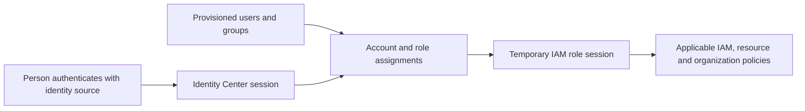

# IAM Identity Center and human federation

IAM Identity Center connects workforce identities to AWS accounts and supported applications.[^identity-center] It is not a replacement for every IAM role, resource policy or workload credential path. A person, an AWS account role, and a Pod's workload role are separate identities.

## Follow each boundary

What it does: separates authentication, directory state, assignment and service authorization. A successful portal login does not prove an account/role assignment or permission to perform a service operation.

## Choose the instance and identity source

An organization instance supports multi-account access; an account instance is intended for its supported application assignments and does not provide the same AWS account access portal/multi-account permission features.[^instances] Record the instance ARN, identity-store ID, administrative account, configured Region/replication and chosen access method instead of guessing from a console label.

External-IdP designs use SAML for sign-in and provision applicable identities separately, commonly with SCIM. SAML does not query the IdP for a complete user/group directory.[^external-idp] Check immutable identity mapping, group membership, provisioning failures, certificate/token lifecycle and ownership at the source. A working SAML login can coexist with stale or missing assignments.

## Distinguish current account-access models

| Model | What owns the account role and mapping? |
| --- | --- |
| Identity Center permission sets | A centrally maintained policy template provisions Identity Center-controlled roles in assigned accounts. |
| IAM account access manager | Existing/custom IAM roles remain managed in accounts; account access manager maps Identity Center users/groups to them. |
| Direct IAM federation | An IdP-specific trust/mapping design uses account roles without assuming a permission-set workflow. |

Current AWS documentation supports account access manager alongside permission sets or independently, including its separate `account-access` API namespace.[^account-access] Custom trust, tags or role paths may favor that model; uniform provisioned baselines may favor [permission sets](permission-sets-and-assignments.md). Inventory both if both exist. The lab in this section deliberately covers only permission-set assignment snapshots.

## Connect to engineering access

Use [CLI sessions](cli-sso-and-role-sessions.md) for the selected model's login path, [access reviews](access-review-and-offboarding.md) for identity lifecycle, and [EKS human access](../../../security/identity-federation/eks-human-identity-and-rbac.md) for cluster authorization. Human federation does not grant a Pod AWS permissions; retain the [IRSA/Pod Identity comparison](../../../cross-topic-guides/eks-workload-identity.md) as that entry point.

## Evidence and limits

Official sources reviewed on 2026-11-10. These drafts describe current AWS behavior and an applied review process. No AWS account/API call, login, policy attachment, organization change, root session, account creation/closure, or user-session revocation was executed during authoring. CLI examples are source-reviewed AWS CLI v2 instructions; no AWS CLI runtime version was tested. The separate synthetic inventory lab validates local reconciliation only.

[Back to governance and access](index.md) | [Back to AWS](../index.md)

[^identity-center]: [IAM Identity Center overview](https://docs.aws.amazon.com/singlesignon/latest/userguide/what-is.html).
[^instances]: [Identity Center organization/account instances](https://docs.aws.amazon.com/singlesignon/latest/userguide/identity-center-instances.html).
[^external-idp]: [External identity providers and provisioning](https://docs.aws.amazon.com/singlesignon/latest/userguide/manage-your-identity-source-idp.html).
[^account-access]: [IAM account access manager](https://docs.aws.amazon.com/IAM/latest/UserGuide/account-access-manager.html).
