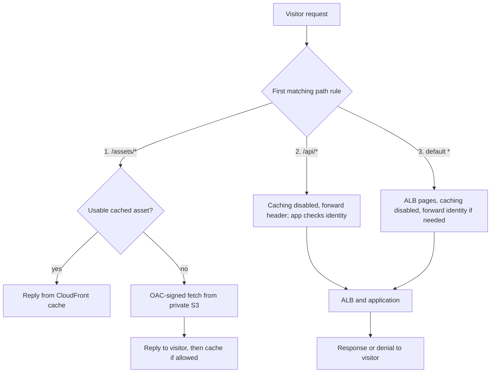

# CloudFront

## Purpose

Amazon CloudFront is AWS's content delivery network (CDN). It receives a
visitor's request at an edge location, matches a behavior that names an origin,
and may reuse a cached copy for later requests. On a miss it contacts that
origin. An **origin** is the application or storage that holds the original
content.[^cloudfront-how-it-works]

This page helps you read a CloudFront distribution as a set of request-routing
and protection decisions. For the general cache model, start with
[CDN and edge fundamentals](../../edge/cdn-and-edge-fundamentals.md).

## Why the distribution matters

A **distribution** is the CloudFront configuration for a site. It connects a
public hostname to one or more origins and says how matching request paths
are handled. A site may need different handling for versioned images, public
pages, and signed-in API responses. One rule for all three can accidentally
cache private data or send a request to the wrong backend.

Think of the distribution as a **reception desk with a route sheet**. The desk
checks the requested path, selects the appropriate backend, and may answer
from a copy already at hand. The analogy has limits: CloudFront operates at
many edge locations, a cache hit never reaches the origin, and path matching
is decided by exact rules and their order rather than human judgement.

| Part | Simple meaning | Question it answers |
| --- | --- | --- |
| Alternate domain name and certificate | The site name, such as `learn.example.org`, and proof CloudFront may serve it over TLS. | Which public name do visitors use? |
| Origin | S3 storage or an application endpoint that provides the response on a miss. | Where does the original come from? |
| Cache behavior | A path pattern plus the origin and policies to apply. | Which rule handles this URL? |
| Cache policy | The cache key and minimum, default, and maximum lifetime. | May two requests reuse one stored response, and for how long? |
| Origin request policy | Additional headers, cookies, or query strings sent to the origin on a miss without entering the cache key. | What does the origin need to receive? |

CloudFront tests non-default cache behaviors in their listed order and uses
the **first matching** path pattern. The default `*` behavior catches what
remains. A broad rule placed before a sensitive one can select the wrong
origin or access policy; behavior order also decides which access settings,
such as signed URLs, apply.[^cloudfront-cache-behaviors]
The pattern checks the request path, not its query string or cookies. It
chooses behavior, not whether a user is allowed to see the response.[^cloudfront-cache-behaviors]
Cache and origin request policies are separate, though values placed in the
cache key are automatically forwarded to the origin. If a response depends on
a cookie or header forwarded only by the origin request policy, that value does
not separate cached copies. Disable caching for such private responses or
design and verify an appropriate cache key.[^cloudfront-cache-policy][^cloudfront-origin-request-policy]
For example, an earlier `/a*` rule would also match `/api/orders` and could
apply its own cache and origin settings; `/api/*` would never be checked.

## Example: one site, two origins

This site and its routes are invented. Assume the API uses an
`Authorization` header and checks it in the application. The table shows
the intended decisions, not a deployable distribution; no CloudFront
configuration or request was run.

| Order | Path pattern | Origin | Cache and identity decision |
| --- | --- | --- | --- |
| 1 | `/assets/*` | S3 bucket without direct public access | Assets are public through CloudFront; versioned names allow a long cache lifetime. OAC authorizes CloudFront's S3 fetch on a miss. |
| 2 | `/api/*` | Application Load Balancer (ALB) | Disable CloudFront caching with zero minimum, default, and maximum TTLs; forward the viewer's `Authorization` header to the ALB for an application check. |
| Default | `*` | ALB | Also disable caching until page responses are proven safe to share; forward any identity inputs the application needs to check each request. |

When someone requests `/assets/logo-v3.svg`, the first rule selects S3. A
usable copy can return from the edge; a miss goes to S3. A request for
`/api/orders` skips the first rule, selects the ALB, and reaches the
application with its identity header. The application must validate that
identity for this request. CloudFront's managed `CachingDisabled` policy
has all three TTLs set to zero, so a response containing one person's
orders is not reused for another request. Without a suitable origin request
policy, CloudFront removes `Authorization` from GET and HEAD requests before
they reach the ALB. AWS documents two safe choices for origin-authorized
responses: forward the header with caching disabled, as here, or include it
in a verified cache key. Forwarding identity without separating cached copies
is dangerous. For example, if Sam's `Authorization` header were forwarded
while his `/api/orders` response were stored under a key based only on the
path, Jo's later request could receive Sam's orders without a new application
check.
A request for `/shop` reaches the default rule.[^cloudfront-managed-cache-policies][^cloudfront-authorization-header]

A positive minimum TTL can make CloudFront cache a response even if the origin
sends `Cache-Control: private` or `no-store`. The default behavior's cache
policy matters too: a page such as `/shop` might show a personal cart, so the
origin's response headers alone are not a safe sharing rule under a positive
minimum TTL.[^cloudfront-cache-policy]

For an API that accepts `POST` or other write methods, the behavior's
allowed-methods setting must admit them and the application must still
authorize each operation. The path rule does neither job by itself.
CloudFront can cache GET and HEAD responses when policy permits, but not
POST responses. That does not make an authenticated GET safe to
cache.[^cloudfront-cache-behaviors]

Text alternative: CloudFront chooses the first matching path rule. For
`/assets/*`, a usable cached copy returns immediately; otherwise CloudFront
signs a fetch to private S3 through OAC and may store the response. For
`/api/*`, caching is disabled, the identity header is forwarded to the
ALB application, and the application checks it before responding. Other
paths reach the default ALB behavior, which also has caching disabled and
forwards any required identity in this example. The diagram helps locate
both the rule that handles a request and the point where an origin is, or
is not, contacted.

## Protect each connection and origin

- **Viewer to CloudFront.** A custom site hostname needs an alternate domain
  name, a matching certificate, and DNS pointing at the distribution. An ACM
  certificate for this viewer-facing name must be in
  `us-east-1`.[^cloudfront-alternate-domain] Set each behavior to redirect
  HTTP to HTTPS or use HTTPS only, especially when cookies or tokens travel.
- **CloudFront to an application origin.** This is a separate connection.
  For a custom origin, an HTTPS-only origin protocol policy tells CloudFront
  to use HTTPS even if the visitor connection used another protocol. An
  invalid origin certificate causes CloudFront to drop the TLS connection.
  Its name must match the origin domain name, or the viewer `Host` header if
  that header is forwarded; HTTPS-only origins therefore need an appropriate
  certificate and hostname.[^cloudfront-origin-settings]
  Do not assume HTTPS at the viewer also guarantees HTTPS to the
  origin.[^cloudfront-origin-protocol]
- **CloudFront to S3.** For a regular S3 bucket, origin access control (OAC)
  lets CloudFront sign requests. A bucket policy can grant the CloudFront
  service principal access scoped to the distribution; the bucket policy and
  S3 Block Public Access settings must also prevent direct public access.
  OAC does not apply to an S3 website endpoint, which is configured as a
  custom origin.[^cloudfront-s3-oac]
- **CloudFront to the ALB.** OAC for S3 does not prevent a visitor from
  reaching a public ALB directly. AWS documents ways to restrict an
  internet-facing ALB to CloudFront traffic, including an origin custom
  header checked by the ALB and a CloudFront managed prefix list on its
  security group. Keep the header secret and rotate it periodically. A
  prefix list alone admits CloudFront traffic generally, not only this
  distribution.
  Choose and test an origin-access design for the actual application.[^cloudfront-restrict-alb]
- **Edge filtering.** An AWS WAF web ACL can be associated with a CloudFront
  distribution to filter requests before they reach the application. It is
  an additional control, not a replacement for application authorization or
  origin access rules.[^cloudfront-waf]

For the full response-sharing and bypass model, use
[CDN caching and origin protection](../../edge/cdn-caching-and-origin-protection.md).
That guide develops the sharing and bypass decisions in more detail.

## Observe the result

CloudFront access logs record details of viewer requests, including paths and
responses, and can help investigate wrong routing or cache behavior. AWS
describes standard logs as **best effort**: a record can arrive late and, in
rare cases, be missing. Do not treat log counts alone as a complete request
ledger.[^cloudfront-logging] A safe deployment check would compare a small
set of public, private, and direct-origin requests with the intended policies
and origin logs. This page does not claim that such a check was performed.

## Check your understanding

1. Which behavior handles `/api/orders` in the example, and what would
   happen if a broader pattern appeared first?
2. Why do the viewer HTTPS policy and the origin protocol policy need
   separate review?
3. What does OAC protect for the S3 origin, and what cache mistake would it
   leave unsolved?
4. For the signed-in `/api/orders` request, which setting prevents reuse of
   one visitor's response, and which setting carries identity to the ALB?

## Answer guide

1. `/api/*` handles `/api/orders` because `/assets/*` does not match. An
   earlier matching broad rule could select a different origin or policy.
2. They protect separate connections: visitor to CloudFront and CloudFront
   to the ALB. Review both settings.
3. OAC can restrict direct access to the regular S3 bucket origin. It does
   not make an authenticated ALB response safe to share from cache or
   protect the ALB from direct access.
4. A cache policy with all TTLs at zero prevents CloudFront response reuse;
   an origin request policy forwards the required identity header. The
   application still validates the identity and permissions.

## Deeper study

- [How CloudFront delivers content](https://docs.aws.amazon.com/AmazonCloudFront/latest/DeveloperGuide/HowCloudFrontWorks.html)
  for the edge-to-origin request flow.
- [Cache behavior settings](https://docs.aws.amazon.com/AmazonCloudFront/latest/DeveloperGuide/DownloadDistValuesCacheBehavior.html)
  for ordered path patterns and per-behavior policies.
- [Use managed cache policies](https://docs.aws.amazon.com/AmazonCloudFront/latest/DeveloperGuide/using-managed-cache-policies.html)
  for the zero-TTL `CachingDisabled` policy.
- [Configure the `Authorization` header](https://docs.aws.amazon.com/AmazonCloudFront/latest/DeveloperGuide/add-origin-custom-headers.html)
  for forwarding identity to an origin without reusing private responses.
- [Add an alternate domain name](https://docs.aws.amazon.com/AmazonCloudFront/latest/DeveloperGuide/CreatingCNAME.html)
  and [custom-origin protocol behavior](https://docs.aws.amazon.com/AmazonCloudFront/latest/DeveloperGuide/RequestAndResponseBehaviorCustomOrigin.html)
  for the two TLS connections.
- [Restrict access to an S3 origin](https://docs.aws.amazon.com/AmazonCloudFront/latest/DeveloperGuide/private-content-restricting-access-to-s3.html)
  and [restrict access to an ALB](https://docs.aws.amazon.com/AmazonCloudFront/latest/DeveloperGuide/restrict-access-to-load-balancer.html)
  for two different origin-access paths.
- [Use AWS WAF protections](https://docs.aws.amazon.com/AmazonCloudFront/latest/DeveloperGuide/distribution-web-awswaf.html)
  for edge filtering that complements application authorization.
- [CloudFront access logs](https://docs.aws.amazon.com/AmazonCloudFront/latest/DeveloperGuide/AccessLogs.html)
  for investigation and delivery limits.

For an EKS application behind an ALB, continue to
[CDN in front of EKS](../../../cross-topic-guides/cdn-in-front-of-eks.md).
For a provider choice, see [Akamai vs. CloudFront](../../edge/akamai-vs-cloudfront.md).
[Back to AWS networking](index.md) | [Back to AWS index](../index.md)

[^cloudfront-how-it-works]: [Amazon CloudFront - How CloudFront delivers content](https://docs.aws.amazon.com/AmazonCloudFront/latest/DeveloperGuide/HowCloudFrontWorks.html).
[^cloudfront-cache-behaviors]: [Amazon CloudFront - Cache behavior settings](https://docs.aws.amazon.com/AmazonCloudFront/latest/DeveloperGuide/DownloadDistValuesCacheBehavior.html).
[^cloudfront-cache-policy]: [Amazon CloudFront - Understand cache policies](https://docs.aws.amazon.com/AmazonCloudFront/latest/DeveloperGuide/cache-key-understand-cache-policy.html).
[^cloudfront-origin-request-policy]: [Amazon CloudFront - Control origin requests with a policy](https://docs.aws.amazon.com/AmazonCloudFront/latest/DeveloperGuide/controlling-origin-requests.html).
[^cloudfront-managed-cache-policies]: [Amazon CloudFront - Use managed cache policies](https://docs.aws.amazon.com/AmazonCloudFront/latest/DeveloperGuide/using-managed-cache-policies.html).
[^cloudfront-authorization-header]: [Amazon CloudFront - Configure the Authorization header](https://docs.aws.amazon.com/AmazonCloudFront/latest/DeveloperGuide/add-origin-custom-headers.html).
[^cloudfront-alternate-domain]: [Amazon CloudFront - Add an alternate domain name](https://docs.aws.amazon.com/AmazonCloudFront/latest/DeveloperGuide/CreatingCNAME.html).
[^cloudfront-origin-protocol]: [Amazon CloudFront - Request and response behavior for custom origins](https://docs.aws.amazon.com/AmazonCloudFront/latest/DeveloperGuide/RequestAndResponseBehaviorCustomOrigin.html).
[^cloudfront-origin-settings]: [Amazon CloudFront - Origin settings](https://docs.aws.amazon.com/AmazonCloudFront/latest/DeveloperGuide/DownloadDistValuesOrigin.html).
[^cloudfront-s3-oac]: [Amazon CloudFront - Restrict access to an Amazon S3 origin](https://docs.aws.amazon.com/AmazonCloudFront/latest/DeveloperGuide/private-content-restricting-access-to-s3.html).
[^cloudfront-restrict-alb]: [Amazon CloudFront - Restrict access to Application Load Balancers](https://docs.aws.amazon.com/AmazonCloudFront/latest/DeveloperGuide/restrict-access-to-load-balancer.html).
[^cloudfront-waf]: [Amazon CloudFront - Use AWS WAF protections](https://docs.aws.amazon.com/AmazonCloudFront/latest/DeveloperGuide/distribution-web-awswaf.html).
[^cloudfront-logging]: [Amazon CloudFront - Access logs](https://docs.aws.amazon.com/AmazonCloudFront/latest/DeveloperGuide/AccessLogs.html).
