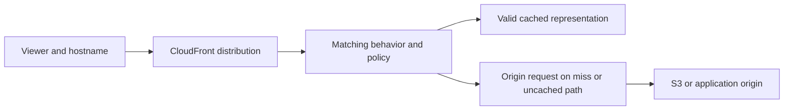

# CloudFront

Amazon CloudFront is a content delivery network and reverse proxy in front of an origin. Viewers connect to the distribution; cache behavior and security controls decide whether the response comes from an edge cache or a backend. It can serve static objects and dynamic applications, but those paths need different cache and authorization decisions.

## Understand the request path



What it does: separates viewer TLS, behavior selection, cache lookup, and origin access. A successful edge response can be cached even while a backend is failing; verify both paths deliberately.

| Object | Decision it owns |
| --- | --- |
| Distribution | Viewer domains, origins, behaviors, certificates, logging, and security associations. |
| Behavior | Which origin/policies serve a matching path and which methods/protocols are allowed. |
| Cache policy | Included headers/cookies/query strings and TTL bounds. |
| Origin request policy | Additional request data the origin needs without necessarily adding it to the cache key. |
| Origin access control / network boundary | How direct backend access is restricted. |

## Protect cache isolation

Include inputs that change the representation in the cache key; exclude irrelevant tracking parameters. A smaller key can improve hit ratio, but omitting a real language, tenant, or authorization-dependent variation can serve the wrong content.[^cache-key] Treat authenticated and administrative paths as uncached unless an explicit isolation design is tested.

CloudFront's minimum TTL matters: if it is greater than zero, caching can occur despite origin `no-cache`, `no-store`, or `private` directives. Setting all three TTL values to zero disables caching.[^cache-policy] Forwarding a header is not by itself a safe cache-isolation policy. Test with distinct controlled users and compare bodies as well as headers.

## Protect both TLS legs and the origin

Viewer-to-CloudFront and CloudFront-to-origin are separate connections. Requiring HTTPS from viewers does not by itself force HTTPS to the origin.[^viewer-tls] Validate the intended hostname, certificate chain, and origin protocol independently.

For a regular private S3 bucket origin, use Origin Access Control with appropriately scoped bucket/KMS permissions and signing behavior. S3 website endpoints are custom origins and cannot use S3 OAC/OAI.[^s3-oac] Do not make a bucket public to work around a distribution permission error.

For supported private ALB/NLB/EC2 backends, evaluate VPC origins using current Region and protocol restrictions. AWS requires an IGW attached to the VPC for this feature, but that IGW is not the route carrying traffic into the private origin; no public-subnet route is required for that origin path.[^vpc-origins] A public custom origin needs its own bypass-protection design. Follow the [EKS edge guide](../../../cross-topic-guides/cdn-in-front-of-eks.md) for Kubernetes integration.

Use AWS WAF where application-layer request filtering is required, with a web ACL associated with the distribution.[^cloudfront-waf] Plan edge access/security logs and their retention so operators can distinguish policy blocks, cached responses, and origin failures. WAF filtering complements authentication and direct-origin protection; it does not replace them.

## Inspect and verify deliberately

```bash
aws cloudfront get-distribution-config --id <distribution-id> --profile <profile> --no-cli-pager
```

What it does: reads origins, behaviors, policy references, viewer settings, and the ETag used for controlled updates.[^cloudfront-cli] CloudFront is a global service; do not interpret an arbitrary regional CLI setting as the distribution's placement. Inspect referenced policies separately and keep the returned configuration private.

Verification should cover a static cache hit, an origin fetch, authenticated paths using two controlled identities, normal DNS/TLS, and direct-origin denial where required. Correlate the real request with edge and origin telemetry; a `Hit` header is not proof of authorization correctness.

Before changing behaviors, record current configuration and rollback, review costs for transfer/requests/logging/invalidation, and wait for deployment before evaluating results. Prefer versioned static object names for routine releases. This inspection needs no cloud cleanup; separate sandbox work must disable/delete task-owned distributions in the supported sequence and preserve origin access until the change has safely completed.

## Evidence and operating boundary

Official sources reviewed on 2026-10-29. AWS services evolve independently of the CLI. AWS CLI v2.38.5 parsed this CloudFront example using an offline input skeleton. Output-skeleton generation failed because its generated origin-group member list violated the CLI model constraint; no output-contract or runtime claim is made. No AWS account calls or infrastructure provisioning were executed for this revision. Replace angle-bracket placeholders before use, confirm account/Region, and keep network inventories private.

## Related routes

- [CDN caching and origin protection](../../edge/cdn-caching-and-origin-protection.md).
- [Akamai versus CloudFront](../../edge/akamai-vs-cloudfront.md).
- [Back to AWS networking](index.md)
- [Back to AWS](../index.md)

[^cache-key]: [Control the CloudFront cache key](https://docs.aws.amazon.com/AmazonCloudFront/latest/DeveloperGuide/controlling-the-cache-key.html)
[^cache-policy]: [Understand CloudFront cache policies](https://docs.aws.amazon.com/AmazonCloudFront/latest/DeveloperGuide/cache-key-understand-cache-policy.html)
[^s3-oac]: [Restrict access to an S3 origin](https://docs.aws.amazon.com/AmazonCloudFront/latest/DeveloperGuide/private-content-restricting-access-to-s3.html)
[^viewer-tls]: [Require HTTPS for CloudFront viewers](https://docs.aws.amazon.com/AmazonCloudFront/latest/DeveloperGuide/using-https-viewers-to-cloudfront.html)
[^vpc-origins]: [CloudFront VPC origins](https://docs.aws.amazon.com/AmazonCloudFront/latest/DeveloperGuide/private-content-vpc-origins.html)

[^cloudfront-cli]: [AWS CLI get-distribution-config](https://docs.aws.amazon.com/cli/latest/reference/cloudfront/get-distribution-config.html)

[^cloudfront-waf]: [Use AWS WAF protections](https://docs.aws.amazon.com/AmazonCloudFront/latest/DeveloperGuide/distribution-web-awswaf.html)
