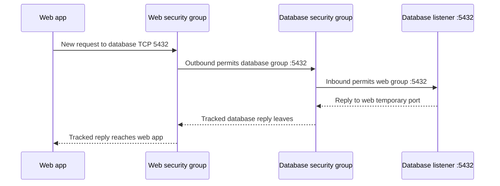

# Security groups

## The idea in plain language

An AWS **security group** is a set of network allow rules associated with a
resource's network interface, such as an EC2 instance's. An inbound rule
answers which **new** requests may enter; an outbound rule answers which
**new** traffic may leave. There are no explicit deny rules. If no rule
matches a new packet, the group does not allow it. A response to an
allowed, tracked connection can pass in the reverse direction without a
separate reply rule.[^aws-sg][^aws-sg-rules][^aws-connection-tracking]

**Tracked** means the security group keeps enough information about an
allowed connection to recognize its response as part of the same exchange,
rather than treating that response as a new request.[^aws-connection-tracking]

Think of a door with a guest list: the database door can admit a web server
for one service without admitting every caller. Its team badge stands for
membership in the web group; the attendant remembering a reply stands for
connection tracking. This picture has limits. The group checks network
source or destination, protocol, port, direction, and connection state. It
does not authenticate a database user, prove that the database is listening,
or repair a broken route.

## Follow one application request

Imagine a web application and a PostgreSQL database on separate EC2
instances in the same VPC. The database listens on TCP port `5432`. The
web instance has a **web group**; the database instance has a **database
group**. For this example, the web group has an outbound rule to the
database group on TCP `5432`, and the database group has an inbound rule
from the web group on TCP `5432`. Assume each instance has only its named
group in the diagram; a real instance can have more associated groups.
These names and rules are illustrative; no AWS resources were created or
tested.[^aws-sg-rules]

Text alternative: the web application starts a connection to database TCP
port `5432`. Its web group's outbound rule allows that new request to the
database group. The database group's inbound rule allows the request from
the web group. The database listener receives it and replies to the web
instance's temporary client port. For this tracked connection, the reply
passes the database group's outbound and the web group's inbound checks
without separate reply rules. The subnet ACL, route, host firewalls, and
database listener still need to support the path.[^aws-sg-rules][^aws-connection-tracking]

| New request check | Rule in this example | What it answers |
| --- | --- | --- |
| Web group, outbound | TCP `5432` to the database group | May the web instance start this connection? |
| Database group, inbound | TCP `5432` from the web group | May the database instance receive it? |

The request's destination is database port `5432`; the reply's destination
is the web client's temporary port. The two example rules are for the **new
request**, not two rules for the request and reply. An outbound allow-all
rule on the web group could also permit the new request, if it is actually
present. See [stateful networking](stateful-networking.md) for the subnet
ACL's separate return-path checks and the exceptions to connection
tracking.[^aws-connection-tracking]

The group reference does **not** copy the web group's rules into the
database group. In this same-VPC example, it matches traffic using the
private IP addresses of network interfaces associated with the referenced
group, for the stated direction, protocol, and port. This is membership
that changes as interfaces join or leave the group, not a fixed list of
addresses. The example uses the database's **private** address; do not
assume a connection through a public or Elastic IP will match a group
reference. Adding the web group to an instance changes which instances
match the rule; it does not give their application users database
credentials. A reference also does not create a route or open every port.
AWS documents further conditions for cross-VPC references and a limitation
when traffic is routed through a middlebox appliance.[^aws-sg-rules]

## Read a rule without guessing

| Part | Question to ask |
| --- | --- |
| Direction | Is this a new inbound request or new outbound traffic? |
| Protocol and port | Is it the protocol and destination port the service actually uses? |
| Source or destination | Does the actual source or destination match the IP range, prefix list, or referenced group? |
| Association | Is this group associated with the network interface of the resource receiving or sending traffic? |

Multiple groups associated with one resource contribute their allow rules
together. One matching rule in any associated group can permit a new packet;
the groups do not override each other with deny rules.[^aws-sg-rules]

Starting rules depend on how a group was created:

| Group | Initial inbound | Initial outbound |
| --- | --- | --- |
| AWS creation state for a new non-default group | None | Allow all |
| VPC's default group | From members of that same group | Allow all |
| New `aws_security_group` managed by the Terraform AWS provider | None | AWS's initial allow-all rule is removed; define egress if needed |

These are starting states, not promises about current configuration. AWS
rules can be edited. The Terraform provider documentation currently
recommends separate `aws_vpc_security_group_ingress_rule` and
`aws_vpc_security_group_egress_rule` resources for new rules, and warns
against combining them with inline rules on the same group. This page does
not provide a copyable Terraform configuration; inspect the group's actual
rules and the owning code before changing them.[^aws-sg-rules][^aws-default-sg][^terraform-aws-sg]

If **none of the web instance's associated groups** has a matching outbound
rule, this new web-to-database request cannot start. An empty egress rule
set in one group is not enough to conclude that when another associated
group permits the request. Even with no matching outbound rule, the web
instance can still reply to an unrelated allowed **inbound** request: the
reverse packet for a tracked connection can leave. AWS may associate the
VPC's default group with an EC2 instance when no group is specified at
launch, so verify the actual association rather than assuming either row
of the table applies.[^aws-sg-rules][^aws-default-sg][^aws-connection-tracking]

The fact that a packet passes a security group says only that this network
control allowed it. A subnet network ACL, route, host firewall, or
application can still stop the connection. A database authentication error
means the request reached a database service far enough to receive that
error; opening another network port will not grant the missing database
permission. See [stateful networking](stateful-networking.md) for how the
subnet ACL and group treat replies differently.

## If access fails

Use the intended source, destination, protocol, and port to narrow the
question before changing a rule:

1. Confirm the actual resource and its associated security groups.
2. Check outbound rules across **all groups associated with the web
   instance** and inbound rules across **all groups associated with the
   database instance** for the new TCP `5432` request. A Terraform-created
   web group may have no egress rule, but another associated group could
   still allow it.
3. If a rule references a group, confirm the source resource is associated
   with that group and both groups are in the same VPC as in this example.
   For groups in different VPCs, check AWS's direction-specific peering or
   transit-gateway conditions and the real route before relying on the
   reference.[^aws-sg-rules]
4. If those checks match, inspect routes, network ACLs, host firewalls, and
   the database listener. A timeout alone does not identify which layer
   stopped the request. If the database returns an authentication or
   authorization error, investigate the database identity and grants rather
   than assuming another security-group rule is needed.

These are read-and-reason checks; this page does not prescribe a rule
change. Restrict source ranges and ports to the traffic the workload
actually needs.[^aws-sg]

## Check your understanding

- Why does the database group need an inbound rule for new web requests?
- What does naming the web group as a source include, and what does it not
  include?
- What would you inspect after the rules look correct but the connection
  still fails?
- If the database returns "permission denied" for the web application's
  database user, would opening another security-group port fix it?
- If a Terraform-created web group has no outbound rules and is the **only**
  group associated with the web instance, can it start this database
  connection? Can it still reply to a separately allowed, tracked inbound
  request? What changes if a second associated group allows outbound TCP
  `5432` to the database?

## Answer guide

1. The database group must allow the new request from the web group on
   TCP `5432`; membership alone is not a blanket allow rule.
2. The reference matches private network-interface addresses of resources
   associated with the web group for this rule. It copies no rules, creates
   no route, and grants no database-user permissions.
3. Check the web group's outbound rule, database group's inbound rule,
   membership, routes, subnet ACLs, host firewalls, and listener, following
   the actual observed failure.
4. No. The application-level database identity or grants need inspection.
5. The only group lacks an outbound allow, so it cannot start the new
   database connection. It can reply to a separately allowed, tracked
   inbound request without a reverse outbound rule. A second associated
   group with a matching outbound rule would allow the new database
   request, assuming the database's inbound and other path checks pass.

## Official documentation for deeper study

- [Control traffic using security groups](https://docs.aws.amazon.com/vpc/latest/userguide/vpc-security-groups.html)
  explains resource association and connection tracking.
- [Security group rules](https://docs.aws.amazon.com/vpc/latest/userguide/security-group-rules.html)
  explains directions, defaults, combined rules, and group references.
- [Default security groups](https://docs.aws.amazon.com/vpc/latest/userguide/default-security-group.html)
  shows the VPC default group's self-referencing inbound rule.
- [Terraform AWS provider security group](https://registry.terraform.io/providers/hashicorp/aws/latest/docs/resources/security_group)
  explains its egress behavior and rule-resource choices.
- [Security group connection tracking](https://docs.aws.amazon.com/AWSEC2/latest/UserGuide/security-group-connection-tracking.html)
  explains why replies to tracked requests can pass without reverse rules.

Next, use [stateful networking](stateful-networking.md) to trace a request
and reply through the subnet ACL, or return to the [AWS networking
index](index.md).

[^aws-sg]: [Amazon VPC: Security groups](https://docs.aws.amazon.com/vpc/latest/userguide/vpc-security-groups.html).
[^aws-sg-rules]: [Amazon VPC: Security group rules](https://docs.aws.amazon.com/vpc/latest/userguide/security-group-rules.html).
[^aws-default-sg]: [Amazon VPC: Default security groups](https://docs.aws.amazon.com/vpc/latest/userguide/default-security-group.html), source record `aws-default-sg`.
[^terraform-aws-sg]: [Terraform AWS provider: Security group resource](https://registry.terraform.io/providers/hashicorp/aws/latest/docs/resources/security_group), source record `terraform-aws-sg`.
[^aws-connection-tracking]: [Amazon EC2: Security group connection tracking](https://docs.aws.amazon.com/AWSEC2/latest/UserGuide/security-group-connection-tracking.html).
