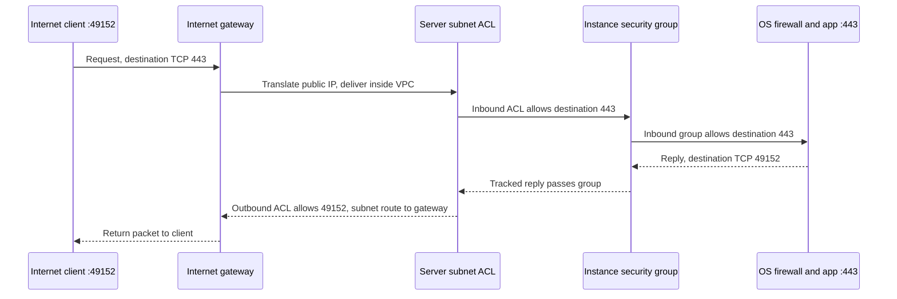

# Stateful networking

## The idea in plain language

In networking, **state** can mean remembering that a packet belongs to a
connection already allowed. An AWS **security group** normally tracks an
allowed connection at a resource's network interface, so its reply can pass
without a separate reverse-direction rule. A **network access control list
(network ACL)** checks traffic crossing a subnet boundary without remembering
previous packets. Its inbound and outbound rules must each allow the
relevant direction. Some very broadly allowed security-group flows are not
tracked; that exception is explained below.[^aws-sg][^aws-nacl][^aws-connection-tracking]

Imagine a venue where one attendant remembers that a guest entered and lets
their answer back out. That is the security group's tracked reply. Another
attendant checks everyone crossing the door against a separate list in each
direction. That is the subnet ACL. The analogy has limits: these controls
evaluate packet addresses, protocol, ports, and connection state, not a
person's identity. Neither proves that an application is healthy or that a
particular user is authorized.

This use of *stateful* is different from a [stateful
application](../architecture/stateful-vs-stateless.md), which needs saved
data between requests. A server can be stateless as an application while a
security group tracks its network connections.

## Follow a request and its reply

Imagine an internet client at documentation address `203.0.113.10` using
temporary TCP port `49152` to reach an EC2 web server listening on TCP port
`443`. The server has a public IPv4 address. Its subnet route table has a
route toward an attached internet gateway, which translates the public
address to the instance's private IPv4 address. Without that address and
route, opening a security-group or ACL rule cannot make an internet client
reach the instance.[^aws-internet-gateway]

Assume a custom ACL on the server subnet and a security group whose inbound
rule allows this client's TCP request to port `443`. These example rules
only illustrate one path; `203.0.113.10` is a documentation address, and no
AWS network or connection was configured or tested.

Text alternative: the internet client sends a packet to TCP destination
port `443`. The internet gateway translates the public destination address
to the instance's private address and delivers it inside the VPC. The subnet
ACL checks its inbound rule, and the instance security
group checks its inbound rule. The operating-system firewall and web listener
must also allow the request. The server's reply has TCP destination port
`49152`; the security group passes it as a tracked reply, while the subnet
ACL checks its outbound rule. The subnet's route to the internet gateway
sends it out, and the gateway translates the source back to the public
address. This shows why an inbound request can pass while its reply is
blocked at a custom subnet ACL.[^aws-sg][^aws-nacl][^aws-internet-gateway]

| Packet | Server-subnet check | Destination port | Source or destination to match |
| --- | --- | --- | --- |
| Request | Inbound custom ACL allow and inbound security-group allow | TCP `443` | Source `203.0.113.10/32` in this invented one-client example |
| Reply | Outbound custom ACL allow; no separate security-group rule for a tracked reply | TCP `49152` | Destination `203.0.113.10/32` in this example |

The ACL port range matches the packet's **destination** port on each
crossing, not the client's source port. If the instance starts a different
connection as the client, the directions reverse: its response enters the
server subnet toward an ephemeral destination port. This table is for
understanding one packet path, not a copyable public-site
ruleset.[^aws-nacl-custom]

The client's operating system or service chooses its temporary, or
**ephemeral**, port range. Do not copy `49152` or one example range as a
universal rule. AWS documents different ranges for different clients and
services; choose rules for the actual traffic you expect.[^aws-nacl-custom]

## What each control decides

| Control | Attached to | How to think about the reply |
| --- | --- | --- |
| Security group | A resource's network interface, such as an EC2 instance's | A tracked reply passes without a reverse rule. Rules are allow-only; a new request must match an appropriate rule. |
| Network ACL | Subnet | Inbound and outbound packets are evaluated separately; the first numbered allow or deny rule that matches decides, then the final `*` rule denies any unmatched packet. |

These rules describe controls, not their starting configuration. The
**default network ACL** initially allows all inbound and outbound traffic;
it can be edited. A **new custom ACL** denies unmatched traffic in both
directions until rules are added. The VPC's **default security group**
initially permits inbound traffic from resources in that same group, not
arbitrary internet clients; a new security group starts with no inbound
rules and an outbound rule allowing all traffic. Check the actual
association and rules before blaming a missing
reply rule.[^aws-default-nacl][^aws-nacl-custom][^aws-default-sg][^aws-new-sg]

The diagram assumes a **tracked** flow. AWS documents an exception for TCP
or UDP: if a rule permits the flow from all addresses (`0.0.0.0/0` or
`::/0`) and a corresponding reverse rule permits all addresses on all ports
(`0–65535`), the flow can be untracked. Its response then passes because
that reverse rule allows it. Some connections are automatically tracked
regardless of their rules. The example's narrow inbound source
`203.0.113.10/32` keeps this direct connection tracked. Removing a rule
need not immediately interrupt an already tracked connection. Connection
state is not a substitute for checking actual rules and traffic.[^aws-connection-tracking]

Both controls can affect the same path. A security group's tracked reply
does **not** bypass a network ACL that denies that outbound packet. A
working pair of rules also does not establish that routing, the server's
listener, DNS, or the host firewall is correct. The host firewall runs in
the instance's operating system; it is a separate decision from VPC rules.
VPC Flow Logs can show accepted and rejected traffic, but an `ACCEPT`
record does not prove an application replied. A `REJECT` does not by itself
name the exact rule or prove which control denied the packet. Work out the
direction from source and destination addresses and ports, or use a custom
`flow-direction` field, then compare with the actual configuration. Flow
logs must cover the relevant interface, are aggregated and delivered later,
and can skip records. A missing record does not prove a packet was never
sent.[^aws-flow-log-examples][^aws-flow-log-records]

## A safe first diagnosis

When a connection fails, start with the intended source, destination,
protocol, and ports. Then ask:

1. For an internet client, does the instance have a public IPv4 or Elastic
   IP address so the gateway can deliver the request? Does the server
   subnet's route table send internet-bound replies to that gateway? A
   route decides where a packet goes; it does not permit it through a
   firewall.[^aws-internet-gateway]
2. Which ACL is associated with the server subnet? If it is restricted,
   does its first matching inbound rule allow destination TCP `443`, and
   does its first matching outbound rule allow the actual client's ephemeral
   destination port? ACLs do not evaluate packets routed only within the
   same subnet.[^aws-nacl]
3. Does the instance's associated security group allow a **new inbound**
   request on TCP `443` from the intended source? A tracked reply needs no
   separate outbound group rule.
4. If those controls appear correct, inspect the host firewall, listener,
   and any other path component. An Application Load Balancer adds its own
   listeners, security groups, and subnet path; it is outside this direct
   EC2 example.

This is a reasoning sequence, not a recommendation to open broad port
ranges. Choose the narrow rules your traffic needs and check their effect.
For detailed security-group behavior, use the [security groups
guide](security-groups.md).

## Check your understanding

- Why can a reply pass a security group without an explicit reverse rule?
- Why might that same reply still be denied by a network ACL?
- In the example, which packet has destination TCP `443`, and which has
  destination TCP `49152`?
- Would an unchanged default network ACL need a new outbound reply rule?
- Why is a single hard-coded ephemeral port range a risky assumption?

## Answer guide

1. The group tracks an allowed connection and treats its reply as part of
   that connection in the illustrated case.
2. An ACL does not remember the first packet; its outbound rule must allow
   the reply's destination address and port.
3. The request targets server port `443`; the reply targets client port
   `49152`.
4. No. An unchanged default ACL already allows both directions.
5. The client's actual temporary port range can differ from this one
   example, so inspect the real path before choosing rules.

## Official documentation for deeper study

- [Control traffic using security groups](https://docs.aws.amazon.com/vpc/latest/userguide/vpc-security-groups.html)
  explains resource rules and tracked reply traffic.
- [Control subnet traffic with network ACLs](https://docs.aws.amazon.com/vpc/latest/userguide/vpc-network-acls.html)
  explains stateless subnet checks and ordered rules.
- [Custom network ACLs](https://docs.aws.amazon.com/vpc/latest/userguide/custom-network-acl.html)
  explains response rules and client-dependent ephemeral ports.
- [Default network ACL](https://docs.aws.amazon.com/vpc/latest/userguide/default-network-acl.html)
  shows the starting allow-all rules, which can be edited.
- [Security group connection tracking](https://docs.aws.amazon.com/AWSEC2/latest/UserGuide/security-group-connection-tracking.html)
  explains tracked and untracked flows and rule-change timing.
- [Internet gateway](https://docs.aws.amazon.com/vpc/latest/userguide/VPC_Internet_Gateway.html)
  explains the public address, route, and gateway requirements.
- [Flow log record examples](https://docs.aws.amazon.com/vpc/latest/userguide/flow-logs-records-examples.html)
  shows how allowed requests and rejected responses appear in records.
- [Flow log records](https://docs.aws.amazon.com/vpc/latest/userguide/flow-log-records.html)
  defines default fields, optional direction, aggregation, and delivery.

Next, read [security groups](security-groups.md) for resource-level checks,
or return to the [AWS networking index](index.md).

[^aws-sg]: [Amazon VPC: Security groups](https://docs.aws.amazon.com/vpc/latest/userguide/vpc-security-groups.html).
[^aws-nacl]: [Amazon VPC: Network ACLs](https://docs.aws.amazon.com/vpc/latest/userguide/vpc-network-acls.html).
[^aws-nacl-custom]: [Amazon VPC: Custom network ACLs](https://docs.aws.amazon.com/vpc/latest/userguide/custom-network-acl.html).
[^aws-connection-tracking]: [Amazon EC2: Security group connection tracking](https://docs.aws.amazon.com/AWSEC2/latest/UserGuide/security-group-connection-tracking.html).
[^aws-default-nacl]: [Amazon VPC: Default network ACL for a VPC](https://docs.aws.amazon.com/vpc/latest/userguide/default-network-acl.html).
[^aws-default-sg]: [Amazon VPC: Default security groups for your VPCs](https://docs.aws.amazon.com/vpc/latest/userguide/default-security-group.html).
[^aws-new-sg]: [Amazon VPC: Create a security group for your VPC](https://docs.aws.amazon.com/vpc/latest/userguide/creating-security-groups.html).
[^aws-internet-gateway]: [Amazon VPC: Enable internet access using an internet gateway](https://docs.aws.amazon.com/vpc/latest/userguide/VPC_Internet_Gateway.html).
[^aws-flow-log-examples]: [Amazon VPC: Flow log record examples](https://docs.aws.amazon.com/vpc/latest/userguide/flow-logs-records-examples.html).
[^aws-flow-log-records]: [Amazon VPC: Flow log records](https://docs.aws.amazon.com/vpc/latest/userguide/flow-log-records.html).
