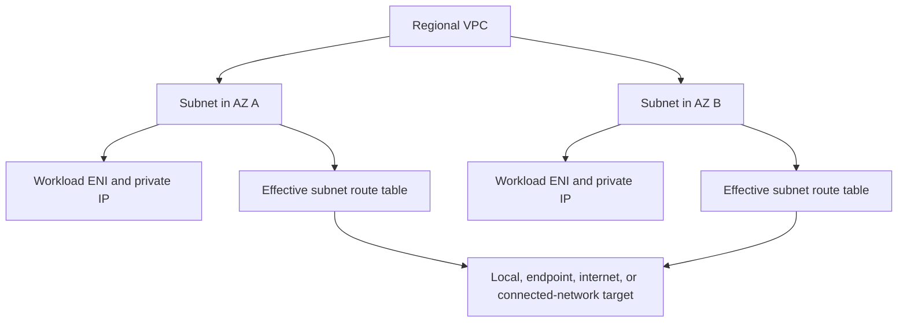

# VPC and subnet fundamentals

A virtual private cloud (VPC) is a logically isolated network in an AWS Region. Subnets divide its address space and place resources in individual Availability Zones (AZs). An elastic network interface (ENI) connects a resource to a subnet; IP addresses, security groups, and routing then determine its network path.[^vpc-model]

## Model the network before choosing services



What it does: separates the regional address boundary from zonal workload placement and the route selected for a destination. This is a conceptual diagram; filtering and DNS are additional controls, not bypassed by the arrows.

A subnet stays within one AZ. Its routing defines its exposure: a public subnet has a direct internet-gateway route; a private subnet does not. An isolated subnet has no route outside its VPC. A resource does not become internet-reachable merely because a subnet name contains `public`.[^subnets] Check its addresses, effective routes, security controls, and application listener separately.

## Make an address and failure-domain plan

| Decision | Question to answer before implementation |
| --- | --- |
| VPC CIDR | Does it overlap another VPC, corporate network, VPN, or future connected network? |
| Subnet CIDRs | Is there headroom for ENIs, load balancers, endpoints, and autoscaling? |
| AZ placement | Can another AZ serve the workload if one fails, including data and outbound dependencies? |
| IPv4/IPv6 | Which services and clients support the chosen family, and which egress path serves each? |
| DNS | Which names resolve privately, and how do hybrid clients reach the right resolver? |
| Ownership | Who approves route, firewall, address-space, and cost changes? |

For EKS, include Pod IP consumption, rollout surge, and node growth in capacity planning. A network with free node CPU can still run out of subnet addresses. Reuse the [Kubernetes-on-AWS guide](../../../cross-topic-guides/kubernetes-on-aws.md) for the workload layer instead of treating VPC subnets as Kubernetes namespaces.

## Inspect an existing design

Use a named read-only profile for an already-authorized account. These examples do not create resources.

```bash
aws ec2 describe-vpcs --vpc-ids <vpc-id> --profile <profile> --region <region> --no-cli-pager
aws ec2 describe-subnets --filters Name=vpc-id,Values=<vpc-id> --query 'Subnets[].{Subnet:SubnetId,AZ:AvailabilityZone,IPv4:CidrBlock,FreeIPv4:AvailableIpAddressCount,AssignPublicIPv4:MapPublicIpOnLaunch}' --profile <profile> --region <region> --no-cli-pager
```

What it does: identifies the VPC's address space and each subnet's placement and remaining IPv4 addresses. `MapPublicIpOnLaunch` describes an allocation setting; it is not proof of a working internet route. An empty result can mean the wrong account/Region or filter, rather than that a network must be created.

Success is a documented address/ownership map that explains where a workload lives and how its dependencies are reached. Continue with route selection, then choose the required egress and endpoint patterns. The inspection creates nothing to clean up; protect any saved inventory as internal infrastructure information.

## Evidence and operating boundary

Official sources reviewed on 2026-10-29. AWS services evolve independently of the CLI. AWS CLI v2.38.5 validated the EC2 command examples using offline output skeletons. Those checks cover command inputs and the sample query, not account permissions, resource state, DNS, or packet delivery. No AWS account calls or infrastructure provisioning were executed for this revision. Replace angle-bracket placeholders before use, confirm account/Region, and keep network inventories private.

## Related routes

- [Route tables and path selection](route-tables-and-path-selection.md).
- [Read-only inspection lab](network-inspection-lab.md).
- [Back to AWS networking](index.md)
- [Back to AWS](../index.md)

[^vpc-model]: [How Amazon VPC works](https://docs.aws.amazon.com/vpc/latest/userguide/how-it-works.html)
[^subnets]: [Subnets for your VPC](https://docs.aws.amazon.com/vpc/latest/userguide/configure-subnets.html)
