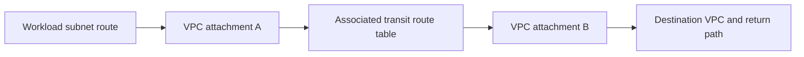

# Choose VPC and hybrid connectivity

Choose connectivity from the relationship you need: two networks exchanging routes, many networks sharing a controlled transit hub, one client consuming a service, or an on-premises network reaching AWS. A private connection alone does not grant application authorization or guarantee encryption requirements.

## Select the scope

| Need | Candidate | Principal trade-off |
| --- | --- | --- |
| Direct routed connection between a small number of VPCs | VPC peering | Straightforward pairs; a growing mesh increases route and ownership work. |
| Hub connectivity and route-domain segmentation | Transit Gateway | Centralized policy/routing plus attachment, processing, and operational costs. |
| Consume a specific service without opening full network connectivity | PrivateLink | Service exposure rather than general transitive routing. |
| Encrypted hybrid tunnel | Site-to-Site VPN | IPsec tunnels and customer-device/routing responsibility. |
| Private dedicated hybrid transport | Direct Connect | Circuit/provider lead time, routing, resilience, and a separate encryption decision. |

VPC peering requires non-overlapping CIDRs, accepted connection state, routes on both sides, and appropriate filtering. It does not provide transitive routing: A↔B and B↔C do not automatically create A↔C reachability.[^peering]

PrivateLink presents selected service/resource access paths rather than an unrestricted network bridge.[^private-link] Prefer that shape when consumers need one API instead of broad address-space reachability; verify supported endpoint/service types, DNS, and access policy.

## Understand Transit Gateway's two route layers

What it does: shows that a VPC route targeting a transit gateway is only the first routing decision. At the transit gateway, the ingress attachment's associated table chooses the next attachment. Return traffic needs its own consistent route.

An attachment associates with one transit route table. Route propagation controls which attachment routes are learned into a table; association and propagation are distinct settings. VPC subnet routes targeting the transit gateway are still needed.[^transit-gateway] Avoid treating the default transit table as a universal shared network: segmentation should state which networks may reach which other networks.

## Design hybrid resilience and security

Site-to-Site VPN uses IPsec and provides two tunnels; configure and test the customer side and routing rather than assuming both paths work because the AWS connection exists.[^site-vpn] A tunnel being up does not prove the desired prefix is announced or reachable.

Direct Connect uses dedicated connectivity and virtual interfaces, with BGP and partner/customer responsibilities.[^direct-connect] Do not equate private transport with application-level encryption. Define the encryption, independent failure paths, failover timing, and operational ownership required by the workload; use the service-specific security/resiliency design before deploying.

## Verification, cost, and recovery

Before implementation, record account/Region/AZ boundaries, CIDRs, exchanged prefixes, allowed applications, DNS ownership, and who can change each route domain. Compare attachment/circuit hours, processed data, transfer paths, and the number of independently maintained connections using current pricing.

Verification needs forward and return reachability plus the application permission boundary: test an intended permitted flow, a disallowed segment, and the planned failover path in a controlled window. Keep rollback routes and out-of-band access. This page provisions nothing; a future sandbox must remove task-owned routes and attachments in dependency order, coordinate peer acceptance/cleanup with owners, and confirm that circuits or billable connections are actually released.

Detailed Transit Gateway deployment, hybrid DNS, BGP policy, and failover drills remain focused future procedures, not evidence implied by this selection guide.

## Evidence and operating boundary

Official sources reviewed on 2026-10-29. AWS services evolve independently of the CLI. This is a source-reviewed selection guide; no peering, transit, VPN, Direct Connect, or endpoint deployment/failover walkthrough was executed. No AWS account calls or infrastructure provisioning were executed for this revision. Replace angle-bracket placeholders before use, confirm account/Region, and keep network inventories private.

## Related routes

- [VPC endpoints and DNS](vpc-endpoints-and-private-dns.md).
- [Connectivity troubleshooting](network-connectivity-troubleshooting.md).
- [Back to AWS networking](index.md)
- [Back to AWS](../index.md)

[^peering]: [VPC peering basics and limitations](https://docs.aws.amazon.com/vpc/latest/peering/vpc-peering-basics.html)
[^transit-gateway]: [AWS Transit Gateway](https://docs.aws.amazon.com/vpc/latest/tgw/what-is-transit-gateway.html)
[^site-vpn]: [AWS Site-to-Site VPN](https://docs.aws.amazon.com/vpn/latest/s2svpn/VPC_VPN.html)
[^direct-connect]: [AWS Direct Connect](https://docs.aws.amazon.com/directconnect/latest/UserGuide/Welcome.html)
[^private-link]: [What is AWS PrivateLink](https://docs.aws.amazon.com/vpc/latest/privatelink/what-is-privatelink.html)
