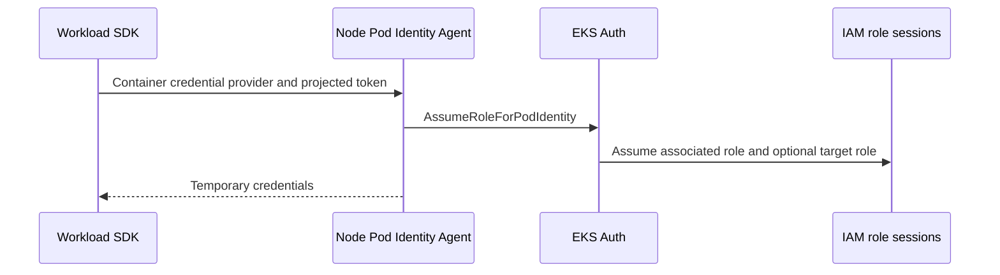

# Operate EKS Pod Identity

Use the [EKS workload-identity comparison](../../../cross-topic-guides/eks-workload-identity.md) to choose an integration. This guide diagnoses an existing EKS Pod Identity setup; it does not create roles, agents, or associations.

## Follow the credential path



What it does: shows the container-provider/agent path. IRSA instead uses the SDK's web-identity provider and STS exchange; swapping token audiences or role trust policies between them breaks the integration.[^pod-flow]

The current documented compute scope is Linux EC2 nodes on EKS. Fargate, Windows EC2 Pods, Outposts, EKS Anywhere, and self-managed Kubernetes are outside the listed supported scope. Standard clusters need a compatible node agent; Auto Mode supplies the integration without the separate agent installation step.[^pod-identity]

## Inspect association and agent

```bash
aws eks list-pod-identity-associations --cluster-name <cluster> --namespace <namespace> --service-account <service-account> --region <region> --profile <profile> --no-cli-pager
aws eks describe-pod-identity-association --cluster-name <cluster> --association-id <association-id> --region <region> --profile <profile> --no-cli-pager
kubectl get daemonset eks-pod-identity-agent -n kube-system
kubectl exec -n <namespace> <pod> -- aws sts get-caller-identity --no-cli-pager
```

What it does: checks the EKS-side mapping, its actual role/optional target, standard-cluster agent presence, and effective workload identity. A missing DaemonSet is not by itself an Auto Mode failure. A ServiceAccount annotation cannot prove that an EKS association exists.[^pod-association]

Check that the application uses the intended service account, the SDK supports the container credential provider, and earlier credentials do not mask it. The node-agent needs its documented EKS Auth permissions and network path. Proxy settings must bypass the agent's link-local address as documented; ordinary STS connectivity alone does not prove this path works.[^pod-flow][^pod-identity]

## Separate source and target roles

The associated role is in the cluster account. A target role can be in another account; Pod Identity supports automatic role chaining through the association's target-role configuration. Source-role permission and target-role trust must both authorize that hop.[^pod-target] Scope cluster/namespace/service-account conditions deliberately; do not substitute an unrestricted cross-account trust example.

Role trust uses the EKS Pod Identity service principal and required role/session-tag actions; IRSA's IAM OIDC provider is a different principal model. Review session-tag or association-session-policy settings together with trust/ABAC conditions rather than disabling tags blindly.[^pod-association]

## Allow for propagation and caches

Association changes are eventually consistent. AWS currently documents agent credential caches of six hours for a direct role and 59 minutes when a target role is used. Changing an association does not reset cached credentials; recreating affected Pods can apply changes sooner.[^pod-target] A rollout still needs an explicit caller and positive/negative authorization check. During an incident, changing the association alone cannot establish containment of issued credentials.

Record expected caller, SDK/agent/platform versions, association ID, affected workload and controlled restart/rollback before a migration. Remove task-owned test Pods only after evidence capture; retain shared agents, associations, and roles unless the change specifically owns them.

## Evidence and limits

Official sources reviewed on 2026-11-10. This draft records source review and local fixture checks where stated. AWS account calls, live EKS credentials, key/secret changes, detection delivery, and incident containment were not executed. CLI examples require a supported AWS CLI v2 and authorized account access; no CLI runtime version was tested in this batch.

[Back to AWS security](index.md) | [Back to AWS](../index.md)

[^pod-identity]: [EKS Pod Identity requirements](https://docs.aws.amazon.com/eks/latest/userguide/pod-identities.html)
[^pod-flow]: [EKS Pod Identity credential flow](https://docs.aws.amazon.com/eks/latest/userguide/pod-id-how-it-works.html)
[^pod-association]: [EKS Pod Identity associations](https://docs.aws.amazon.com/eks/latest/userguide/pod-id-association.html)
[^pod-target]: [EKS Pod Identity target roles and caching](https://docs.aws.amazon.com/eks/latest/userguide/pod-id-assign-target-role.html)
