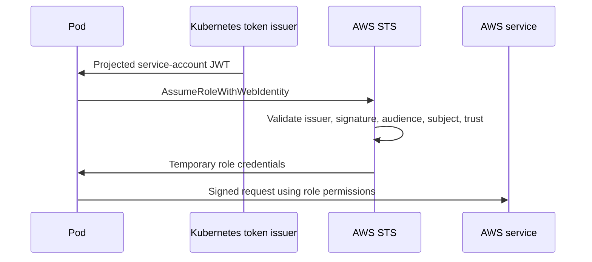

# IRSA fundamentals and credential flow

## Purpose

Understand how a Kubernetes workload obtains temporary AWS credentials through IAM Roles for Service Accounts.

Sources reviewed: 2026-10-29. See the [validation record](../../../../knowledge-base-audit.md) for executed checks and unexecuted runtime labs.

## What IRSA is

IRSA maps a Kubernetes service account to an IAM role using an OIDC trust relationship. On EKS, the workload identity integration projects a bounded service-account token and injects role/token configuration into eligible Pods. A supported AWS SDK exchanges that token through STS `AssumeRoleWithWebIdentity` and refreshes temporary credentials.[^aws-irsa][^sdk-credential-compatibility]



## Identity boundaries

A service account is a Kubernetes API identity. An IAM role is an AWS identity. Kubernetes RBAC does not grant S3 permissions; IAM permissions do not authorize Kubernetes API operations. Annotating a service account is insufficient without an IAM OIDC provider, valid role trust, permissions, and a compatible credential provider chain.

IRSA is commonly deployed through EKS integration. Other Kubernetes environments need their own supported issuer, token projection, trust, and workload integration; there is no universal annotation-only Kubernetes feature that enables AWS access.

## Compared with alternatives

Use the existing [EKS workload-identity guide](../../../cross-topic-guides/eks-workload-identity.md) as the decision entry point. IRSA uses OIDC federation; EKS Pod Identity uses EKS associations and a different credential-delivery/trust model. Node roles expose a broader shared boundary. Long-lived access keys add distribution and rotation risk.

## Verify the actual credential source

```bash
kubectl get serviceaccount s3-reader -n irsa-lab -o yaml
kubectl exec -n irsa-lab reader -- aws sts get-caller-identity
```

What it does: compares configured role annotation with the role actually used by the SDK. The returned ARN should be an assumed role for the intended workload role. Do not print token files or credential environment values.

## Security limits

IRSA does not make containers a security boundary. Restrict node metadata access, account for privileged and host-network workloads, and avoid static environment credentials overriding the intended provider chain. Trace role assumptions with CloudTrail and test denied operations.

## Related links

- [AWS IRSA](https://docs.aws.amazon.com/eks/latest/userguide/iam-roles-for-service-accounts.html)
- [SDK credential compatibility](https://docs.aws.amazon.com/eks/latest/userguide/iam-roles-for-service-accounts-minimum-sdk.html)
- [Trust and permissions](irsa-trust-and-permissions.md)
- [EKS S3 lab](../../../cross-topic-guides/irsa-s3-access-on-eks.md)
- [Back to parent index](index.md)
- [Back to major area](../../index.md)
- [Back to root index](../../../../README.md)

[^aws-irsa]: [AWS IRSA](https://docs.aws.amazon.com/eks/latest/userguide/iam-roles-for-service-accounts.html).
[^sdk-credential-compatibility]: [SDK credential compatibility](https://docs.aws.amazon.com/eks/latest/userguide/iam-roles-for-service-accounts-minimum-sdk.html).
