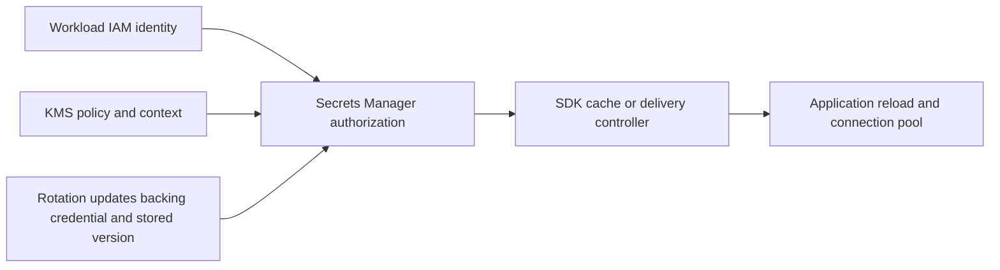

# Secrets Manager access and rotation

Use Parameter Store for named configuration according to its supported tiers/types; use Secrets Manager when the requirement is a credential lifecycle with supported rotation and secret-specific controls. Parameter Store `SecureString` encrypts values but does not itself provide a complete credential rotation workflow.[^parameters] Prefer workload identity over distributing an AWS access key as another application secret.

## Trace the consumer path



What it does: includes storage, delivery, and actual application adoption. Writing a new stored version is not evidence that an already-running process or database connection uses it.

Limit consumers to required secret ARNs and operations. A customer-managed KMS key adds key-policy/IAM/context requirements. Cross-account secret access needs the relevant resource/identity grants and supported encryption-key setup.[^secret-practices] Keep secret values out of terminal transcripts, manifests, CI outputs, and telemetry.

## Inspect metadata before retrieving values

```bash
aws secretsmanager describe-secret --secret-id <secret-arn> --profile <profile> --region <region> --no-cli-pager
aws secretsmanager list-secret-version-ids --secret-id <secret-arn> --profile <profile> --region <region> --no-cli-pager
```

What it does: inspects rotation metadata and version/staging labels without requesting `SecretString` or `SecretBinary`. Metadata still reveals resource information. A metadata success does not prove the consumer can retrieve or decrypt the value, nor that a rotation completed successfully.

## Design a rotation acceptance

1. Choose the supported rotation integration and document the backing system's credential update and rollback behavior. Current options include managed, managed external-secret, and Lambda-based rotation; do not assume every secret uses a Lambda function.[^secret-rotation]
2. Use a synthetic credential in a disposable backing service. Record the consumer's identity, refresh interval, delivery lag, reload behavior, and maximum permitted overlap.
3. Verify the new credential authenticates and the application resumes useful work with it. Then verify the old credential is rejected when the design says it should be.
4. Exercise a failed backing-system update and a stale consumer/cache. Record retries, alarms, rollback, and the owner of each boundary.

For Kubernetes delivery, [External Secrets](../../../kubernetes/applications-and-tools/platform-tooling/external-secrets-operator.md) and [CSI mounting](../../../kubernetes/applications-and-tools/platform-tooling/secrets-store-csi-driver.md) have different persistence and refresh models. Check the actual operator/provider configuration. A synchronized Kubernetes Secret adds another access/storage boundary; environment-variable consumers usually need a rollout, while mounted-file consumers need application reload support.

## Recovery and cleanup

If retrieval fails, distinguish wrong identity, missing secret authorization, KMS denial, network path, stale version stage, and application cache failure. Do not solve a delivery failure by printing the credential into a log. Remove disposable consumer resources/reports after evidence capture; secret deletion must follow its retention/recovery process and the backing system's lifecycle. No secret is created or rotated by this guide.

## Evidence and limits

Official sources reviewed on 2026-11-10. This draft records source review and local fixture checks where stated. AWS account calls, live EKS credentials, key/secret changes, detection delivery, and incident containment were not executed. CLI examples require a supported AWS CLI v2 and authorized account access; no CLI runtime version was tested in this batch.

[Back to AWS security](index.md) | [Back to AWS](../index.md)

[^parameters]: [Parameter Store and service selection](https://docs.aws.amazon.com/systems-manager/latest/userguide/systems-manager-parameter-store.html)
[^secret-practices]: [Secrets Manager best practices](https://docs.aws.amazon.com/secretsmanager/latest/userguide/best-practices.html)
[^secret-rotation]: [Secrets Manager rotation](https://docs.aws.amazon.com/secretsmanager/latest/userguide/rotating-secrets.html)
