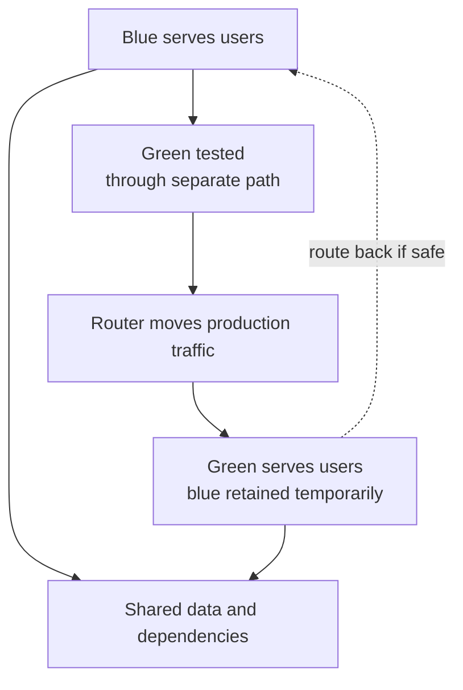

# Blue-green deployment

After reading, you should be able to say which version receives user
requests, how to test the candidate before moving those requests, and
when routing users back would still work. A **traffic router** is the
load balancer or service control that chooses which version receives a
request. A **version** is one running release of the application.

## The idea in plain language

A blue-green deployment keeps two application versions available during a
release. **Blue** is the version currently serving users; **green** is the
candidate. The team checks green, moves user requests to it, watches the
result, and keeps blue available for a defined time in case requests need
to move back. The colors name roles during this release, not permanent
versions: green becomes the serving version after a successful move.
[^aws-ecs-blue-green][^azure-container-apps]

Picture a theater with two stages. While one stage hosts the show, the
other is prepared and checked. The audience can be directed to the new
stage when it is ready. The analogy has a limit: both stages may share the
same ticket system, so changing that shared system affects both versions.
For software, that shared system might be a database, queue, or API.

## Follow one release

Imagine a checkout service moving from version 1 to version 2. This is an
illustrative flow, not an observed deployment.

Text alternative: blue serves production requests while green is tested
through a separate path. The router then directs production requests to
green; blue remains available for a limited recovery window. Routing users
back is useful only while blue can still serve them and both versions can
handle the shared data. The arrows from both release states to shared data
show why moving traffic cannot reverse data changes.[^aws-ecs-blue-green]

The simplest blue-green move sends all production traffic from blue to
green at once. Some implementations also divide that move into steps:
CodeDeploy-managed ECS blue-green deployments support all-at-once,
canary, and linear shifts. ECS's built-in blue-green strategy is a separate
mechanism with a full production traffic move; built-in linear and canary
are separate ECS strategies. Azure Container Apps can use revision traffic
weights; Cloud Run provides related revision traffic controls, though its
documentation describes rollouts and traffic migration rather than naming
this pattern blue-green.
[^aws-codedeploy][^aws-ecs-codedeploy][^aws-ecs-blue-green][^aws-ecs-deployment-config][^azure-container-apps][^cloud-run-rollouts]

For the invented checkout service, a full move is `100% blue / 0% green`,
then `0% blue / 100% green`. Where the chosen deployment mechanism supports
splitting, a trial could be `90% blue / 10% green` before the full move.
Those percentages are illustrative, not a setting every platform offers.
The trial limits how many requests reach green while both versions handle
the same shared data.

## What each stage answers

| Stage | Reader question | Evidence to seek |
| --- | --- | --- |
| Prepare green | Can the new version start beside blue? | Deployment status, configuration, dependency compatibility. |
| Test green | Does it perform the intended user flow? | A representative smoke test through a separate test path, not only process health. |
| Move traffic | Are users reaching the intended version? | Router weights or target groups, requests or logs showing which version served them, errors, latency. |
| Observe | Is green behaving acceptably under real load? | Agreed technical and user-facing signals over a defined period. |
| Keep or retire blue | Is switching traffic back still useful? | Blue remains able to serve requests within the recovery window and shared data still works with version 1. |

The precise checks and observation period are team decisions. A green
health check can show the process is alive without proving checkout, login,
or payment works. The example needs the application's own acceptance
signals before a real release. The test path must be configured: for
example, an ECS load balancer can have an optional test listener, while
Azure Container Apps can expose a label-specific address for the green
revision.[^aws-ecs-alb][^azure-container-apps]

## Why rollback has a boundary

If version 2 fails because of its code or configuration, traffic may be
redirected to version 1 while blue remains available. AWS ECS and Azure
Container Apps describe this as a benefit of their blue-green
approaches.[^aws-ecs-blue-green][^azure-container-apps]

But routing back does **not** undo a database migration, a message already
sent, or a payment already processed. Both versions must understand any
shared data they encounter during the transition, or the team needs a
separate recovery plan. For example, if version 2 writes data that version 1
cannot read, returning requests to version 1 may fail even though its code
still runs. AWS's blue-green guidance recommends backward-compatible schema
changes for this reason. The same reasoning applies to irreversible side
effects outside the database; a routing control does not reverse them.
[^aws-blue-green-data]

Running both versions also consumes extra capacity during the overlap.
Amazon ECS explicitly calls out temporary resource usage as a
consideration.[^aws-ecs-blue-green] The team should plan when blue can be
retired and what evidence is needed before removing it.

## When this pattern fits

Choose it when you can run two versions together, route users deliberately,
check green before full cutover, and keep shared data compatible long enough
to switch back. If those conditions are absent, the label “blue-green” will
not make a release safe. A rolling update gradually starts new replicas and
removes old ones, so both versions may briefly serve users. A canary shift
sends a small share of requests to the new version first. Some blue-green
implementations also support that canary shift. Compare the actual traffic
and recovery behavior rather than relying on the pattern name.

## Check your understanding

- What is the difference between making green ready and moving production
  traffic to it?
- Why might moving traffic back to blue fail after a database change?
- Can a blue-green release shift traffic gradually, or must it be one switch?

In the first question, green can be ready and tested while blue still serves
users. In the second, version 1 may be unable to read data changed by version
2. In the third, a full switch is the simple pattern, while some platforms
support staged shifts between the two versions.

## Official documentation for deeper study

- [AWS CodeDeploy deployments](https://docs.aws.amazon.com/codedeploy/latest/userguide/deployments.html) explains platform-specific blue-green traffic options.
- [Amazon ECS blue-green deployments](https://docs.aws.amazon.com/AmazonECS/latest/developerguide/deployment-type-blue-green.html) covers service revisions, validation, overlap, and rollback.
- [Amazon ECS deployment strategies](https://docs.aws.amazon.com/AmazonECS/latest/APIReference/API_DeploymentConfiguration.html) distinguishes built-in blue-green, linear, and canary strategies.
- [CodeDeploy blue-green deployments for ECS](https://docs.aws.amazon.com/AmazonECS/latest/developerguide/deployment-type-bluegreen.html) documents its all-at-once, canary, and linear traffic options.
- [ECS load balancer resources](https://docs.aws.amazon.com/AmazonECS/latest/developerguide/alb-resources-for-blue-green.html) explains the optional test listener.
- [AWS blue-green data and schema guidance](https://docs.aws.amazon.com/whitepapers/latest/blue-green-deployments/best-practices-for-managing-data-synchronization-and-schema-changes.html) explains why both versions need compatible data during a rollback window.
- [Azure Container Apps blue-green deployment](https://learn.microsoft.com/en-us/azure/container-apps/blue-green-deployment) shows revisions and traffic weights.
- [Cloud Run rollouts and traffic migration](https://cloud.google.com/run/docs/rollouts-rollbacks-traffic-migration) describes revision traffic and rollback controls.

See the [cloud solutions index](index.md) and [end-to-end
deployment](../../cross-topic-guides/end-to-end-deployment.md).

[^aws-codedeploy]: [Working with deployments in CodeDeploy](https://docs.aws.amazon.com/codedeploy/latest/userguide/deployments.html), source record `aws-codedeploy`.
[^aws-ecs-blue-green]: [Amazon ECS blue-green deployments](https://docs.aws.amazon.com/AmazonECS/latest/developerguide/deployment-type-blue-green.html), source record `aws-ecs-blue-green`.
[^aws-ecs-deployment-config]: [Amazon ECS deployment configuration](https://docs.aws.amazon.com/AmazonECS/latest/APIReference/API_DeploymentConfiguration.html), source record `aws-ecs-deployment-config`.
[^aws-ecs-codedeploy]: [CodeDeploy blue-green deployments for ECS](https://docs.aws.amazon.com/AmazonECS/latest/developerguide/deployment-type-bluegreen.html), source record `aws-ecs-codedeploy`.
[^aws-ecs-alb]: [ECS load balancer resources](https://docs.aws.amazon.com/AmazonECS/latest/developerguide/alb-resources-for-blue-green.html), source record `aws-ecs-alb`.
[^aws-blue-green-data]: [AWS data synchronization and schema changes for blue-green deployments](https://docs.aws.amazon.com/whitepapers/latest/blue-green-deployments/best-practices-for-managing-data-synchronization-and-schema-changes.html), source record `aws-blue-green-data`.
[^azure-container-apps]: [Blue-green deployment in Azure Container Apps](https://learn.microsoft.com/en-us/azure/container-apps/blue-green-deployment), source record `azure-container-apps`.
[^cloud-run-rollouts]: [Cloud Run rollouts, rollbacks, and traffic migration](https://cloud.google.com/run/docs/rollouts-rollbacks-traffic-migration), source record `cloud-run-rollouts`.
