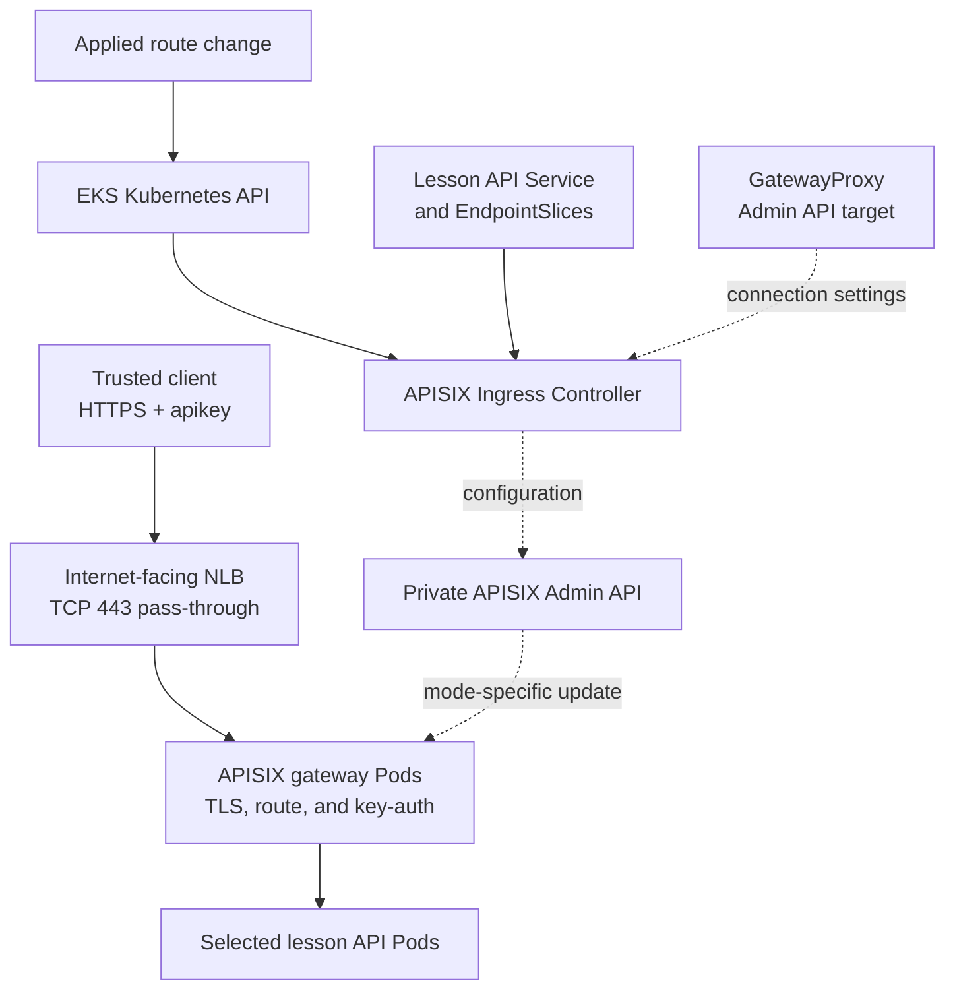

# APISIX on EKS

## Purpose

An API gateway on EKS has two paths. **User requests** travel through an
AWS entry point, APISIX gateway Pods, and a backend application.
**Configuration changes** travel through the Kubernetes API and APISIX
Ingress Controller before they affect the gateway. Keeping those paths
separate makes it easier to explain a failure and decide which component
owns a fix.[^apisix-ingress-start][^apisix-deployment-architecture]

Read [What Apache APISIX does for an API](../kubernetes/applications-and-tools/apache-apisix.md)
first if routes, upstreams, and plugins are new terms. This page focuses
on how they meet AWS networking and EKS workloads.

## One request and one route change

Think of a venue with an outer entrance, a reception desk, and rooms
inside. The AWS load balancer is the entrance; APISIX is the desk that
reads a request and applies a route or policy; the backend Service is
the room name in the directory, and the application Pods are the rooms
that can actually answer. The APISIX Ingress Controller updates the
desk's instructions and the list of available rooms. The analogy stops
at the network: a Service is often a configuration reference here, not
an extra network hop, and a successful entrance check does not prove
the requested lesson was returned.[^apisix-resources]

The following lesson-search API is invented. No EKS cluster, load
balancer, gateway, route, plugin, backend, or request was configured or
tested.

The example chooses the AWS Load Balancer Controller, IP targets, and
an internet-facing NLB explicitly. The controller otherwise uses
**instance targets by default**; Service type `LoadBalancer` alone
does not choose all of these settings.[^aws-lbc-nlb]

1. A trusted client sends `GET https://learn.example.com/lessons/42`
   with an `apikey` header, as in the
   [APISIX introduction](../kubernetes/applications-and-tools/apache-apisix.md).
   For this invented example, an **internet-facing** AWS Network Load
   Balancer (NLB) uses a **TCP listener on port 443**. It passes the
   encrypted connection to APISIX, which terminates HTTPS. The AWS Load
   Balancer Controller registers gateway Pod IPs as targets; the Pod IPs
   must be reachable from the NLB.[^aws-eks-nlb][^aws-nlb-listeners]
2. An APISIX gateway Pod matches the host and path, checks the
   configured `key-auth` plugin against a Consumer credential, and uses
   the lesson API's Kubernetes Service as the backend
   reference. By default, the controller tracks that Service's
   EndpointSlices and APISIX proxies directly to selected application
   Pods rather than sending every request through the Service's
   cluster IP.[^apisix-routes][^apisix-plugin][^apisix-key-auth][^apisix-resources]
3. Separately, a team changes an `HTTPRoute`, `Ingress`, or supported
   APISIX custom resource. APISIX Ingress Controller watches that
   Kubernetes resource and translates it into gateway configuration.
   Its `GatewayProxy` connection settings identify the APISIX Admin API
   target. The controller does not handle each user request.
   [^apisix-ingress-start][^apisix-resources]

Text alternative: the solid top path carries the client request from an
NLB TCP listener to APISIX, which decrypts HTTPS and forwards a
validated request to a selected lesson API Pod. The lower path
carries an applied route change through the Kubernetes API to the APISIX
Ingress Controller. `GatewayProxy` names the Admin API connection; the
controller also reads the backend Service and EndpointSlices and uses
that private control path to update gateway configuration. Neither
the controller nor, by default, the Service cluster IP is a hop in each
client request.[^apisix-resources]

Keep the Admin API reachable only on the private control path, with
credentials and an IP allowlist. Do not include its port on the
internet-facing gateway `LoadBalancer` Service. The Admin API can
change APISIX configuration; it is not a reader-facing endpoint.
[^apisix-admin-api]

An NLB is **one** way to expose APISIX on EKS. It can give APISIX the
Layer 7 routing and plugin role while AWS handles external network
entry. An NLB with **instance targets** reaches gateway Pods through
node ports; one with **IP targets** can target their Pod IPs directly.
This choice is about the NLB-to-gateway leg, separate from how APISIX
chooses lesson API Pods. The example above uses IP targets and assumes
Pod addresses are routable inside the VPC; another CNI/network layout
may require instance targets instead. EKS Auto Mode and the AWS Load
Balancer Controller have different Service annotations and ownership
rules; use the documentation for the implementation and target mode
selected for the cluster. The controller that actually claims the
Service determines which load balancer is created. A plain
`LoadBalancer` Service can even be claimed by the older AWS cloud
provider controller and create a Classic Load Balancer. In the AWS
Load Balancer Controller path, an NLB is internal unless configured as
internet-facing. Confirm the actual load balancer type, scheme,
listeners, target type, and registered targets in AWS before assuming
it is private or public. An AWS Application Load
Balancer can also route HTTP traffic, but adding its own Layer 7 rules
changes which layer owns host/path decisions.
[^aws-eks-nlb][^aws-eks-auto-nlb][^aws-lbc-nlb]

## Decide where each policy lives

| Decision | Possible owner in this example | What to make explicit |
| --- | --- | --- |
| Public or private exposure | AWS load balancer and network configuration | Which subnets, scheme, listener, target mode, and security boundary expose APISIX. |
| TLS termination | NLB listener, APISIX gateway, or both on separate connections | Which endpoint decrypts TLS, where certificates live, and whether the next hop is encrypted. |
| Host/path route and gateway policy | APISIX route and explicitly attached plugins | The matching host/path, backend, and actual authentication or limit plugin. |
| Backend availability | Kubernetes Service, EndpointSlices, and application Pods | The selector, ready endpoints, application health, and response. |

In the lesson example, a TCP listener passes TLS through to APISIX.
For illustration, Service `port: 443` can map to a deliberately
configured APISIX HTTPS `targetPort: 9443`; the IP-target NLB sends to
that Pod port. Instance targets instead use the Service's assigned
node port before traffic reaches APISIX. These are different port
numbers with different owners, not a claim about a chart default.
An NLB TLS listener would instead terminate client TLS at the load
balancer, with its client-facing certificate there. With a **TCP target
group**, APISIX receives plaintext HTTP and needs an HTTP listener and
a route attached to that listener. With a **TLS target group**, the NLB
starts a new TLS connection; APISIX needs an HTTPS listener and its own
certificate. AWS does not validate the target certificate. These
choices change what APISIX receives, so decide the target protocol,
listener, and route attachment together.[^aws-nlb-target-groups]
Separately decide whether APISIX encrypts its connection to the backend.
Do not infer end-to-end TLS from a browser lock icon alone.
[^aws-nlb-listeners]

If gateway policy or logs depend on the original client IP, check the
NLB target group's client-IP behavior before using that address. For
IP targets with TCP or TLS, preservation is disabled by default; APISIX
may see an NLB private IP address instead. AWS documents client-IP
preservation and Proxy Protocol v2 options. Proxy Protocol v2 requires
matching gateway support; either choice needs a deliberate network and
trust-boundary review. With instance targets, Kubernetes node-port
forwarding under `externalTrafficPolicy: Cluster` can also replace the
client address with a node address.[^aws-nlb-target-groups][^k8s-source-ip]

This matters for the [APISIX policy guide](../kubernetes/applications-and-tools/apisix-security-traffic-and-observability.md):
`limit-count` uses `remote_addr` as its default counter key. If many
clients appear to APISIX under one NLB or node address, they can share
one quota unexpectedly. Establish a trusted client-address source
before choosing an IP-keyed limit; do not trust a client-supplied
forwarded-address header by itself.[^apisix-limit-count]

The NLB does not check the `apikey` header or provide HTTP-aware
protection against invalid-key floods. Plan that protection at an
explicit gateway or earlier HTTP-aware boundary; the NLB target-health
signal and an IP-keyed quota do not provide it by themselves.
[^aws-nlb-listeners]

APISIX plugins run only when configured on the relevant route, service,
consumer, or other supported scope. A gateway installation alone does
not add authentication or rate limiting to the lesson API. Keep the
backend's business authorization in the application, and prevent a
direct route to the backend from bypassing required gateway policy.

An internal `ClusterIP` Service alone does not isolate its Pods from
other cluster workloads. Restrict backend ingress to approved gateway
Pods with an enforced NetworkPolicy and verify the selected EKS CNI
actually enforces it; review any separate VPC or Pod security-group
path as well.[^aws-eks-network-policy]

See [How APISIX policies shape one request](../kubernetes/applications-and-tools/apisix-security-traffic-and-observability.md)
for those decisions.[^apisix-plugin]

## Diagnose the first broken handoff

| Observation | First evidence to inspect | Why |
| --- | --- | --- |
| No load-balancer address | Gateway Service, its events, and the selected AWS load-balancer controller. | First check whether an NLB was provisioned. |
| NLB targets are unhealthy | Target type and port, target-group health settings, gateway Pod readiness, and network reachability. | The entry path may fail before APISIX can respond. |
| NLB target is healthy, but the HTTPS request or route fails | TLS handshake, host/path, route status, controller logs, and applied gateway configuration. | A default TCP health check only confirms that the target accepts a connection on its health-check port. It does not prove HTTPS, a loaded route, or backend health. |
| APISIX rejects the request | Matched route and the plugin that made the decision. | A configured policy can intentionally block a request before proxying. |
| APISIX matches a route, but the backend fails | Service port, ready endpoints, backend network path, and application logs. | A matched route does not create a healthy application. |

The APISIX documentation provides separate ways to inspect translated
controller configuration and the configuration synchronized to the
gateway. This is more informative than assuming a successfully applied
Kubernetes manifest is live at the data plane.[^apisix-configuration-troubleshooting]

For example, a restarted API-driven standalone Pod can accept a TCP
connection before its route configuration has synchronized. An NLB
target can therefore be healthy while that Pod returns a no-route
`404`. Inspect synchronization on each Pod, and design readiness and
health checks to reflect the configuration the gateway must serve;
verify that behavior in the chosen deployment mode before relying on
it for traffic admission.
[^aws-nlb-health][^apisix-deployment-architecture]

Gateway API support is versioned and may be partial for specific fields.
Before using an `HTTPRoute` option, check the controller's supported
resource and field table for the version you run. Check that the
`GatewayClass` selects APISIX, even if the cluster has only one Gateway
API controller. A `Gateway` listener does not make APISIX open a new
data plane port: the gateway must already listen on the actual target port.
In the reviewed Ingress Controller v0.3.0 documentation,
`listener_port_match_mode` defaults to `off`. When enabled, it
compares the Gateway listener port with the port APISIX accepted the
connection on. In the illustrative `443` to `9443` mapping above, a
Gateway listener on `443` would not match a connection APISIX accepts
on `9443`, producing a route `404`. Keep the mode off or align the
listener and APISIX receiving ports after checking the current
controller release.
[^apisix-gateway-api][^apisix-configuration-troubleshooting]

The controller can configure APISIX through an etcd-backed Admin API
or API-driven standalone mode, which the reviewed v0.3.0 controller docs mark
experimental. These have different storage and recovery paths. If some
gateway Pods serve a new route and others return `404`, compare the
applied configuration on each Pod before changing the AWS entry or
backend. [How the gateway and controller fit together](../kubernetes/applications-and-tools/apisix-architecture-and-deployment.md)
explains those modes.[^apisix-deployment-architecture]

## Check your understanding

1. If APISIX returns a no-route response for `/lessons/42`, which path
   should you inspect first?
2. Why can an `HTTPRoute` exist in Kubernetes while only some gateway
   Pods serve it?
3. If an NLB TLS listener terminates HTTPS, what target protocol and
   APISIX listener must be checked before the route can match?
4. Does the backend Service name in the route mean every request passes
   through its cluster IP?

## Deeper study

- [APISIX Ingress Controller introduction](https://apisix.apache.org/docs/ingress-controller/getting-started/get-apisix-ingress-controller/)
  and [route configuration](https://apisix.apache.org/docs/ingress-controller/getting-started/configure-routes/)
  for the controller-to-gateway path.
- [APISIX deployment architecture](https://apisix.apache.org/docs/ingress-controller/concepts/deployment-architecture/)
  and [configuration troubleshooting](https://apisix.apache.org/docs/ingress-controller/reference/apisix-ingress-controller/configuration-troubleshoot/)
  for mode and state checks.
- [APISIX Ingress Controller resources](https://apisix.apache.org/docs/ingress-controller/concepts/resources/)
  for the Service reference, EndpointSlice tracking, and default Pod path.
- [EKS Network Load Balancers](https://docs.aws.amazon.com/eks/latest/userguide/network-load-balancing.html)
  and [NLB listeners](https://docs.aws.amazon.com/elasticloadbalancing/latest/network/load-balancer-listeners.html)
  for AWS entry and TLS choices.
- [AWS Load Balancer Controller NLB guide](https://kubernetes-sigs.github.io/aws-load-balancer-controller/latest/guide/service/nlb/)
  for Service ownership and target-type defaults.
- [EKS network policies](https://docs.aws.amazon.com/eks/latest/userguide/cni-network-policy.html)
  for backend traffic isolation and enforcement limits.
- [NLB target groups](https://docs.aws.amazon.com/elasticloadbalancing/latest/network/load-balancer-target-groups.html)
  for target type, client-IP preservation, and Proxy Protocol v2.
- [NLB health checks](https://docs.aws.amazon.com/elasticloadbalancing/latest/network/target-group-health-checks.html)
  for the limit of a healthy TCP target.
- [APISIX Admin API](https://apisix.apache.org/docs/apisix/admin-api/)
  for the private configuration endpoint and access controls.
- [How the APISIX gateway and controller fit together](../kubernetes/applications-and-tools/apisix-architecture-and-deployment.md)
  and [trace an APISIX 404](../kubernetes/troubleshooting/apisix.md)
  for deeper Kubernetes-specific guidance.

[Back to cross-topic guides](index.md)

[^apisix-ingress-start]: [Apache APISIX - Get APISIX and APISIX Ingress Controller](https://apisix.apache.org/docs/ingress-controller/getting-started/get-apisix-ingress-controller/).
[^apisix-routes]: [Apache APISIX - Configure Routes](https://apisix.apache.org/docs/ingress-controller/getting-started/configure-routes/).
[^apisix-deployment-architecture]: [Apache APISIX - Deployment Architecture](https://apisix.apache.org/docs/ingress-controller/concepts/deployment-architecture/).
[^apisix-resources]: [Apache APISIX - Ingress Controller Resources](https://apisix.apache.org/docs/ingress-controller/concepts/resources/).
[^apisix-gateway-api]: [Apache APISIX - Gateway API support](https://apisix.apache.org/docs/ingress-controller/concepts/gateway-api/).
[^apisix-configuration-troubleshooting]: [Apache APISIX - Configuration Troubleshooting](https://apisix.apache.org/docs/ingress-controller/reference/apisix-ingress-controller/configuration-troubleshoot/).
[^apisix-plugin]: [Apache APISIX - Plugin](https://apisix.apache.org/docs/apisix/terminology/plugin/).
[^apisix-key-auth]: [Apache APISIX - Key Authentication](https://apisix.apache.org/docs/apisix/plugins/key-auth/).
[^aws-eks-nlb]: [Amazon EKS - Network Load Balancers](https://docs.aws.amazon.com/eks/latest/userguide/network-load-balancing.html).
[^aws-eks-auto-nlb]: [Amazon EKS - Configure NLBs with EKS Auto Mode](https://docs.aws.amazon.com/eks/latest/userguide/auto-configure-nlb.html).
[^aws-lbc-nlb]: [AWS Load Balancer Controller - Network Load Balancer](https://kubernetes-sigs.github.io/aws-load-balancer-controller/latest/guide/service/nlb/).
[^aws-eks-network-policy]: [Amazon EKS - Limit Pod traffic with Kubernetes network policies](https://docs.aws.amazon.com/eks/latest/userguide/cni-network-policy.html).
[^aws-nlb-listeners]: [Elastic Load Balancing - NLB listeners](https://docs.aws.amazon.com/elasticloadbalancing/latest/network/load-balancer-listeners.html).
[^aws-nlb-target-groups]: [Elastic Load Balancing - NLB target groups](https://docs.aws.amazon.com/elasticloadbalancing/latest/network/load-balancer-target-groups.html).
[^aws-nlb-health]: [Elastic Load Balancing - NLB target health checks](https://docs.aws.amazon.com/elasticloadbalancing/latest/network/target-group-health-checks.html).
[^apisix-admin-api]: [Apache APISIX - Admin API](https://apisix.apache.org/docs/apisix/admin-api/).
[^apisix-limit-count]: [Apache APISIX - Rate Limiting by Count](https://apisix.apache.org/docs/apisix/plugins/limit-count/).
[^k8s-source-ip]: [Kubernetes - Using Source IP](https://kubernetes.io/docs/tutorials/services/source-ip/).
