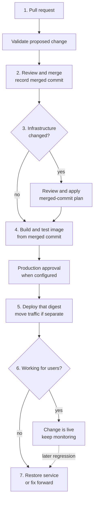

# End-to-end deployment

## Purpose

Use this page to see a software delivery path as one chain: a proposed change,
validation, review and merge, optional infrastructure work, a built artifact,
a deployment, a check that users are served, and a recovery path. After
reading it you should be able to say what evidence each stage produces and
what it does not prove.

This is a map, not a production deployment recipe. Each stage links to the
page that covers it properly.

## What a delivery chain is

A delivery chain is the sequence of steps that turns a change in a repository
into a change in a running system. Some steps are **gates**, where a check or
review allows the change to continue. Other steps create or observe the
result; they are not proof of the next step's success.

Three terms used below:

- **CI (continuous integration)** is automation that checks changes as they
  are integrated, such as tests and linting on a pull request and after merge.
- An **artifact** is the built thing that is deployed, for example a container
  image.
- A **rollout** is the process of bringing a new version into service. It
  may replace running replicas or move traffic between versions.

## Why it matters

An easy misreading of a pipeline is "CI is green, so it works". CI usually
runs before deployment, against a specific revision in its runner or test
setup. It does not prove the new version started in production, reached its
database, or served users correctly. Check which revision was tested and
which was built after merge.

Every gate answers one narrow question. Trouble starts when a team treats the
answer to one question as the answer to another.

## The stages and what each one proves

| Stage | Question it answers | Evidence it produces | What it does not prove |
| --- | --- | --- | --- |
| 1. Pull-request validation | Do the proposed files pass the automated checks? | Check results tied to the revision the workflow actually tested. | That the eventual merged commit or deployed image works. |
| 2. Review and merge | Did an authorized reviewer approve the change, and which commit landed on `main`? | Review record and merged commit ID. | That the merged commit is safe to release. |
| 3. Infrastructure, when changed | What would change in the target environment, and what did apply do? | A saved plan made from the merged commit, its review, an apply result, and a follow-up resource check. | That the application stays healthy afterward. |
| 4. Artifact build | Exactly which image came from the merged commit? | Build record and immutable image digest; test results for that exact image when claimed. | That it behaves correctly in production. |
| 5. Deploy and route | Did the platform bring up the selected image and, when separate, move traffic to it? | Target environment, observed image reference, new version ready, and evidence of how users reach it: completed rolling update or recorded traffic move. | That users get correct responses. |
| 6. User check | Is the service doing its job for users now? | A user-level check and relevant live signals. | That it will stay healthy. |
| 7. Recovery, if needed | Can the team restore service or fix forward? | An observed recovery result, using a path planned before release. | That every infrastructure or data change was reversed. |

The concrete Pod and rollout evidence below describes a Kubernetes rolling
update, where old replicas are replaced. In a blue-green release, green can
be running and tested while blue still serves users. Moving production
traffic to green is a separate step, controlled by a person or deployment
automation. With a staged shift, user checks run while only part of the
traffic has moved. Blue may remain running during the observation window.
[^aws-ecs-blue-green] The team must record both green's readiness and the
actual traffic move.

Some supporting facts from the tools involved:

- **A gate can require a person.** In GitHub Actions, a deployment environment
  can have protection rules, such as required reviewers or a restriction on
  which branches may deploy. Configure those rules: naming an environment
  alone does not require approval. A protected job waits for the configured
  rules before it starts.[^github-deployment-environments]
- **An infrastructure plan is a proposal.** `terraform plan` does not carry out
  the proposed resource changes.[^terraform-plan] If infrastructure changes,
  review the plan made from the merged commit and apply that same saved plan;
  a throwaway pull-request plan is not the applied artifact. See
  [GitHub Actions with Terraform](github-actions-with-terraform.md).
- **A digest pins one image reference.** A tag can be moved to point at a
  different image; a digest is content-derived and fixed for the referenced
  image manifest or multi-platform index.[^kubernetes-container-images] It
  lets you identify the deployed image. To say the *tested* image is running,
  test that exact digest and carry it through a trusted build and deployment
  path.
- **A completed rolling update is a platform statement.** Kubernetes marks a
  Deployment complete when all replicas are updated, all are available, and no
  old replicas are running.[^kubernetes-deployments] That is about Pods, not
  about whether a user's request succeeds; it does not describe a blue-green
  release that deliberately retains blue.

## Visual: the chain and its way back

Text alternative: the chain starts with a pull request, validation, review
and merge. Infrastructure is planned, reviewed, and applied only if changed.
A build from the merged commit produces an image. After any configured
production approval, the job deploys that image by digest. For a blue-green
release, traffic is moved to it as a separate step. A user check then
asks whether the service works. If it passes, monitoring continues; a later
regression can still need recovery. If it fails, the team restores service or
fixes forward.

The user check happens after at least some users can reach the new version. It
can **detect** impact but cannot prevent every first bad request. A
pre-production user-path test can catch some defects earlier. A canary or
other staged traffic shift can limit early exposure while live checks run;
retaining blue can make switching traffic back faster while it remains
compatible with shared data. Neither proves every user path works. See
[Blue-green deployment](../cloud/solutions/blue-green-deployment.md) for
the relationship between these release choices.

## Example: one change to a fictional service

This example is illustrative. The service, names, and results are invented,
and nothing here was run.

A team owns `bookings-api`, a small service running on Kubernetes with a
database managed through Terraform. A developer changes how booking dates are
validated. The invented merged commit is `a9c4e7a`; no database or
infrastructure configuration changes in this release.

| Stage | What happens | Evidence | Owner |
| --- | --- | --- | --- |
| 1 | PR CI runs checks against the proposed change. | Recorded check results and tested revision. | Author. |
| 2 | A teammate approves the change, and it merges as `a9c4e7a`. | Review and merged commit ID. | Author and reviewer. |
| 3 | The team identifies no infrastructure change and does not run a Terraform apply. | The release record says this stage was skipped; it makes no claim about drift. | Infrastructure owner. |
| 4 | A trusted `main` build creates an image from `a9c4e7a`, tests that image, and records its digest. | Build, test, and digest tied to the merged commit. | Pipeline. |
| 5 | A production job waits for configured environment approval, then performs a Kubernetes rolling update to that digest. | Target, digest, and completed rollout. | Deployer. |
| 6 | `POST /bookings` errors rise, and a test booking using the mobile client's date format fails. | Metrics and a failed user-level check. | On-call engineer. |
| 7 | Because no data or schema changed and the old image is retained, the engineer sends its digest through the service's controlled recovery job and checks the booking path again. The author prepares a fix. | Previous rollout and user check succeed; error rate falls. | On-call engineer, then author. |

What went wrong: the new validation rejected a date format that a mobile
client still sends. PR and image tests did not include that format, so the
earlier checks and rollout passed. Only stage 6 exercised that user path.

What to notice:

- The earlier checks passed and the change was still wrong. Each check had a
  narrower question than the user-path check in stage 6.
- The recovery was possible because the previous image was retained and this
  release had no incompatible data or infrastructure change. Recording its
  digest alone would not guarantee that it could still be pulled or run.
- The rollback did not fix the code. The repository still contains the faulty
  change until a new change goes through the chain. A later deployment from
  that repository could bring the fault back; a GitOps controller may
  reconcile it sooner. Use the owning deployment path to keep the cluster
  and repository aligned. See [GitOps](../kubernetes/applications-and-tools/gitops.md).

## Who owns rollback

"Roll back" means different things at different layers, and they are not
equally reversible.

| Layer | How it is reversed | Typical owner | Limit |
| --- | --- | --- | --- |
| Source | A new commit that reverses the change. See [Git undo and recovery](../git/troubleshooting/undo-and-recovery.md). | The authoring team. | Reverting code does not by itself change what is running. |
| Running version | For a rolling update, return the workload to a retained previous revision or known-good image. For blue-green, route traffic back to blue while it remains available and compatible. Kubernetes Deployment history depends on `.spec.revisionHistoryLimit`; setting it to zero removes the ability to roll back after cleanup.[^kubernetes-deployments][^aws-ecs-blue-green] | Whoever is on call for the service. | Needs a retained, usable version and a working route. It does not restore separate ConfigMaps, Secrets, data, or schema. |
| Infrastructure | A new reviewed plan that moves resources back. | The infrastructure owner. | Terraform has no undo; some changes replace or destroy resources. |
| Data | Depends on the change. A schema or data migration may not be reversible. | The service team, often with the database owner. | Plan this before the change, not during the incident. |

The practical rule: decide who may trigger each kind of rollback, and how,
before the deployment starts. During an incident is too late to find out that
nobody has permission.

## An analogy: a series of inspections

Think of a building project that needs separate sign-offs: the drawings are
approved, the materials are inspected, the wiring is certified, and the keys
are handed over.

Where the analogy stops being accurate:

- **Software gates are much narrower than they sound.** "Tests passed" covers
  only the cases someone wrote.
- **The service can be exposed before the last check.** Building inspections
  usually precede handing over keys; a live user check observes a deployed
  version after traffic has begun reaching it.
- **The last check is not permanent.** An inspection describes a moment. A
  service needs continued monitoring while it runs.
- **Going back takes preparation.** Returning to a previous version depends
  on a retained revision, an available image, and compatible data and
  infrastructure. Rehearse the recovery path for the kind of change you make.

## Check your understanding

- CI passed and the rollout completed. Name two things that are still
  unknown.
- Why does deploying by image digest make a rollback more trustworthy than
  deploying by a tag such as `latest`?
- In the example, which stage detected the problem, and why could the earlier
  stages not have detected it?
- After the rollback in the example, what state is the repository in, and
  what has to happen next?

## Next steps

- Source control and review: [Git fundamentals](../git/git-fundamentals.md) and
  the [GitHub Actions section](../git/github-actions/index.md).
- Infrastructure stage: [Terraform fundamentals](../terraform/fundamentals/terraform-fundamentals.md)
  and [GitHub Actions with Terraform](github-actions-with-terraform.md).
- Deploy stage: [Kubernetes fundamentals](../kubernetes/fundamentals/kubernetes-fundamentals.md)
  and [GitHub Actions with Kubernetes](github-actions-with-kubernetes.md).
- Health and user check: [Observability stack](observability-stack.md).
- Practise a rollout failure caught by Kubernetes, then recover locally:
  [Local deployment learning path](local-deployment-learning-path.md). It does
  not exercise the user-level failure in this page's example.

## Official documentation for deeper study

- Approval gates, branch restrictions, and environment secrets: [GitHub Docs - Deployments and environments](https://docs.github.com/en/actions/reference/workflows-and-actions/deployments-and-environments).
- What a plan is and is not: [`terraform plan` command](https://developer.hashicorp.com/terraform/cli/commands/plan).
- Tags versus digests: [Kubernetes - Images](https://kubernetes.io/docs/concepts/containers/images/).
- Rollout completion, failure, and rolling back: [Kubernetes - Deployments](https://kubernetes.io/docs/concepts/workloads/controllers/deployment/).
- Traffic shift and the time blue stays available: [Amazon ECS blue-green deployments](https://docs.aws.amazon.com/AmazonECS/latest/developerguide/deployment-type-blue-green.html).

## Related links

- [Git index](../git/index.md)
- [Terraform index](../terraform/index.md)
- [Kubernetes index](../kubernetes/index.md)
- [AWS index](../cloud/aws/index.md)
- [Deploying to EKS](deploying-to-eks.md)
- [Back to cross-topic guides](index.md)
- [Back to knowledge index](../index.md)

[^github-deployment-environments]: [GitHub Docs - Deployments and environments](https://docs.github.com/en/actions/reference/workflows-and-actions/deployments-and-environments), source record `github-deployment-environments`.
[^terraform-plan]: [terraform plan command](https://developer.hashicorp.com/terraform/cli/commands/plan), source record `terraform-plan`.
[^kubernetes-container-images]: [Kubernetes - Images](https://kubernetes.io/docs/concepts/containers/images/), source record `kubernetes-container-images`.
[^kubernetes-deployments]: [Kubernetes - Deployments](https://kubernetes.io/docs/concepts/workloads/controllers/deployment/), source record `kubernetes-deployments`.
[^aws-ecs-blue-green]: [Amazon ECS blue-green deployments](https://docs.aws.amazon.com/AmazonECS/latest/developerguide/deployment-type-blue-green.html), source record `aws-ecs-blue-green`.
