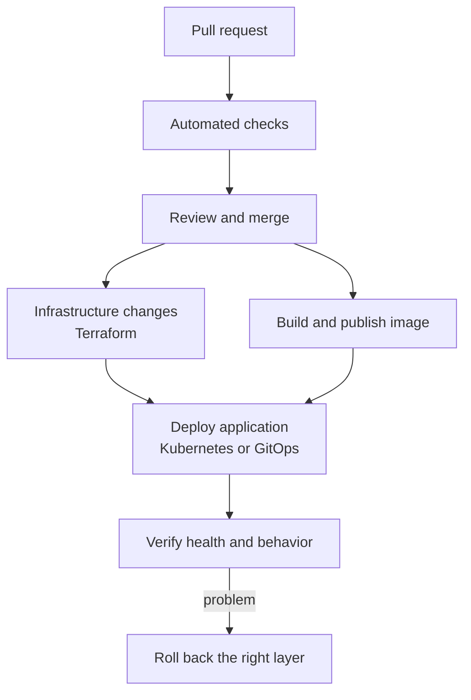

# End-to-end deployment

An end-to-end deployment is the full path a change travels: from a developer's
pull request, through automated checks and reviews, to infrastructure and
application changes in production, and finally to proof that users are fine.
Each stage has a **gate**, a check that must pass before the change moves on.
When something goes wrong, you need to know which layer to roll back.

## The path

What it shows: infrastructure and the application image can be prepared in
parallel after merge, but the application is deployed only after both are ready.

## Stages and their gates

| Stage | What happens | Gate before moving on | Learn more |
| --- | --- | --- | --- |
| Pull request | A small, focused change is proposed. | A clear description and an owner. | [Git workflows](../git/index.md) |
| Automated checks | Formatting, tests, security scans, and a Terraform plan run. | All required checks pass. | [GitHub Actions](../git/github-actions/index.md) |
| Review and merge | A person reads the code and the plan. | Approval from a code owner. | [Terraform review checklist](../terraform/best-practices/review-and-automation-checklist.md) |
| Infrastructure | The reviewed Terraform plan is applied. | Approval in a protected environment; the apply succeeds. | [GitHub Actions with Terraform](github-actions-with-terraform.md) |
| Build | The application image is built and tagged with the commit SHA. | Tests and image scan pass. | [GitHub Actions with Kubernetes](github-actions-with-kubernetes.md) |
| Deploy | Kubernetes rolls out the new image. | The rollout completes and new Pods are ready. | [Deploying to EKS](deploying-to-eks.md) |
| Verify | Health checks, logs, metrics, and a real user flow are checked. | Error rate and latency stay normal. | [Observability stack](observability-stack.md) |

## Roll back the right layer

Each layer keeps its own record, so "undo" means something different in each:

| Layer | How to roll back | What it does **not** do |
| --- | --- | --- |
| Git | Revert the commit with `git revert` and merge it. | It does not change anything already running. |
| Application | `kubectl rollout undo`, or revert the manifest in Git when using GitOps. | It does not change Git (unless you use GitOps) or the infrastructure. |
| Infrastructure | Revert the Terraform configuration, review the new plan, and apply it. | Terraform has no "undo": deleted data does not come back. Restore data from backups. |

The safest rollback is usually the smallest one: roll back the application
first if only the application changed, and keep a database or infrastructure
rollback for when you have a tested plan.

## Practice it safely

You can practice most of this path locally before using a cloud account. The
[Start here](../start-here.md) route covers Git recovery, a Kubernetes deploy
and rollback, and the Terraform lifecycle on your own machine.

## Related links

- [Terraform on AWS](terraform-on-aws.md)
- [GitOps on EKS](gitops-on-eks.md)
- [EKS operations](eks-operations.md)
- [Velero backup and restore](../migrations/velero/index.md)
- [Back to cross-topic guides](index.md)
