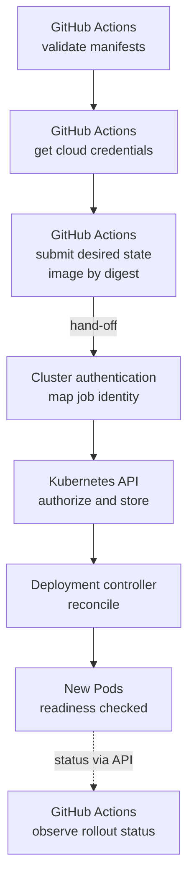

# GitHub Actions with Kubernetes

## Purpose

Use this page to understand a deployment from GitHub Actions to Kubernetes as
two systems doing two different jobs. After reading it you should be able to
say which system is responsible for each step, and what a green workflow run
does and does not tell you.

The page is conceptual. It contains no workflow file to copy. For workflow
syntax and permissions, use the [GitHub Actions section](../git/github-actions/index.md).

## What each system does

**GitHub Actions** runs jobs in response to repository events. In a
deployment, a job checks things, proves who it is, tells the cluster what
should run, and reports what it saw.

**Kubernetes** stores that request as desired state. Controllers create Pods,
and the scheduler and nodes place and start them; Kubernetes observes their
readiness and replaces old Pods during a rollout. [Kubernetes fundamentals](../kubernetes/fundamentals/kubernetes-fundamentals.md)
explains that model.

The workflow does not deploy anything in the sense of starting containers. It
submits a change and then watches.

## Why it matters

If you picture the workflow as "the thing that deploys", two mistakes follow.
You expect the job's success to mean the application works, and you look in
the workflow log for failures that actually happened inside the cluster,
minutes after the job's last command.

Knowing the hand-off point tells you where to look and whose permissions
matter.

## Visual: the hand-off

This diagram uses a cloud identity path like the EKS example below. Other
clusters can authenticate a deployment job differently.

Text alternative: the GitHub Actions job validates manifests, gets cloud
credentials, and submits desired state that names the image by digest. That
submission is the hand-off. The cluster authenticates and maps the job's
identity; the Kubernetes API then checks authorization and stores the object.
The Deployment controller creates new Pods, whose readiness is checked. The
job asks the API for rollout status, shown as a dashed final step.

Everything after the hand-off happens in the cluster, on the
cluster's schedule.

## The ideas a deployment job depends on

### Manifest validation

Validation can catch malformed manifests, known schema errors, or mistakes in
repository policy before anything reaches the cluster. Its coverage depends
on the validator, the cluster version, installed custom resources, and live
admission rules. The API server still makes the final acceptance decision.
Even a valid manifest can name the wrong image or replica count.

### Image identity

An image can be referenced by tag or by digest. A tag can be moved to point at
a different image. A digest is a hash of the image's content and does not
change.[^kubernetes-container-images] Submitting the digest that the build
produced means the cluster requests that exact built image and gives you an
exact value to return to. To claim the deployed artifact was tested, the tests
must exercise that same image. Pass the digest from a trusted build of the
merged commit; treat an artifact from a pull-request run as untrusted input.

### Target context and namespace

The same manifests can be sent to any cluster the job can reach. The target
cluster does not appear in the manifest. A namespace may be set in
`metadata.namespace` or supplied by the job. The job should make its target
explicit and fail if it is not the intended cluster and namespace.

### Scoped authentication

The job needs credentials and an identity the cluster accepts. There are
three separate checks:

1. **GitHub to cloud.** A deployment job can exchange its OIDC token for
   short-lived cloud credentials when the role's trust policy matches the
   job's actual claims. `id-token: write` lets every step in that job request
   a token; it grants no cloud permission on its own. Run untrusted tooling
   in a separate job without `id-token: write` or cloud credentials.[^github-oidc-reference]
2. **Cloud to cluster.** The cloud identity must be authenticated and mapped
   to a cluster identity. On EKS, an access entry can connect an IAM role to
   Kubernetes groups or an EKS access policy.[^eks-access-entries]
3. **Cluster authorization.** A namespaced Role and RoleBinding can grant
   only the needed Kubernetes permissions. EKS access policies can also
   authorize requests, so check the identity's combined access rather than
   assuming a narrow RoleBinding limits a broader policy.[^kubernetes-rbac][^eks-access-policies]

The [AWS OIDC guide](../git/github-actions/aws-oidc-federation.md) explains
the first check; [EKS identity and RBAC](../security/identity-federation/eks-human-identity-and-rbac.md)
explains the remaining two. Workload creation is powerful even in one
namespace: a workload may mount Secrets and run as a ServiceAccount there.
Keep privileged identities and sensitive resources out of that
namespace.[^kubernetes-rbac-good-practices]

### Protected environment

A GitHub deployment environment can carry protection rules: required
reviewers, a wait timer, or a restriction on which branches and tags may
deploy. Configure those rules explicitly; naming an environment alone is not
an approval gate. The protected job does not start until its rules pass, so
it cannot request an environment-shaped OIDC token before then. Check
self-review and administrator bypass settings.[^github-deployment-environments]
The cloud role must trust the job's actual subject format. An environment
subject by itself does not identify one workflow or event; another workflow
on an allowed ref can name that environment. See [Actions security](../git/github-actions/security-secrets-and-permissions.md).

### Rollout observation

After the hand-off, the job can wait and ask the cluster how the rollout is
going. Kubernetes marks a Deployment complete when all replicas are updated,
all are available, and no old replicas are running. `kubectl rollout status`
returns a zero exit code when that happens. If a Deployment makes no progress
within its progress deadline, the controller records that it has
stalled, and `kubectl rollout status` exits non-zero. Kubernetes does not
automatically roll the Deployment back; it continues trying to reconcile.
Set the job timeout long enough to observe the Deployment's progress
deadline.[^kubernetes-deployments]

Know the limits of this signal:

- "Available" depends on the readiness probe. A readiness probe decides when a
  container is ready to accept traffic.[^kubernetes-probes] If the probe is
  missing or only checks that the process started, a broken application can
  still count as available.
- A completed rollout describes Pods. It does not show that requests from
  users succeed, that dependencies are reachable, or that the right
  configuration is in effect. Treat that as a separate check; see
  [Observability stack](observability-stack.md).

### Failure recovery

When a rollout stalls, check which Pods are actually serving. Depending on
the update strategy and the health of old Pods, some old replicas may still
serve, or availability may already be reduced. Decide whether to fix forward
or go back. A Deployment can return to a previous revision only while that
revision is retained; `.spec.revisionHistoryLimit` controls the retained
history.[^kubernetes-deployments]

A Deployment rollback restores an earlier Pod template; it does not undo
separate ConfigMap, Secret, or other object changes. The earlier image must
still exist in the registry. If you fix forward instead, the Deployment may
remain stalled or at reduced capacity until the fix arrives.

A rollback performed directly in the cluster leaves the repository describing
the newer version. The next deployment from the repository would reintroduce
the problem. A recovery is finished only when the repository and the cluster
agree again.

## Example: one deployment, step by step

This example is illustrative. The service, names, and outcomes are invented,
and nothing here was run.

A team deploys `bookings-api` to the `bookings` namespace of a production
cluster.

| Step | Who acts | What happens | If it fails |
| --- | --- | --- | --- |
| 1 | GitHub Actions | A separate, ungated job validates manifests. | The job stops. Nothing reached the cluster. |
| 2 | GitHub Actions and a reviewer | A deployment job references the protected `production` environment and waits for approval. | Without approval, the job does not start or request its environment-shaped token. |
| 3 | GitHub Actions and cloud | The job exchanges an OIDC token for temporary cloud credentials. An EKS access entry and RoleBinding were configured earlier for the role and `bookings` namespace. | If the exchange fails, check cloud trust. It does not test cluster access. |
| 4 | GitHub Actions and cluster | The job submits the Deployment with the new image digest. EKS authenticates the role; Kubernetes checks its namespace permission. | A missing EKS mapping or RoleBinding makes the API request fail. |
| 5 | Kubernetes | New Pods fail readiness because a required setting is missing. | The rollout stalls. Some old Pods may keep serving; capacity may be reduced. |
| 6 | GitHub Actions | The observation step sees no progress before the deadline and fails the job. | The team reads Pod events and logs in the cluster, not the workflow log. |
| 7 | On-call engineer and author | The engineer checks remaining capacity. The author adds the missing setting in a new pull request. | The stalled Deployment keeps reconciling until the fix reaches it. |

What to notice: the workflow submits desired state in step 4. Kubernetes
performs the rollout in step 5; the workflow observes it in step 6, and people
decide how to recover in step 7. The red job reports a cluster outcome. The
cause is found with cluster tools such as those in
[kubectl basics](../kubernetes/commands/kubectl-basics.md) and
[Kubernetes troubleshooting](../kubernetes/troubleshooting/index.md).

## An analogy: a courier and a building manager

The workflow is a courier who delivers a signed work order to a building. The
building manager, Kubernetes, reads the order and carries out the work.

Where the analogy stops being accurate:

- **The courier waits and reports.** A real courier leaves. A deployment job
  usually stays to observe the rollout, which is why a cluster failure shows
  up as a failed job.
- **The manager never stops.** Controllers keep comparing desired and actual
  state long after the job has finished.
- **The work order does not identify the building.** The target cluster comes
  from the job's configuration and credentials. The namespace may also be
  named in the manifest.

## Trade-off: push or pull

This page describes a **push** model: a job outside the cluster submits
changes. In a **pull** model, often called GitOps, a controller inside the
cluster reads the repository and applies changes itself, so the pipeline needs
no cluster credentials. Each has costs. See [GitOps](../kubernetes/applications-and-tools/gitops.md)
and [GitOps on EKS](gitops-on-eks.md).

## Check your understanding

- The workflow run is green. Which of these does that establish: the manifests
  were accepted, the Pods are available, users are being served?
- Why is `id-token: write` not, by itself, permission to change anything in a
  cluster?
- A rollout stalls at step 5. Where do you look for the cause, and why not in
  the workflow log?
- After rolling back directly in the cluster, what is still inconsistent?

## Next steps

- Workflow structure and permissions: [GitHub Actions workflow structure](../git/github-actions/workflow-structure.md)
  and [security, secrets, and permissions](../git/github-actions/security-secrets-and-permissions.md).
- Federated credentials: [AWS OIDC federation](../git/github-actions/aws-oidc-federation.md).
- The cluster side: [Kubernetes fundamentals](../kubernetes/fundamentals/kubernetes-fundamentals.md).
- The wider chain this step sits in: [End-to-end deployment](end-to-end-deployment.md).
- An applied route on AWS: [Deploying to EKS](deploying-to-eks.md).

## Official documentation for deeper study

- Protection rules and environment secrets: [GitHub Docs - Deployments and environments](https://docs.github.com/en/actions/reference/workflows-and-actions/deployments-and-environments).
- Token claims, subject formats, and the `id-token` permission: [GitHub Docs - OpenID Connect reference](https://docs.github.com/en/actions/reference/security/oidc).
- Rollout status, progress deadline, and rollback: [Kubernetes - Deployments](https://kubernetes.io/docs/concepts/workloads/controllers/deployment/).
- Tags and digests: [Kubernetes - Images](https://kubernetes.io/docs/concepts/containers/images/).
- Namespaced permissions: [Kubernetes - Using RBAC Authorization](https://kubernetes.io/docs/reference/access-authn-authz/rbac/).
- Why workload creation needs care: [Kubernetes - RBAC good practices](https://kubernetes.io/docs/concepts/security/rbac-good-practices/).
- How an IAM role gets EKS access: [Amazon EKS - Access entries](https://docs.aws.amazon.com/eks/latest/userguide/access-entries.html).
- What readiness means: [Kubernetes - Liveness, Readiness, and Startup Probes](https://kubernetes.io/docs/concepts/configuration/liveness-readiness-startup-probes/).

## Related links

- [GitHub Actions documentation](https://docs.github.com/actions)
- [Kubernetes deployments documentation](https://kubernetes.io/docs/concepts/workloads/controllers/deployment/)
- [GitHub Actions section](../git/github-actions/index.md)
- [End-to-end deployment](end-to-end-deployment.md)
- [Back to cross-topic guides](index.md)
- [Back to knowledge index](../index.md)

[^github-deployment-environments]: [GitHub Docs - Deployments and environments](https://docs.github.com/en/actions/reference/workflows-and-actions/deployments-and-environments), source record `github-deployment-environments`.
[^github-oidc-reference]: [GitHub Docs - OpenID Connect reference](https://docs.github.com/en/actions/reference/security/oidc), source record `github-oidc-reference`.
[^kubernetes-container-images]: [Kubernetes - Images](https://kubernetes.io/docs/concepts/containers/images/), source record `kubernetes-container-images`.
[^kubernetes-deployments]: [Kubernetes - Deployments](https://kubernetes.io/docs/concepts/workloads/controllers/deployment/), source record `kubernetes-deployments`.
[^kubernetes-rbac]: [Kubernetes - Using RBAC Authorization](https://kubernetes.io/docs/reference/access-authn-authz/rbac/), source record `kubernetes-rbac`.
[^kubernetes-rbac-good-practices]: [Kubernetes - RBAC good practices](https://kubernetes.io/docs/concepts/security/rbac-good-practices/), source record `kubernetes-rbac-good-practices`.
[^eks-access-entries]: [Amazon EKS - Access entries](https://docs.aws.amazon.com/eks/latest/userguide/access-entries.html), source record `eks-access-entries`.
[^eks-access-policies]: [Amazon EKS - Associate access policies with access entries](https://docs.aws.amazon.com/eks/latest/userguide/access-policies.html), source record `eks-access-policies`.
[^kubernetes-probes]: [Kubernetes - Liveness, Readiness, and Startup Probes](https://kubernetes.io/docs/concepts/configuration/liveness-readiness-startup-probes/), source record `kubernetes-probes`.
