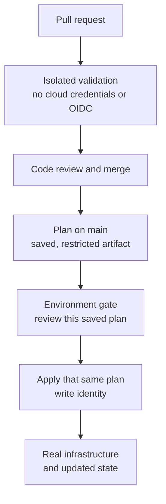

# GitHub Actions with Terraform

## Purpose

Use this page to understand what changes when Terraform runs in a pipeline
instead of on your laptop. After reading it you should be able to tell three
CI activities apart, say which of them can change real infrastructure, and
explain why a plan file is a sensitive artifact.

The page assumes the model in [Terraform fundamentals](../terraform/fundamentals/terraform-fundamentals.md):
configuration, provider, state, plan, and apply. It is not a workflow to copy.
The command sequence itself is in the [core Terraform workflow](../terraform/commands/core-workflow.md).

## What running Terraform in CI means

Running Terraform in CI means a GitHub Actions job, not a person at a
terminal, runs Terraform commands. That job needs the same three things a
person needs: the configuration, access to the state, and an identity the
cloud provider accepts.

What changes is that nobody is watching the terminal. The pause where a person
reads a plan and types "yes" has to be rebuilt deliberately out of pipeline
features.

## Why it matters

A sequence such as "init, validate, plan, apply" looks like four steps of one
task. In a pipeline they are three different activities with different risks
and different permissions. Treating them as one leads to two familiar
failures: pull requests that can change production, and applies that nobody
reviewed.

## Three activities, not one

| Activity | When it runs | What it needs | Can it change infrastructure? |
| --- | --- | --- | --- |
| Pull request validation | On every proposed change. | An isolated job with no backend access, cloud credentials, or OIDC token permission; it can install PR-selected providers and modules. | It does not intentionally apply resources, but untrusted tooling can run. |
| Plan | After merge, from the exact `main` commit to be deployed, for a specific environment. An optional pull-request plan is only a preview. | Access to state, provider operations needed to plan, and backend locking. | It does not apply the proposed resource changes. |
| Apply | After review of that post-merge saved plan. | Write access to state and to the provider. | Yes. |

**Validation** checks that configuration is syntactically valid and
internally consistent. `terraform validate` does not check remote services
such as remote state or provider APIs. It needs an initialized working
directory with the referenced providers and modules installed, and that
initialization can be done without touching the backend.[^terraform-validate]
`terraform init -backend=false` and `validate` can still install or execute
code selected by the pull request. Keep that job separate from jobs holding
cloud credentials, secrets, or `id-token: write`.
A passing validation says the files make sense. It says nothing about what would happen
to real resources.

**Plan** reads the current state of existing remote objects, compares the
configuration with the prior state, and proposes a set of changes. It does not
carry them out.[^terraform-plan] A plan is environment-specific: the same
configuration can produce a different plan against a different state. Planning
can still acquire a backend lock and read provider data; it is not a promise
of no other side effects.

**Apply** carries out proposed resource changes through the provider.

An optional **speculative plan on a pull request** can help code review. It
is throwaway: do not apply its saved file after merge. HashiCorp's automation
guide runs pull-request plans without `-out` and creates the plan to apply
from the primary branch after merge.[^terraform-automation] A pull request
can change the configuration, modules, providers, and workflow that its own
job runs. Only offer a PR plan against real state where PR authors are already
trusted with that state and cloud role; otherwise keep that access out of PR
jobs. The applied plan still comes from the merged branch.

## The pieces that make CI different

### State and backend

A **backend** determines where Terraform stores state. The default backend
keeps state in a local file on disk.[^terraform-backends] GitHub-hosted jobs
normally start on fresh runners, so a local state file would not be shared
reliably across runs.[^github-runner-choice] Self-hosted runners may retain
files, but their local disk is not a suitable shared-state design. Pipelines
therefore depend on a remote backend that every intended run can reach.
[^github-self-hosted-runners]

If the backend supports it, Terraform locks the state for operations that
could write it, so that two runs cannot write at the same
time.[^terraform-state-locking] Locking is a backend feature, and the backend
documentation describes it as optional, so confirm that yours provides it and
that it is enabled.[^terraform-backends] [Terraform state management](../terraform/fundamentals/state-management.md)
covers backends and locking in depth.

### Identity

The job must prove who it is to the cloud provider. A job can request an OIDC
token from GitHub and exchange it for short-lived credentials, which avoids
storing a long-lived cloud key as a repository secret. The `id-token: write`
permission only allows the job to request that token, but it applies to every
step in that job.[^github-oidc-reference] Run untrusted tooling in a separate
job without this permission or cloud credentials; see [Actions security](../git/github-actions/security-secrets-and-permissions.md).

Planning proposes resource changes; applying carries them out. A team may
give the planning job narrower cloud-resource permissions than the apply job.
HashiCorp's automation guidance mentions read-only plan credentials as an
option and warns that both identities must reach the same target
account.[^terraform-automation] This is a design choice, not a universal
permission set: planning can read provider data, and state backends have their
own permissions. For example, the S3 backend with `use_lockfile` needs write
and delete permissions on its lock object even during a plan that acquires a
state lock.[^terraform-s3-backend]

Give planning and applying separate trust paths if they use different cloud
roles. A plan job on `main` can use a separate planning environment restricted
to `main` and a read-oriented role; the apply job can use the protected
production environment and write role.
Check each role's actual OIDC subject and target account. A pull-request job
must not receive the apply role. See the [AWS OIDC trust model](../git/github-actions/aws-oidc-federation.md).

### Branch and environment gate

A GitHub deployment environment can require reviewers and restrict which
branches may deploy. These rules must actually be configured. The protected
job does not start until they pass, so it cannot request its environment-shaped
OIDC token before then. Self-review and administrator bypass settings also
affect the gate.[^github-deployment-environments]

The token's subject claim can name the environment. GitHub documents
`repo:ORG/REPO:environment:NAME` as one format, but immutable repository IDs
and claim customization can change it. Match the actual claim. An environment
subject alone does not name the workflow, job, or event: another workflow on
an allowed ref could reference the same environment. Protect the workflow and
use the environment branch rules with the cloud trust policy.[^github-oidc-reference]

### Why the approval has to live in the pipeline

Run interactively without a plan file, `terraform apply` creates a plan and
asks you to approve it. Given a saved plan file, it performs the operations in
that plan without prompting.[^terraform-apply]

In automation, a saved-plan apply will not pause. A required environment
reviewer can hold the apply job before it starts. The pipeline must show that
reviewer the **post-merge saved plan** and ensure the job applies that exact
plan. The gate approves a job; by itself it does not bind a plan artifact to
the job. That is an inference from GitHub's job-level gate and HashiCorp's
requirement to connect approval to the correct plan.[^github-deployment-environments][^terraform-automation]

### Drift between plan and apply

Time passes between the saved plan a reviewer reads and the apply. If another
apply updates the Terraform state first, Terraform rejects the saved plan as
stale. Generate a new plan from `main` and obtain a new review.[^terraform-automation]

An out-of-band change to a real resource does not itself update Terraform
state, so this stale-plan check cannot prove that remote objects stayed the
same. Keep the gap short and allow only one outstanding plan, as HashiCorp
recommends.[^terraform-automation] If remote drift is suspected, investigate
it before making and reviewing a new plan.

Record the merged source commit, target account, workspace and backend, and
plan artifact identity. Apply the exact saved plan the reviewer saw. A new
plan made inside the apply job is a different plan and needs a new review.

### Plan files are sensitive

A saved plan file contains the full configuration, prior state, input
variables, and values associated with planned changes. Even unchanged
resources in that prior state may hold secrets. Sensitive values can be in
clear text in the file even where terminal output hides them. Treat it as a
potentially sensitive artifact.[^terraform-plan][^terraform-plan-tutorial]

The plan may need to travel between jobs. In GitHub Actions, signed-in people
with repository read access can download workflow artifacts; on a public
repository that includes public readers.[^github-artifact-download] Do not
upload a plaintext production plan there. Use a restricted store or encrypt
the artifact, and ensure the apply job gets the exact reviewed file.
HashiCorp calls for the entire initialized working directory to be restored
at the same absolute path, with the same provider plugins, operating system,
architecture, Terraform version, and target account when planning and
applying on different machines.[^terraform-automation][^terraform-plan-tutorial]
That directory transfer can carry backend settings or other sensitive files;
protect it with the same access limits as the plan file.
Keep the provider lock file with the configuration. The same caution applies to
posting plan output in a pull-request comment: terminal redaction does not
make a plan safe to publish widely.

## Visual: where the gate sits

Text alternative: a pull request is validated in a separate job without
backend access, cloud credentials, or OIDC token permission, then merged
after code review. A trusted job on `main` then creates a saved
plan for the target environment. A required reviewer reads that plan and
releases the gated apply job, which uses a write identity to apply the same
plan and update real infrastructure and state.

Nothing before the environment gate applies proposed resource changes.
The plan may still lock its backend and expose sensitive state. A speculative
pull-request plan, if used, is a separate preview and never crosses into the
apply job.

## Example: one change through the pipeline

This example is illustrative. The repository, names, and outcomes are
invented, and nothing here was run.

A team manages the network for `bookings-api` with Terraform. A developer
opens a pull request that adds one tag to a subnet.

| Moment | What happens | Managed resources changed? | What could go wrong |
| --- | --- | --- | --- |
| Pull request opened | Formatting and validation run in an isolated, uncredentialed job. | No planned resource change | Untrusted configuration, modules, or providers may execute; do not give this job cloud or state credentials. |
| Code review and merge | The change lands on `main`. A pull-request preview, if one existed, is discarded. | No | A PR plan could differ from the merged commit. |
| Plan job on `main` | The job reads the production state and saves a plan showing one in-place update. | No | The saved file holds configuration, variables, and planned values; restrict access. |
| Deployment review | A reviewer checks this exact saved plan, its source commit, and target. | No | Code review alone did not approve this post-merge plan. |
| Meanwhile | A colleague's separate change is applied first. | Yes | It changes the state the reviewed plan used. |
| Apply job | Terraform rejects the stale saved plan; the job fails. | No | The job must not silently replace it with a fresh plan. |
| New plan and review | A trusted job on `main` saves a fresh plan; a reviewer approves a new gated apply job. | No | The new plan may describe different changes. |
| Second apply job | It applies that new saved plan with the production write identity. | Yes | A partial failure can still require recovery. |

What to notice: two rows change real infrastructure; each was separately
reviewed. The rejected saved plan is the process working. Terraform detects
that the state changed; it does not prove that no remote change happened
without a state update.

## Trade-offs and failure boundaries

- **Stricter gates slow delivery.** Requiring re-review after every
  intervening apply is safe and can be frustrating on a busy repository.
  Smaller, separate state files reduce collisions.
- **A partly failed apply is not an all-or-nothing operation.** Changes that
  completed before the failure stay in place. Inspect what changed, resolve
  the error, and make and review another plan before applying again; Terraform
  does not automatically roll back.[^terraform-apply]
- **Plan permissions still reveal information.** An identity without permission
  to change managed resources can still read state, and state can contain
  secrets. Narrow resource permissions do not make a planning job harmless.
- **Any privileged pull-request plan is risky.** Same-repository authors can
  change workflow and Terraform code too. A PR job with cloud or state access
  exposes that access to its steps. Never grant it the apply identity.

## Check your understanding

- Which of validation, plan, and apply needs cloud credentials, and which can
  change infrastructure?
- Why does `terraform apply` with a saved plan make the environment gate more
  important, not less?
- A plan was approved yesterday, and another change was applied this morning.
  Why should the approved plan not simply be applied?
- Why is a saved plan file treated as sensitive even when the terminal output
  shows values as hidden?
- Why should the plan applied after merge come from the merged commit rather
  than the pull-request run?

## Next steps

- The model underneath: [Terraform fundamentals](../terraform/fundamentals/terraform-fundamentals.md).
- Backends, locking, and secrets in state: [Terraform state management](../terraform/fundamentals/state-management.md).
- Command-level detail and plan review signals: [core Terraform workflow](../terraform/commands/core-workflow.md).
- Short-lived credentials from GitHub: [AWS OIDC federation](../git/github-actions/aws-oidc-federation.md)
  and [OIDC fundamentals](../security/identity-federation/oidc-fundamentals.md).
- The AWS side of the same pipeline: [Terraform on AWS](terraform-on-aws.md).

## Official documentation for deeper study

- What validation covers: [`terraform validate` command](https://developer.hashicorp.com/terraform/cli/commands/validate).
- Plan behaviour, saved plans, and their sensitivity: [`terraform plan` command](https://developer.hashicorp.com/terraform/cli/commands/plan).
- Automatic and saved-plan modes: [`terraform apply` command](https://developer.hashicorp.com/terraform/cli/commands/apply).
- Approval between plan and apply, and plan invalidation: [Running Terraform in automation](https://developer.hashicorp.com/terraform/tutorials/automation/automate-terraform).
- Where state is stored: [Backends](https://developer.hashicorp.com/terraform/language/state/backends) and [State locking](https://developer.hashicorp.com/terraform/language/state/locking).
- S3 backend lock-file permissions: [Terraform - S3 backend](https://developer.hashicorp.com/terraform/language/backend/s3).
- Approval gates: [GitHub Docs - Deployments and environments](https://docs.github.com/en/actions/reference/workflows-and-actions/deployments-and-environments).
- Subject claims for environments: [GitHub Docs - OpenID Connect reference](https://docs.github.com/en/actions/reference/security/oidc).
- Runner lifecycle: [GitHub-hosted job runners](https://docs.github.com/en/actions/how-tos/write-workflows/choose-where-workflows-run/choose-the-runner-for-a-job)
  and [self-hosted runners](https://docs.github.com/en/actions/concepts/runners/self-hosted-runners).

## Related links

- [GitHub Actions documentation](https://docs.github.com/actions)
- [Terraform CLI documentation](https://developer.hashicorp.com/terraform/cli)
- [GitHub Actions section](../git/github-actions/index.md)
- [End-to-end deployment](end-to-end-deployment.md)
- [Back to cross-topic guides](index.md)
- [Back to knowledge index](../index.md)

[^terraform-validate]: [terraform validate command](https://developer.hashicorp.com/terraform/cli/commands/validate), source record `terraform-validate`.
[^terraform-plan]: [terraform plan command](https://developer.hashicorp.com/terraform/cli/commands/plan), source record `terraform-plan`.
[^terraform-apply]: [terraform apply command](https://developer.hashicorp.com/terraform/cli/commands/apply), source record `terraform-apply`.
[^terraform-backends]: [Terraform - Backends, state storage and locking](https://developer.hashicorp.com/terraform/language/state/backends), source record `terraform-backends`.
[^terraform-state-locking]: [Terraform - State locking](https://developer.hashicorp.com/terraform/language/state/locking), source record `terraform-state-locking`.
[^terraform-s3-backend]: [Terraform - S3 backend](https://developer.hashicorp.com/terraform/language/backend/s3), source record `terraform-s3-backend`.
[^terraform-automation]: [HashiCorp tutorial - Running Terraform in automation](https://developer.hashicorp.com/terraform/tutorials/automation/automate-terraform), source record `terraform-automation`.
[^terraform-plan-tutorial]: [HashiCorp tutorial - Create a Terraform plan](https://developer.hashicorp.com/terraform/tutorials/cli/plan), source record `terraform-plan-tutorial`.
[^github-deployment-environments]: [GitHub Docs - Deployments and environments](https://docs.github.com/en/actions/reference/workflows-and-actions/deployments-and-environments), source record `github-deployment-environments`.
[^github-oidc-reference]: [GitHub Docs - OpenID Connect reference](https://docs.github.com/en/actions/reference/security/oidc), source record `github-oidc-reference`.
[^github-artifact-download]: [GitHub Docs - Downloading workflow artifacts](https://docs.github.com/en/actions/how-tos/manage-workflow-runs/download-workflow-artifacts), source record `github-artifact-download`.
[^github-runner-choice]: [GitHub Docs - Choosing the runner for a job](https://docs.github.com/en/actions/how-tos/write-workflows/choose-where-workflows-run/choose-the-runner-for-a-job), source record `github-runner-choice`.
[^github-self-hosted-runners]: [GitHub Docs - Self-hosted runners](https://docs.github.com/en/actions/concepts/runners/self-hosted-runners), source record `github-self-hosted-runners`.
