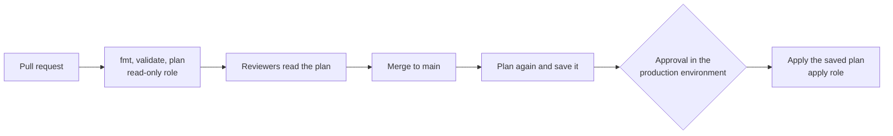

# GitHub Actions with Terraform

A good Terraform pipeline does two things. On every pull request it shows
reviewers exactly what would change. After merge it applies **only** that kind
of reviewed change, and only after a person approves it. Nobody runs
`terraform apply` from a laptop against shared infrastructure.

## The flow



What it shows: the pull request plan is for review; the plan that is applied is
made from `main` after merge, saved to a file, and applied unchanged after an
approval.

## Before you start

- A remote state backend with locking, so two runs cannot write state at the
  same time. See [remote backends and locking](../terraform/fundamentals/remote-backends-and-locking.md).
- Two cloud roles that GitHub can assume through OpenID Connect (OIDC), so no
  long-lived keys are stored in GitHub:[^gha-oidc-aws]
  - a **plan** role with read-only permissions, used by pull requests;
  - an **apply** role with change permissions, trusted only for the `main`
    branch and the protected environment.
- A GitHub **environment** named `production` with required reviewers.[^gha-environments]
  See [AWS OIDC federation](../git/github-actions/aws-oidc-federation.md) for the role trust setup.

## Example workflow

> [!WARNING]
> This workflow can change real infrastructure. Replace every placeholder, use
> a sandbox account first, and pin each action to a full commit SHA, as the
> comments show.[^gha-secure-use]

```yaml
name: terraform

on:
  pull_request:
    paths: ["infra/**"]
  push:
    branches: [main]
    paths: ["infra/**"]

permissions:
  contents: read
  id-token: write # lets the job request an OIDC token for the cloud role

concurrency:
  group: terraform-production
  cancel-in-progress: false # never cancel a run that may be applying

jobs:
  plan:
    runs-on: ubuntu-latest
    defaults:
      run:
        working-directory: infra
    steps:
      - uses: actions/checkout@<full-commit-sha> # v7.0.1
      - uses: hashicorp/setup-terraform@<full-commit-sha> # v4.0.1
        with:
          terraform_version: 1.17.1
      - uses: aws-actions/configure-aws-credentials@<full-commit-sha>
        with:
          role-to-assume: arn:aws:iam::111122223333:role/terraform-plan
          aws-region: eu-west-1
      - run: terraform fmt -check -recursive
      - run: terraform init -input=false
      - run: terraform validate
      - run: terraform plan -input=false -out=tfplan
      - if: github.event_name == 'push'
        uses: actions/upload-artifact@<full-commit-sha>
        with:
          name: tfplan
          path: infra/tfplan
          retention-days: 1

  apply:
    if: github.event_name == 'push'
    needs: plan
    runs-on: ubuntu-latest
    environment: production # waits for a required reviewer
    defaults:
      run:
        working-directory: infra
    steps:
      - uses: actions/checkout@<full-commit-sha> # v7.0.1
      - uses: hashicorp/setup-terraform@<full-commit-sha> # v4.0.1
        with:
          terraform_version: 1.17.1
      - uses: aws-actions/configure-aws-credentials@<full-commit-sha>
        with:
          role-to-assume: arn:aws:iam::111122223333:role/terraform-apply
          aws-region: eu-west-1
      - uses: actions/download-artifact@<full-commit-sha>
        with:
          name: tfplan
          path: infra
      - run: terraform init -input=false
      - run: terraform apply -input=false tfplan
```

What it does:

- Every pull request that touches `infra/` gets formatting, validation, and a
  plan made with the read-only role. Reviewers read the plan output in the job
  log.
- After merge, the `plan` job saves the plan from `main`. The `apply` job waits
  for approval in the `production` environment, then applies that saved plan
  with the apply role.[^tf-apply]
- `concurrency` keeps two runs for the same infrastructure from overlapping.

If the state changed after the plan was saved, Terraform refuses to apply the
stale plan. Re-run the workflow to make a fresh plan instead of forcing it.[^tf-plan]

## Keep it safe

- **Treat plan files as secrets.** A saved plan can contain sensitive values.
  Keep artifact retention short and restrict who can download artifacts.
- **Never print secrets.** Mark sensitive variables `sensitive = true`, and do
  not echo credentials or state.
- **Fail clearly in automation.** Use `-input=false` so a missing variable
  fails instead of waiting for input. `terraform plan -detailed-exitcode`
  returns `2` when there are changes, which is useful for drift checks; see
  [plan exit codes in CI](../terraform/commands/plan-exit-codes-and-ci.md).
- **Do not run untrusted code with cloud access.** Pull requests from forks
  must not receive the plan role. Keep `pull_request` (not
  `pull_request_target`) for plan jobs that check out pull-request code.

## Related links

- [Terraform core workflow](../terraform/commands/core-workflow.md)
- [Review and automation checklist](../terraform/best-practices/review-and-automation-checklist.md)
- [GitHub Actions security, secrets, and permissions](../git/github-actions/security-secrets-and-permissions.md)
- [Terraform on AWS](terraform-on-aws.md)
- [End-to-end deployment](end-to-end-deployment.md)
- [Back to cross-topic guides](index.md)

[^tf-plan]: [Terraform plan command](https://developer.hashicorp.com/terraform/cli/commands/plan)
[^tf-apply]: [Terraform apply command](https://developer.hashicorp.com/terraform/cli/commands/apply)
[^gha-oidc-aws]: [Configuring OpenID Connect in Amazon Web Services](https://docs.github.com/en/actions/how-tos/secure-your-work/security-harden-deployments/oidc-in-aws)
[^gha-environments]: [Deployments and environments](https://docs.github.com/en/actions/reference/workflows-and-actions/deployments-and-environments)
[^gha-secure-use]: [Secure use reference for GitHub Actions](https://docs.github.com/en/actions/reference/security/secure-use)
