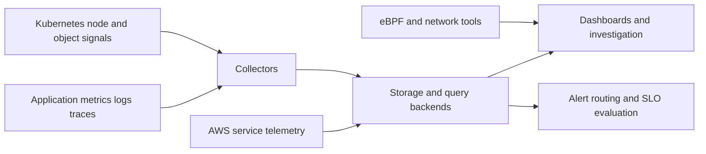

# Cross-topic observability architecture

## Purpose

Connect application instrumentation, Kubernetes collection, AWS telemetry, backends, alerts, and operations.

Sources reviewed: 2026-10-29. See the [validation record](../../knowledge-base-audit.md) for executed checks and unexecuted runtime labs.

## Reference flow

Separate collection from retention/querying. Prometheus-compatible metrics, log storage, and trace backends have different data models and scaling costs. Grafana can correlate supported data sources; the OpenTelemetry Collector is a pipeline component rather than a mandatory backend.

## Design decisions

| Decision | Define before rollout |
| --- | --- |
| User outcomes | SLIs, SLOs, error budget, and actionable alert owners. |
| Collection | SDKs, node agents, gateways, cloud integrations, coverage gaps. |
| Data protection | Payload/label redaction, access scope, encryption, retention. |
| Reliability | Queues, retries, loss/backpressure, failover, pipeline alerts. |
| Cost | Cardinality, sampling, ingestion, indexing, retention, cross-region transfer. |
| Operations | Tool ownership, pinned versions, upgrades, runbooks, recovery tests. |

## AWS and Kubernetes

Combine workload signals with EKS control-plane logs where enabled and relevant CloudWatch service metrics/logs. Configure access through the chosen workload identity; granting telemetry permissions is separate from granting application data access. Avoid exporting the same stream through multiple collectors without an intentional duplication strategy.

Use [IRSA/Pod Identity guidance](eks-workload-identity.md) for AWS permissions, [Kubernetes observability](../kubernetes/observability/index.md) for detailed signals/tool selection, and [collector patterns](../kubernetes/observability/telemetry-aggregation.md) for node/gateway topology.

## Validation and failures

Generate a synthetic user request, locate its supported metrics/logs/traces, check timestamps and source revision, and trigger a controlled alert. Break a collector/backend connection and prove the pipeline reports loss, queueing, or delayed export. A green collector Pod is insufficient.

Choose Pixie/eBPF when supported low-level visibility answers a specific debugging question. Keep application propagation and business instrumentation for context those tools cannot infer. Establish a redacted support bundle and an alert-to-runbook path before onboarding production services.

## Related links

- [OpenTelemetry Collector](https://opentelemetry.io/docs/collector/)
- [CloudWatch](https://docs.aws.amazon.com/cloudwatch/)
- [EKS control-plane logging](https://docs.aws.amazon.com/eks/latest/userguide/control-plane-logs.html)
- [Cloud](../cloud/index.md)
- [AWS](../cloud/aws/index.md)
- [Kubernetes](../kubernetes/index.md)
- [Observability fundamentals](../kubernetes/observability/fundamentals-and-signals.md)
- [Pixie](../kubernetes/observability/pixie-architecture-and-queries.md)
- [Back to parent index](index.md)
- [Back to root index](../../README.md)
