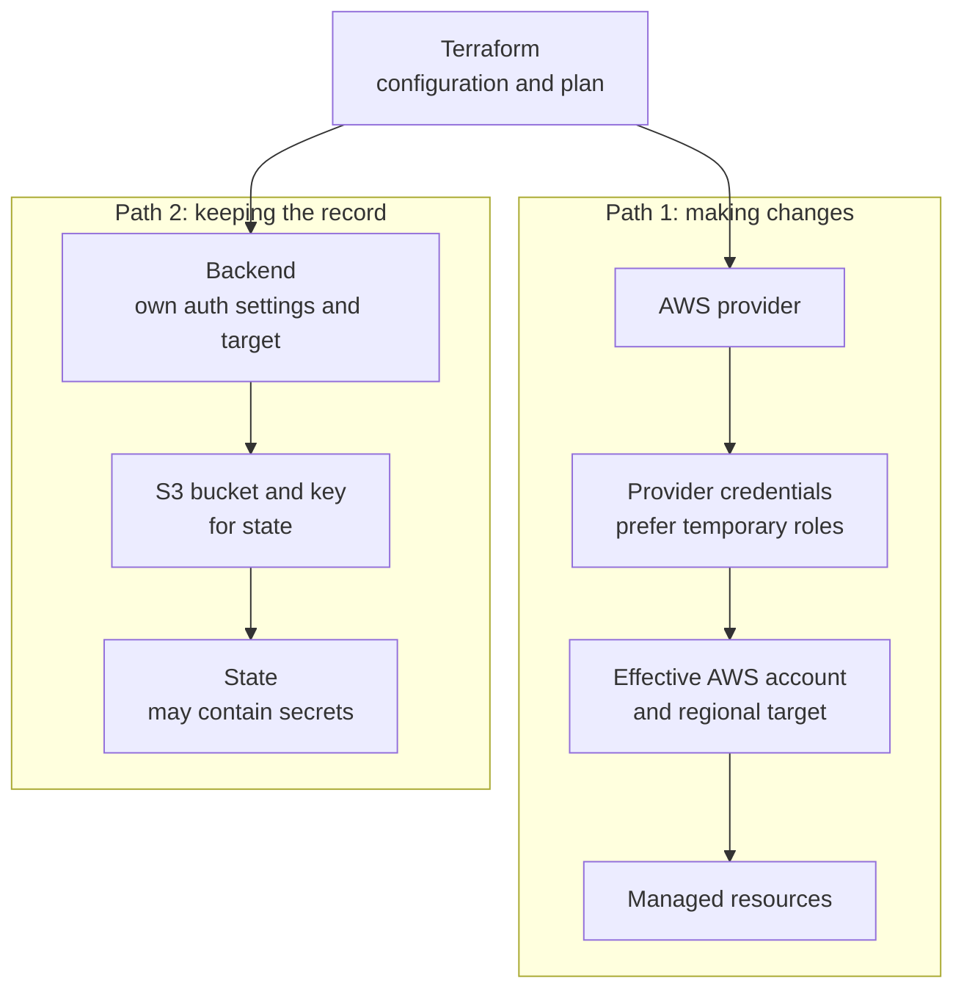

# Terraform on AWS

## Purpose

Use this page to understand where the boundaries are when Terraform manages
AWS infrastructure. After reading it you should be able to answer four
questions before any plan: which plugin is talking to AWS, as whom and where,
about which resources, and where the record of those resources is kept.

The page builds on [Terraform fundamentals](../terraform/fundamentals/terraform-fundamentals.md)
and does not repeat the plan and apply model. It creates nothing in AWS and
needs no credentials.

## What "Terraform on AWS" is made of

Terraform itself knows nothing about AWS. Four separate things combine:

| Part | Simple definition | What it decides |
| --- | --- | --- |
| AWS provider | The plugin that turns Terraform resource declarations into AWS API calls. | Which resource types exist and how they behave. |
| Identity, account, and region | The credentials the provider uses, the effective AWS account, and the Region for regional calls. | Whose permissions apply, who is billed, and where regional resources are created. |
| Resources | The AWS objects that the configuration declares, such as a network or a bucket. | What exists in AWS. |
| Backend | The place Terraform stores its state. | Whether Terraform can find, share, and protect its record of those resources. |

The first three describe where changes are made. The backend describes where
the memory of those changes is kept. They are configured separately, and they
can point at different accounts or Regions. The backend can also use a
different credential source from the provider.

## Why it matters

Some costly Terraform-on-AWS mistakes cross these boundaries: a correct
configuration applied with the wrong account's credentials, resources created
in an unintended Region, or a state file that two people wrote at once.

Billable AWS resources may accrue charges while they exist. A VPC itself has
no additional charge, but components such as NAT gateways do.[^aws-vpc-overview]
Some changes are slow or impossible to reverse. The boundaries determine
where these effects happen.

## Visual: two separate paths



Text alternative: Terraform, holding the configuration and plan, connects to
two separate paths. Path 1 makes changes: the AWS provider uses its selected
credentials, preferably a temporary role, to act in an effective AWS account
and, for regional resources, a Region. Path 2 keeps the record: the backend
uses its own connection settings to reach a bucket and key holding state,
which may contain secrets. Its credentials may come from the same environment
as the provider's or from a separate configuration. Check both paths.

## Boundary 1: the AWS provider

A provider is a plugin. The AWS provider supplies the AWS resource types and
makes the API calls. Its configuration can come from several places, applied
in a documented order: parameters in the provider block, then environment
variables, then shared credentials and configuration files, then container or
instance credentials.[^terraform-aws-provider]

That order is why the same configuration can behave differently on two
machines. What is set in a shell or a pipeline can decide which credentials
and Region are used when the provider block does not.

The provider documentation warns against hard-coding credentials in
configuration, because they can leak if the file is ever
committed.[^terraform-aws-provider]

## Boundary 2: identity, account, and region

**Identity.** AWS's own guidance is that workloads should use temporary
credentials from IAM roles, and that permissions should follow least
privilege.[^aws-iam-best-practices] For Terraform this means the role used to
apply should be able to manage the resource types in that configuration and
little else. A role with administrator access turns every mistake in a plan
into a possible account-wide mistake.

**Account.** The provider can use credentials directly or assume another
role. Its *effective* identity determines the account for API calls; a
resource declaration does not state the intended account. The provider offers
an `allowed_account_ids` setting that lists permitted account IDs and rejects
the effective identity if it belongs to another account.[^terraform-aws-provider]
This guard checks the provider, not the account or bucket selected by the
state backend.

**Region.** Most AWS resources are regional. The provider configuration sets
their default Region; AWS provider v6 lets most resources override that
default with their own `region` argument. Some resources are global. A wrong
Region can lead to an error, replacement, or a plan for resources elsewhere;
check the resource's effective Region, not just the provider
block.[^terraform-aws-region-guide]

Short-lived credentials in pipelines are covered in [GitHub Actions with
Terraform](github-actions-with-terraform.md) and [AWS OIDC federation](../git/github-actions/aws-oidc-federation.md).

## Boundary 3: the resources

Resources are the part everyone looks at, so this page says least about them.
Two points belong to the boundary view:

- **An apply can start resource charges.** A plan does not carry out its
  proposed resource changes, but planning can still use a paid remote service
  or backend and read provider data. An apply that creates billable resources
  can start charges that continue while those resources exist. [Cost
  allocation basics](../finops/cost-allocation-basics.md) covers ownership
  and tagging.
- **Some changes replace or destroy.** A plan line that replaces a database or
  deletes a bucket may not be recoverable from Terraform alone. Recovery then
  depends on backups and provider-side protection you arranged earlier.

## Boundary 4: the backend and its state

A backend determines where state is stored. The default is a local file on
disk.[^terraform-backends] For anything shared, teams use a remote backend,
and on AWS that is commonly the S3 backend, which stores the state as an
object in a bucket.[^terraform-s3-backend]

Four things about the S3 backend are easy to get wrong:

- **Locking is opt-in.** The S3 backend documentation describes state locking
  as an opt-in feature. It is enabled with the `use_lockfile` argument, which
  defaults to `false`. Check that your installed Terraform version supports
  the setting. Deprecated DynamoDB locking can still work during migration;
  current documentation says it will be removed in a future minor
  version.[^terraform-s3-backend] Storing state in S3 alone does not stop
  concurrent writes.
- **The lock belongs to one state path.** The bucket, key, and workspace select
  the state object and its lock. Locking that path does not stop another run
  from using a different path or the wrong provider account. Terraform stops
  if it cannot acquire a supported, configured lock.[^terraform-s3-backend][^terraform-state-locking]
- **Recovery depends on retained versions or backups.** The documentation
  highly recommends bucket versioning so a previous state object can be
  recovered after accidental deletion or human error. Verify that a usable
  version is still retained.[^terraform-s3-backend]
- **Confidentiality needs access control.** S3 encrypts new objects with SSE-S3
  by default; Terraform's `encrypt` setting is optional. A team can choose
  KMS when its key-control requirements call for it, but still must restrict
  who can read the state.[^terraform-s3-backend][^s3-default-encryption]

State is also sensitive. With a remote backend, Terraform does not keep state
on local disk in normal operation, which the documentation calls a major
benefit when state contains sensitive values.[^terraform-backends] The bucket
then becomes the thing to protect: whoever can read it can read the state.
Saved plans can still contain prior state, and the initialized working
directory can contain sensitive backend settings. Protect those local files
and any CI archive that carries them.[^terraform-backends]

Backend access has its own permission needs, even if the same role supplies
both provider and backend credentials. For S3 these include listing the
bucket and reading and writing the state object, plus reading, writing, and
deleting the lock file when lock files are used. KMS encryption and older
DynamoDB locking need additional permissions documented by the
backend.[^terraform-s3-backend] See
[Terraform state management](../terraform/fundamentals/state-management.md).

## Example: the wrong account and missing state

This example is illustrative. The team, account numbers, and outcomes are
invented, and nothing was run or created. `111111111111` and `222222222222`
are placeholder account numbers.

A team keeps a sandbox account, `111111111111`, and a production account,
`222222222222`. The `bookings` network configuration is meant for the
sandbox. Its provider settings look like this:

```hcl
provider "aws" {
  region              = "eu-west-1"
  allowed_account_ids = ["111111111111"]
}
```

What it declares: the default Region, and the only account this configuration
may be used with. It contains no credentials; those come from the environment
the command runs in.

An engineer who was working in production an hour ago starts from a fresh
local working directory with **no state file** and runs a plan without
switching credentials. The intended sandbox resources already exist, but
this empty state knows nothing about them.

| Setup | What happens | Why |
| --- | --- | --- |
| With `allowed_account_ids`, as above | The provider refuses to continue. | The credentials belong to `222222222222`, which is not in the allowed list. |
| Without `allowed_account_ids`, with empty local state | For this invented configuration, the plan proposes creating the network in production. Another resource or account setup might instead cause an API error or a different plan. | The empty state has no sandbox bindings, and the provider points at production. |
| With sandbox credentials but still empty local state | The guard allows the account, yet the plan can propose another network in the sandbox. | The account is right, but the state has no bindings for the existing sandbox network. |
| Without the guard, with production credentials, and the engineer applies | If the proposed creation is allowed and succeeds, another network appears in production. Billable components, if any, may start accruing charges. | An apply follows the plan in the account the effective provider identity reaches. |

What to notice: the first two rows keep the same empty state and production
credentials; removing the account guard changes whether the wrong target is
rejected. The third row changes only the credentials: the guard lets the
correct account through, but the empty state can still propose duplicates.
The guard checks account identity, not state correctness. A shared
remote backend would not be an empty local file; check its bucket, key,
workspace, account, and lock setting separately before treating a plan as
representative of the intended environment.

## An analogy: a work crew and its inventory book

Imagine a work crew with a work order, a badge, and an inventory book. The
work order is the configuration. The badge selects which site the crew can
reach, like provider credentials selecting an account. The book records what
the crew already manages, like state. An account guard is the crew checking
the site address before work starts; it does not check whether the inventory
book is the right one.

Where the analogy stops being accurate:

- **The plan reads the real site.** Terraform can call AWS while planning, so
  it is not merely comparing the work order with a paper book.
- **The book may contain secrets.** State can hold credentials or other
  sensitive values and needs access controls and recovery copies.
- **Losing the book does not demolish the site.** AWS resources remain, but
  Terraform may no longer know which objects correspond to its declarations.

## Trade-offs and failure boundaries

- **Narrow permissions cost effort.** A least-privilege role has to be
  updated when the configuration starts managing a new resource type. The
  alternative is a role that can do far more than any plan needs.
- **One state per account and environment limits the blast radius.** It also
  means more backends to configure and protect.
- **Losing state does not delete resources.** They keep running and may keep
  costing money, but Terraform loses their bindings. Restore a known-good
  state version or backup if one exists; otherwise recovery may require
  carefully importing existing resources, not applying a plan made from empty
  state.[^terraform-s3-backend][^terraform-import]
- **Destroy is as real as apply.** Removing resources through Terraform
  deletes them in AWS. Check the account and Region before a destroy with the
  same care as before an apply.

## Check your understanding

- The provider block sets no credentials. Where do they come from, and why can
  that differ between a laptop and a pipeline?
- State is stored in an S3 bucket. Is it locked during an apply? What
  determines the answer?
- In the example, which mistake does `allowed_account_ids` stop, and why can
  correct sandbox credentials still lead to a duplicate plan?
- The state file is deleted by accident. What happens to the AWS resources,
  and what makes recovery possible?

## Next steps

- The model underneath: [Terraform fundamentals](../terraform/fundamentals/terraform-fundamentals.md).
- Backends, locking, and sensitive state: [Terraform state management](../terraform/fundamentals/state-management.md).
- Reviewing a plan before apply: [core Terraform workflow](../terraform/commands/core-workflow.md).
- Running this in a pipeline: [GitHub Actions with Terraform](github-actions-with-terraform.md).
- How AWS trusts external identities: [IAM OIDC provider and STS web identity](../cloud/aws/security/iam-oidc-provider-and-sts-web-identity.md).
- A different model for the same goal: [Crossplane on AWS](crossplane-on-aws.md).

## Official documentation for deeper study

- Provider configuration, credential sources, and `allowed_account_ids`: [Terraform Registry - AWS Provider](https://registry.terraform.io/providers/hashicorp/aws/latest/docs).
- Per-resource Region choices in AWS provider v6: [Enhanced Region Support](https://registry.terraform.io/providers/hashicorp/aws/latest/docs/guides/enhanced-region-support).
- State storage, `use_lockfile`, versioning, and required permissions: [Terraform - S3 backend](https://developer.hashicorp.com/terraform/language/backend/s3).
- What a backend is: [Terraform - Backends](https://developer.hashicorp.com/terraform/language/state/backends).
- Restoring management without state: [Terraform - Import existing resources](https://developer.hashicorp.com/terraform/language/import).
- How locking behaves: [Terraform - State locking](https://developer.hashicorp.com/terraform/language/state/locking).
- Temporary credentials and least privilege: [AWS IAM - Security best practices](https://docs.aws.amazon.com/IAM/latest/UserGuide/best-practices.html).
- VPC versus charged network components: [Amazon VPC - What is Amazon VPC?](https://docs.aws.amazon.com/vpc/latest/userguide/what-is-amazon-vpc.html).
- Default S3 encryption: [Amazon S3 - Configuring default encryption](https://docs.aws.amazon.com/AmazonS3/latest/userguide/default-bucket-encryption.html).

## Related links

- [Terraform AWS provider documentation](https://registry.terraform.io/providers/hashicorp/aws/latest/docs)
- [Terraform index](../terraform/index.md)
- [AWS index](../cloud/aws/index.md)
- [GitHub Actions with Terraform](github-actions-with-terraform.md)
- [Back to cross-topic guides](index.md)
- [Back to knowledge index](../index.md)

[^terraform-aws-provider]: [Terraform Registry - AWS Provider documentation](https://registry.terraform.io/providers/hashicorp/aws/latest/docs), source record `terraform-aws-provider`.
[^terraform-aws-region-guide]: [Terraform AWS Provider - Enhanced Region Support](https://registry.terraform.io/providers/hashicorp/aws/latest/docs/guides/enhanced-region-support), source record `terraform-aws-region-guide`.
[^terraform-s3-backend]: [Terraform - S3 backend](https://developer.hashicorp.com/terraform/language/backend/s3), source record `terraform-s3-backend`.
[^terraform-backends]: [Terraform - Backends, state storage and locking](https://developer.hashicorp.com/terraform/language/state/backends), source record `terraform-backends`.
[^terraform-state-locking]: [Terraform - State locking](https://developer.hashicorp.com/terraform/language/state/locking), source record `terraform-state-locking`.
[^aws-iam-best-practices]: [AWS IAM User Guide - Security best practices in IAM](https://docs.aws.amazon.com/IAM/latest/UserGuide/best-practices.html), source record `aws-iam-best-practices`.
[^terraform-import]: [Terraform - Import existing resources](https://developer.hashicorp.com/terraform/language/import), source record `terraform-import`.
[^aws-vpc-overview]: [Amazon VPC - What is Amazon VPC?](https://docs.aws.amazon.com/vpc/latest/userguide/what-is-amazon-vpc.html), source record `aws-vpc-overview`.
[^s3-default-encryption]: [Amazon S3 - Configuring default encryption](https://docs.aws.amazon.com/AmazonS3/latest/userguide/default-bucket-encryption.html), source record `s3-default-encryption`.
