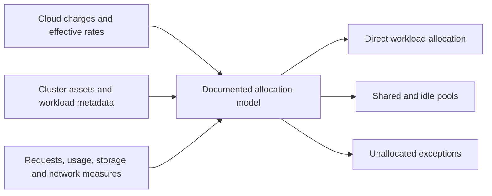

# Kubernetes cost allocation and idle capacity

Kubernetes labels and namespaces describe workload ownership, while the cloud bill usually contains nodes, disks, load balancers, network transfer, and managed-service fees. An allocation model connects these views; it does not create a second invoice. Keep the authoritative provider total and the internal distribution reconciled.[^finops-allocation]

## Build the ownership join

Use an agreed label dictionary for team, application/service, environment, and cost center, with explicit exception handling. FinOps Foundation's container-label guidance provides useful dimensions; choose values that match the organization's ownership registry rather than copying a vocabulary blindly.[^container-labels]

What it does: shows the bill and cluster data joining into one explainable distribution. Node charges are allocated to workloads; adding those workload allocations again to the node invoice would double-count the same cost.

## State the policy for each pool

| Pool | Example decision |
| --- | --- |
| Dedicated workload asset | Assign directly to its real owner. |
| Shared node resources | Use the selected allocation model's CPU, memory, GPU, and effective-rate rules. |
| Platform/system workloads | Central funding, proportional allocation, or another owned rule. |
| Idle/headroom | Keep visible; decide whether it is required resilience or avoidable excess. |
| Storage/network/shared services | Allocate with their own supported measurement; do not assume CPU share explains them. |
| Unknown ownership | Retain an explicit unallocated bucket and remediation owner. |

OpenCost defines a vendor-neutral model for measuring/allocating Kubernetes infrastructure costs and distinguishes asset/workload idle and shared costs. Shared costs may use uniform, proportional, or other agreed measures.[^opencost] Inspect the actual implementation/version and rate source before treating a dashboard as reconciled billing truth.

Requested capacity and measured usage answer different questions. Requests affect scheduling/reservation; usage shows observed demand. Lowering requests may improve packing, but does not reduce a fixed node bill unless capacity can actually be removed safely. Required failover, rollout surge, and autoscaling headroom should remain visible instead of being labeled waste automatically.

## Verify allocation and operational effect

For one representative period, reconcile cluster/provider charges, direct allocations, shared/idle pools, and unallocated items under a single cost basis. Handle Spot/commitment discounts consistently and avoid pricing every allocation at a public list rate while claiming invoice accuracy. Compare cost per useful workload unit alongside SLOs and peak capacity.

The synthetic lab distributes a shared pool using a deliberately chosen 3:1 weight and exact-cent reconciliation. That is a policy demonstration, not the OpenCost algorithm or evidence of a real cluster deployment. A live acceptance needs installed-tool/version evidence, representative metadata/metrics, billing reconciliation, and safe capacity-change validation.

This guide deploys no agent and changes no requests, labels, or nodes. A future sandbox should remove task-owned telemetry/tests after retaining required evidence, without deleting production workloads or the metadata that cost reporting depends on.

## Evidence and limits

Official sources reviewed on 2026-10-29. Examples use synthetic assumptions, not customer bills, current price quotations, or verified production savings. The local Decimal-based lab was executed with Python 3.13.17; AWS account queries, notifications, purchases, resource changes, and live optimization were not executed. These draft guides do not imply ownership approval or runtime evidence for an organization.

## Related routes

- [Observability signals](../kubernetes/observability/index.md).
- [Platform scaling tools](../kubernetes/applications-and-tools/platform-tooling/policy-security-and-scaling.md).
- [Shared-cost policy](cost-allocation-basics.md).
- [Back to this section](index.md)
- [Back to FinOps](index.md)

[^opencost]: [OpenCost specification](https://opencost.io/docs/specification/)
[^container-labels]: [FinOps Foundation — Container cost allocation labels](https://www.finops.org/wg/container-cost-allocation/)
[^finops-allocation]: [FinOps Foundation — Allocation](https://www.finops.org/framework/capabilities/allocation/)
