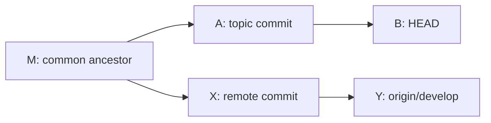

# Common Git use cases

## Outcome and starting point

Use this page to put **one small change on its own remote branch**
for review. You will update the base branch, create a topic branch,
inspect and commit one intended file, compare the topic with the
base, and push it. The example uses this knowledge base's `develop`
branch. In another repository, substitute its actual review base.

Start from a cloned repository with an `origin` remote, permission
to push a topic branch, and a clean working tree. Run commands from
the repository root. Read [Git fundamentals](../git-fundamentals.md)
first if working tree, index, commit, branch, or remote are new terms.
The `git switch` commands need Git 2.23 or later.[^git-switch]

| Location | What it contains before you push |
| --- | --- |
| Working tree | The files you can edit. |
| Index, also called staging area | The exact file versions selected for the next commit. |
| Local topic branch | Your new commits; they exist only locally until you push. |
| Remote topic branch | A copy of pushed commits that collaborators can review. |

A branch is a movable name for a commit. Making a local commit
does **not** publish it; `git push` sends it to the remote.
Pushing does **not** merge it into `develop`. A pull request is a feature
of the hosting service for proposing and reviewing the change; pushing
does not automatically approve one.[^git-commit][^git-push]
[^github-pull-requests]

## 1. Check the target and update the base

```bash
git status --short --branch
git remote -v
```

Stop if status shows file changes, or if `origin` is not the repository
you intend. Save unfinished work before switching branches.[^git-status]
Then:

```bash
git fetch origin
git switch develop
git pull --ff-only origin develop
```

`git fetch` updates your local knowledge of `origin`; it does not merge changes
into your current branch. The pull then updates local `develop`
only when it can fast-forward. If it reports divergent history,
stop. Inspect commits unique to local `develop` and to the last-fetched
`origin/develop`:

```bash
git log --oneline origin/develop..develop
git log --oneline develop..origin/develop
```

The first list may contain local work you need to preserve. The second
shows newer remote work as of the fetch. Do not reset or force push to
make the error disappear; save a branch for wanted local commits and
follow [Undo and recovery](../troubleshooting/undo-and-recovery.md) if
the branch needs repair.[^git-revisions]
[^git-fetch][^git-pull]

If you already have uncommitted work, save it deliberately or use
a separate worktree before switching. The short routes below show
where to learn those choices.

## 2. Create a topic branch and select one change

```bash
git switch -c topic/clearer-glossary
```

This creates and selects a **local** branch at the updated
`develop` commit. The branch name is an example; choose a name
that describes your change. It will fail if the branch already
exists.[^git-switch]

Now edit `knowledge/glossary.md` for this example. Before
staging, inspect exactly what you changed:

```bash
git status --short
git diff -- knowledge/glossary.md
git add -- knowledge/glossary.md
git diff --staged -- knowledge/glossary.md
```

The first diff shows the working-tree edit. `git add` copies
the current file version into the index. The staged diff shows
what the next commit will contain. If you edit the file again
after staging, inspect and stage it again; the staged copy does
not update itself.[^git-add][^git-diff]

Only commit after checking for unintended files and sensitive
content:

```bash
git status --short
git commit -m "Clarify glossary terms"
git status --short --branch
```

Expected result: the commit is on `topic/clearer-glossary`,
and `git status --short` shows no remaining changes if you
intended to include everything. A file left unstaged remains
outside that commit. The commit message is an example, not a
record of a change made by this guide.

## 3. Review the branch and publish it

```bash
git fetch origin
git diff --stat origin/develop...HEAD
git diff origin/develop...HEAD
git log origin/develop..HEAD --oneline
git status --short --branch
```

The three-dot **diff** compares the common ancestor with your branch
tip. The two-dot **log** lists commits reachable from your branch but
not from `origin/develop`. In the example below, a two-dot **diff**
from `origin/develop` to HEAD would compare Y with B and also show
the remote's X and Y changes in reverse. Dot notation answers a
different question in `diff` and `log`.[^git-diff][^git-revisions]
[^git-log]



Text alternative: topic commits A and B and remote commits X and Y
branch from shared commit M. `git diff origin/develop...HEAD` compares
M with B, showing the topic's file changes. `git log origin/develop..HEAD`
lists A and B because they are reachable from HEAD but not from the
remote branch. Check the file list, diff, and commit list before pushing.
Fetch first so `origin/develop` reflects the remote as of that fetch.
[^git-diff][^git-revisions]

```bash
git push -u origin HEAD
```

This publishes the current branch to `origin` and sets its
upstream, so a later push from the same branch can usually be
`git push`. Check the remote URL and branch name before the
first push; a push makes the commits visible to people with
access to that remote. Afterward, open a pull request against
the repository's required base branch, `develop` in this
example, and wait for its review and checks.[^git-push]
[^github-pull-requests]

If the remote rejects the push, read the error before retrying.
Authentication, permission, branch rules, or a changed remote
branch require different fixes. Avoid a force push as a
guess.

## Other common tasks

Use these routes when your goal is different from preparing one
reviewable branch:

| Goal | First safe move | Next route |
| --- | --- | --- |
| Start from an existing remote project | `git clone <repository-url>`; inspect the new remote and branch. | [Git fundamentals](../git-fundamentals.md). |
| Start tracking a folder with no Git history | Check its files and ignore rules before `git init` and selective staging. `git init` does not create a remote. | [Daily Git commands](daily-commands.md). |
| Pause tracked edits to switch tasks | Inspect `git status`, then `git stash push -m "reason"`. Add `-u` only when untracked files must be included; ignored files are still excluded. | [Git stash documentation](https://git-scm.com/docs/git-stash). |
| Work on two branches without moving unfinished changes | `git worktree add -b topic/other-task ../other-task develop` creates a separate directory and a new branch from `develop`. | [Git worktree documentation](https://git-scm.com/docs/git-worktree). |
| Undo a mistake | Inspect status, both diffs, and recent commits before selecting a recovery command. | [Undo and recovery](../troubleshooting/undo-and-recovery.md). |
| Find a specialized command | Start with the goal and the command's effects. | [Complete command catalog](complete-command-catalog.md). |

`git stash` is a temporary local store, not a backup shared with
the remote. Restoring a stash can conflict with later edits.
To resume, inspect `git stash list`, then inspect the selected entry
with `git stash show -p`, specifying its reference, for example
`git stash show -p 'stash@{1}'`. Recheck the list immediately before
`git stash apply` and again before any `git stash drop`: the number
can shift when another stash is created. Apply the selected reference,
then check files and status before dropping it. Plain `apply` does not
guarantee the original staged state; `--index` requests that too, and
can fail if it conflicts. Stashes are shared by this repository's
worktrees, so choose the entry by its list output rather than assuming
the latest one is yours.[^git-stash][^git-worktree]
The worktree command requires the example branch name and directory
to be unused; inspect `git worktree list` before creating one. A branch
already checked out in another worktree cannot normally be checked out
again. When the extra worktree is clean and no longer needed, remove it
with `git worktree remove ../other-task` rather than deleting its folder.
[^git-stash][^git-worktree]

## Verify your understanding

1. Which command changes your local `develop`, and which command
   only updates what you know about `origin`?
2. If you edit a file after `git add`, which version will the
   next commit contain until you stage again?
3. What do the three-dot diff and the branch-only log help you
   check before pushing?
4. After `git push -u origin HEAD`, which parts of the review
   and merge process are still ahead?

## Deeper study

- [Git switch](https://git-scm.com/docs/git-switch)
  for creating and selecting branches.
- [Git add](https://git-scm.com/docs/git-add) and
  [Git diff](https://git-scm.com/docs/git-diff)
  for the working-tree-to-index review.
- [Git push](https://git-scm.com/docs/git-push)
  for upstream tracking and publishing.
- [Revision ranges](https://git-scm.com/docs/gitrevisions)
  for two-dot log ranges and branch comparisons.
- [Git workflows](https://git-scm.com/docs/gitworkflows)
  for other team branching patterns.

[Back to Git commands](index.md)

[^git-fetch]: [Git - git-fetch](https://git-scm.com/docs/git-fetch).
[^git-status]: [Git - git-status](https://git-scm.com/docs/git-status).
[^git-pull]: [Git - git-pull](https://git-scm.com/docs/git-pull).
[^git-switch]: [Git - git-switch](https://git-scm.com/docs/git-switch).
[^git-add]: [Git - git-add](https://git-scm.com/docs/git-add).
[^git-diff]: [Git - git-diff](https://git-scm.com/docs/git-diff).
[^git-commit]: [Git - git-commit](https://git-scm.com/docs/git-commit).
[^git-push]: [Git - git-push](https://git-scm.com/docs/git-push).
[^git-log]: [Git - git-log](https://git-scm.com/docs/git-log).
[^git-stash]: [Git - git-stash](https://git-scm.com/docs/git-stash).
[^git-worktree]: [Git - git-worktree](https://git-scm.com/docs/git-worktree).
[^git-revisions]: [Git - Specifying revisions and ranges](https://git-scm.com/docs/gitrevisions), source record `git-revisions`.
[^github-pull-requests]: [GitHub Docs - About pull requests](https://docs.github.com/en/pull-requests/get-started/about-pull-requests), source record `github-pull-requests`.
