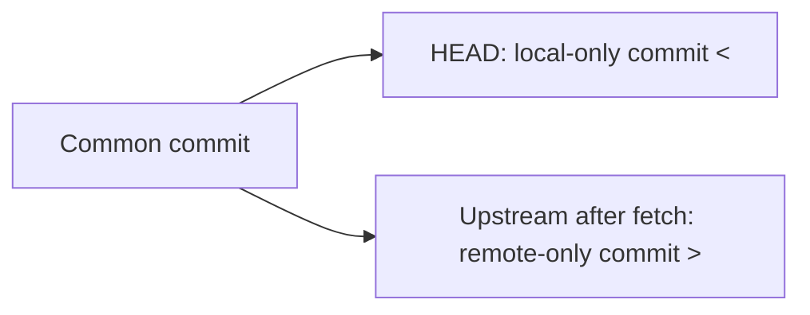

# Git troubleshooting commands

## Start with the question, not a fix

Use this page when Git behaves differently from what you expected:
a push is rejected, a file seems ignored, a merge stops, or the
repository may be damaged. The first job is to find **which
boundary** failed: your current branch, its upstream, the remote
repository, the index and working tree, or the object database.
This page gathers evidence; [Solve Git issues](solve-issues.md)
helps choose a recovery action after you know what happened.

From the affected repository, run:

```bash
git status
git branch -vv
git remote -v
```

Expected result: `git status` names the current branch, local edits,
and any unfinished merge or rebase. `branch -vv` shows each local branch's
tracking branch, if one exists. For example, this **illustrative** line
means local `main` tracks `origin/main` and the two have diverged:

```text
* main 7e8dc77 [origin/main: ahead 1, behind 1] Local edit
```

The name inside brackets identifies the tracking branch; a local branch
without brackets has no upstream. Match its remote name, `origin` here,
to a row in `git remote -v` to read that remote's fetch and push URLs.
The ahead/behind counts describe the last fetched view and may be stale.
These commands inspect local state; they do not fetch, merge, or push.
Be careful when sharing a remote URL from a private repository:
some URLs contain credentials or internal hostnames.[^git-status]
[^git-branch][^git-remote]

| Symptom | First question | Focused check |
| --- | --- | --- |
| Push was rejected | Is the remote or upstream wrong, or did the remote branch move? | [Branch and remote](#a-push-or-pull-uses-the-wrong-target-or-is-rejected). |
| A file does not appear, or appears despite `.gitignore` | Is the path already tracked? Which ignore rule matches it? | [Ignore and tracking](#a-file-is-missing-or-ignore-seems-broken). |
| Merge, rebase, or cherry-pick stopped | Which operation is active, and which paths are unmerged? | [Conflict](#an-operation-stopped-on-a-conflict). |
| Git reports missing or corrupt objects | Does the object database pass a read-only integrity check? | [Repository health](#git-reports-object-errors). |
| A commit or local edit seems lost | Was the branch tip moved, or was uncommitted content discarded? | [Undo and recovery](../troubleshooting/undo-and-recovery.md). |

## A push or pull uses the wrong target or is rejected

First read the exact error. An authentication failure, a protected
branch rule, and a non-fast-forward rejection require different
responses. Inspect the target before fetching:

```bash
git branch -vv
git remote -v
```

`branch -vv` shows tracking information for local branches;
`remote -v` shows fetch and push URLs. If the branch has no
upstream, a command using `@{upstream}` below will fail; stop
and decide which remote branch should be tracked. The upstream is
not necessarily the branch named in an explicit `git push` command:
compare the source and destination in the rejection message (for
example, `main -> main`) with the branch and remote you intended.
Ahead/behind counts still reflect the last fetch.[^git-branch]
[^git-remote]

If the URL and upstream are right, refresh your view and compare
the two histories. These commands assume the upstream is on
`origin`; use its actual remote name if yours differs:

```bash
git fetch origin
git log --left-right --graph --oneline HEAD...@{upstream}
```

`fetch` updates remote-tracking references; it does **not**
merge into the checked-out branch. The log marks commits on
each side of the symmetric difference `...`: `<` means reachable
only from local `HEAD`, and `>` means reachable only from its
upstream as of this fetch. A disposable repository produced this
**example output** after one commit was made on each side:

```text
< 7e8dc77 local edit
> 82a3bc5 remote edit
```



Text alternative: the two branches share an earlier commit. The local
branch has one commit marked `<`; the fetched upstream has a different
commit marked `>`. Neither branch includes the other's new commit yet.

Only `>` lines mean local `HEAD` is behind that upstream. Both markers
mean the histories diverged. Only `<` means local `HEAD` is ahead, so
a non-fast-forward rejection needs another explanation, such as a
different push destination or a remote update after the fetch. No lines
mean the two tips matched at the time of that fetch. If the server
reported permission or branch-rule denial, this graph does
not override that message. Do not force-push as a diagnostic.
[^git-fetch][^git-log]

For the safe branch-to-review path, use
[Common Git use cases](common-use-cases.md).

## A file is missing or ignore seems broken

Here, a file is "missing" when it exists on disk but does not appear in
Git status. Suppose `.gitignore` contains `build/`. Inspect whether
`build/output.txt` is tracked and which rule would match:

```bash
git status --short -- build/output.txt
git ls-files -- build/output.txt
git check-ignore -v --no-index -- build/output.txt
```

If `ls-files` prints the path, Git tracks it. A tracked file with an
unstaged edit might show this in short status:

```text
 M build/output.txt
```

An unchanged tracked file shows nothing. Think of `.gitignore` as a
filter for new files, not a way to remove a file Git already tracks.
The `--no-index` flag shows a rule that *would* match even for a
tracked path; it does **not** mean Git currently ignores that tracked
file. In a disposable repository, the matching-rule output was:

```text
.gitignore:1:build/    build/output.txt
```

Read it as rule file, line number, pattern, then path; Git separates
the pattern and path with a tab. A printed pattern starting with `!`
is a negation, meaning that rule makes the path *not* ignored. If
there is no match, `check-ignore -v --no-index` prints nothing and
exits with status 1.[^git-ls-files][^git-check-ignore]

If `ls-files` prints nothing, the path is not tracked. `??` in short
status means Git sees an untracked file; if status prints nothing but
the file exists, ask Git whether an ignore rule hides it:

```bash
git check-ignore -v -- build/output.txt
```

An ordinary `build/` match explains why the new file is absent from
status. A final negated match means Git does not ignore the path. Check
its exact spelling and case, then try
`git status --short --untracked-files=all -- build/output.txt` to see
whether the usual status settings hid an untracked file. Decide whether
the file should be versioned before changing tracking;
[Solve Git issues](solve-issues.md) covers the action after this diagnosis.

This example is about a generated file, not a credential.
If a secret was committed, removing it from current tracking
does not erase it from existing commits; rotate the secret and
follow the repository's incident process.

## An operation stopped on a conflict

```bash
git status
git diff --name-only --diff-filter=U
```

`status` names the in-progress operation and suggests its
next command. The filtered diff lists paths still marked
unmerged. In a disposable merge conflict, `git status` said
`both modified: config.txt` and the filtered diff printed
`config.txt`. Inspect the file and decide what the combined
content should be before staging a resolution. Staging with
`git add` marks a path resolved; it does not prove the content is
correct or remove conflict markers for you. After staging, an
empty filtered diff means no paths remain *marked* unmerged,
but `git status` may still say a merge, rebase, or cherry-pick
needs its `--continue` step. Review the content and run the
relevant checks before continuing.[^git-status][^git-diff]

Do not run `merge --abort`, `rebase --abort`,
`cherry-pick --abort`, or a reset
merely because the conflict feels surprising: first confirm
which operation you would abandon and whether you have
other edits to preserve. During a rebase, the meanings of
"ours" and "theirs" in conflict tools may be opposite to what
you expect; decide from the actual content and the operation
named by `git status`.[^git-rebase]

For recovery choices after inspection, use
[Undo and recovery](../troubleshooting/undo-and-recovery.md).

## Git reports object errors

When Git says an object is missing or corrupt, inspect the
local object database before attempting repair:

```bash
git fsck --full
```

This checks connectivity and validity of local objects; `--full`
is already the default but makes the scope explicit. It may take
time in a large repository. A line such as the following can appear
with a **zero** exit status; it reports an object outside Git's reachable
history as checked from references, reflogs, and the index. That alone
is not proof of corruption:

```text
dangling blob b38fff39566de31add5cdd9eecb217c86441a778
```

That example came from a disposable repository with an unreferenced
blob. Messages such as `missing` or `hash mismatch`, or a nonzero exit,
need investigation. Before repair or cleanup, preserve a copy of the
entire repository, including `.git`. Avoid `git gc`, `git prune`, and
`git reflog expire` until you understand which objects or history you
may need for recovery. A passing scan does not inspect working-tree
files, uncommitted edits, or the remote repository; it also cannot
explain a credential or service failure.[^git-fsck][^git-gc]

## Check your understanding

1. Why does `git fetch origin` help compare a rejected
   push without merging into your branch?
2. Why can a tracked file still appear even when its path
   matches `.gitignore`?
3. Which command tells you what operation is in progress
   before you consider an abort?
4. What does a failing `git fsck --full` establish, and
   what does a passing result leave unanswered?

## Deeper study

- [Git status](https://git-scm.com/docs/git-status),
  [branch](https://git-scm.com/docs/git-branch), and
  [remote](https://git-scm.com/docs/git-remote)
  for the local target and tracking model.
- [Git fetch](https://git-scm.com/docs/git-fetch)
  and [log](https://git-scm.com/docs/git-log)
  for comparing local and remote commits.
- [Git check-ignore](https://git-scm.com/docs/git-check-ignore)
  and [ls-files](https://git-scm.com/docs/git-ls-files)
  for ignore-rule versus tracked-file behavior.
- [Git fsck](https://git-scm.com/docs/git-fsck)
  for object integrity checks.
- [Git rebase](https://git-scm.com/docs/git-rebase)
  for conflict-side meanings during a rebase.
- [Git gc](https://git-scm.com/docs/git-gc)
  for cleanup and expiry behavior.

[Back to Git commands](index.md)

[^git-status]: [Git - git-status](https://git-scm.com/docs/git-status).
[^git-branch]: [Git - git-branch](https://git-scm.com/docs/git-branch).
[^git-remote]: [Git - git-remote](https://git-scm.com/docs/git-remote).
[^git-fetch]: [Git - git-fetch](https://git-scm.com/docs/git-fetch).
[^git-log]: [Git - git-log](https://git-scm.com/docs/git-log).
[^git-check-ignore]: [Git - git-check-ignore](https://git-scm.com/docs/git-check-ignore).
[^git-ls-files]: [Git - git-ls-files](https://git-scm.com/docs/git-ls-files).
[^git-diff]: [Git - git-diff](https://git-scm.com/docs/git-diff).
[^git-fsck]: [Git - git-fsck](https://git-scm.com/docs/git-fsck).
[^git-rebase]: [Git - git-rebase](https://git-scm.com/docs/git-rebase).
[^git-gc]: [Git - git-gc](https://git-scm.com/docs/git-gc).
