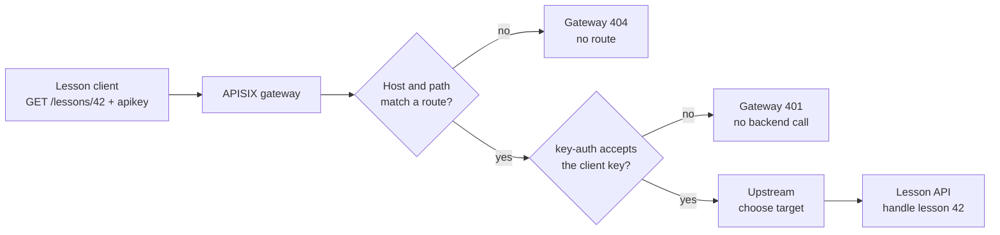
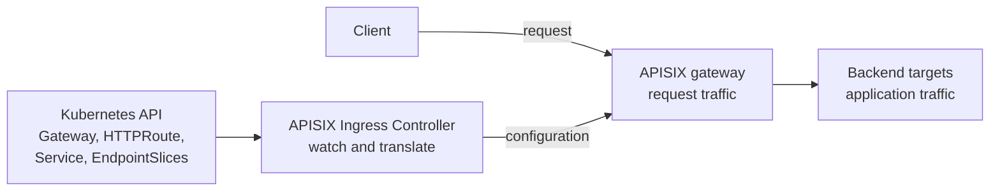

# What Apache APISIX does for an API

## The idea in one minute

An **API gateway** is an entry point in front of one or more backends.
Apache APISIX accepts a request, selects a **route**, applies configured
**plugins** at their relevant stages, and may send the request to an
**upstream** backend. A route says *which requests match*; an upstream
says *where matched requests go*.
Plugins can add behavior such as authentication, rate limits, or request
logging, but that behavior exists only when it is configured for the
relevant traffic. Different plugins can act before forwarding, on the
response, or during logging.[^apisix-route][^apisix-plugin]

Think of APISIX as a building lobby: it reads the address on a visitor's
invitation, may check a pass, and sends the request to an office. The
office still performs the actual work. The analogy stops at the network:
the client does not walk to the backend. APISIX forwards the request and
relays the response, can transform or reject requests, and can choose
among multiple backend targets.

## Follow one invented request

The names and paths below are **invented**. No gateway, route, request,
or backend was created or tested for this page.

A trusted lesson client sends `GET https://learn.example.com/lessons/42`
with a valid `apikey` request header. Typing that URL into a browser's
address bar would **not** send this key. Assume APISIX terminates HTTPS
with a certificate for that hostname before it routes the HTTP request;
otherwise a TLS failure could stop the request before the route or plugin.
[^apisix-certificate]

Suppose the team configured a route that matches host
`learn.example.com` and path prefix `/lessons`,
enabled the `key-auth` plugin for that route, created a Consumer with the
corresponding credential, set `hide_credentials: true` for the plugin,
and configured an upstream for the lesson API. That setting keeps the
client key from being forwarded to the lesson API; without it, APISIX's
default is to pass the key upstream.[^apisix-key-auth]
The route, plugin setting, Consumer credential, and upstream have distinct
jobs; the plugin may be bound to a route or another supported scope.
[^apisix-route][^apisix-plugin][^apisix-key-auth]

Text alternative: the lesson client sends a request with host, path, and
an API key. APISIX first looks for a matching route. Without one, this
example stops with a gateway `404`. On the matching route, `key-auth`
checks the key against an APISIX Consumer credential. A missing or invalid
key stops with `401` before the backend. With a valid key, the upstream
chooses a target and the lesson API handles lesson 42. This diagram shows
the access check, not every possible plugin stage.[^apisix-key-auth]
[^apisix-config-troubleshoot]

| Step | APISIX asks | Who owns the answer? |
| --- | --- | --- |
| Route | Does this request match the configured host and path? | APISIX routing configuration.[^apisix-route] |
| Plugin | Does this client key match a configured credential? | This route's `key-auth` setting and an APISIX Consumer credential.[^apisix-key-auth] |
| Upstream | Which configured target should receive the accepted request? | APISIX upstream configuration and, in Kubernetes, backend endpoint discovery.[^apisix-route][^apisix-resources] |
| Application | Does lesson 42 exist, and what response should the caller receive? | The lesson API. The gateway's client-key check does not by itself supply the application's user-authorization decision. |

A matching route and a valid client key do not prove that lesson 42 exists
or that a particular person may see it. The application owns those
decisions and needs the appropriate identity information if it enforces
person-level access. The APISIX Consumer identifies the **calling client**
here, not the person using it; the backend needs its own user identity
context if it makes per-person decisions.[^apisix-key-auth]

A `404` might come from APISIX because no route matched or from the
application because lesson 42 does not exist. A path mismatch is another
way to get an application `404`: without a rewrite, the backend sees
`/lessons/42`, so a backend expecting `/42` may reject it. In a Gateway API
route, an `HTTPRoute` `URLRewrite` filter can change the upstream path
when the installed controller supports it; APISIX also has its own
`proxy-rewrite` plugin. Configure and verify the actual route source.
[^gateway-rewrites][^apisix-proxy-rewrite][^apisix-gateway-api]
The [APISIX 404 guide](../troubleshooting/apisix.md) shows how to separate
those cases.

In this example, a missing key returns `401` from `key-auth` before the
lesson API is called.[^apisix-key-auth] A valid key can still lead to
an application `404` or a gateway error if the upstream cannot be
reached. The exact response depends on configured plugins and the actual
failing layer; use gateway and backend evidence before assigning ownership.

## Two paths in Kubernetes

When APISIX runs with its Ingress Controller, a **request path** and a
**configuration path** operate at the same time:[^apisix-controller]

Text alternative: live requests go from a client through the APISIX gateway
to backend targets. Separately, the APISIX Ingress Controller watches
Kubernetes routing objects and backend Service and EndpointSlice information
and translates them into gateway configuration. The controller is not an
extra hop in each client request. The arrow omits where configuration is
stored; the [architecture guide](apisix-architecture-and-deployment.md)
explains the deployment modes.

The Kubernetes authoring choices include standard `Ingress`, supported
Gateway API resources, and APISIX-specific custom resources. The
controller translates them into APISIX configuration. Gateway API support
is field-specific and version-sensitive, so check the current APISIX
[support table](https://apisix.apache.org/docs/ingress-controller/concepts/gateway-api/)
before relying on a field.[^apisix-controller][^apisix-gateway-api]

An `HTTPRoute` existing in Kubernetes does not mean every request can use
it. Its `parentRefs` must attach to an allowed Gateway listener, that
Gateway's class must be managed by the intended controller, and the
controller must apply the route to APISIX. For APISIX specifically,
confirm that its `GatewayProxy` connection settings identify the intended
gateway. Check the route's `status.parents` conditions, especially
`Accepted` and `ResolvedRefs`, then compare the applied gateway
configuration before blaming the lesson API. The
[APISIX 404 guide](../troubleshooting/apisix.md) gives the first checks;
the [architecture guide](apisix-architecture-and-deployment.md) explains
the configuration handoff.[^apisix-gateway-api][^apisix-resources]
[^apisix-config-troubleshoot]

A Kubernetes `Service` identifies an application backend; for an
`HTTPRoute`, `backendRefs` can name that Service. APISIX's own
**Service** object is a different gateway abstraction for sharing upstream
or plugin configuration. In Kubernetes, the Ingress Controller watches
`EndpointSlice` changes and APISIX can proxy directly to Pod endpoints
instead of sending to the Service's virtual IP. In the usual Kubernetes
Service path, kube-proxy programs node rules for that virtual IP; it is
not a separate server that carries each request. That is why the
simplified request diagram says *backend targets* rather than drawing
a Service as another machine.[^apisix-resources][^k8s-service-virtual-ips]

## What APISIX helps with

- **One entry point:** several APIs can use host and path rules to share a
  gateway, with each matched route leading to its chosen upstream.
  [^apisix-route]
- **Shared traffic policy:** configured plugins can enforce or observe
  behavior at the gateway, for example an API-key check or request log.
  They do not automatically implement application-specific permission
  rules.[^apisix-plugin]
- **Kubernetes-driven configuration:** teams can declare supported route
  resources in Kubernetes and let the Ingress Controller translate them.
  The gateway serves traffic; the controller keeps its configuration in
  step with the declared resources.[^apisix-controller]

APISIX adds a component to operate. The team still needs to decide where
TLS terminates, which configuration API the controller uses, who can
change routes and credentials, and how to verify a request through the
whole path. Continue to [how the gateway and controller fit together](apisix-architecture-and-deployment.md)
for those boundaries and to [request policies](apisix-security-traffic-and-observability.md)
for plugin placement.

## Check your understanding

1. In the lesson example, which part chooses the API backend, and which
   part decides whether lesson 42 exists?
2. If a Kubernetes `HTTPRoute` exists but APISIX has not received its
   configuration, which path in the second diagram needs investigation,
   and what attachment should you check first?
3. Does adding APISIX automatically require API keys for every route?
   What happens when this route receives a request without one?
4. Why can an `HTTPRoute` name a Kubernetes `Service` while APISIX sends
   the request directly to a Pod endpoint address?

## Explore further

- [Configure Routes](https://apisix.apache.org/docs/apisix/getting-started/configure-routes/)
  explains matching and upstreams.[^apisix-route]
- [Plugin](https://apisix.apache.org/docs/apisix/terminology/plugin/)
  explains how configured gateway behavior runs.[^apisix-plugin]
- [key-auth](https://apisix.apache.org/docs/apisix/plugins/key-auth/)
  shows Consumer credentials, the `apikey` header, and rejection behavior.
  [^apisix-key-auth]
- [APISIX Ingress Controller](https://apisix.apache.org/docs/ingress-controller/getting-started/get-apisix-ingress-controller/)
  explains how Kubernetes resources reach APISIX.[^apisix-controller]
- [Ingress Controller Resources](https://apisix.apache.org/docs/ingress-controller/concepts/resources/)
  explains Kubernetes Services, EndpointSlices, and APISIX resource types.
  [^apisix-resources]
- [Gateway API and Ingress](gateway-api-and-ingress.md) introduces those
  Kubernetes route APIs.
- [Back to Kubernetes applications and tools](index.md).

[^apisix-route]: [Apache APISIX, Configure Routes](https://apisix.apache.org/docs/apisix/getting-started/configure-routes/), source record `apisix-route`.
[^apisix-plugin]: [Apache APISIX, Plugin](https://apisix.apache.org/docs/apisix/terminology/plugin/), source record `apisix-plugin`.
[^apisix-controller]: [Apache APISIX, Get APISIX and APISIX Ingress Controller](https://apisix.apache.org/docs/ingress-controller/getting-started/get-apisix-ingress-controller/), source record `apisix-controller`.
[^apisix-resources]: [Apache APISIX, Ingress Controller Resources](https://apisix.apache.org/docs/ingress-controller/concepts/resources/), source record `apisix-resources`.
[^apisix-gateway-api]: [Apache APISIX, Gateway API support](https://apisix.apache.org/docs/ingress-controller/concepts/gateway-api/), source record `apisix-gateway-api`.
[^apisix-key-auth]: [Apache APISIX, key-auth](https://apisix.apache.org/docs/apisix/plugins/key-auth/), source record `apisix-key-auth`.
[^apisix-proxy-rewrite]: [Apache APISIX, proxy-rewrite](https://apisix.apache.org/docs/apisix/plugins/proxy-rewrite/), source record `apisix-proxy-rewrite`.
[^apisix-config-troubleshoot]: [Apache APISIX, Ingress Controller configuration troubleshooting](https://apisix.apache.org/docs/ingress-controller/reference/apisix-ingress-controller/configuration-troubleshoot/), source record `apisix-config-troubleshoot`.
[^gateway-rewrites]: [Gateway API, HTTP path redirects and rewrites](https://gateway-api.sigs.k8s.io/guides/user-guides/http-redirect-rewrite/), source record `gateway-rewrites`.
[^k8s-service-virtual-ips]: [Kubernetes, Virtual IPs and Service Proxies](https://kubernetes.io/docs/reference/networking/virtual-ips/), source record `k8s-service-virtual-ips`.
[^apisix-certificate]: [Apache APISIX, Certificate](https://apisix.apache.org/docs/apisix/certificate/), source record `apisix-certificate`.
