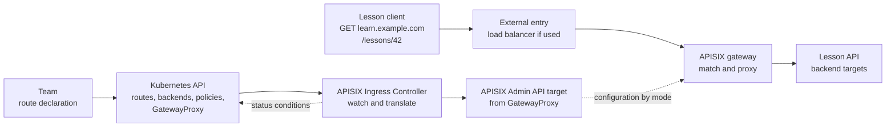

# How the APISIX gateway and controller fit together

## The idea in one minute

Two different programs usually appear in an APISIX installation on
Kubernetes. The **APISIX gateway** accepts client traffic and proxies it
to backends. The **APISIX Ingress Controller** watches supported Kubernetes
route resources and turns them into gateway configuration. The controller
configures the gateway; it is not an extra stop for each client request.
[^apisix-controller-architecture]

There is a separate question: **how APISIX itself receives and holds its
configuration**. APISIX documents traditional, decoupled, and standalone
deployment modes. That is separate from whether your team writes
`Ingress`, Gateway API routes, or APISIX custom resources in Kubernetes.
[^apisix-deployment-modes][^apisix-resources]

If you have not met routes and upstreams yet, begin with
[What Apache APISIX does for an API](apache-apisix.md).

## One service, two paths

Keep the invented lesson request from the introduction: a trusted client
sends `GET https://learn.example.com/lessons/42` with an API key. Suppose
an `HTTPRoute` and Gateway in namespace `lessons` match host
`learn.example.com` and path prefix `/lessons`, then name the
`lesson-api` Kubernetes Service in the same namespace. APISIX terminates
HTTPS for that hostname.
The earlier page's `key-auth` plugin and Consumer credential are still
assumed, but this diagram focuses on routing and configuration. Gateway
API users need APISIX-specific plugin and Consumer resources for that
policy; an `HTTPRoute` alone does not create it.[^apisix-controller-examples]
No gateway, controller, route, or backend was deployed or tested for this
example.

Text alternative: in the upper path, the lesson client's request reaches
an optional external entry, then the APISIX gateway, then lesson API
targets. In the lower path, the team submits routing and connection
resources to Kubernetes. The APISIX Ingress Controller translates them,
writes status back to Kubernetes, and sends changes to the APISIX Admin
API target named by `GatewayProxy` in this controller-integrated example.
In traditional mode that API can run on the serving APISIX instance; in
decoupled mode it belongs to a separate control plane. The paths
meet at the serving gateway; the controller is not in each client request.
The dotted arrow omits the mode-specific storage (etcd or memory); the
file-driven mode below is outside this Admin API handoff.
[^apisix-resources][^apisix-controller-examples]

The entry point and APISIX gateway must be reachable and listening on
the intended ports. A Gateway API `Gateway` listener declaration does not
make APISIX open a new data-plane port: the APISIX support table states
that the port must already be configured on the gateway. This example
keeps the introduction's TLS choice: APISIX terminates HTTPS with a
certificate referenced from an HTTPS Gateway listener. Another deployment
may terminate TLS earlier, so check the actual listener and certificate
path instead of inferring it from the diagram.[^apisix-gateway-api]

## What each Kubernetes object contributes

For the Gateway API path, the team can reason from the outside toward
the backend:[^apisix-gateway-api]

| Object | Question it answers | What it does not do |
| --- | --- | --- |
| `GatewayClass` | Which controller owns this family of Gateways? | It does not receive requests.[^gateway-api-gatewayclass] |
| `Gateway` | Which listeners exist, and which routes may attach? | It does not itself open an APISIX socket.[^apisix-gateway-api] |
| `HTTPRoute` | Which Gateway does this route request through `parentRefs`, and which host, path, and backend should match? | It does not prove an actual request reached APISIX. |
| APISIX `GatewayProxy` | Which APISIX configuration endpoint and credentials should the controller use? | It is a connection definition, not a client-traffic hop.[^apisix-resources] |
| Kubernetes `Service` and `EndpointSlice` | Which application backend and endpoints are discoverable? | They do not make an unmatched APISIX route match.[^apisix-resources] |

In the APISIX controller's current Gateway API examples, the `Gateway`
references a `GatewayProxy` through `spec.infrastructure.parametersRef`.
This invented example uses that association. Confirm which connection
settings the installed controller resolves and which Admin API target
they name; a correct `HTTPRoute` cannot configure the intended gateway
through the wrong target.[^apisix-controller-examples][^apisix-resources]

The controller also supports `Ingress` and APISIX-specific resources.
These offer different configuration surfaces; current Gateway API support
varies by resource and field. Check the
[APISIX support table](https://apisix.apache.org/docs/ingress-controller/concepts/gateway-api/)
for the installed controller version rather than assuming every field in
the Gateway API specification is implemented.[^apisix-resources][^apisix-gateway-api]

Read status from the outside inward:

1. Check the `GatewayClass` `spec.controllerName` against the intended
   APISIX controller and read its `Accepted` condition.[^gateway-api-gatewayclass]
2. On the `Gateway`, check listener protocol, port, hostname, and
   `allowedRoutes`; its listener status includes `attachedRoutes`.
   A route's hostname must intersect the listener's hostname, and a
   listener must allow that route's kind and namespace.[^gateway-api-gateway]
3. On the `HTTPRoute`, find `status.parents` for the intended Gateway.
   Read `Accepted` and `ResolvedRefs`, including reasons and messages.
   If the parent entry is **absent**, first check `parentRefs`, class
   ownership, and controller health: an invalid or out-of-scope parent
   may receive no status update at all.[^gateway-api-status]

Compare every relevant condition's `observedGeneration` with its
object's `metadata.generation`; an older observation describes an older
configuration. `Programmed` belongs on Gateway and listener status,
not as a standard `HTTPRoute` condition. Gateway API defines it as
configuration sent to a data plane, but it does not prove that this
APISIX instance loaded the route or that a user request succeeds.
Compare the controller's translated configuration with the gateway's
applied state when the live request disagrees with status.
[^gateway-api-implementation][^gateway-api-status]
[^apisix-config-troubleshoot]

## Where APISIX keeps its configuration

The deployment mode changes the *configuration* path, not the basic
purpose of the gateway. The current APISIX documentation describes these
modes. This review used APISIX runtime **3.19.0** and Ingress Controller
**v0.3.0** documentation; compare the behavior with your installed
versions.[^apisix-deployment-modes][^apisix-controller-architecture]

| Mode | Configuration and processes | Decision to make |
| --- | --- | --- |
| Traditional | One APISIX instance has data-plane and control-plane roles; etcd stores configuration and an Admin API can change it. | Who operates etcd, and how is the Admin API protected? |
| Decoupled | Separate APISIX control-plane and data-plane instances use etcd-backed configuration. The cited controller install guide does not demonstrate this topology. | Does the extra separation justify the extra components and recovery path? |
| Standalone, file-driven | APISIX loads local YAML or JSON configuration without etcd and checks the file for changes. This is outside the controller-to-Admin-API path shown above. | How is the complete file delivered and restored on every gateway instance? |
| Standalone, API-driven | A dedicated API supplies full configuration held in memory; APISIX starts empty until updated. The APISIX documentation calls this an emerging mode designed for its Ingress Controller, and its controller deployment page labels standalone mode experimental. | Does the installed controller and gateway version support the required behavior, and how is configuration restored after restart? |

This is a map of the documented modes, not a claim that one is best for
every cluster. For example, choosing a controller to read `HTTPRoute`
objects does not, by itself, specify which APISIX mode stores the resulting
configuration. Conversely, choosing standalone mode does not make every
Gateway API feature available.[^apisix-controller-architecture][^apisix-gateway-api]

### Follow the configuration handoff

The `GatewayProxy` identifies the connection the controller uses to
configure APISIX. In a traditional etcd-backed installation, that
connection reaches the APISIX Admin API; APISIX persists the change in
etcd. In a decoupled design, the Admin API belongs to the APISIX control
plane while the separate data plane serves client requests; the cited
controller install guide does not provide a decoupled recipe, so verify
support for the installed version before using this topology. In
standalone API-driven mode, the dedicated
`/apisix/admin/configs` endpoint receives the full configuration held in
memory. Every serving gateway replica must receive the intended
configuration; a single Service address does not prove that each replica
has it. The file-driven mode reads a local file instead and is outside
the controller integration shown in the diagram.
[^apisix-deployment-modes][^apisix-controller-architecture]
[^apisix-resources][^apisix-config-troubleshoot]

After a restart, the storage choice matters. An etcd-backed gateway can
read configuration from etcd again if that dependency is available; a
file-driven gateway reads its delivered file. An API-driven standalone
gateway starts with empty in-memory configuration until it receives an
update, so a new or restarted replica needs a successful synchronization
before it can serve the intended route. If the controller is unavailable
at the same time, that replica can have no matching routes even while
other replicas still serve old configuration. A controller outage does
not put the controller in each live request, but it can prevent new
route or endpoint changes from reaching gateways. Check the chosen mode's
restart and synchronization behavior in a disposable environment before
promising availability.[^apisix-deployment-modes]

The APISIX documentation warns against directly using the API-driven
standalone endpoint without understanding its internal behavior. Use the
current [controller installation guide](https://apisix.apache.org/docs/ingress-controller/install/)
and [deployment architecture](https://apisix.apache.org/docs/ingress-controller/concepts/deployment-architecture/)
for a particular version. Its current installation guide gives a
Kubernetes version prerequisite and separate Helm paths for traditional
and standalone controller integration; check those prerequisites before
planning a rollout.[^apisix-deployment-modes][^apisix-controller-install]

## Follow a failure to the responsible path

The first question is whether the problem is in **request delivery** or
**configuration delivery**. Do not begin by changing the route or the
gateway until you have evidence about the failing boundary.

| Observation | Investigate first | Why |
| --- | --- | --- |
| Client cannot connect to the intended address or port. | External entry, Service exposure, gateway listener, and TLS placement. | The request may never reach APISIX. |
| The `HTTPRoute` has no `status.parents` entry for the intended Gateway. | `parentRefs`, GatewayClass ownership, and controller health. | An out-of-scope or invalid parent may receive no status rather than an explicit rejection.[^gateway-api-status] |
| Kubernetes route exists, but its status rejects a parent or backend reference. | Listener attachment, hostname intersection, cross-namespace permission, backend reference, and controller messages. | The controller has reported a configuration problem.[^gateway-api-implementation] |
| The route is `Accepted`, but the intended APISIX instance has no matching route. | Controller sync logs, translated route, `GatewayProxy` target and credentials, Admin API reachability, and each gateway replica's applied state. | Kubernetes acceptance and configuration delivery are separate handoffs.[^apisix-config-troubleshoot][^apisix-resources] |
| APISIX received the request and returned `404`. | Exact host, path, method, attached route, and applied APISIX configuration. | A declared route does not prove this request matched it.[^apisix-gateway-api] |
| A protected route returns `401`, or unexpectedly accepts a request without a key. | The APISIX `PluginConfig` attachment, `key-auth` setting, and Consumer credential. | Gateway API route matching does not automatically apply the example's authentication policy.[^apisix-controller-examples] |
| Route matches, but the backend fails. | Backend `Service`, endpoints, application status, and gateway upstream behavior. | The request crossed the route boundary but may fail afterward.[^apisix-resources] |

[Trace an APISIX 404](../troubleshooting/apisix.md) is the focused path
for that symptom. [APISIX on EKS](../../cross-topic-guides/apisix-on-eks.md)
adds AWS load-balancer ownership to the same model. Those guides keep
environment-specific steps out of this architectural explanation.

## Check your understanding

1. The team creates an `HTTPRoute`. Which component reads it, and which
   component handles the client's HTTP request?
2. An `HTTPRoute` is `Accepted`, but APISIX has no matching route. What
   should the team inspect between the controller and the gateway?
3. What configuration can a file-driven gateway read after restart, and
   what must an API-driven standalone gateway receive again?
4. The Gateway reports `Programmed`, but a client cannot load a lesson. What
   evidence would show which request or configuration boundary failed?

## Explore further

- [APISIX deployment modes](https://apisix.apache.org/docs/apisix/deployment-modes/)
  explains the configuration choices and their mechanisms.
  [^apisix-deployment-modes]
- [Ingress Controller deployment architecture](https://apisix.apache.org/docs/ingress-controller/concepts/deployment-architecture/)
  explains how the controller configures APISIX.
  [^apisix-controller-architecture]
- [APISIX Gateway API support](https://apisix.apache.org/docs/ingress-controller/concepts/gateway-api/)
  lists supported resources and fields.[^apisix-gateway-api]
- [APISIX configuration troubleshooting](https://apisix.apache.org/docs/ingress-controller/reference/apisix-ingress-controller/configuration-troubleshoot/)
  separates translated controller state from applied gateway state.
  [^apisix-config-troubleshoot]
- [Gateway API implementer's guide](https://gateway-api.sigs.k8s.io/guides/implementers-guide/)
  explains the meaning and limits of status conditions.
  [^gateway-api-implementation]
- [Gateway API and Ingress](gateway-api-and-ingress.md) compares the
  Kubernetes authoring surfaces.
- [Back to Kubernetes applications and tools](index.md).

[^apisix-deployment-modes]: [Apache APISIX, Deployment modes](https://apisix.apache.org/docs/apisix/deployment-modes/), source record `apisix-deployment-modes`.
[^apisix-controller-architecture]: [Apache APISIX, Ingress Controller Deployment Architecture](https://apisix.apache.org/docs/ingress-controller/concepts/deployment-architecture/), source record `apisix-controller-architecture`.
[^apisix-controller-install]: [Apache APISIX, Install with Helm](https://apisix.apache.org/docs/ingress-controller/install/), source record `apisix-controller-install`.
[^apisix-gateway-api]: [Apache APISIX, Gateway API support](https://apisix.apache.org/docs/ingress-controller/concepts/gateway-api/), source record `apisix-gateway-api`.
[^apisix-resources]: [Apache APISIX, Ingress Controller Resources](https://apisix.apache.org/docs/ingress-controller/concepts/resources/), source record `apisix-resources`.
[^gateway-api-implementation]: [Gateway API, Implementer's Guide](https://gateway-api.sigs.k8s.io/guides/implementers-guide/), source record `gateway-api-implementation`.
[^gateway-api-gateway]: [Gateway API, Gateway](https://gateway-api.sigs.k8s.io/reference/api-types/gateway/), source record `gateway-api-gateway`.
[^gateway-api-gatewayclass]: [Gateway API, GatewayClass](https://gateway-api.sigs.k8s.io/reference/api-types/gatewayclass/), source record `gateway-api-gatewayclass`.
[^gateway-api-status]: [Gateway API, Troubleshooting and Status](https://gateway-api.sigs.k8s.io/docs/concepts/troubleshooting/), source record `gateway-api-status`.
[^apisix-controller-examples]: [APISIX Ingress Controller, Configuration Examples](https://apisix.apache.org/docs/ingress-controller/reference/apisix-ingress-controller/examples/), source record `apisix-controller-examples`.
[^apisix-config-troubleshoot]: [APISIX Ingress Controller, Configuration Troubleshooting](https://apisix.apache.org/docs/ingress-controller/reference/apisix-ingress-controller/configuration-troubleshoot/), source record `apisix-config-troubleshoot`.
