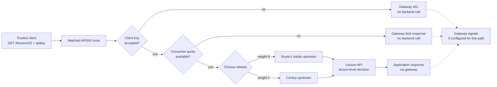

# How APISIX policies shape one request

## The idea in one minute

APISIX matches a request to a route, then runs the **plugins actually
configured** for that traffic. A plugin might identify a caller, reject
an over-limit request, select a release target, or record a signal.
Plugins are not automatically active just because APISIX is installed,
and their execution depends on the configured scope and phase.
[^apisix-plugin]

The gateway can answer questions such as "does this request carry a
recognized API key?" The application still answers a different question:
"may this user see lesson 42?" Keeping those questions distinct prevents
an authenticated API client from being mistaken for an authorized user.
The example below is **invented**; no request or policy was run for this
page.

Read [What Apache APISIX does for an API](apache-apisix.md) first for the
route and upstream model. This page follows a single route with optional
policy choices.

## A request can leave at more than one point

Continue the invented request from the introduction: a **trusted lesson
client** sends `GET https://learn.example.com/lessons/42` with an `apikey`
header. For the rejection branches below, imagine this same client also
making a request with a missing or wrong key. The valid key belongs to a
credential for APISIX Consumer `lesson-client`; `key-auth` is configured
with `hide_credentials: true`, so
the key is not forwarded to the backend. A public mobile app would not be
a safe place to keep this shared key, because users could extract it. The
route matches the host and `/lessons` prefix. The team is considering a
request quota, a small canary release, and gateway telemetry. These are
possible additions to the invented route, not a deployed configuration.
[^apisix-key-auth]

Text alternative: the trusted client request matches an APISIX route.
The configured key check can reject it with `401`. An accepted client may
then be stopped by its quota; neither rejection reaches the lesson API.
An allowed request goes to a stable or canary upstream. The lesson API
decides whether this caller may read lesson 42 and replies through the
gateway. Configured gateway metrics can cover those paths; a trace appears
only when that request is sampled and exported.

This is a **decision path for the proposed policy**, not a universal
execution order. APISIX plugins run in phases and priority order, and
global, Route, Service, and Consumer configurations can interact. Verify
that authentication sets the Consumer before a Consumer-keyed limit runs
in the effective configuration. A request ID or tracing work may run in
a different phase than the decision boxes suggest.[^apisix-plugin]

## Four different policy questions

| Question | APISIX capability in this example | Limit of the answer |
| --- | --- | --- |
| Which API client is calling? | `key-auth` checks a credential associated with an APISIX `Consumer` when enabled on a Route or Service.[^apisix-key-auth] | A valid key identifies that configured consumer. It does not prove which human is using the app or whether that human owns lesson 42. |
| How many requests are allowed in a window? | `limit-count` counts by a configured key and time window; `consumer_name` can identify the authenticated Consumer.[^apisix-limit-count] | The result depends on the counter key, route grouping, and storage policy; a per-gateway counter is not a cluster-wide quota. |
| Which release receives an allowed request? | `traffic-split` can choose among upstreams by condition or weight.[^apisix-traffic-split] | A weight is a routing instruction, not a guarantee that a small sample has that exact ratio or that a user stays on one release. |
| What can operators observe? | `request-id`, `prometheus`, or `opentelemetry` can add correlation, metrics, or tracing when configured.[^apisix-request-id][^apisix-prometheus][^apisix-opentelemetry] | A client may supply its own request ID, tracing can be unsampled, and gateway signals do not prove the lesson was correct. |

### Identity is not record authorization

To use `key-auth`, the team needs a configured `Consumer` and credential,
then enables the plugin on the appropriate route or service. APISIX checks
the key before proxying and can pass Consumer information to the backend.
The introduction's `hide_credentials: true` choice matters: the documented
default would forward the key to the backend.[^apisix-key-auth]
The lesson API must still decide whether the authenticated caller is
allowed to read this specific lesson.[^apisix-key-auth]

For an identity provider, the `openid-connect` plugin supports more than
one interaction pattern. Its `bearer_only` option changes whether it
strictly expects bearer access tokens; a configured authorization-code
flow can instead redirect a browser when authentication is needed. Its
documentation also has explicit issuer and audience-validation options.
A team must choose and test the intended token flow; the presence of an
OIDC plugin name alone does not define a complete access policy.
[^apisix-openid-connect]

Treat identity headers passed from the gateway as claims whose trust
depends on the network path. If a backend is reachable directly or a
client can supply the same header without a trusted gateway check, the
backend needs its own validation or a protected path. This follows from
the difference between a configured gateway check and an application
authorization decision; it was not tested here.

### A limit needs a key and a counter scope

The phrase "1,000 requests per minute" leaves two questions unanswered:
**per what key**, and **counted where**? The documented `limit-count`
defaults are `key_type: var` and `key: remote_addr`, so the default groups
requests by the address APISIX sees. In the lesson example, the team
could choose `key: consumer_name` with `key_type: var` to count requests
for Consumer `lesson-client` after successful key authentication. A
Consumer key is a client identity, not the identity of an individual
learner. Verify that it resolves on the actual requests; otherwise the
intended per-Consumer policy has no sound identity to count.
[^apisix-limit-count]

For a small illustrative quota, suppose the team configures **5 requests
in 60 seconds per Consumer**. On a single gateway instance, the sixth
authenticated `lesson-client` request in that same window would exceed
the counter's limit. A different Consumer would have a separate counter.
A `group` setting can
deliberately share a limit across routes; without that choice, do not
assume this route's counter also covers another route.
[^apisix-limit-count] The invented quota was not run against a gateway.

The current `limit-count` documentation says its default `local` policy
keeps a separate counter on each APISIX instance. With traffic spread
across replicas, the aggregate can approach the configured limit times
the number of instances; a client pinned to one instance may reach only
that instance's limit. Redis-backed policies share counters across
instances. Those modes have different
availability and operating costs; select one for the actual quota
requirement. For Redis-backed limits, the documented `allow_degradation`
setting controls whether a counter-backend failure lets requests continue
without rate limiting or returns an error; its default is to return an
error.[^apisix-limit-count]

An over-limit response is not necessarily `429`. The APISIX 3.19.0
documentation lists `503` as the default `rejected_code`; the team could
configure `429` for a clearer quota response if that fits its API
contract. A gateway `503` from a limit and a `503` from another failure
cannot be separated by status-code metrics alone. Inspect the configured
plugin response and gateway evidence.[^apisix-limit-count] A
Consumer-keyed quota also cannot identify an unrecognized key as
`lesson-client`. In the proposed decision path, key authentication
rejects such requests before the Consumer quota. Do not assume another
limiter attached to that same route will see them; design protection at
an earlier entry boundary and verify it with invalid-key requests.

### A traffic split needs measured outcomes

Suppose the stable lesson API is the route's existing upstream. In the
documented APISIX canary pattern, a split entry names an alternative
upstream and another entry has only a weight, leaving that share on the
route's existing upstream. Here the canary entry has **weight 1** and
the route's stable upstream has **weight 9**. This 1:9 ratio expresses an
intended share of allowed requests, not a promise that exactly one of
every ten requests reaches the canary.[^apisix-traffic-split]

This policy would select a release **after** the proposed Consumer quota
accepts a request. Both releases therefore draw from the same
per-Consumer counter for this route; an over-limit request never needs a
release selection. APISIX warns that its round-robin weighted selection
can produce less accurate observed ratios, especially after state
resets. A weight does not prove the new backend is healthy or that a
learner's journey succeeds.
Compare per-version requests, errors, latency, and an actual lesson-read
path before increasing the share. An upstream-node metric label is an
address, not a release name; map changing backend addresses to versions
or use an application signal that names the version.[^apisix-traffic-split]
[^apisix-prometheus]

When the APISIX Ingress Controller owns the route, express supported
plugin settings through the controller's resources, such as a
`PluginConfig` referenced by an `HTTPRoute`, plus a separate `Consumer`
resource for the client credential. Direct Admin API edits to
controller-owned configuration may be replaced
by the next reconciliation. Check installed controller support for the
chosen split and upstream fields.[^apisix-controller-resources]

### Telemetry needs deliberate configuration

The `request-id` plugin generates an ID or reuses a non-empty incoming
one. A caller can therefore choose a value; do not treat it as guaranteed
unique or as proof of identity. The APISIX 3.19.0 documentation says
gateway access and error logs carry NGINX's `$request_id` without the
plugin; enabling the plugin changes the logged ID and can forward its
chosen value upstream and in the response. Join gateway and lesson API
records only after confirming that both systems record the
same field and value.[^apisix-request-id]

The Prometheus plugin collects gateway request, status, and latency
metrics when enabled for the relevant traffic. Its route, response-code,
and upstream-node labels can help distinguish gateway rejections from
requests sent to a backend node, but a rejected request has no selected
upstream node. A node label is an address; map it to the stable or canary
version before using it as release evidence. Confirm that the metric
scope covers the failing path and that a collector actually scrapes the
endpoint.[^apisix-prometheus]

The OpenTelemetry plugin needs more than its name on a route: the
documented sampler defaults to `always_off`. Collector settings are a
separate configuration concern, and the collector must be reachable.
The team must choose a sampling policy and verify exported spans. The
lesson API needs its own instrumentation and
trace propagation before a gateway trace can explain the application's
decision. None of these telemetry plugins automatically records that
lesson 42 was correct or useful to the reader.[^apisix-opentelemetry]

## Use the first missing signal

| Observation | First question | Next evidence |
| --- | --- | --- |
| Gateway rejects the request before the lesson API sees it. | Which configured authentication or limit plugin made the decision? | Effective route/plugin configuration and gateway response. |
| Repeated wrong keys produce `401` while the Consumer quota stays unchanged. | Does the protection also cover requests without an authenticated Consumer? | Effective plugin scope and a separate invalid-key protection design. |
| Request reaches the lesson API, which returns `404` or `403`. | Did the application reject this lesson or user? | Application response and logs tied to the same request. |
| New release receives unexpected traffic. | What match and weight did `traffic-split` actually use? | Per-version request counts and user-path results.[^apisix-traffic-split] |
| No gateway metric or span appears for a failing client. | Did the client reach APISIX, and did this path have an enabled metric scope or a sampled, exportable trace? | External entry and gateway access evidence, plugin scope, sampler, scrape or collector health.[^apisix-prometheus][^apisix-opentelemetry] |

For route matching rather than policy, use
[Trace an APISIX 404](../troubleshooting/apisix.md). For where the
Ingress Controller and gateway run, use
[How the APISIX gateway and controller fit together](apisix-architecture-and-deployment.md).

## Check your understanding

1. Why can a valid API key still lead to a lesson being denied by the
   application?
2. If two APISIX replicas each use the default local `limit-count`
   policy, is a configured limit automatically global?
3. What does a `traffic-split` weight say, and what outcome must still
   be measured?
4. Why is a request ID not proof of identity, and why might an enabled
   OpenTelemetry plugin still export no traces?

## Explore further

- [APISIX plugins](https://apisix.apache.org/docs/apisix/terminology/plugin/)
  explains phases, scope, and precedence.[^apisix-plugin]
- [key-auth](https://apisix.apache.org/docs/apisix/plugins/key-auth/)
  explains Consumers, credentials, and route enablement.[^apisix-key-auth]
- [limit-count](https://apisix.apache.org/docs/apisix/plugins/limit-count/)
  documents key choice, local and Redis counters, and rejected responses.
  [^apisix-limit-count]
- [traffic-split](https://apisix.apache.org/docs/apisix/plugins/traffic-split/)
  describes conditional and weighted upstreams.[^apisix-traffic-split]
- [prometheus](https://apisix.apache.org/docs/apisix/plugins/prometheus/)
  and [opentelemetry](https://apisix.apache.org/docs/apisix/plugins/opentelemetry/)
  show how gateway signals are enabled and exported.
  [^apisix-prometheus][^apisix-opentelemetry]
- [Back to Kubernetes applications and tools](index.md).

[^apisix-plugin]: [Apache APISIX, Plugin](https://apisix.apache.org/docs/apisix/terminology/plugin/), source record `apisix-plugin`.
[^apisix-key-auth]: [Apache APISIX, key-auth](https://apisix.apache.org/docs/apisix/plugins/key-auth/), source record `apisix-key-auth`.
[^apisix-openid-connect]: [Apache APISIX, openid-connect](https://apisix.apache.org/docs/apisix/plugins/openid-connect/), source record `apisix-openid-connect`.
[^apisix-limit-count]: [Apache APISIX, limit-count](https://apisix.apache.org/docs/apisix/plugins/limit-count/), source record `apisix-limit-count`.
[^apisix-traffic-split]: [Apache APISIX, traffic-split](https://apisix.apache.org/docs/apisix/plugins/traffic-split/), source record `apisix-traffic-split`.
[^apisix-request-id]: [Apache APISIX, request-id](https://apisix.apache.org/docs/apisix/plugins/request-id/), source record `apisix-request-id`.
[^apisix-prometheus]: [Apache APISIX, prometheus](https://apisix.apache.org/docs/apisix/plugins/prometheus/), source record `apisix-prometheus`.
[^apisix-opentelemetry]: [Apache APISIX, opentelemetry](https://apisix.apache.org/docs/apisix/plugins/opentelemetry/), source record `apisix-opentelemetry`.
[^apisix-controller-resources]: [Apache APISIX, Ingress Controller Resources](https://apisix.apache.org/docs/ingress-controller/concepts/resources/), source record `apisix-controller-resources`.
