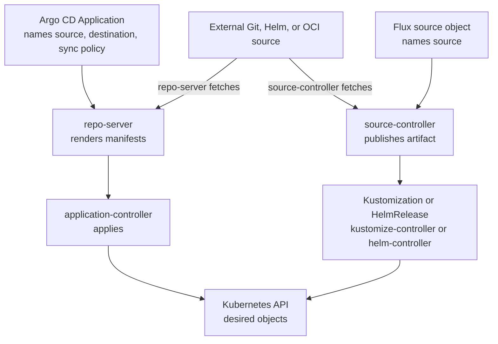

# Argo CD vs. Flux

## Purpose

Use this page to compare Argo CD and Flux on differences their own
documentation states, and to turn those differences into questions about your
own constraints. After reading it you should be able to explain a choice
between them, or a split between them, in terms of evidence.

The page does not name a winner. It assumes the model in [GitOps](gitops.md)
and the Flux parts described in [Flux](flux.md).

## What is being compared

Argo CD and Flux are both open-source tools that run in Kubernetes, fetch a
description of what should run, and reconcile a cluster toward it. They
implement the same operating model. They differ in how they package it: what
object represents "an application", which components you run, how people
interact with them, and what their defaults are.

Text alternative: both tools fetch from an external source; the source does
not push into the cluster. Argo CD groups a source, destination, and sync
policy in an `Application`. Its repo-server renders manifests and its
application controller applies them. Flux gives a source its own object and artifact;
kustomize-controller or helm-controller then reconciles a `Kustomization` or
`HelmRelease`. Both paths send desired objects to the Kubernetes API. The
diagram shows the main handoff, not every controller or credential involved.
[^argo-cd-architecture][^flux-components]

## Why it matters

Comparisons of these tools are often reduced to slogans, such as "one has a
UI" or "one is closer to Git". Slogans hide the facts that decide a real
choice: Argo CD can run without its UI, Flux can be used with a UI from
another project, and both reconcile from Git and from OCI registries.

The costly mistakes come from unexamined defaults. A team that moves from one
tool to the other and assumes the same pruning or drift behaviour can delete
resources it meant to keep, or keep a hand edit it expected to be reverted.

## Documented differences

Read each row as "what the documentation says", not as a score.

| Aspect | Argo CD | Flux |
| --- | --- | --- |
| What represents an application | An `Application` object: usually one source, optionally several, plus a destination cluster and namespace.[^argo-cd-declarative-setup][^argo-cd-multiple-sources] | No required all-in-one `Application` object. A source object is fetched into an artifact, and a `Kustomization` or `HelmRelease` reconciles it.[^flux-components] |
| Where desired state can come from | Git repositories holding Kustomize, Helm, Jsonnet, or plain manifests; Helm chart repositories; OCI images; and custom plugins.[^argo-cd-application-sources][^argo-cd-helm][^argo-cd-oci] | Common source objects include GitRepository, OCIRepository, HelmRepository, and Bucket; Flux also has generated chart and artifact objects.[^flux-components] |
| Main control components | The API server, repository server, and application controller have distinct roles.[^argo-cd-architecture] A separate core installation omits the API server and UI.[^argo-cd-installation] | source-controller and kustomize-controller are the minimum; helm-controller and notification-controller are added by default. Optional extras include image automation and source-watcher.[^flux-optional-components] |
| How people operate it | Through the API server, which serves a web UI, a CLI, and CI systems, with its own sign-on and access rules.[^argo-cd-architecture][^argo-cd-overview] In the core installation, through Kubernetes objects and Kubernetes access rules.[^argo-cd-installation] | Through Kubernetes custom resources, created by a user or by other automation.[^flux-components] The project ships no UI of its own and points to UIs from other projects.[^flux-faq] |
| Applying a new revision | Manual unless an automated sync policy is set on the application.[^argo-cd-automated-sync] | A `Kustomization` reconciles a new source revision and on its interval until suspended. A `HelmRelease` also reacts to a new chart artifact.[^flux-kustomization][^flux-helmrelease] |
| Pruning removed resources | Automatic pruning is off by default; a manual sync may still prune when selected.[^argo-cd-automated-sync] | `prune` is required on a `Kustomization`, so the author must choose. Deleting a `HelmRelease` is a separate uninstall path.[^flux-kustomization][^flux-helmrelease] |
| Reverting hand edits | Self-heal is off by default. A hand edit is reported as OutOfSync but does not alone trigger an automated sync; a later sync can overwrite it.[^argo-cd-automated-sync] | A `Kustomization` corrects drift on each interval.[^flux-kustomization] A `HelmRelease` needs drift detection enabled for that behaviour.[^flux-helmrelease] |
| Health | Built-in checks for standard resource types; custom checks can be configured. Application health reflects its immediate child resources, not every descendant.[^argo-cd-resource-health] | A `Kustomization` waits for health only when `healthChecks` or `wait` is set. A `HelmRelease` waits for its resources by default during Helm actions.[^flux-kustomization][^flux-helmrelease] |
| Using a Helm chart | Argo CD renders the chart with `helm template`; Argo CD manages the applied Kubernetes objects rather than a Helm release lifecycle.[^argo-cd-helm] | A `HelmRelease` asks helm-controller to perform Helm install and upgrade actions with a chart artifact.[^flux-helmrelease] |
| Reaching other clusters | A destination is part of each `Application`. Credentials for other clusters are stored as Secrets in Argo CD's cluster.[^argo-cd-declarative-setup] An `ApplicationSet` can target many clusters from one manifest.[^argo-cd-applicationset] | A `Kustomization` or `HelmRelease` can carry a `kubeConfig` reference to apply to a remote cluster.[^flux-kustomization][^flux-helmrelease] |
| Limiting what a team can deploy | An `AppProject` restricts sources, destinations, and kinds, but the `default` project is permissive and project rules do not narrow the underlying cluster credential. Optional sync impersonation is beta and off by default.[^argo-cd-projects][^argo-cd-sync-impersonation] | A `Kustomization` and a `HelmRelease` can each name a service account. Without one or an enforced default account, their controllers can apply with cluster-admin authority.[^flux-multitenancy] |

Both tools can also be installed in the cluster they manage, so that each
cluster reconciles itself and no cluster holds another's
credentials.[^argo-cd-installation][^flux-installation] Whether one
central installation or one per cluster is better is an architecture
question; see [Tooling clusters](tooling-clusters.md).

### Reading the rows about defaults

The three rows on applying, pruning, and reverting are the ones to check
first when you adopt or migrate. Here is what the same event means for an
Argo CD `Application` without automated sync and a Flux `Kustomization`
with its required `prune` choice:

| Event | Argo CD application default | Flux `Kustomization` |
| --- | --- | --- |
| A new source revision arrives. | Reports OutOfSync and waits for a sync. | Reconciles the revision when the source is available. |
| Someone changes a managed field in the cluster. | Reports OutOfSync; that edit alone does not trigger sync. A later sync can overwrite it. | Corrects the difference on a later reconciliation, unless suspended or configured to ignore it. |
| A managed manifest disappears from the source. | Does not prune it automatically; a manual sync can prune it if selected. | Removes it only when `prune: true`; the author must set `prune`. |

These are controller behaviours, not proof that a workload works. A Flux
`HelmRelease` also has its own upgrade, uninstall, and optional drift rules.
Deleting the reconciliation object itself follows a different path: an Argo
CD `Application` can cascade to its resources through a finalizer; a Flux
`Kustomization` uses its deletion policy, which defaults to mirroring
`prune`; deleting a `HelmRelease` starts a Helm uninstall. Review those
rules separately from removing a manifest.
[^argo-cd-app-deletion][^flux-kustomization][^flux-helmrelease]

Both can be configured toward the other's behaviour. Neither default is
safer in general: one favours a human decision before change, the other
favours the cluster always matching the source.

### Operational overhead

The documentation supports statements about the main roles, not a complete
Pod count or how much effort an installation costs. Check the actual install
manifests and optional components for the version you would run.

- Argo CD's usual installation is a multi-tenant one that is typically
  maintained by a platform team, and the project recommends its
  high-availability manifests for production.[^argo-cd-installation] Its API
  server is a network service with its own authentication and access rules,
  which is extra surface to secure and also the feature that lets people
  work without cluster credentials.[^argo-cd-architecture]
- Flux's default installation is four controllers and no user-facing
  server.[^flux-optional-components] Access to it is access to the Kubernetes
  API, so whoever needs to see or change Flux objects needs Kubernetes
  permissions.

Which of these is "less overhead" depends on what your organisation already
runs. Neither project's documentation measures it, and this page does not
either.

## Example: one team's decision

This scenario is illustrative. The organisation and its constraints are
invented, and no evaluation was run. It shows a method, and its outcome
applies only to the stated constraints.

A three-person platform team at a fictional company, Tidewater, runs a
staging and a production cluster for eight application teams. They write down
their constraints before looking at either tool.

| Constraint | What the documentation says | Effect on the decision |
| --- | --- | --- |
| Application developers have no access to the production Kubernetes API, and must still see what is deployed and whether it is healthy. | Argo CD's API server and UI have their own sign-on and access rules.[^argo-cd-overview] Flux is operated through Kubernetes objects and ships no UI.[^flux-faq] | Favours Argo CD's multi-tenant installation, unless the team adds a separate UI or grants read access to the cluster. |
| A controller outside production must not have production deployment authority. | Either tool can run inside each cluster and reconcile that cluster.[^argo-cd-installation][^flux-installation] | Neutral. The team chooses a local installation in each cluster. |
| Removing a plain Kubernetes manifest from production source must not automatically delete its live object. | Argo CD does not prune under automated sync by default.[^argo-cd-automated-sync] Flux requires an explicit `prune` value on a `Kustomization`.[^flux-kustomization] | Neutral for this plain-manifest case. Helm chart upgrades and deletion of controller objects need their own review.[^argo-cd-app-deletion][^flux-helmrelease] |
| Each team may deploy only to its own namespaces. | Argo CD projects can restrict destinations, but `default` is permissive and the underlying cluster credential needs separate review.[^argo-cd-projects][^argo-cd-sync-impersonation] Flux can impersonate scoped accounts, but its apply controllers are broadly privileged by default.[^flux-multitenancy] | Neutral. Neither tool's default tenant setup enforces this; the platform must configure and test the boundary. |
| A hand edit during an incident must not be silently reverted or silently kept. | Argo CD reports OutOfSync without self-healing by default, but a later sync can overwrite the edit.[^argo-cd-automated-sync] A Flux `Kustomization` corrects drift unless suspended or configured to ignore it.[^flux-kustomization] | Neutral, but it requires an incident procedure that fits the chosen tool. |

Four of the five constraints do not separate the tools. The first one does,
so the team chooses Argo CD, installed in each cluster, with restricted
projects and UI roles for each application team and automatic pruning left
off in production. They must still protect who can change each project or
`Application`, inspect the actual cluster credential or configured sync
impersonation, and test allowed and denied deployments. The
[GitOps security page](gitops-security-and-multitenancy.md) traces those
checks; a comparison table cannot establish a tenant boundary.

What would change the answer:

- If developers already had read access to the production API, the first
  constraint would be met by Kubernetes itself, and the choice would turn on
  other things, such as which resource model the team finds clearer.
- If the security team objected to running another authenticated network
  service, Flux or Argo CD's core installation would fit better, and the
  visibility need would have to be met some other way.

Before committing, the team would still need a trial on the staging cluster.
A comparison of documentation does not show how either tool behaves with
their charts, their access rules, or their people.

## Using both

The two tools can run in the same cluster. The condition is that no resource
is managed by both.

Why overlap conflicts: each tool holds its own intended state for the
resources it manages and applies it. If both manage one Deployment from
different sources, each sees the other's result as a difference from its own
intent. With drift correction active on both sides, they overwrite each other
in turn. With it active on one side only, the other reports the resource as
out of sync indefinitely. This conclusion is reasoned from each tool's
documented behaviour; neither project documents the two running against the
same resource.

The same problem exists inside one tool, which is some evidence that it is
real. Argo CD has a sync option that fails a sync when a resource is already
applied by another `Application`.[^argo-cd-sync-options]

A workable split gives each tool whole, separate areas, for example:

- by cluster: one tool per cluster;
- by namespace: platform add-ons under one tool, application namespaces under
  the other;
- by layer: one tool installs and configures the other, and then manages
  nothing that the second tool manages.

Write the split down. The failure this prevents is two tools each being
correct about a different intended state.

### An analogy: two editors, one paragraph

Two editors each hold a master copy of a document and each restores the
shared file to match their copy whenever they look at it. If their copies
differ in one paragraph, that paragraph changes every time either of them
looks.

Where the analogy stops being accurate:

- **Editors would talk.** Two controllers do not negotiate, and neither
  project's documentation describes detecting the other.
- **The fix is ownership, not agreement.** Making the two copies identical is
  fragile, because they diverge at the next change. Assigning each paragraph
  to one editor is what holds.
- **Not every controller restores.** Whether a tool reverts a difference
  depends on its self-heal or drift settings, so the symptom may be a
  permanent "out of sync" report instead of a change that flips back and
  forth.

## Common misconceptions

- **"Argo CD is the one with the UI, so Flux is for people who do not want
  one."** Argo CD has an installation without the UI, and other projects
  provide UIs for Flux.
- **"Flux is Git-native and Argo CD is not."** Both reconcile from Git, and
  both can use OCI registries.[^argo-cd-oci][^flux-components]
- **"They behave the same once installed."** Their defaults for applying,
  pruning, and reverting differ.
- **"One is for small teams and one for large."** Nothing in either project's
  documentation supports a size rule.

## Check your understanding

- A team migrates a workload from a Flux `Kustomization` to an Argo CD
  application and changes no settings. Name two behaviours that may now
  differ.
- In the Tidewater scenario, which constraint decided the outcome, and what
  single change would have made it neutral?
- Both tools manage the same ConfigMap from different repositories, and only
  one of them corrects drift. What do you expect each to report?
- Why is "make both repositories contain the same manifest" a weaker fix than
  assigning the resource to one tool?

Answer hints: on migration, a new commit may wait for manual Argo CD sync,
and a hand edit may remain OutOfSync until another sync. The Tidewater choice
turned on developer visibility without production API access; read access
or a separate UI could change that. With overlapping ownership, the tool
that corrects drift can restore its copy while the other reports OutOfSync.
Identical copies are fragile because the next change can make them differ.

## Next steps

- The shared operating model: [GitOps](gitops.md).
- Flux's controllers and status signals: [Flux](flux.md) and
  [How Flux applies a HelmRelease from Git](flux-reconciliation-and-helm.md).
- Projects, service accounts, and tenancy in both tools:
  [GitOps security and multi-tenancy](gitops-security-and-multitenancy.md).
- One installation or many: [Tooling clusters](tooling-clusters.md).
- An applied route on AWS: [GitOps on EKS](../../cross-topic-guides/gitops-on-eks.md).

## Official documentation for deeper study

- Argo CD's components: [Argo CD - Architectural Overview](https://argo-cd.readthedocs.io/en/stable/operator-manual/architecture/).
- Multi-tenant and core installations: [Argo CD - Installation](https://argo-cd.readthedocs.io/en/stable/operator-manual/installation/).
- Applications, projects, and cluster credentials as objects: [Argo CD - Declarative Setup](https://argo-cd.readthedocs.io/en/stable/operator-manual/declarative-setup/).
- Combining sources within one application: [Argo CD - Multiple Sources for an Application](https://argo-cd.readthedocs.io/en/stable/user-guide/multiple_sources/).
- Argo CD with [Helm chart repositories](https://argo-cd.readthedocs.io/en/stable/user-guide/helm/)
  or [OCI sources](https://argo-cd.readthedocs.io/en/stable/user-guide/oci/).
- Automated sync, pruning, and self-heal: [Argo CD - Automated Sync Policy](https://argo-cd.readthedocs.io/en/stable/user-guide/auto_sync/).
- How health is computed: [Argo CD - Resource Health](https://argo-cd.readthedocs.io/en/stable/operator-manual/health/).
- Restricting sources and destinations: [Argo CD - Projects](https://argo-cd.readthedocs.io/en/stable/user-guide/projects/).
- Optional [Argo CD sync impersonation](https://argo-cd.readthedocs.io/en/stable/operator-manual/app-sync-using-impersonation/)
  and [Flux multi-tenancy lockdown](https://fluxcd.io/flux/installation/configuration/multitenancy/).
- Flux's controllers and resource types: [Flux - GitOps Toolkit components](https://fluxcd.io/flux/components/).
- Pruning, drift correction, health checks, impersonation, and remote clusters: [Flux - Kustomization](https://fluxcd.io/flux/components/kustomize/kustomizations/).
- Helm drift detection: [Flux - HelmRelease](https://fluxcd.io/flux/components/helm/helmreleases/).
- Default and extra controllers: [Flux - Optional components](https://fluxcd.io/flux/installation/configuration/optional-components/).

## Related links

- [GitOps](gitops.md)
- [Flux](flux.md)
- [Back to Kubernetes applications and tools](index.md)
- [Back to Kubernetes index](../index.md)
- [Back to knowledge index](../../index.md)

[^argo-cd-overview]: [Argo CD - Overview](https://argo-cd.readthedocs.io/en/stable/), source record `argo-cd-overview`.
[^argo-cd-architecture]: [Argo CD - Architectural Overview](https://argo-cd.readthedocs.io/en/stable/operator-manual/architecture/), source record `argo-cd-architecture`.
[^argo-cd-installation]: [Argo CD - Installation](https://argo-cd.readthedocs.io/en/stable/operator-manual/installation/), source record `argo-cd-installation`.
[^argo-cd-declarative-setup]: [Argo CD - Declarative Setup](https://argo-cd.readthedocs.io/en/stable/operator-manual/declarative-setup/), source record `argo-cd-declarative-setup`.
[^argo-cd-application-sources]: [Argo CD - Tools](https://argo-cd.readthedocs.io/en/stable/user-guide/application_sources/), source record `argo-cd-application-sources`.
[^argo-cd-helm]: [Argo CD - Helm](https://argo-cd.readthedocs.io/en/stable/user-guide/helm/), source record `argo-cd-helm`.
[^argo-cd-oci]: [Argo CD - OCI](https://argo-cd.readthedocs.io/en/stable/user-guide/oci/), source record `argo-cd-oci`.
[^argo-cd-multiple-sources]: [Argo CD - Multiple Sources for an Application](https://argo-cd.readthedocs.io/en/stable/user-guide/multiple_sources/), source record `argo-cd-multiple-sources`.
[^argo-cd-automated-sync]: [Argo CD - Automated Sync Policy](https://argo-cd.readthedocs.io/en/stable/user-guide/auto_sync/), source record `argo-cd-automated-sync`.
[^argo-cd-app-deletion]: [Argo CD - App Deletion](https://argo-cd.readthedocs.io/en/stable/user-guide/app_deletion/), source record `argo-cd-app-deletion`.
[^argo-cd-resource-health]: [Argo CD - Resource Health](https://argo-cd.readthedocs.io/en/stable/operator-manual/health/), source record `argo-cd-resource-health`.
[^argo-cd-projects]: [Argo CD - Projects](https://argo-cd.readthedocs.io/en/stable/user-guide/projects/), source record `argo-cd-projects`.
[^argo-cd-sync-impersonation]: [Argo CD - Application Sync using impersonation](https://argo-cd.readthedocs.io/en/stable/operator-manual/app-sync-using-impersonation/), source record `argo-cd-sync-impersonation`.
[^argo-cd-applicationset]: [Argo CD - Introduction to ApplicationSet controller](https://argo-cd.readthedocs.io/en/stable/operator-manual/applicationset/), source record `argo-cd-applicationset`.
[^argo-cd-sync-options]: [Argo CD - Sync Options](https://argo-cd.readthedocs.io/en/stable/user-guide/sync-options/), source record `argo-cd-sync-options`.
[^flux-components]: [Flux - GitOps Toolkit components](https://fluxcd.io/flux/components/), source record `flux-components`.
[^flux-kustomization]: [Flux - Kustomization](https://fluxcd.io/flux/components/kustomize/kustomizations/), source record `flux-kustomization`.
[^flux-helmrelease]: [Flux - HelmRelease](https://fluxcd.io/flux/components/helm/helmreleases/), source record `flux-helmrelease`.
[^flux-optional-components]: [Flux - Optional components](https://fluxcd.io/flux/installation/configuration/optional-components/), source record `flux-optional-components`.
[^flux-multitenancy]: [Flux - Multi-tenancy lockdown](https://fluxcd.io/flux/installation/configuration/multitenancy/), source record `flux-multitenancy`.
[^flux-installation]: [Flux - Installation](https://fluxcd.io/flux/installation/), source record `flux-installation`.
[^flux-faq]: [Flux - Frequently asked questions](https://fluxcd.io/flux/faq/), source record `flux-faq`.
