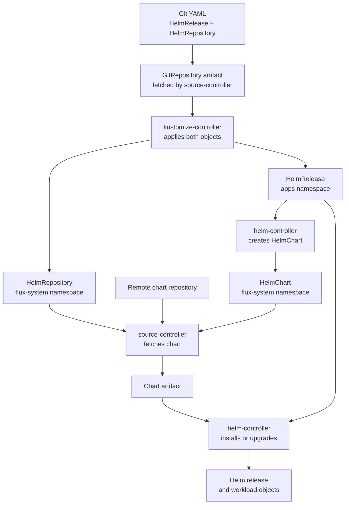

# How Flux applies a HelmRelease from Git

## The idea in one minute

A `HelmRelease` file in Git does **not** install a chart by itself. Two
handoffs must succeed:

1. **Git to Kubernetes:** source-controller fetches the Git artifact, then
   kustomize-controller applies its declarations as Kubernetes objects.
2. **HelmRelease to installed release:** helm-controller reads the
   `HelmRelease`, arranges for a chart artifact from source-controller, then
   installs or upgrades the Helm release.

The controllers reconcile separately and report separate status.
[^flux-kustomization][^flux-helmrelease][^flux-helm-guide]

Think of Git as holding an installation request. The Flux `Kustomization`
delivers that request and its chart-source address to the cluster;
helm-controller carries out the request once the chart is available. The
analogy stops there: both controllers repeatedly compare desired and
observed state, and the chart is a separate artifact from the Git file.
[^flux-helm-guide]

If you are new to Flux, read [Flux](flux.md) for the controller and artifact
model and [How Helm turns a chart into a release](helm.md) for chart, values,
and release vocabulary. This page follows one case in which Git contains a
`HelmRelease` declaration and a Helm repository provides its chart.

## Two paths meet at helm-controller



Text alternative: source-controller fetches Git YAML as a `GitRepository`
artifact. kustomize-controller applies both the `HelmRelease` in `apps` and
the `HelmRepository` in `flux-system`. helm-controller sees the release and
creates a `HelmChart` in the source's `flux-system` namespace. With the
`HelmRepository` and remote chart repository as inputs, source-controller
fetches and publishes the chart artifact. helm-controller uses that artifact
and the `HelmRelease` to install or upgrade the release and its Kubernetes
objects.[^flux-gitrepository][^flux-helm-guide][^flux-helmchart]

The names are easy to mix up:

| Name | What it represents | Controller to inspect |
| --- | --- | --- |
| Flux `Kustomization` | A request to build and apply manifests from a source path. The path can contain ordinary Kubernetes objects, including a `HelmRelease`. | kustomize-controller[^flux-kustomization] |
| `HelmRelease` | A request for a chart version, values, and Helm release lifecycle. | helm-controller[^flux-helmrelease] |
| `HelmRepository` | The address and fetch settings for this example's HTTP chart repository. The first handoff applies this object too. | source-controller reads it[^flux-helmrepository] |
| `HelmChart` | The chart selection from the `HelmRelease`; it is created in the source namespace and reports the fetched chart artifact. | helm-controller creates it; source-controller fills its artifact[^flux-helm-guide][^flux-helmchart] |

A Flux `Kustomization` is a Kubernetes custom resource. A
`kustomization.yaml` inside a repository is a Kustomize build file. They
are related but are not the same object.[^flux-kustomization]

## Example: the lesson API chart

The names, repository addresses, path, and chart version here are
**invented**. Nothing was fetched, applied, or installed for this example.
Assume a `GitRepository` named `platform-config` already fetches the team's
configuration repository and the `apps` namespace already exists.

The team stores one `releases.yaml` file containing a `HelmRepository` and
`HelmRelease` under `./clusters/demo/releases` in Git. A Flux
`Kustomization` points to that path. For plain YAML without a
`kustomization.yaml`, Flux generates a build file for the manifests at the
path. The chart package comes from a separate HTTP Helm repository, not from
that Git path. This is one chart-source choice; Flux also supports other
source kinds.[^flux-kustomization][^flux-helm-guide]

This is a platform-owned or single-team flow, not a tenant lockdown example.
Neither the `Kustomization` nor the `HelmRelease` below names a scoped apply
account. Under Flux's standard defaults, the kustomize-controller and
helm-controller can apply with cluster-admin authority. Platform-enforced
default service accounts can narrow those apply identities. The
`HelmRelease` in `apps` also refers to a
`HelmRepository` in `flux-system`.
That cross-namespace reference would be denied with Flux's
`--no-cross-namespace-refs` lockdown. For a shared-cluster boundary, read
[GitOps security and multi-tenancy](gitops-security-and-multitenancy.md)
before adapting these manifests.[^flux-multitenancy]

```yaml
apiVersion: kustomize.toolkit.fluxcd.io/v1
kind: Kustomization
metadata:
  name: lesson-releases
  namespace: flux-system
spec:
  interval: 10m
  sourceRef:
    kind: GitRepository
    name: platform-config
  path: ./clusters/demo/releases
  prune: true
  timeout: 5m
  healthChecks:
    - apiVersion: helm.toolkit.fluxcd.io/v2
      kind: HelmRelease
      name: lesson-api
      namespace: apps
```

This first object tells kustomize-controller *where to find declarations*.
Its `healthChecks` entry makes the `Kustomization` wait for the named
`HelmRelease` to become Ready. The first handoff can finish applying objects
while the second handoff is still running. In this invented configuration,
`timeout: 5m` bounds that health check; if it fails or times out, the
`Kustomization` reports Ready=False. Without the check, a ready
`Kustomization` would establish that it applied the `HelmRelease` object,
not that helm-controller installed the chart.
[^flux-kustomization]

`prune: true` means removing a previously managed object from the path can
cause Flux to delete it. Removing the `HelmRelease` declaration can then
trigger helm-controller to uninstall its release and workloads; it may take
time or fail if the Helm uninstall cannot finish. Review deletion behavior
before removing the file.[^flux-kustomization][^flux-helmrelease]

The single `releases.yaml` file at that Git path contains two YAML
documents:

```yaml
apiVersion: source.toolkit.fluxcd.io/v1
kind: HelmRepository
metadata:
  name: lesson-charts
  namespace: flux-system
spec:
  interval: 30m
  url: https://charts.example.invalid
---
apiVersion: helm.toolkit.fluxcd.io/v2
kind: HelmRelease
metadata:
  name: lesson-api
  namespace: apps
spec:
  interval: 30m
  chart:
    spec:
      chart: lesson-api
      version: 1.2.3
      sourceRef:
        kind: HelmRepository
        name: lesson-charts
        namespace: flux-system
```

The `.invalid` address is deliberately unusable. Replace it, the chart
name, and the version only after checking a real chart's documentation.
The `HelmRelease` chart template tells helm-controller to create a
`HelmChart` named `apps-lesson-api` in `flux-system`, the namespace of its
`sourceRef`. source-controller uses that object and `HelmRepository` to
fetch the chart and publish a chart artifact. helm-controller then uses the
artifact for the release. The HelmChart lives in `flux-system` even though
the HelmRelease lives in `apps`; this is why the status commands below use
different namespaces. A fixed version makes the intended chart explicit;
with this HelmRepository source, a version range could select a newer
matching chart as the source updates.[^flux-helm-guide][^flux-helmchart]

### Follow one change

Suppose the team changes the chart version in the Git `HelmRelease` from
the invented `1.2.3` to `1.2.4`:

1. `GitRepository` fetches the new configuration revision and reports its
   artifact.[^flux-gitrepository]
2. For handoff 1, `Kustomization` applies the changed `HelmRelease` object.
   Its health check waits while handoff 2 runs; if the release fails or the
   five-minute timeout expires, the `Kustomization` reports Ready=False.
   [^flux-kustomization]
3. For handoff 2, helm-controller updates its generated `HelmChart` to ask
   for `1.2.4`. source-controller fetches that chart and publishes an
   artifact. helm-controller then upgrades the release and reports the
   result on the `HelmRelease`.[^flux-helm-guide][^flux-helmchart][^flux-helmrelease]
4. Kubernetes controllers work toward the objects produced by Helm. A real
   user request remains a separate verification step.

No step above was run for this guide. A newer Git revision, an applied
`HelmRelease` object, a selected chart version, and a successful Helm action
are different facts. The Git revision identifies the configuration input;
the chart version identifies the selected package; a Helm release revision
counts release actions. None alone proves the application answers a request.

## Read the first failed boundary

In a cluster you are authorized to inspect, start with reported conditions
rather than changing a resource because it looks old. These commands are
arranged by the two handoffs in this example; Flux's troubleshooting guide
also recommends starting with source and reconciler status.
[^flux-troubleshooting]

```bash
flux get sources git -n flux-system
flux get kustomizations -n flux-system
flux get helmreleases -n apps
flux get sources helm -n flux-system
flux get sources chart -n flux-system
```

These commands only read status. The Git source and `Kustomization` show
handoff 1, but the latter also reports handoff-2 health-check failures in
this example. If the `HelmRelease` exists but is not Ready, inspect it and
the last two sources. `sources helm` lists `HelmRepository` objects; `sources chart`
lists `HelmChart` objects, including their artifact status. The generated
chart in this example is in `flux-system`, not `apps`. Use the names and
namespaces in *your* installation, then inspect the failing object's
conditions and message.[^flux-cli-chart][^flux-helm-guide]

| First failing signal | What it narrows down | What to check next |
| --- | --- | --- |
| `GitRepository` has no current artifact | Configuration may not have been fetched. | Its URL, reference, credentials, and condition message.[^flux-gitrepository] |
| `Kustomization` cannot build or apply | The declaration may not have reached Kubernetes. | Its source revision, path, dependency, and apply error.[^flux-kustomization] |
| `Kustomization` health check fails or times out | The objects may have been applied, but the named `HelmRelease` did not become Ready within the check. | The release condition and its chart source; do not assume the Git file was rejected.[^flux-kustomization] |
| `HelmRelease` is missing or not ready | It may not have been applied, its chart may be unavailable, or its Helm action may have failed. | If missing, return to the `Kustomization`; otherwise read the release condition before tracing its chart source.[^flux-helmrelease] |
| `HelmRepository` or `HelmChart` is not ready | The selected chart may not be available to helm-controller. | The source URL, chart name and version, and artifact conditions.[^flux-helm-guide][^flux-helmrepository][^flux-helmchart] |

Do not assume that a green `Kustomization` proves the application works.
It waits for the `HelmRelease` in this example only because `healthChecks`
names it. Even a ready `HelmRelease` says what helm-controller established
about a release; it does not send an end-user request. Helm drift detection
is also an explicit setting, so a ready release alone does not prove that
every live object still matches the stored manifest.[^flux-kustomization][^flux-helmrelease]

## When to use each object

- Use a Flux `Kustomization` to apply YAML or Kustomize overlays from a
  source. The YAML may itself declare a `HelmRelease`.[^flux-kustomization]
- Use a `HelmRelease` to ask Flux to manage a Helm chart installation,
  upgrade, and related lifecycle actions. It needs a chart source.[^flux-helmrelease]
- If Git holds the `HelmRelease` and a chart repository holds the chart,
  you normally need both paths in the diagram. Choose the health check
  deliberately so the `Kustomization` status means what readers expect.

For an installation procedure, use Flux's current
[Manage Helm Releases](https://fluxcd.io/flux/guides/helmreleases/) guide.
Check the current CRD versions, chart source, access rights, values,
secret handling, and removal behavior before applying any configuration.

## Check your understanding

1. A `Kustomization` applied a `HelmRelease`, but the chart could not be
   fetched. Which controller path should you inspect after the
   `Kustomization`?
2. Without `healthChecks`, what does a ready `Kustomization` establish
   about its `HelmRelease` manifest? What does it leave open?
3. Why are a Git commit, a chart version, and a Helm release revision
   different pieces of evidence?

Answer hints: the chart path is source-controller's `HelmRepository` and
`HelmChart`, followed by helm-controller. Without `healthChecks`,
`Kustomization` Ready proves its apply, not the Helm action. A Git commit
identifies configuration, a chart version identifies a package, and a Helm
release revision records a release action; check an actual request to learn
whether the application works.

## Explore further

- [Flux Kustomization](https://fluxcd.io/flux/components/kustomize/kustomizations/)
  explains source paths, pruning, and health checks.[^flux-kustomization]
- [Flux HelmRelease](https://fluxcd.io/flux/components/helm/helmreleases/)
  documents chart references, lifecycle, conditions, and drift detection.
  [^flux-helmrelease]
- [Manage Helm Releases](https://fluxcd.io/flux/guides/helmreleases/)
  walks through chart sources and declarative releases.[^flux-helm-guide]
- [Flux troubleshooting cheatsheet](https://fluxcd.io/flux/cheatsheets/troubleshooting/)
  gives the official status-inspection sequence.[^flux-troubleshooting]
- [Flux overview](flux.md) and [Helm basics](helm.md) provide the two
  prerequisite models.
- [Back to Kubernetes applications and tools](index.md).

[^flux-kustomization]: [Flux, Kustomization](https://fluxcd.io/flux/components/kustomize/kustomizations/), source record `flux-kustomization`.
[^flux-helmrelease]: [Flux, HelmRelease](https://fluxcd.io/flux/components/helm/helmreleases/), source record `flux-helmrelease`.
[^flux-helm-guide]: [Flux, Manage Helm Releases](https://fluxcd.io/flux/guides/helmreleases/), source record `flux-helm-guide`.
[^flux-gitrepository]: [Flux, GitRepository](https://fluxcd.io/flux/components/source/gitrepositories/), source record `flux-gitrepository`.
[^flux-helmrepository]: [Flux, HelmRepository](https://fluxcd.io/flux/components/source/helmrepositories/), source record `flux-helmrepository`.
[^flux-helmchart]: [Flux, HelmChart](https://fluxcd.io/flux/components/source/helmcharts/), source record `flux-helmchart`.
[^flux-troubleshooting]: [Flux, troubleshooting cheatsheet](https://fluxcd.io/flux/cheatsheets/troubleshooting/), source record `flux-troubleshooting`.
[^flux-cli-chart]: [Flux CLI, get sources chart](https://fluxcd.io/flux/cmd/flux_get_sources_chart/), source record `flux-cli-chart`.
[^flux-multitenancy]: [Flux, multi-tenancy lockdown](https://fluxcd.io/flux/installation/configuration/multitenancy/), source record `flux-multitenancy`.
