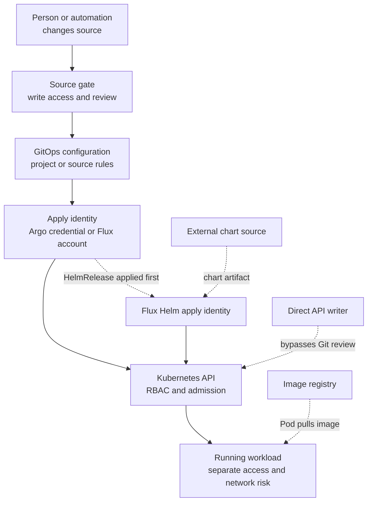

# GitOps security and multi-tenancy

## The idea in one minute

GitOps lets a controller read a desired configuration and apply it to a
cluster. A person may be unable to deploy directly with `kubectl` yet still
be able to change what the controller deploys by editing a trusted source.
That makes **who can change the source** and **what the controller may
apply** parts of the same security question.[^flux-multitenancy][^argo-declarative]

Picture a delivery service: someone submits an order, the office checks its
destination, the courier shows credentials, and the destination decides what
may enter. Git review, GitOps policy, apply identity, and Kubernetes controls
play those roles. The analogy has a limit: a deployed workload can use
namespace Secrets or service-account permissions and may reach across the
network or, if unsafe Pods are allowed, the node. Delivery to the right
namespace is only one check.[^kubernetes-rbac][^kubernetes-network-policy]

This is a model for reviewing a design, not a ready-to-apply security
configuration. The tool-specific procedures are in the official links
below. Read [GitOps](gitops.md) first if the source-to-cluster path is new.

## Follow a change through four gates

Text alternative: a person or automation changes a source; review rules
decide what reaches the GitOps tool. Its project or source rules shape the
next stage. Argo CD uses a cluster credential to apply, while Flux can use
an impersonated service account; a Flux HelmRelease is a second apply stage.
An external chart artifact enters that Helm stage.
Kubernetes RBAC and admission decide which objects can be created. A direct
API writer may bypass Git review, and a running Pod pulls an image from a
registry and has its own access to Secrets, identities, and networks. The
arrows show questions to check, not proof that any gate is enabled.
[^github-protected-branches][^argo-projects][^flux-multitenancy][^kubernetes-rbac][^kubernetes-images]

| Gate | Ask this concrete question | Why it matters |
| --- | --- | --- |
| Source | Who can edit the trusted Git branch or publish its chart and image? Which reviews and checks are enforced?[^github-protected-branches][^kubernetes-images] | A controller cannot tell whether a valid manifest or external artifact was approved by the right people. |
| GitOps policy | Which Argo project or Flux source objects and lockdown flags allow this reconciliation?[^argo-projects][^flux-multitenancy] | Argo projects and Flux lockdown use different controls; neither substitutes for protecting its own configuration. |
| Apply identity | Which credential applies objects, including a separate Flux HelmRelease stage?[^argo-security][^flux-multitenancy] | A destination setting does not reduce Kubernetes API permissions. |
| Kubernetes and workload | What do RBAC and admission permit, and what can a deployed Pod mount or reach?[^kubernetes-rbac][^kubernetes-network-policy] | Pod creation can expose namespace Secrets or service-account powers, and network or node access may cross the namespace. |

The source gate applies to more than the configuration repository. Check that
the GitOps source reference selects the protected branch; a tag or another
branch can bypass that branch's review rules.
[^flux-gitrepository][^github-protected-branches]

A `HelmRelease` can point at a chart stored elsewhere; review who may publish
or replace that chart too. [How Flux applies a HelmRelease from
Git](flux-reconciliation-and-helm.md) shows the two sources. A manifest can
also name a container image tag controlled by a registry publisher. If that
tag moves, a later Pod may run different bytes without a Git change. An
image digest pins the selected image version, but it does not prove the code
is safe.[^flux-helmrelease][^kubernetes-images]

## Example: two teams, one cluster

This example is **invented**. No repository protection, GitOps policy,
service account, admission rule, or cluster was configured or tested for it.

The payments team deploys its API in the `payments` namespace. The catalog
team deploys in `catalog`. Platform administrators own the GitOps
installation, cluster-level add-ons, the two namespaces, and the initial
permission rules. The intended boundary is:

1. Payments writers can propose changes to the payments configuration,
   but a protected production branch requires the team's review before a
   merge.[^github-protected-branches]
2. With Argo CD, a platform-owned `AppProject` allows the approved payments
   source and destination but denies `catalog`, the Argo CD namespace, and
   unwanted cluster-scoped kinds. With Flux, platform-owned source objects,
   lockdown flags, and scoped Kubernetes RBAC must together prevent those
   changes; Flux has no equivalent single `AppProject` allowlist.
   [^argo-projects][^flux-multitenancy]
3. The actual Kubernetes apply credential is reviewed. In the Flux version
   of the example, both the tenant `Kustomization` and any `HelmRelease` must
   use approved accounts whose permissions fit `payments`. A tenant must not
   be able to choose a more privileged account in that namespace.
   [^flux-multitenancy][^flux-kustomization][^flux-helmrelease]
4. Platform policy restricts what Pods can mount, which service accounts
   they can use, and whether a privileged Pod could reach the node. An
   enforced Pod Security Standard addresses Pod privileges, not Secret
   mounts or service-account choice. Separate sensitive workloads into
   appropriate namespaces and use admission rules for finer restrictions.
   Supported and enforced NetworkPolicies address Pod traffic. A namespace
   name alone does not block traffic to `catalog`.
   [^kubernetes-rbac][^kubernetes-pod-security-admission][^kubernetes-network-policy]

If a payments commit changes a Deployment replica count, the design should
let it pass after review. If it asks for a ClusterRoleBinding or targets the
catalog namespace, the design should stop it at a documented gate. The team
must also be unable to edit the project, apply identity, or permission rules
that enforce that gate. All of these expected denials need testing in a
disposable environment before the team treats the boundary as real.

### Argo CD: project and access rules

An Argo CD `AppProject` can restrict the repositories an application reads,
its destination clusters and namespaces, and which resource kinds may be
deployed. Project roles and Argo CD RBAC govern actions through Argo CD's API
and UI. Git writers or Kubernetes users who can create or edit `Application`
objects need separate source and Kubernetes permission checks.
The built-in `default` project initially allows every repository, cluster,
and resource kind, so it is not a payments-team boundary.[^argo-projects]

Argo CD warns that a project allowed to deploy into Argo CD's own namespace
grants its applications admin-level access. In the invented example, the
payments project must not target that namespace. A parent app that creates
other `Application` objects is also sensitive: whoever can edit its source
can change each child's `spec.project`. Keep that parent source under
platform-admin review.[^argo-cluster-bootstrapping]

A project describes which deployments Argo CD should accept. Protect the
`AppProject` and the `Application` definition itself: if a team can change
the project's allow rules or can choose a more privileged project, it can
escape the intended limit. If Applications are enabled outside the control-plane
namespace, `sourceNamespaces` names where an **Application object** may use
the project; it is not the Git source or the deployment destination.
Kubernetes write access to `Application` objects in Argo CD's control-plane
namespace is especially sensitive: those objects can choose any project.
[^argo-projects][^argo-application-namespaces]

The Kubernetes credential used by Argo CD can have broader write access than
one project's policy. Argo CD documents cluster-admin-level permissions in
its default installation and ways to narrow cluster writes. The project
policy remains a separate gate; check both it and the actual cluster RBAC.
Argo CD also documents optional application-sync impersonation, currently
marked beta and disabled by default, which can use project-mapped service
accounts; verify its configuration before assuming a narrower sync identity.
[^argo-sync-impersonation]
A project does not replace Git review, Kubernetes admission, or a test that
a payments workload cannot reach catalog resources.[^argo-security]

### Flux: apply identities for both stages

Flux documents that its apply controllers have `cluster-admin` authority by
default. If a `Kustomization` or `HelmRelease` omits
`spec.serviceAccountName`, its controller uses its own identity unless the
platform enforces `--default-service-account`. For a shared cluster, Flux's
multi-tenancy guide shows how platform administrators can enforce a
namespaced apply account,
disable cross-namespace source references and Kustomize remote bases, and
separate platform-owned reconciliation from tenant-owned reconciliation.
Without those restrictions, a tenant can introduce material from outside its
reviewed source or refer to another tenant's Flux source object.
[^flux-multitenancy]

The important distinction is between *where* a manifest is placed and
*who* applies it:

- A Flux `Kustomization` can set `targetNamespace`, which sets or overrides
  the namespace of namespaced objects in its build. It is not an authorization
  boundary for cluster-scoped objects or later reconcilers.
  `spec.serviceAccountName` selects the account to impersonate while applying
  objects; that account is associated with the `Kustomization` object's
  namespace, not chosen by `targetNamespace`.[^flux-kustomization]
- If the applied objects include a `HelmRelease`, helm-controller later
  performs another reconciliation. The `HelmRelease` has its own
  `spec.serviceAccountName` for that Helm operation. A scoped first stage
  followed by an unset HelmRelease identity can let helm-controller apply
  the chart with its broader default authority if the platform has not
  enforced a default apply account. Check the release's target namespace
  and its apply identity separately.
  [^flux-helmrelease][^flux-multitenancy]
- A tenant should not be able to edit the platform's privileged
  `Kustomization`, the service accounts and bindings that define its own
  boundary, or another tenant's source objects. Nor should it be able to
  choose a more privileged account in its own namespace. Flux's lockdown
  guide addresses those relationships together.[^flux-multitenancy]

If a tenant can create its own `GitRepository` or `HelmRepository`, it can
choose that object's URL. Cross-namespace lockdown does not approve the URL
of a source the tenant owns. Restrict source-object creation with RBAC or
enforce an approved-source policy with admission before treating a source
list as trusted.[^flux-gitrepository][^flux-helmrepository][^kubernetes-rbac]

For a concrete failure path, suppose the payments `Kustomization` is scoped
to a payments account that may create a `HelmRelease`, and that release's
chart contains a `ClusterRoleBinding`. If the `HelmRelease` omits its apply
account and helm-controller has no enforced default account, the first
stage can succeed while the chart is applied with the controller's broad
authority. The two-stage boundary needs a denial test for that chart and
an approved account for **each** stage. This is a possible configuration,
not a test result from this repository.[^flux-multitenancy][^flux-helmrelease]

A field without an actual service account, binding, source, and platform
lockdown cannot demonstrate a secure tenant setup. Use Flux's
[multi-tenancy procedure](https://fluxcd.io/flux/installation/configuration/multitenancy/)
and its [Kustomization](https://fluxcd.io/flux/components/kustomize/kustomizations/)
and [HelmRelease](https://fluxcd.io/flux/components/helm/helmreleases/)
references to design and test the complete boundary.

## Secrets remain a separate decision

A Kubernetes `Secret` stored as base64 text in Git is readable by anyone
with access to that file. Flux explicitly advises against plaintext or
base64 Secret values in either public or private Git sources.[^flux-secrets]

Two common paths are SOPS-encrypted Secret manifests, which Flux can
decrypt at reconciliation time, and a separate secret manager with an
operator that synchronizes values into Kubernetes. Both eventually create
or use live Kubernetes Secrets, so the team still has to manage decryption
keys, controller access, namespace access, and rotation.[^flux-secrets]

In the payments example, a restricted Git repository would not make a
plaintext payment credential safe. Nor would a namespace Role that blocks
`get secrets` necessarily protect it from someone who can create arbitrary
Pods in that namespace.[^kubernetes-rbac]

## What to verify before calling it a boundary

- Identify every trusted Git repository and chart source. Who can change
  each one, and which review rules are actually enforced? Check who publishes
  images and whether the workload names a movable tag or a digest. Verify the
  configured Git ref uses the protected branch.
- In Argo CD, inspect the application's project, permitted sources,
  destinations, resource kinds, and who can modify the project, parent app,
  and `Application`; separately inspect the cluster credential's RBAC.
- In Flux, inspect both the `Kustomization` and any `HelmRelease` apply
  identity, the controllers' default-account flags, the actual service
  accounts and RBAC bindings, and whether tenant objects can reference other
  namespaces or remote bases. Check who may create new source objects and
  choose their URLs.
- Test an allowed payments change and a denied catalog or cluster-scoped
  change in a disposable cluster. Record the API denial or policy decision,
  not merely a green sync.
- Check what an allowed workload can mount, which service account it can
  use, and how its secrets reach the namespace. Check enforced Pod Security
  rules and whether a network plugin implements the intended NetworkPolicies.
  [^kubernetes-rbac][^kubernetes-pod-security-admission][^kubernetes-network-policy]
- Give each Kubernetes object one reconciliation owner. If Argo CD and
  Flux both manage it, their desired states can conflict; see
  [Argo CD vs. Flux](argo-cd-vs-flux.md#using-both).

## Check your understanding

1. Why can a person without direct cluster write access still change
   production through GitOps?
2. Does `targetNamespace: payments` by itself stop a cluster-scoped object
   or a downstream `HelmRelease` from acting elsewhere? Which permissions
   would answer that question?
3. If a Flux `Kustomization` creates a `HelmRelease` with no
   `serviceAccountName`, which two apply identities need review?
4. Why is a base64 Kubernetes Secret in a private Git repository still
   a poor default for a payment credential?

Answer hints: Git write access can change desired cluster state. Placement
does not grant or deny API operations; inspect the apply accounts and RBAC.
A `Kustomization` uses its named account or the kustomize-controller identity;
the `HelmRelease` uses its own named account or the helm-controller identity.
An enforced default account may narrow either unset case. Base64 is an encoding, not
encryption.

## Explore further

- [Argo CD Projects](https://argo-cd.readthedocs.io/en/stable/user-guide/projects/)
  covers allowed sources, destinations, kinds, roles, and the default
  project.[^argo-projects]
- [Flux multi-tenancy](https://fluxcd.io/flux/installation/configuration/multitenancy/)
  gives the complete lockdown procedure.[^flux-multitenancy]
- [Kubernetes RBAC good practices](https://kubernetes.io/docs/concepts/security/rbac-good-practices/)
  explains workload-creation and privilege boundaries.[^kubernetes-rbac]
- [Flux secrets management](https://fluxcd.io/flux/security/secrets-management/)
  compares encrypted and external-secret paths.[^flux-secrets]
- [Kubernetes Pod Security Admission](https://kubernetes.io/docs/concepts/security/pod-security-admission/)
  covers enforce, audit, and warn modes.[^kubernetes-pod-security-admission]
- [Kubernetes Network Policies](https://kubernetes.io/docs/concepts/services-networking/network-policies/)
  covers default Pod reachability and plugin requirements.[^kubernetes-network-policy]
- [Argo CD Applications in any namespace](https://argo-cd.readthedocs.io/en/stable/operator-manual/app-any-namespace/)
  explains the `sourceNamespaces` boundary.[^argo-application-namespaces]
- [Kubernetes Images](https://kubernetes.io/docs/concepts/containers/images/)
  distinguishes image tags from digests.[^kubernetes-images]
- [GitOps](gitops.md), [Flux](flux.md), and
  [Argo CD vs. Flux](argo-cd-vs-flux.md) give the prerequisite models.
- [Back to Kubernetes applications and tools](index.md).

[^github-protected-branches]: [GitHub, About protected branches](https://docs.github.com/en/repositories/configuring-branches-and-merges-in-your-repository/managing-protected-branches/about-protected-branches), source record `github-protected-branches`.
[^argo-projects]: [Argo CD, Projects](https://argo-cd.readthedocs.io/en/stable/user-guide/projects/), source record `argo-projects`.
[^argo-declarative]: [Argo CD, Declarative Setup](https://argo-cd.readthedocs.io/en/stable/operator-manual/declarative-setup/), source record `argo-declarative`.
[^argo-application-namespaces]: [Argo CD, Applications in any namespace](https://argo-cd.readthedocs.io/en/stable/operator-manual/app-any-namespace/), source record `argo-application-namespaces`.
[^argo-security]: [Argo CD, Security Overview](https://argo-cd.readthedocs.io/en/stable/operator-manual/security/), source record `argo-security`.
[^argo-sync-impersonation]: [Argo CD, Application Sync using impersonation](https://argo-cd.readthedocs.io/en/stable/operator-manual/app-sync-using-impersonation/), source record `argo-sync-impersonation`.
[^argo-cluster-bootstrapping]: [Argo CD, Cluster Bootstrapping](https://argo-cd.readthedocs.io/en/stable/operator-manual/cluster-bootstrapping/), source record `argo-cluster-bootstrapping`.
[^flux-multitenancy]: [Flux, Multi-tenancy lockdown](https://fluxcd.io/flux/installation/configuration/multitenancy/), source record `flux-multitenancy`.
[^flux-kustomization]: [Flux, Kustomization](https://fluxcd.io/flux/components/kustomize/kustomizations/), source record `flux-kustomization`.
[^flux-helmrelease]: [Flux, HelmRelease](https://fluxcd.io/flux/components/helm/helmreleases/), source record `flux-helmrelease`.
[^flux-gitrepository]: [Flux, GitRepository](https://fluxcd.io/flux/components/source/gitrepositories/), source record `flux-gitrepository`.
[^flux-helmrepository]: [Flux, HelmRepository](https://fluxcd.io/flux/components/source/helmrepositories/), source record `flux-helmrepository`.
[^flux-secrets]: [Flux, Secrets Management](https://fluxcd.io/flux/security/secrets-management/), source record `flux-secrets`.
[^kubernetes-rbac]: [Kubernetes, RBAC good practices](https://kubernetes.io/docs/concepts/security/rbac-good-practices/), source record `kubernetes-rbac`.
[^kubernetes-images]: [Kubernetes, Images](https://kubernetes.io/docs/concepts/containers/images/), source record `kubernetes-images`.
[^kubernetes-pod-security-admission]: [Kubernetes, Pod Security Admission](https://kubernetes.io/docs/concepts/security/pod-security-admission/), source record `kubernetes-pod-security-admission`.
[^kubernetes-network-policy]: [Kubernetes, Network Policies](https://kubernetes.io/docs/concepts/services-networking/network-policies/), source record `kubernetes-network-policy`.
