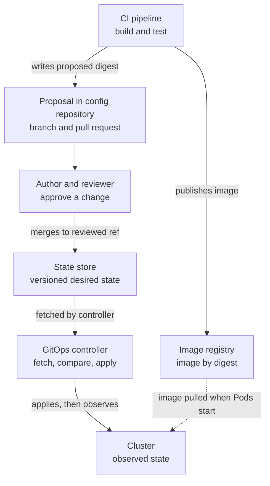

# GitOps

## Purpose

Use this page to understand GitOps as a way of operating a system, separate
from any one tool. After reading it you should be able to say what a pipeline
publishes, what a cluster controller pulls, and what a "synced" status does
and does not tell you.

The page is conceptual and contains nothing to run. For one tool's moving
parts, read [Flux](flux.md). To choose a tool, read
[Argo CD vs. Flux](argo-cd-vs-flux.md).

## What GitOps is

GitOps is a way of running a system in which you write down what should be
running, keep that description under version control, and let an agent with
access to the environment fetch it and keep the environment matching it.

The description is called the **desired state**. The software that fetches and
applies it is called an **agent** or **controller**. The work of making the
real system match the description is called **reconciliation**.

## Why it matters

GitOps changes who acts on a cluster. In a push model, a pipeline job logs in
to the cluster and submits changes, as described in
[GitHub Actions with Kubernetes](../../cross-topic-guides/github-actions-with-kubernetes.md).
In GitOps the pipeline stops earlier, and a controller with standing
permissions acts instead.

People who miss that shift make predictable mistakes:

- They read "synced" as "working".
- They fix a production problem by hand and are surprised when the fix
  disappears, or when it quietly stays and the repository no longer describes
  the cluster.
- They assume that deleting a file always deletes the running resource, or
  that it never does.

## The four principles

The OpenGitOps project defines GitOps through four principles about the
desired state and the agents that act on it.[^opengitops-principles]

| Principle | In plain words | What it rules out |
| --- | --- | --- |
| Declarative | You describe the result you want, not the steps to get there. | A script of commands as the record of what should exist. |
| Versioned and immutable | Every version of the description is kept, and a stored version does not change. | Editing the record in place with no history. |
| Pulled automatically | Agents fetch the description from the source themselves. | A system that only changes when something outside pushes to it. |
| Continuously reconciled | Agents keep observing the real state and keep trying to apply the desired state. | Applying once and never checking again. |

Three details in the definitions are easy to miss:

- **The store does not have to be Git.** Git is the usual example. The
  principles require immutable, versioned history; the OpenGitOps glossary
  also recommends access control and an audit record.[^opengitops-principles][^opengitops-glossary]
- **"Continuously" does not mean "instantly".** It means reconciliation keeps
  happening.[^opengitops-glossary] The delay depends on the tool and whether
  a source revision or a live resource changed.
- **Desired state is configuration, not data.** It generally excludes
  persistent application data such as database contents.[^opengitops-glossary]
  Versioned configuration alone does not back up or restore that data.

A tool can offer a manual mode without automatically applying differences.
For example, Argo CD can compare Git with the cluster while automated sync
is disabled. Enable automated sync if the agent is to apply new revisions
without a separate push or manual action.[^argo-cd-automated-sync]

Git makes a commit identifiable by its hash, but a branch name can move to a
different commit. A container image tag can also point to different bytes
without a new configuration commit. Protect the source ref that controllers
follow and use image digests when the exact image matters; see
[GitOps security and multi-tenancy](gitops-security-and-multitenancy.md).

## What CI publishes and what the controller pulls

Text alternative: the CI pipeline builds and tests, publishes an image to a
registry, and writes a proposed digest change to a branch and pull request.
An author and reviewer merge that change into the ref followed by the
controller. The GitOps controller fetches the new revision;
the arrow shows the revision moving, and the controller opens the connection.
It applies the revision to the cluster and then observes the result.
Separately, the cluster pulls the image from the registry when Pods start.
No arrow runs from CI to the cluster.

The diagram shows one reviewed setup. CI needs permission to push an image
and write its proposed configuration branch, but not to apply to the cluster.
The controller actually follows whatever source ref it was configured to
read; a tag or unprotected branch need not contain a reviewed merge. Argo
CD's documentation states the consequence for its own tool:
with automated sync, a pipeline deploys by committing to the repository and
no longer needs direct access to Argo CD's API.[^argo-cd-automated-sync] The
standing cluster access sits with the controller, so its permissions deserve
the same scrutiny as pipeline credentials; see
[GitOps security and multi-tenancy](gitops-security-and-multitenancy.md).
The controller may run in the target cluster or in a management cluster with
access to it; [Argo CD vs. Flux](argo-cd-vs-flux.md) explains the difference.

## Six words to keep apart

| Word | Question it answers | Where the answer lives |
| --- | --- | --- |
| Source revision | Which version is newest at the source, and which was last applied? | Compare the source identifier, such as a commit hash, with the controller's recorded applied revision. |
| Intended state | What should exist, according to that revision? | The desired state as rendered for that revision. |
| Observed state | What exists right now? | The cluster's API. |
| Sync status | Does the observed state match the intended state? | A tool's comparison, such as Argo CD's `Synced` or `OutOfSync`.[^argo-cd-core-concepts] |
| Drift, as used here | Did a live change move the observed state away from an unchanged intended state? | A comparison and the cause of the difference.[^opengitops-glossary] |
| Health | Do selected resources report that they are ready? | Resource status, when the tool checks it. This is separate from sync status.[^argo-cd-core-concepts][^flux-kustomization] |

Two differences cause most confusion:

- **A new revision and a live edit have different causes.** A new revision
  creates a pending change until it is applied. A hand edit moves the live
  system away from an unchanged description: this page calls that drift.
  OpenGitOps' reconciliation definition also distinguishes these two causes
  of divergence, though its drift definition is broader. Both can make a
  tool report a mismatch such as `OutOfSync`.[^opengitops-glossary][^argo-cd-core-concepts]
- **Applied is not healthy.** A controller can submit every manifest
  successfully and the workload can still fail to start.

## What a green sync does not prove

A green status makes a narrow statement about the thing that status checks.
Argo CD reports sync and health separately: `Synced` means its live resources
match the target, while `Healthy` is a resource-health assessment.
[^argo-cd-core-concepts][^argo-cd-resource-health] Flux reports `Ready` for
each reconciliation object. For example:

- Flux marks a Kustomization ready when the source was fetched, the manifests
  were built and applied. If `wait` or `healthChecks` is configured, those
  checks must also pass; otherwise Ready does not report rollout
  health.[^flux-kustomization]
- Argo CD's built-in check for a Deployment looks at the observed generation
  and the number of updated replicas, and an application's health is the
  worst health among its immediate child resources.[^argo-cd-resource-health]

None of these signals sends a request as a user would. The displayed sync and
health signals can be green while the application returns errors, because:

- the description itself is wrong, for example it names a wrong address for a
  dependency, and the controller faithfully applied it;
- the failure is outside the described resources, such as a database, a DNS
  record, or a certificate;
- the health check is weaker than real use.

Whether users are served is a separate question with separate evidence. See
[Observability stack](../../cross-topic-guides/observability-stack.md) for
that evidence, and
[End-to-end deployment](../../cross-topic-guides/end-to-end-deployment.md)
for what each delivery stage proves.

## Behaviour that depends on configuration

Two behaviours are often described as if GitOps always did them. Each tool
has its own setting and its own default, so check rather than assume.

**Pruning** means deleting a running resource because it is no longer in the
description.

- In Argo CD, automated sync does not delete such resources unless pruning is
  turned on. The documentation calls this a safety
  mechanism.[^argo-cd-automated-sync]
- In a Flux Kustomization, `prune` is a required field: the author must
  choose. When it is on, removing a resource from the source revision deletes
  that managed resource. With the default `MirrorPrune` deletion policy,
  deleting the Kustomization deletes its managed resources **only if**
  `prune: true`; with `prune: false`, they are orphaned. An explicit
  deletion policy can change that outcome.[^flux-kustomization]

Removing a manifest and deleting the controller object are different events.
Argo CD's `Application` deletion also has its own finalizer rules; see
[Argo CD vs. Flux](argo-cd-vs-flux.md#documented-differences).

**Self-healing** means correcting a live change made outside the desired
state.

- In Argo CD, a live change does not trigger an automated sync unless
  self-heal is turned on.[^argo-cd-automated-sync]
- A Flux Kustomization detects and corrects drift in the fields it manages on
  each interval.[^flux-kustomization] A `HelmRelease` has separate drift
  detection, which is off unless enabled.[^flux-helmrelease]

So "the file is gone, the resource is gone" and "the controller will undo
that edit" are both statements about one configuration, not about GitOps.

## Safe boundaries

### Secrets

The desired state often needs credentials, and a versioned store keeps every
version it has ever held. A secret committed in plain text is exposed to
everyone who can read the store, and stays in its history.

Do not put a readable secret in the versioned store. Flux describes storing
encrypted secrets that are decrypted in the cluster: Flux itself can decrypt
SOPS-encrypted material, or a separate controller can handle another format
such as Sealed Secrets. An operator can instead fetch secrets from an
external store. With the SOPS path, Flux needs access to the decryption key
and plaintext.[^flux-secrets-management]
Argo CD recommends populating secrets on the destination cluster so Argo CD
does not handle their values.[^argo-cd-secret-management] If a readable
secret was committed, rotate it: deleting the file in a later commit does
not erase earlier copies.

The boundary to hold: the store may describe *which* secret a workload needs
or hold it encrypted. It should not hold a readable secret value.

### Emergency changes by hand

During an incident someone may need to change the cluster directly. With a
reconciling controller that has two possible outcomes, and both are unsafe if
unplanned:

- The controller reverts the change at its next reconciliation.
- The change stays, and the store no longer describes the cluster. A later
  sync can then overwrite the fix without warning.

A safe emergency change starts by identifying every reconciler that owns the
affected resource or the controller object you plan to pause. Pause the
relevant reconciliation before editing by hand. If a parent declares the
pause setting, a live change to that setting may be reverted by the parent.
In Flux, suspending a `Kustomization` stops its new revisions and drift
correction, but a `HelmRelease` it created reconciles separately and may need
its own suspension.[^flux-kustomization][^flux-helmrelease] In Argo CD,
turning off an `Application`'s automated sync pauses its automatic apply if
another reconciler does not manage that setting. An `ApplicationSet`-managed
application needs its own control path;
editing the generated `Application` alone does not toggle its automated
sync.[^argo-cd-automated-sync] Record the emergency edit and put the
intended change into the store before resuming the owners. The emergency is
over only when the store and the cluster agree again.

## Example: one change to a fictional service

This example is illustrative. The service, repository, revisions, and
outcomes are invented, and nothing here was run. It assumes a controller set
up to apply new revisions automatically, check Deployment rollout health,
and correct drift in declared fields. The configuration declares the
Deployment's image by digest. Its readiness probe checks `/ready`, but not
the request path used by customers.

A team runs `parcel-tracker`. Its desired state lives in a repository named
`fleet-config`.

| Step | What happens | Store / last applied revision | Why live differs | Health signal | Users |
| --- | --- | --- | --- | --- | --- |
| 1 | Steady state on the old image. | `7c1e` / `7c1e` | Match. | Deployment ready. | Served. |
| 2 | CI publishes a new image and opens a digest-change pull request. | `7c1e` / `7c1e` | Match; nothing merged. | Deployment ready. | Served. |
| 3 | A reviewer merges the new digest. | `a1b2` / `7c1e` | Pending revision; no live edit. | Deployment ready (old-image Pods). | Served by old image. |
| 4 | The controller applies `a1b2`; new Pods become ready. | `a1b2` / `a1b2` | Match. | Deployment ready. | `/parcels` returns errors; request monitor alerts. |
| 5 | An engineer edits the declared image field in the cluster back to the old digest. | `a1b2` / `a1b2` | Live image now differs from `a1b2`: drift. | Old-image Pods become ready. | Served again. |
| 6 | The controller's next reconciliation restores the new digest from `a1b2`. | `a1b2` / `a1b2` | Match. | New-image Pods ready. | Errors return. |
| 7 | The team merges a revert that names the old digest; the controller applies it. | `d4e5` / `d4e5` | Match. | Old-image Pods ready. | Served again. |

What to notice:

- The health check can stay green in step 4 or step 6 while customers get
  errors. The request monitor, not the Deployment probe, catches the bug.
- Steps 3 and 5 both show a mismatch, for different reasons.
- The hand edit in step 5 changed a field named in the desired state. It was
  undone in step 6 because this controller corrects that drift. A different
  owner or configuration may leave a hand edit in place.
- Recovery in step 7 was a new revision, not a command against the cluster.
  The store's history now records both the mistake and the fix.

## An analogy: a gardener with a planting plan

A garden has a planting plan kept in a binder where every past version is
filed. A gardener walks the beds on a regular round, compares them with the
current plan, and reports what does not match. The owner decides whether the
gardener should replant automatically.

Where the analogy stops being accurate:

- **The gardener judges plants, not visitors.** The round confirms that each
  bed holds what the plan says. It does not find out whether visitors can use
  the path. A controller's health check has the same limit.
- **Weeding is an instruction, not a habit.** Whether the gardener removes a
  plant that the plan no longer lists depends on what they were told. Pruning
  is a setting.
- **Replanting is an instruction too.** Whether a direct change is undone
  depends on the controller and its settings. The plan's declared fields
  matter; a controller does not own every detail of an object.
- **The gardener only tends listed beds.** Anything outside the plan is left
  alone. A controller manages only resources in its scope.
- **A real gardener would notice a bad plan.** A controller will not. It
  applies a wrong description as faithfully as a right one.

## Common misconceptions

- **"GitOps means using Git."** The principles require a versioned, immutable
  store with pull and reconciliation. Keeping manifests in Git while a
  pipeline pushes them does not meet the third and fourth principles.
- **"Synced means it works."** Argo CD's sync status compares intended and
  observed resources; health is another signal, and neither proves a user
  request succeeds.
- **"The controller always cleans up and always reverts edits."** Both depend
  on configuration.
- **"GitOps removes the need for cluster credentials."** It moves them from
  the pipeline to the controller.

## Check your understanding

- A pipeline finishes successfully in a GitOps setup. What has it produced,
  and what has it not done?
- The store has a new revision that the cluster has not applied yet. Why does
  this page call that a pending revision rather than a hand edit?
- A file is deleted from the store. What do you need to know before you can
  say whether the running resource will be deleted?
- A sync is green and users report errors. Name two explanations that are
  consistent with both facts.

## Next steps

- One tool's parts and how a revision moves through them: [Flux](flux.md),
  then [How Flux applies a HelmRelease from Git](flux-reconciliation-and-helm.md).
- Choosing between two tools: [Argo CD vs. Flux](argo-cd-vs-flux.md).
- Controller permissions, tenancy, and secrets:
  [GitOps security and multi-tenancy](gitops-security-and-multitenancy.md).
- The push model this replaces:
  [GitHub Actions with Kubernetes](../../cross-topic-guides/github-actions-with-kubernetes.md).
- What each delivery stage proves:
  [End-to-end deployment](../../cross-topic-guides/end-to-end-deployment.md).
- Evidence that users are served:
  [Observability stack](../../cross-topic-guides/observability-stack.md).
- An applied route on AWS: [GitOps on EKS](../../cross-topic-guides/gitops-on-eks.md).

## Official documentation for deeper study

- The four principles: [OpenGitOps - GitOps Principles](https://opengitops.dev/).
- Definitions of desired state, drift, pull, reconciliation, and state store:
  [OpenGitOps - GitOps Glossary](https://github.com/open-gitops/documents/blob/main/GLOSSARY.md).
- Pruning, self-heal, and automated sync semantics in Argo CD:
  [Argo CD - Automated Sync Policy](https://argo-cd.readthedocs.io/en/stable/user-guide/auto_sync/).
- What Argo CD's health status measures:
  [Argo CD - Resource Health](https://argo-cd.readthedocs.io/en/stable/operator-manual/health/).
- Why Argo CD reports sync status separately from health:
  [Argo CD - Core Concepts](https://argo-cd.readthedocs.io/en/stable/core_concepts/).
- Pruning, intervals, suspension, and health checks in Flux:
  [Flux - Kustomization](https://fluxcd.io/flux/components/kustomize/kustomizations/).
- HelmRelease drift detection and suspension:
  [Flux - HelmRelease](https://fluxcd.io/flux/components/helm/helmreleases/).
- Options for secrets: [Flux - Secrets Management](https://fluxcd.io/flux/security/secrets-management/)
  and [Argo CD - Secret Management](https://argo-cd.readthedocs.io/en/stable/operator-manual/secret-management/).

## Related links

- [Argo CD vs. Flux](argo-cd-vs-flux.md)
- [Flux](flux.md)
- [How Flux applies a HelmRelease from Git](flux-reconciliation-and-helm.md)
- [GitOps security and multi-tenancy](gitops-security-and-multitenancy.md)
- [GitOps on EKS](../../cross-topic-guides/gitops-on-eks.md)
- [Back to Kubernetes applications and tools](index.md)
- [Back to Kubernetes index](../index.md)
- [Back to knowledge index](../../index.md)

[^opengitops-principles]: [OpenGitOps - GitOps Principles v1.0.0](https://opengitops.dev/), source record `opengitops-principles`.
[^opengitops-glossary]: [OpenGitOps - GitOps Glossary](https://github.com/open-gitops/documents/blob/main/GLOSSARY.md), source record `opengitops-glossary`.
[^flux-kustomization]: [Flux - Kustomization](https://fluxcd.io/flux/components/kustomize/kustomizations/), source record `flux-kustomization`.
[^flux-helmrelease]: [Flux - HelmRelease](https://fluxcd.io/flux/components/helm/helmreleases/), source record `flux-helmrelease`.
[^flux-secrets-management]: [Flux - Secrets Management](https://fluxcd.io/flux/security/secrets-management/), source record `flux-secrets-management`.
[^argo-cd-automated-sync]: [Argo CD - Automated Sync Policy](https://argo-cd.readthedocs.io/en/stable/user-guide/auto_sync/), source record `argo-cd-automated-sync`.
[^argo-cd-core-concepts]: [Argo CD - Core Concepts](https://argo-cd.readthedocs.io/en/stable/core_concepts/), source record `argo-cd-core-concepts`.
[^argo-cd-resource-health]: [Argo CD - Resource Health](https://argo-cd.readthedocs.io/en/stable/operator-manual/health/), source record `argo-cd-resource-health`.
[^argo-cd-secret-management]: [Argo CD - Secret Management](https://argo-cd.readthedocs.io/en/stable/operator-manual/secret-management/), source record `argo-cd-secret-management`.
