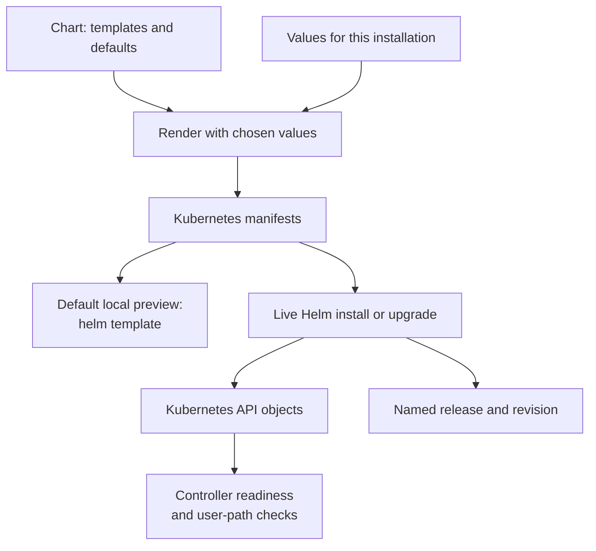

# How Helm turns a chart into a release

## The idea in one minute

Helm packages related Kubernetes resources into a **chart**. A chart
contains templates and default **values**. Chosen values fill in the
templates to produce Kubernetes manifests. Installing them creates a
named **release** in a namespace, starting at revision 1. An upgrade
or rollback creates another revision of that release; the chart's own
version is a separate number.[^helm-introduction][^helm-intro]

A chart is like a reusable blueprint, values are choices for one
building, and the release is Helm's record of an installation. The
analogy stops there: Kubernetes controllers still have to make the
objects run, and a working application still needs a user-level
check. Helm also has special handling for custom resource definitions
(CRDs), explained below.



Text alternative: Helm combines a chart with chosen values to render
manifests. By default, `helm template` produces a local preview. A
live install or upgrade submits objects to the Kubernetes API and records a named
release revision. Controllers then work toward readiness; an
application request remains a separate check.
Local rendering may differ from a cluster-connected operation when
templates depend on the cluster's API capabilities or lookups.
[^helm-template]

## One chart, two releases

The names and settings below are **invented**. No chart was built,
rendered, or installed for this example.

Suppose a `lesson-api` chart contains templates for a Deployment
and Service. The team installs it once as `lessons-dev` in the
`development` namespace and again as `lessons-prod` in `production`.
The installations can use different values from the same chart. This
invented excerpt shows the relationship:

```text
# Chart template excerpt
spec:
  replicas: {{ .Values.replicaCount }}

# development values: replicaCount: 1
# production values: replicaCount: 3
```

Rendering the development inputs produces `spec.replicas: 1` in its
Deployment; production produces `spec.replicas: 3`. That is a change
to a Kubernetes field, not just to a label in Helm. The actual chart
must define that template and value key for this example to work.
[^helm-values-files]

The chart's `version` in `Chart.yaml` identifies the package. Its
optional `appVersion` describes the packaged application and is
informational; inspect the actual image value or rendered manifest
to learn which image will run. A release's revision records an
install, upgrade, or rollback of that *one installation*.
[^helm-charts][^helm-intro]

| Item | `lessons-dev` | `lessons-prod` |
| --- | --- | --- |
| Chart package | `lesson-api` version 1.4.0 | `lesson-api` version 1.4.0 |
| Chosen values | `replicaCount: 1` | `replicaCount: 3` |
| Release record | `lessons-dev` in `development` | `lessons-prod` in `production` |
| Rendered Deployment field | `spec.replicas: 1` | `spec.replicas: 3` |

Now imagine production has only one desired replica after an upgrade.
The reader's first question is **where did the three-replica intent
change?** `helm history lessons-prod -n production` shows the chart
version and release revisions. Compare the last good and current
revision with `helm get values lessons-prod -n production --revision N`:
without `--all`, this shows supplied values; adding `--all` shows
computed values including chart defaults. Replace `N` with each
retained revision number.[^helm-get-values][^helm-history]

Next compare three things: the **current computed value**, the
Deployment's `spec.replicas` in `helm get manifest lessons-prod -n production`,
and the live Deployment's `spec.replicas` in Kubernetes.
The manifest command also accepts `--revision N` for an earlier
retained revision.
If the value is 3 but the Helm manifest says 1 or omits the field,
inspect the chart template and any autoscaling value that changes its
rendering. Kubernetes defaults an omitted Deployment `spec.replicas`
to 1, so an omitted field needs investigation too. If Helm's manifest
says 3 but the live field says 1, check `kubectl get hpa -n production`
and who last changed the field before
editing either source. An HPA can set a Deployment's replica count.
If the supplied production override disappeared, restore it in the
reviewed deployment source and preview the result. The manifest and
live field decide the next investigation; computed values alone do
not prove what Helm submitted.[^helm-get-manifest][^kubernetes-hpa]
[^kubernetes-deployments]

An upgrade can reuse or reset prior release values according to its
flags and supplied overrides. Check the installed Helm version and
its `--reuse-values` or `--reset-values` behavior before assuming a
production override survived; newer releases also document
`--reset-then-reuse-values`. A values file sitting in Git does not
change a release until the team's deployment controller or Helm
operation uses it.[^helm-upgrade]

## What each check can tell you

| Check | What it answers | What it cannot prove |
| --- | --- | --- |
| Read the chart and values | Which templates and defaults are in the reviewed chart version? | That the generated objects fit this cluster or application. |
| Render locally with `helm template` | Which manifests result from these chart inputs on the client? | That the cluster accepts them; cluster lookups and API capabilities may differ. `crds/` files need `--include-crds` to appear in this output. |
| Use a Helm server dry run where appropriate | What does Helm render when connected to the cluster, without persisting the operation? | That all admission rules, a later live operation, controller rollout, or a user request will succeed. |
| Read Helm release status | What did Helm record for this installation and revision? | That every Pod is ready or the application works. `deployed` alone is not an end-to-end health check.[^helm-status] |
| Read Kubernetes and application evidence | Did controllers make the desired objects ready, and can a user complete a request? | That every future request or dependent service will work. |

Helm's `helm template` documentation says local rendering does no
server-side API support test. The upgrade reference distinguishes
client and server dry runs; server mode requires cluster access.
Neither mode proves that Pods become ready or users can complete a
request. Rendered output, dry runs, and release values may expose
Secrets or other sensitive settings, so review where output is stored
or shared.[^helm-template][^helm-upgrade][^helm-get-values]

Helm command details can differ between Helm 3 and 4. Check
`helm version` and the matching command reference before using a flag
or relying on a default waiting behavior. A live install may return
before all resources are ready unless an appropriate wait strategy is
used; even then, check the application's own path. Helm 4 defaults
new releases to server-side apply, while upgrades of existing
releases normally retain their prior apply method. That can affect
which writer owns a field such as replicas.[^helm-install]
[^helm4-overview]

If a release is managed by Flux or another controller, change its
reviewed source rather than running a separate manual upgrade.
[How Flux applies a HelmRelease from Git](flux-reconciliation-and-helm.md)
shows the additional source and controller handoffs. Argo CD uses
Helm to render charts, then manages the resulting application itself;
in that path, `helm list` and `helm history` do not show an installed
Helm release. Inspect the Argo CD application and its Git source
instead.[^argo-helm]

## Revisions are not time travel

Helm records release revisions. `helm history` lists retained
revisions; `helm rollback` can target one of them. If revision 3
is rolled back to revision 1, Helm creates revision 4 using the
selected earlier release configuration; it does not move the
revision number backward. History retention can limit which older
revisions remain available.[^helm-intro][^helm-history]
[^helm-rollback][^helm-upgrade]
A rollback changes Kubernetes resources again. It
does not reverse a database migration, an external API call, or user
data. Verify the workload and user path after a rollback as you
would after an upgrade.

Custom Resource Definitions need extra care. Helm documents a
special `crds/` install path: those CRDs are installed before
templates if absent, but Helm does not upgrade, roll back, or delete them with
ordinary release changes. `helm template` needs `--include-crds` to
show these files. A dry run cannot install a new CRD, so it cannot
fully check custom resources that need the newly registered API.
Do not assume the special protection applies to a CRD placed under
`templates/`: as a managed release resource, it may follow the
release's uninstall path. Deleting any CRD removes all custom objects
of that type across the cluster. Inspect the chart and its CRD owner
before an operator upgrade or uninstall.[^helm-crds][^helm-template]
[^helm-uninstall][^kubernetes-crd-delete]

## Crossplane is a second controller layer

Crossplane is a useful example of Helm's boundary. The official
Crossplane installation guide uses Helm to install **Crossplane
core** into an existing Kubernetes cluster. Crossplane's own
`Provider`, `Function`, and `Configuration` packages then have separate
health, compatibility, and upgrade questions. A Helm release saying
core was installed does not prove that an AWS provider package has
installed its resource types, that
its `ProviderConfig` can authenticate, or that it has reconciled a
managed resource.[^crossplane-install][^crossplane-providers]

For an installation, use the current
[official Crossplane install procedure](https://docs.crossplane.io/latest/get-started/install/)
and [provider guidance](https://docs.crossplane.io/latest/packages/providers/).
The [Crossplane section](../crossplane/index.md) explains
the package and external-resource model. Review the exact chart
version, values, CRDs, and recovery path in your environment
before making a live change.

## Check your understanding

1. Production has one desired replica after an upgrade; its reviewed
   values file says three. Which release, values, chart, and
   Kubernetes evidence would you compare before changing anything?
2. If `helm template` succeeds, what must still be checked against
   the cluster?
3. Why would a healthy Helm release not prove a Crossplane
   provider can create an AWS resource?

## Explore further

- [Using Helm](https://helm.sh/docs/intro/using_helm/)
  introduces charts, values, releases, and revision history.
  [^helm-intro]
- [helm template](https://helm.sh/docs/helm/helm_template/)
  describes local rendering and its limits.[^helm-template]
- [helm upgrade](https://helm.sh/docs/helm/helm_upgrade/)
  documents dry-run modes and output sensitivity.[^helm-upgrade]
- [Helm and CRDs](https://helm.sh/docs/chart_best_practices/custom_resource_definitions/)
  describes their separate lifecycle.[^helm-crds]
- [Back to Kubernetes applications and tools](index.md).

[^helm-introduction]: [Helm, Introduction to Helm](https://helm.sh/docs/intro/introduction/), source record `helm-introduction`.
[^helm-intro]: [Helm, Using Helm](https://helm.sh/docs/intro/using_helm/), source record `helm-intro`.
[^helm-charts]: [Helm, Charts](https://helm.sh/docs/topics/charts/), source record `helm-charts`.
[^helm-values-files]: [Helm, Values Files](https://helm.sh/docs/chart_template_guide/values_files/), source record `helm-values-files`.
[^helm-template]: [Helm, helm template](https://helm.sh/docs/helm/helm_template/), source record `helm-template`.
[^helm-upgrade]: [Helm, helm upgrade](https://helm.sh/docs/helm/helm_upgrade/), source record `helm-upgrade`.
[^helm-status]: [Helm, helm status](https://helm.sh/docs/helm/helm_status/), source record `helm-status`.
[^helm-get-values]: [Helm, helm get values](https://helm.sh/docs/helm/helm_get_values/), source record `helm-get-values`.
[^helm-get-manifest]: [Helm, helm get manifest](https://helm.sh/docs/helm/helm_get_manifest/), source record `helm-get-manifest`.
[^helm-history]: [Helm, helm history](https://helm.sh/docs/helm/helm_history/), source record `helm-history`.
[^helm-rollback]: [Helm, helm rollback](https://helm.sh/docs/helm/helm_rollback/), source record `helm-rollback`.
[^helm-install]: [Helm, helm install](https://helm.sh/docs/helm/helm_install/), source record `helm-install`.
[^helm-uninstall]: [Helm, helm uninstall](https://helm.sh/docs/helm/helm_uninstall/), source record `helm-uninstall`.
[^helm4-overview]: [Helm, Helm 4 Overview](https://helm.sh/docs/overview/), source record `helm4-overview`.
[^argo-helm]: [Argo CD, Helm](https://argo-cd.readthedocs.io/en/latest/user-guide/helm/), source record `argo-helm`.
[^helm-crds]: [Helm, Custom Resource Definitions](https://helm.sh/docs/chart_best_practices/custom_resource_definitions/), source record `helm-crds`.
[^crossplane-install]: [Crossplane, Install Crossplane](https://docs.crossplane.io/latest/get-started/install/), source record `crossplane-install`.
[^crossplane-providers]: [Crossplane, Providers](https://docs.crossplane.io/latest/packages/providers/), source record `crossplane-providers`.
[^kubernetes-crd-delete]: [Kubernetes, Extend the Kubernetes API with CustomResourceDefinitions](https://kubernetes.io/docs/tasks/extend-kubernetes/custom-resources/custom-resource-definitions/), source record `kubernetes-crd-delete`.
[^kubernetes-hpa]: [Kubernetes, Horizontal Pod Autoscaling](https://kubernetes.io/docs/concepts/workloads/autoscaling/horizontal-pod-autoscale/), source record `kubernetes-hpa`.
[^kubernetes-deployments]: [Kubernetes, Deployments](https://kubernetes.io/docs/concepts/workloads/controllers/deployment/), source record `kubernetes-deployments`.
