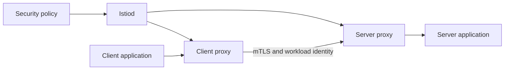

# Istio security fundamentals

## Purpose

Explain what Istio adds to Kubernetes and when mesh authentication is useful.

Sources reviewed: 2026-10-29. See the [validation record](../../../../knowledge-base-audit.md) for executed checks and unexecuted runtime labs.

## What it is

Istio is a service mesh: a control plane configures proxies that mediate traffic between workloads. It can provide workload identity, encrypted transport, traffic policy, and telemetry without implementing those mechanisms separately in every application.[^istio-security][^istio-architecture]

The term `istio-auth` appears in historical material about Istio's authentication/certificate component. Later documentation used Citadel; modern installations integrate core identity/certificate management into Istiod. Do not search for a separate current `istio-auth` product to install.

## Three different controls

| Control | Question | Main resource |
| --- | --- | --- |
| Peer authentication | Is this connection using mesh mTLS? | PeerAuthentication |
| Request authentication | Is a presented JWT valid? | RequestAuthentication |
| Authorization | May this identity perform this operation? | AuthorizationPolicy |

Encryption alone does not restrict which mesh workload may call another. JWT validation alone does not require every request to carry a token. Combine the controls to express the actual requirement.

## When to use it

Use a mesh when multiple services need consistent identity, encryption, policy, and telemetry and a team can operate proxies and control-plane upgrades. A single edge-authentication requirement may be satisfied by a gateway without a full mesh. Kubernetes RBAC controls API operations, not ordinary application HTTP requests.

## Operational prerequisites

Map traffic paths, service accounts, namespaces, trust domains, external dependencies, and bypass paths. Identify who owns root trust, policy review, upgrades, telemetry, and incident response. Verify proxy coverage before assuming a policy protects all traffic.

## Related links

- [Istio security](https://istio.io/latest/docs/concepts/security/)
- [Istio architecture](https://istio.io/latest/docs/ops/deployment/architecture/)
- [Back to parent index](index.md)
- [Back to major area](../../index.md)
- [Back to root index](../../../../README.md)

[^istio-security]: [Istio security](https://istio.io/latest/docs/concepts/security/).
[^istio-architecture]: [Istio architecture](https://istio.io/latest/docs/ops/deployment/architecture/).
