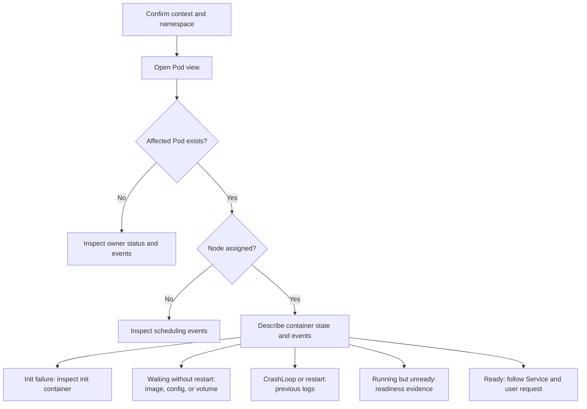

# Inspect a failing Pod with K9s

## What you will do

K9s is a terminal interface that **watches Kubernetes resources**
and lets you move between views, details, and logs. It shows
information from the cluster; it is not another source of truth.
Its shortcuts can also change resources when your identity has
permission, so start by confirming the target.[^k9s-overview]

This guide follows one task: find a Pod that is not serving an
application, inspect its evidence, and choose a focused next step.
The example uses an **invented** `lesson-api` Pod in namespace
`lessons`. No cluster or K9s session was used to create this page.



Text alternative: confirm the target, then ask whether the Pod exists.
If not, inspect its owning workload. If it exists but has no node,
inspect scheduling. For a Pod on a node, read the container state and
events: a failed init container, a startup wait without a restart, a
crash or restart, an unready running container, and a Ready Pod lead
to different next checks.

## 1. Confirm the target

A kubeconfig context names a cluster, user, and optional namespace
choice. Check which context you intend to use, and verify its
cluster mapping if the name is ambiguous. The
[safe kubectl inspection guide](../commands/daily-usage.md)
walks through that check.

For an illustrative context named `learning-lab` and namespace
`lessons`, launch K9s this way:

```bash
k9s --context learning-lab -n lessons --readonly
```

Replace both names with your actual target. K9s documents
`--context`, `-n`, and `--readonly`; the last flag disables
K9s modification commands for this session.[^k9s-commands]
It does not remove your Kubernetes permissions or make the
cluster itself read only. Confirm the context and namespace
shown in K9s before reading or acting on a row.

For the invented example, the target check is **context
`learning-lab`, namespace `lessons`, Pod view**. Check those
labels in your running K9s before interpreting its rows. A similar
name in a different cluster is a different target.

> [!NOTE]
> An empty Pod view may reflect the wrong namespace, an active filter,
> unavailable API access, or missing permission. An owning workload,
> such as a Deployment's ReplicaSet, Job, or StatefulSet, might also be
> failing to create a Pod. Check its status and events before
> concluding that no workload was requested.[^k8s-deployments]

## 2. Open the Pod view and select one Pod

Inside K9s, type `:pod` and press Enter. K9s command mode
also accepts a resource name with a namespace, such as
`:pod lessons`; `?` shows the active help and available
keys in your installed version. The namespace form is useful when
switching targets; recheck the displayed namespace afterward.
[^k9s-commands]

Look at the **Pod name, displayed namespace, readiness, status, and
restart count**. If there are many rows, `/lesson-api` filters the
current view; remember that an active filter can hide other Pods.
Select the affected row with the keyboard before using an action
key. A displayed `STATUS` is a clue, not the Pod's exact API phase:
`ImagePullBackOff` is a container waiting reason and the Pod can still
be in phase `Pending`. Read its details before choosing a fix.
[^k8s-pod-lifecycle]

For example, an invented row might show `lesson-api-abc12` as `0/1`
Ready with `ImagePullBackOff` and zero restarts. The kubelet's image
pull failed and it is backing off before retrying. The row does not
say whether the image reference, platform, registry credentials,
pull policy, or network path is responsible.[^k8s-images]

## 3. Read the evidence for the selected Pod

The current upstream K9s key table documents `d` for describe,
`l` for logs, `p` for previous logs, and `y` for YAML. Key bindings
can depend on the active view and local configuration, so use `?`
in your installed version before relying on one.[^k9s-upstream]

Start with `d` on the selected Pod. Read its **Node** assignment,
`PodScheduled` condition, container **State** or **Last State**, and
recent **Events**. Open logs only for a container that has run.

| First clue | Read next | Why |
| --- | --- | --- |
| No Pod appears for the expected workload | Inspect the owning workload's status and events; for a Deployment, inspect its ReplicaSet too. | Admission, replica count, or controller failure may prevent Pod creation. |
| Pod exists but has no node | `d` for `PodScheduled` and scheduling events. | Placement can fail because of requests, selectors, taints, or volume binding. |
| An init container fails (`Init:` status) | `d` for its state, then that init container's logs if it ran. | Main-container logs may not exist yet. |
| Container crashes or restarts (`CrashLoopBackOff` or restart count above zero) | `d` for its last termination reason, then `p` for that container's previous logs. | A crash loop is a waiting reason, but its previous run is the first evidence to inspect. |
| Container waits without a previous run | `d` for that container's waiting reason and events. | Image, configuration, or volume setup can fail before application logs exist. |
| Container runs but is not Ready | `d` for readiness conditions and any probe events, then its logs. | A running process may still fail a probe or another readiness condition. |
| Pod is Ready but users still fail | Follow Service, entry path, and application response evidence. | Pod readiness alone does not prove the user request. |
| Pod is Evicted, Error, or stuck Terminating | `d` for the Pod reason, message, and events. | These need a cause-specific route rather than an image or crash-loop guess. |

For Pods with several containers, identify the container named in the
waiting or termination status before reading logs. With the Pod
selected, Enter opens its child/container view in common K9s builds;
select the affected container there and use `l` or `p`. Check `?`
for your installed version's bindings.[^k9s-upstream]
Kubernetes also has a separate [init-container debugging guide](https://kubernetes.io/docs/tasks/debug/debug-application/debug-init-containers/).
Recent events are useful but not a permanent record; an empty Events
section on an older Pod does not prove that nothing failed.
[^k8s-debug-init][^k8s-debug-running][^k8s-events]

For the invented image-pull case, select the row and press `d`.
The following **illustrative** signals show why the detail matters;
they are not output captured from K9s or a cluster:

```text
K9s row: lesson-api-abc12    Ready: 0/1        Status: ImagePullBackOff
Describe Pod: lesson-api-abc12                Status: Pending
Container: app               State: Waiting    Reason: ImagePullBackOff
                             Ready: False
Image: registry.team.internal/lesson-api:1.4.0
Event: Failed to pull image ... manifest for tag 1.4.0 not found
```

The row says only that a pull failed. This invented event suggests
the requested tag is missing; in a real cluster, read the **actual**
event before deciding whether to check the reviewed image reference,
registry tag or digest, credentials, platform, or network. The
container in this example has not started, so it may have no
application logs. Do not edit the Deployment merely because the row
says `ImagePullBackOff`.[^k8s-debug-pods][^k8s-images]

A full YAML view and logs may contain configuration, tokens,
or customer data. Share only the evidence needed for a
reviewed issue or incident.

## 4. Follow the first failed boundary

- If no Pod was created, inspect its expected owner. For a Deployment,
  look for a `FailedCreate` event on its ReplicaSet and read Deployment
  conditions before changing quota, policy, or replica count.
  [^k8s-deployments]
- For an image pull in a local kind cluster, follow
  [Diagnose a local image pull in kind](../troubleshooting/kind.md).
- For another image-pull failure, use the event to choose the next
  check in the [Kubernetes images documentation](https://kubernetes.io/docs/concepts/containers/images/).
- For repeated container restarts, follow
  [Diagnose CrashLoopBackOff](../troubleshooting/crashloopbackoff.md).
- For insufficient CPU or memory capacity, follow
  [Investigate Kubernetes resource pressure](../commands/workflows.md).
- For other scheduling or startup failures, use the
  [official Pod debugging route](https://kubernetes.io/docs/tasks/debug/debug-application/debug-pods/).
- For a failed init container, use
  [Debug Init Containers](https://kubernetes.io/docs/tasks/debug/debug-application/debug-init-containers/).
- For a running but unready container, inspect its `Ready` condition
  and any `Unhealthy` probe events, then compare the configured probe
  with the application's actual response. The
  [Kubernetes probe guide](https://kubernetes.io/docs/tasks/configure-pod-container/configure-liveness-readiness-startup-probes/)
  explains the check. A missing probe event does not rule out another
  readiness condition.[^k8s-probes]
- For a Ready Pod with a failing user request, follow
  [Find the first failing Kubernetes boundary](../troubleshooting/common-solutions.md).
- For an evicted Pod, begin with
  [resource-pressure evidence](../commands/workflows.md). For another
  terminal or stuck status, read the Pod reason and use the
  [official Pod debugging guide](https://kubernetes.io/docs/tasks/debug/debug-application/debug-pods/).

K9s is a convenient way to **read** those signals. A
restart, edit, delete, port forward, or shell is a separate
operation with its own target, permission, and side effects.
The official K9s command reference lists deletion and
immediate-kill keys; do not use them as generic repair
shortcuts.[^k9s-commands]

Use `:q` or Ctrl-C to exit K9s when you are done.[^k9s-upstream]

## Check your understanding

1. Why should you check the owning workload and any active filter
   before trusting an empty Pod table?
2. An `ImagePullBackOff` row appears. What extra evidence tells you
   whether the image reference, credentials, or network caused it?
3. A container restarted, but current logs are blank. Which state
   and log instance should you inspect?
4. If a Pod is Ready but the website fails, which boundary comes next?

## Explore further

- [K9s commands](https://k9scli.io/topics/commands/)
  documents launch flags, navigation, filters, and action keys.
  [^k9s-commands]
- [K9s overview](https://k9scli.io/)
  shows the Pod, logs, and relationship views.[^k9s-overview]
- [Debug Pods](https://kubernetes.io/docs/tasks/debug/debug-application/debug-pods/)
  explains the Kubernetes evidence behind these screens.
  [^k8s-debug-pods]
- [Back to Kubernetes applications and tools](index.md).

[^k9s-overview]: [K9s, Overview](https://k9scli.io/), source record `k9s-overview`.
[^k9s-commands]: [K9s, Commands](https://k9scli.io/topics/commands/), source record `k9s-commands`.
[^k9s-upstream]: [K9s, upstream README](https://github.com/derailed/k9s), source record `k9s-upstream`.
[^k8s-debug-pods]: [Kubernetes, Debug Pods](https://kubernetes.io/docs/tasks/debug/debug-application/debug-pods/), source record `k8s-debug-pods`.
[^k8s-pod-lifecycle]: [Kubernetes, Pod lifecycle](https://kubernetes.io/docs/concepts/workloads/pods/pod-lifecycle/), source record `k8s-pod-lifecycle`.
[^k8s-images]: [Kubernetes, Images](https://kubernetes.io/docs/concepts/containers/images/), source record `k8s-images`.
[^k8s-debug-running]: [Kubernetes, Debug Running Pods](https://kubernetes.io/docs/tasks/debug/debug-application/debug-running-pod/), source record `k8s-debug-running`.
[^k8s-debug-init]: [Kubernetes, Debug Init Containers](https://kubernetes.io/docs/tasks/debug/debug-application/debug-init-containers/), source record `k8s-debug-init`.
[^k8s-events]: [Kubernetes, Events](https://kubernetes.io/docs/reference/kubernetes-api/events/), source record `k8s-events`.
[^k8s-deployments]: [Kubernetes, Deployments](https://kubernetes.io/docs/concepts/workloads/controllers/deployment/), source record `k8s-deployments`.
[^k8s-probes]: [Kubernetes, Configure Liveness, Readiness and Startup Probes](https://kubernetes.io/docs/tasks/configure-pod-container/configure-liveness-readiness-startup-probes/), source record `k8s-probes`.
