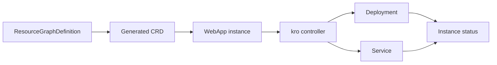

# kro fundamentals

## Purpose

Understand how a resource graph becomes a reusable Kubernetes API.

Sources reviewed: 2026-10-29. See the [validation record](../../../../knowledge-base-audit.md) for executed checks and unexecuted runtime labs.

## What kro is

kro means **Kube Resource Orchestrator**. A `ResourceGraphDefinition` (RGD) describes an API schema and the Kubernetes resources behind it. kro generates a CRD for that API and reconciles underlying resources when users create instances. CEL expressions connect input fields and resource outputs.[^kro-0-9-4-overview][^kro-v0-9-4-source]

A platform team might offer `WebApp` with only image and replica inputs while creating a Deployment and Service. Users request the higher-level API; they do not copy its implementation YAML into every project.



## Boundaries

kro manages Kubernetes resources. To manage an AWS resource through a cloud CRD, its provider/controller must already be installed and authenticated. An S3-looking resource in an example is not provisioned by kro alone.

Keep platform API inputs small and stable; exposing every field of every component merely moves complexity. Version the API and test upgrades with existing instances.

## Inspect installed APIs

```bash
kubectl get resourcegraphdefinitions
kubectl get crds | grep kro
kubectl api-resources | grep -i webapp
```

What it does: distinguishes definitions from generated instance APIs. API discovery appears only after the controller successfully accepts and installs the definition.

## When to use it

Use kro to assemble existing Kubernetes APIs into a platform abstraction. Use plain manifests or Helm/Kustomize when a package is sufficient. Write a custom operator when behavior needs algorithms, external protocols, or reconciliation logic beyond resource composition.

## Related links

- [kro 0.9.4 overview](https://kro.run/docs/overview/)
- [kro v0.9.4 source](https://github.com/kro-run/kro/tree/v0.9.4)
- [Back to parent index](index.md)
- [Back to major area](../../index.md)
- [Back to root index](../../../../README.md)

[^kro-0-9-4-overview]: [kro 0.9.4 overview](https://kro.run/docs/overview/).
[^kro-v0-9-4-source]: [kro v0.9.4 source](https://github.com/kro-run/kro/tree/v0.9.4).
