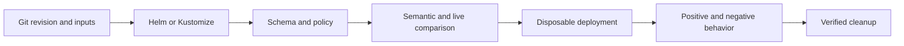

# Kubernetes manifest differences, drift and regression testing

Choose a check by the question it can answer. A manifest can parse, pass a schema, satisfy a label policy, and still send traffic to a port where nothing listens. A green Deployment condition covers the workload controller's criteria, not the complete user request path.

## Semantic differences, configuration drift and behavioral regressions

A **difference** is an observed change between two inputs. **Drift** is a difference between the intended state and live state; first establish which revision, environment and controller define intent. A **regression** is working behavior that a change breaks. Comments, whitespace and mapping-key order can change a textual diff without changing the parsed object. An intentional release change can produce a large diff while preserving behavior.

| Operational question | Check and artifact | What it cannot establish |
| --- | --- | --- |
| What did the author change? | `git diff`: committed/staged/working-tree patch. | The exact rendered objects or API outcome. |
| What will the templates produce? | Helm/Kustomize: complete rendered objects for each values/overlay combination. | Every server capability, lookup, default or admission mutation. |
| Which object fields changed? | dyff: structural paths and before/after values. | Kubernetes meaning or application correctness. |
| How would a Helm upgrade differ? | Helm Diff: installed-release versus proposed-render comparison; optional live-aware mode. | A successful release or a traffic test. |
| Are types and known fields valid? | kubeconform: versioned schema result with valid/invalid/error/skipped counts. | Full API validation, admission or controller behavior. |
| Does this satisfy our stated rules? | Conftest: Rego allow/deny findings. | Rules that were never written or actual cluster enforcement. |
| What would apply change now? | `kubectl diff`: live versus prospective apply, including server-side processing. | Persistent deployment, traffic success or full deletion inventory. |
| Did behavior survive deployment? | Helm test hooks, Chainsaw, HTTP/DNS or domain-specific assertions. | Scenarios and failure modes that the suite does not assert. |

The [routing lab](regression-lab-and-ci.md) exercises one concrete `targetPort: 80` → `81` mutation across these layers.[^kubectl-diff][^dyff][^helm-diff]

## Build a useful release gate

Render each supported environment from a known Git revision and pinned dependencies. Check schema coverage and policy, inspect semantic changes, then use a disposable cluster for admission and behavior. Preserve failure categories in the report: rendering failure, schema error, policy denial, intentional difference, comparison error and failed request are different next actions.

What it does: separates configuration inspection from actual requests and makes cleanup part of acceptance. A failed early gate should stop that release; it does not make later layers unnecessary for releases that pass.

## Compare the intended things

Identify objects by API group, kind, namespace and name, rather than file position. Compare the same chart version, dependency lock, values, overlay, release name, namespace, tool version and API capabilities. Include additions and removals; comparing only matching objects misses a deleted Service or dropped RoleBinding.

Do not sort every YAML list to make a diff shorter. Some list order matters; a comparator also cannot infer every CRD's list semantics. API-group changes, namespace changes, renamed resources, selectors, ports, images, probes, RBAC, storage and deletion intent deserve explicit review.

## Security and tool choice

Start with Git plus the renderer, schema/policy and behavior checks your deployment already needs. Add Helm Diff for Helm release review, or use existing [Argo CD/Flux](../argo-cd-vs-flux.md) revision/reconciliation evidence instead of inventing a second source of truth. Chainsaw is useful when multi-step apply/assert/cleanup makes a shell script difficult to review; a small explicit HTTP probe can be sufficient for a small route.

Live comparison needs cluster credentials and may exercise dry-run admission. Avoid production mutation permissions for a source-only job. Rendered Secrets, environment variables, annotations and plugin output can contain credentials; review redaction before saving artifacts. Default Secret suppression in one tool is not a guarantee for every sensitive string.

## Evidence and next steps

Sources reviewed on 2026-11-10. The lab's eight real offline tool checks were executed on Windows with dyff 1.12.0, kubeconform 0.8.0 and Conftest 0.71.1. Hosted cluster evidence is recorded separately in the [lab](regression-lab-and-ci.md#validation-boundary); do not infer it from a schema pass. Helm Diff, Helm test hooks, Argo CD and Flux are selection guidance here, not executed integrations in this lab.

- [Rendered object comparison](rendered-yaml-comparison.md)
- [Live drift and exit statuses](live-drift.md)
- [Schema/policy coverage](schema-and-policy.md)
- [Back to series](index.md) | [Back to Kubernetes](../../index.md)

[^kubectl-diff]: [kubectl diff contract](https://kubernetes.io/docs/reference/kubectl/generated/kubectl_diff/).
[^dyff]: [dyff project](https://github.com/homeport/dyff).
[^helm-diff]: [Helm Diff documentation](https://github.com/databus23/helm-diff).
