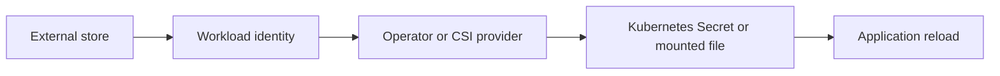

# Kubernetes secret-management patterns

## Purpose

Separate secret storage, access control, delivery, rotation, and application reload.

Sources reviewed: 2026-10-29. See the [validation record](../../../../knowledge-base-audit.md) for executed checks and unexecuted runtime labs.

## What Kubernetes Secrets provide

A Secret is an API object for confidential values. Base64 encoding is reversible encoding, not encryption. Encryption at rest depends on cluster configuration; managed providers may enable protections beyond Kubernetes defaults. RBAC, audit logging, node security, and application logging still matter.[^secret-good-practices][^secrets-and-mounted-volumes]



## Choose the delivery contract

| Pattern | Useful when | Operational consequence |
| --- | --- | --- |
| ESO syncs a Kubernetes Secret | Application expects Secret references | Value also resides in the Kubernetes API store. |
| CSI Driver mounts files | Application can read files | Node/provider availability affects mounts. |
| Vault agent or SDK | Dynamic credentials or leased values | Renewal and revocation become application concerns. |
| SOPS / Sealed Secrets | Encrypted values must travel through Git | Decryption-key recovery is essential. |
| Direct application SDK | Application owns retrieval | Each application needs authentication and retry logic. |

## Rotation is an end-to-end workflow

1. Change the upstream value while allowing any required overlap.
2. Observe reconciliation or remount/refresh.
3. Verify application reload or an intentional restart.
4. Prove a request succeeds with the new value.
5. Revoke the old value and verify it fails.

Environment variables are fixed when the container starts. Updated mounted Secret volumes are eventually refreshed, but `subPath` mounts do not receive automatic updates. Applications must implement reload behavior or be restarted.

## Inspect metadata without printing values

```bash
kubectl get secret app-credentials -n demo -o jsonpath='{.metadata.resourceVersion}{"\n"}'
kubectl get serviceaccount app -n demo -o yaml
```

What it does: checks a Secret revision and workload identity configuration without decoding secret data. A resource-version change does not prove the application consumed the update.

## Security and recovery

Use namespace-scoped stores where possible, separate controller and application identities, restrict `get/list/watch`, and avoid broad trust wildcards. Users who can create Pods can often mount Secrets in that namespace. Back up decryption keys separately from encrypted Git content and test restoration.

## Related links

- [Secret good practices](https://kubernetes.io/docs/concepts/security/secrets-good-practices/)
- [Secrets and mounted volumes](https://kubernetes.io/docs/concepts/configuration/secret/)
- [EKS workload identity](../../../cross-topic-guides/eks-workload-identity.md)
- [Back to parent index](index.md)
- [Back to major area](../../index.md)
- [Back to root index](../../../../README.md)

[^secret-good-practices]: [Secret good practices](https://kubernetes.io/docs/concepts/security/secrets-good-practices/).
[^secrets-and-mounted-volumes]: [Secrets and mounted volumes](https://kubernetes.io/docs/concepts/configuration/secret/).
