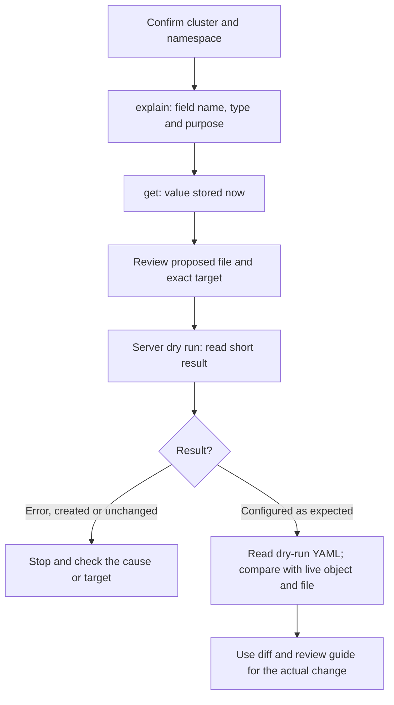

# Inspect a Kubernetes API field before changing a manifest

## What you will do

A manifest field has three useful views. The **schema** describes
the field's name, type, and purpose for an API version. The **live
object** shows what this cluster currently stores. The **proposed
file** is the change you want to submit. A server dry run asks the
API server to check that proposed request now. Seeing a field in
the schema does not mean every value or combination of values is
valid.[^explain][^get][^dry-run]

Think of the schema as a blank form with instructions, the live
object as the filed copy, and the dry run as a clerk checking a
new draft without filing it. The analogy ends at the counter:
the dry run does not cause controllers to act or create Pods to
see whether the application will work.[^dry-run]



Text alternative: confirm the target, ask the API for the field
definition, read the current object, review the proposed file,
then submit that file as a server dry run. Stop on an error,
unexpected creation, or no change. For an expected update,
compare the returned YAML with the live object and file, then
follow the diff and review guide. A successful dry run does
not prove that a later rollout or user request will work.

This guide uses an **invented** Deployment named `web` in namespace
`shop` and a file at `k8s/web-deployment.yaml`. No cluster was used
to test the example. Replace all three values with your actual
target; do not create the example file just to follow along.

## Before you start

- Confirm which cluster and namespace you are allowed to inspect.
  The [opening inspection guide](daily-usage.md) explains how to
  check a context whose name may be ambiguous.
- Have permission to read the Deployment and to perform the
  corresponding apply request. For an existing Deployment, the
  apply dry run needs update permission such as `patch`, even
  though it does not persist the object. Read-only access is not
  enough.[^dry-run]
- Know who owns the live object. A GitOps or release controller may
  replace a direct change. This guide does not apply a live change.

### 1. Ask this cluster about the field

```bash
kubectl config current-context
kubectl config get-contexts
kubectl api-resources --api-group=apps
kubectl explain deployment.spec.strategy --api-version=apps/v1
```

Compare the context's **CLUSTER** mapping with your team's
expected kubeconfig entry. Both names are local labels; use
trusted environment instructions to confirm the server address
when either is ambiguous. **Stop if the target is uncertain**. The
[opening inspection guide](daily-usage.md) shows the full target
check. `api-resources` lists API resources served by
this cluster; its `NAMESPACED` column helps distinguish namespaced
resources such as Deployments from cluster-scoped ones. `explain`
reads the resource's API field documentation. It describes
`strategy`, not the value used by your `web` Deployment.
[^api-resources][^explain]

For a nested setting, ask for the exact path:

```bash
kubectl explain deployment.spec.strategy.rollingUpdate.maxUnavailable --api-version=apps/v1
```

The answer describes the field's shape and purpose for the chosen
API version. It does not validate a particular value or a pair
of related fields. If `explain` cannot find the path, check the
kind, API version, spelling, and cluster version before changing
the file.[^explain]

### 2. Read the stored Deployment

```bash
kubectl get deployment web -n shop -o yaml
```

Find `spec.strategy` in the returned object. Compare only the fields
relevant to your proposed change; the server may include defaults
or metadata absent from your file. `NotFound` calls for checking
context, namespace, and name before going further. The live object
is evidence of stored configuration, not proof that the Pods are
ready or that users can reach the service.[^get]

For example, this **invented excerpt** is the relevant part of a
live `web` Deployment. It is not a complete manifest and was not
read from a cluster:

```yaml
spec:
  replicas: 3
  strategy:
    type: RollingUpdate
    rollingUpdate:
      maxSurge: 1
      maxUnavailable: 1
```

Here `maxUnavailable: 1` permits at most one of three desired
Pods to be unavailable during the rolling update, while
`maxSurge: 1` permits one extra non-terminating Pod. Pods still
terminating can briefly make the total higher. These are
explicit example values, not Kubernetes defaults. When omitted,
both fields default to `25%`; a percentage is rounded down for
`maxUnavailable` and up for `maxSurge`. This describes the
stored strategy, not whether any Pod is healthy right now.
[^deployments]

> [!CAUTION]
> A full YAML response can include configuration details. Use the
> same care when sharing it as you would with the manifest.

### 3. Check the proposed file with the API server

Suppose the reviewed file proposes `maxUnavailable: 0` while
keeping `maxSurge: 1`. Its relevant excerpt is:

```yaml
spec:
  replicas: 3
  strategy:
    type: RollingUpdate
    rollingUpdate:
      maxSurge: 1
      maxUnavailable: 0
```

The field shape is valid, and this pair satisfies the rule that
`maxSurge` and `maxUnavailable` cannot both be zero. The proposed
strategy aims to keep all three desired replicas available during
an update, using room for one extra Pod. It constrains the
Deployment rollout, not unrelated node failures or evictions.
The extra Pod still needs quota and capacity; if it cannot become
ready, the rollout can stall. Pod availability also depends on
the configured readiness checks, not merely this number.
[^deployments]

For contrast, `kubectl explain` can describe both fields in an
alternative file where **both values are `0`**, but the API rejects
that combination. Knowing a field's type is different from
validating the whole object. This is a documentation-based example,
not an error reproduced in this repository.[^explain][^deployments]

Review the **complete** file's `apiVersion`, kind, name,
namespace, and changed fields. Confirm it is the same file and
apply mode that the approved change would use. First read
kubectl's short result:

```bash
kubectl apply -f k8s/web-deployment.yaml -n shop --dry-run=server
```

Look for the operation word in the short result: `created`,
`unchanged`, or `configured`. **Stop** on `created`: step 2
expected an existing Deployment, so recheck the cluster, namespace,
name, and file. On `unchanged`, check whether the proposed field
is actually in the file and whether this is the right target.
`configured` means kubectl found an update to send; it does not
identify which field changed. For that result, inspect the full
returned object:

```bash
kubectl apply -f k8s/web-deployment.yaml -n shop --dry-run=server -o yaml
```

This uses kubectl's default **client-side apply** mode to compute
the request, then sends it through the API server without
persisting it. The server checks authorization, admission,
defaulting, and validation. A webhook that cannot safely handle
dry-run requests can cause this check to fail even when a real
request might proceed.[^dry-run] This command does not check
server-side apply field-ownership conflicts. If the real change
uses `--server-side` or a specific field manager, the dry run
must use those same options to check that different request.
[^apply][^dry-run][^server-side-apply]

In the returned YAML, verify `metadata.name`,
`metadata.namespace`, and the resulting `spec.strategy` against
the live object and proposed file. Any `status` block describes
the current workload, not a prediction of the proposed rollout;
do not read its replica counts or conditions as a dry-run result.
Server-managed metadata and the client-side apply annotation may
also appear in the response.[^dry-run][^apply]

**Stop** if either command reports `Forbidden`, fails admission
or validation, or shows an unexpected object or change. Also
stop if kubectl warns that the live object lacks a
last-applied-configuration annotation; confirm its owner and
apply method before using client-side apply. A dry-run error
is not a reason to try a real apply. The two commands are
separate requests; neither reserves the live object's current
state.[^dry-run]

A successful response means this request passed the API checks
**at that moment**. Generated fields can differ from a real
request, and the live object or admission setup can change
before a later apply. No Deployment controller has created a
new ReplicaSet or Pods as a result of this dry run, so it does
not test scheduling, image pulls, Pod readiness, or application
traffic.[^dry-run][^deployments]

The [manifest-change guide](common-commands.md) uses `kubectl diff`
to compare the live object with a server dry-run result; the diff
can include server-managed fields. It then requires review and
rollout checks. The dry-run YAML here is the full API response
for this request; it does not replace that change review.[^diff]

## Choose the next route

- To make an approved direct change and verify its outcome, follow
  [Review and apply a Kubernetes manifest change](common-commands.md).
- To inspect a Pod that is already failing, use
  [Find the first failing Kubernetes boundary](../troubleshooting/common-solutions.md)
  and then the relevant symptom guide.
- For a different operation, read the focused official procedure:
  [server-side apply](https://kubernetes.io/docs/reference/using-api/server-side-apply/)
  explains field ownership;
  [debug running Pods](https://kubernetes.io/docs/tasks/debug/debug-application/debug-running-pod/)
  explains debug containers and copies;
  [safely drain a node](https://kubernetes.io/docs/tasks/administer-cluster/safely-drain-node/)
  explains workload disruption;
  [authorization](https://kubernetes.io/docs/reference/access-authn-authz/authorization/)
  explains permission checks. These actions have different
  prerequisites from field inspection.

## Explore further

- [kubectl api-resources](https://kubernetes.io/docs/reference/kubectl/generated/kubectl_api-resources/)
  lists resource names, groups, and scopes.[^api-resources]
- [kubectl explain](https://kubernetes.io/docs/reference/kubectl/generated/kubectl_explain/)
  documents fields served by the cluster.[^explain]
- [Kubernetes API dry-run](https://kubernetes.io/docs/reference/using-api/api-concepts/#dry-run)
  describes server processing and its limits.[^dry-run]
- [Deployments](https://kubernetes.io/docs/concepts/workloads/controllers/deployment/)
  explains rolling-update strategy fields.[^deployments]
- [Back to Kubernetes commands](index.md).

[^api-resources]: [Kubernetes, kubectl api-resources](https://kubernetes.io/docs/reference/kubectl/generated/kubectl_api-resources/), source record `api-resources`.
[^explain]: [Kubernetes, kubectl explain](https://kubernetes.io/docs/reference/kubectl/generated/kubectl_explain/), source record `explain`.
[^get]: [Kubernetes, kubectl get](https://kubernetes.io/docs/reference/kubectl/generated/kubectl_get/), source record `get`.
[^apply]: [Kubernetes, kubectl apply](https://kubernetes.io/docs/reference/kubectl/generated/kubectl_apply/), source record `apply`.
[^dry-run]: [Kubernetes, Kubernetes API dry-run](https://kubernetes.io/docs/reference/using-api/api-concepts/#dry-run), source record `dry-run`.
[^deployments]: [Kubernetes, Deployments](https://kubernetes.io/docs/concepts/workloads/controllers/deployment/), source record `deployments`.
[^diff]: [Kubernetes, kubectl diff](https://kubernetes.io/docs/reference/kubectl/generated/kubectl_diff/), source record `diff`.
[^server-side-apply]: [Kubernetes, Server-Side Apply](https://kubernetes.io/docs/reference/using-api/server-side-apply/), source record `server-side-apply`.
