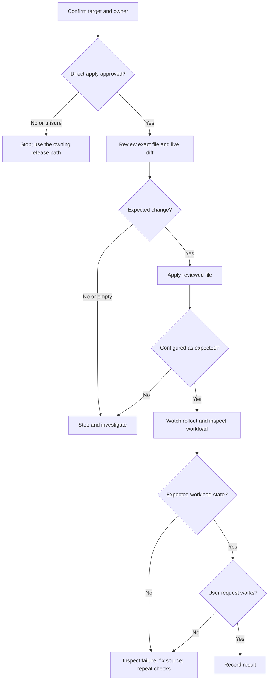

# Review and apply a Kubernetes manifest change

## What you will do

Use `kubectl` to take one **reviewed Deployment manifest**
from a known file to an observed workload state. The sequence is
target → diff → apply → rollout → application check. It is for a
cluster where your team permits direct `kubectl apply` and the
reviewed manifest file is the intended source of truth. If a GitOps
controller, Helm release, or another release system owns the object,
make the change through that system instead.
[GitOps ownership](../applications-and-tools/gitops.md)
explains the reconciliation boundary.



Text alternative: confirm the cluster, namespace, existing object,
and release owner. Stop if direct apply is not approved. Compare the
exact reviewed file with the live object and stop on an empty or
unexplained diff. Apply only the expected change. Stop if the apply
result is unexpected. Watch the workload; if its expected state is
not reached, inspect the failure and fix the reviewed source. Test
a representative user request, then correct the source and repeat
the checks if that request fails.

The page uses an **invented** `web` Deployment in namespace `shop`
and a file named `k8s/web-deployment.yaml`. No cluster command in
this guide was run for its creation. Replace these values with a
real, reviewed file and target.

## Before you change the cluster

- Have permission and an approved change for this environment.
- Confirm that the file describes the intended Deployment and
  namespace. `kubectl apply` can **create** a resource that does
  not already exist.[^kubectl-apply]
- Know how your team corrects the reviewed file if verification
  fails. A live `rollout undo` alone leaves a bad manifest in the
  source path, so a later apply can reintroduce the change.
- Decide what user request demonstrates success. A completed
  rollout is a controller result, not an application test.
  [^deployments]

### 1. Confirm the target and existing object

```bash
kubectl config current-context
kubectl config get-contexts
kubectl get deployment web -n shop
kubectl get deployment web -n shop -o yaml --show-managed-fields
```

Compare the context with the environment named in the change
review, including its `CLUSTER` value in `get-contexts`. The
[opening inspection guide](daily-usage.md) explains that mapping.
Stop if the target is uncertain. The third command confirms
the object exists in the namespace you intend to change. A
`NotFound` result may mean the context, namespace, or name is
wrong; applying the file without resolving that could create
a new object in the wrong place.[^current-context]
[^kubectl-apply]

The YAML output is **an ownership clue, not proof of ownership**.
Look for `app.kubernetes.io/managed-by` under `metadata.labels`, release
annotations, and `metadata.managedFields[].manager`. Also check for
`kubectl.kubernetes.io/last-applied-configuration` under
`metadata.annotations`; its absence is a clue that this object was
not previously managed by client-side `kubectl apply`. A manager name
records a field update; it does not identify the team's intended
release authority on its own. Confirm the owning repository or
release process with your team. If it is unknown or another tool
owns this Deployment, stop here.[^kubectl-get]
[^recommended-labels] [^field-managers] [^declarative-config]

Illustrative `get` output: `web  2/2  2  2  8d` under the columns
`NAME`, `READY`, `UP-TO-DATE`, `AVAILABLE`, `AGE`. The YAML may be
long; do not share it outside the change-review channel because it
can contain configuration details.

### 2. Compare local intent with live state

From the Git checkout that contains the approved manifest, first
check the exact revision and whether this path has local edits:

```bash
git rev-parse HEAD
git ls-files --error-unmatch -- k8s/web-deployment.yaml
git status --short -- k8s/web-deployment.yaml
```

Compare the full commit SHA with the reviewed revision. `git ls-files`
must find the file in Git; `git status` should print nothing for this
path. If either check differs, stop and review the actual file before
continuing. Inspect its `kind`, `metadata.name`,
and `metadata.namespace`; they should describe the existing `web`
Deployment in `shop`. Confirm the file contains only this one
object; otherwise each object needs its own target, owner, diff,
and apply-result check.

```bash
kubectl diff -f k8s/web-deployment.yaml -n shop
```

Illustrative excerpt from a unified diff, not observed cluster output:

```diff
-        image: registry.example/web:v1
+        image: registry.example/web:v2
```

Read **all** changed fields, especially the image, replicas,
selectors, Pod template, and namespace. The image line says what
value would change; it does not prove that `v2` is safe or that
the registry is reachable. Review any additional lines as well;
do not proceed when you cannot explain an unexpected change.
[^kubectl-diff]

If the diff changes `spec.replicas`, check whether a HorizontalPodAutoscaler
targets this Deployment with `kubectl get hpa -n shop`. Compare its
`REFERENCE` column with `Deployment/web`. If one does, stop and ask
the release owner how scaling is meant to be managed: applying a
manifest with `spec.replicas` can reset the autoscaler's current
count.[^horizontal-autoscaling]

`kubectl diff` has a useful exit convention: `0` means no
difference, `1` means differences were found, and a value
greater than `1` means an error. A script that treats every
nonzero exit as failure can mistake a normal diff for a
failed check; a human must still review the actual output.
[^kubectl-diff]

An empty diff means there is no proposed live change; stop instead
of using a successful rollout watch as evidence of a new release.
If the whole object appears as new, revisit step 1: you might be
targeting the wrong cluster, namespace, or name. If diff returns
`Forbidden` or another error, stop and ask the release owner to
resolve permissions or validation; `get` permission alone does not
ensure you can preview an apply. An API dry-run is still checked
against write authorization.[^api-dry-run]

> [!WARNING]
> The diff can reveal configuration details. Share it through
> the same controlled review channel used for the manifest.
> Confirm that the diff and the file come from the revision
> approved for this change.

### 3. Apply only the reviewed file

```bash
kubectl apply -f k8s/web-deployment.yaml -n shop
```

Illustrative result for an existing changed Deployment:
`deployment.apps/web configured`. If it says `created`, the object
did not exist at apply time, despite the opening check. Record the
unexpected creation, alert the release owner, and do not delete it
without the approved recovery process. If it says `unchanged`, stop:
there was no new change to verify. If `apply` warns that the
last-applied-configuration annotation was missing, stop the release
path and ask the owner to inspect the live change; the command may
already have patched the object. An error also stops this path;
read it before trying anything else.[^declarative-config]

Apply asks the API server to create or update the resource
described by that file. It changes live cluster state. The
command succeeding means the API accepted the requested
configuration; it does not mean new Pods are ready or that
customers can complete a request.[^kubectl-apply]
[^deployments]

If the file changed after review, repeat the diff and review
before applying. If the API denies the change, read the error
and resolve the permission, validation, or admission issue
through the normal process. Do not add force flags to make an
unexplained error disappear.

### 4. Watch the rollout and test the result

```bash
kubectl rollout status deployment/web -n shop --timeout=2m
kubectl get deployment web -n shop
```

For the invented two-replica Deployment, a successful Pod-template
change may show a waiting line with an updated-replica count, then
`deployment "web" successfully rolled out`. Afterward, `get`
might show `web  2/2  2  2  8d`
under `NAME`, `READY`, `UP-TO-DATE`, `AVAILABLE`, `AGE`. These are
**illustrative**, not recorded execution output.[^deployments]

For a Deployment Pod-template change, rollout status watches
the latest rollout until it completes or the command times out.
If another revision begins while it is watching, the default
command follows the latest revision; if that happens, find who
started the other change before treating this result as yours.
`--timeout=2m` limits your watch; it does not cancel the
Deployment's rollout. A progress-deadline failure is a condition
reported by the Deployment, not just a short local watch. A timeout
or failure calls for inspection, not an automatic second apply.
Changes only to replicas do not create a Deployment revision, so
use the observed replica counts and the relevant workload check
rather than interpreting a quick rollout-status result as a new
rollout.[^deployments]
[^rollout-status]

Then follow the [Deployment inspection guide](kubectl-basics.md)
to examine matching Pods if readiness is short. Finally run
the representative user request agreed before the change.
For example, if the team's check for this invented shop is a
catalog request, inspect its response and a build identifier
served through the real user path. A `200` from `/healthz`
alone is not that check. Successful rollout status does not
prove that the user request works.
[^deployments]

## If verification fails

Keep the context, diff, apply result, rollout events, and
application observation together. Correct or revert the
**reviewed manifest in version control**, get that correction
reviewed, then repeat target → diff → apply → rollout → user
request. A live `rollout undo` may temporarily restore an older
Pod template, but it does not correct the manifest or other
objects such as ConfigMaps and Secrets. A later apply of the
bad file can reintroduce the problem. Follow your team's
incident and rollback process before any live rollback.
[^rollout-undo] [^deployments]

For other tasks, consult the focused Kubernetes references:
[rollout commands](https://kubernetes.io/docs/reference/kubectl/generated/kubectl_rollout/),
[scaling](https://kubernetes.io/docs/reference/kubectl/generated/kubectl_scale/),
[deletion](https://kubernetes.io/docs/reference/kubectl/generated/kubectl_delete/),
and [output selection](https://kubernetes.io/docs/reference/kubectl/generated/kubectl_get/).
They are separate decisions from applying this manifest.

## Explore further

- [kubectl diff](https://kubernetes.io/docs/reference/kubectl/generated/kubectl_diff/)
  explains the diff and exit codes.[^kubectl-diff]
- [kubectl apply](https://kubernetes.io/docs/reference/kubectl/generated/kubectl_apply/)
  describes declarative creation and updates.[^kubectl-apply]
- [Kubernetes Deployments](https://kubernetes.io/docs/concepts/workloads/controllers/deployment/)
  explains rollout behavior and status.[^deployments]
- [Recommended labels](https://kubernetes.io/docs/concepts/overview/working-with-objects/common-labels/)
  explains the `managed-by` label as one ownership clue.[^recommended-labels]
- [Back to Kubernetes commands](index.md).

[^current-context]: [Kubernetes, kubectl config current-context](https://kubernetes.io/docs/reference/kubectl/generated/kubectl_config/kubectl_config_current-context/), source record `current-context`.
[^kubectl-diff]: [Kubernetes, kubectl diff](https://kubernetes.io/docs/reference/kubectl/generated/kubectl_diff/), source record `kubectl-diff`.
[^kubectl-apply]: [Kubernetes, kubectl apply](https://kubernetes.io/docs/reference/kubectl/generated/kubectl_apply/), source record `kubectl-apply`.
[^rollout-status]: [Kubernetes, kubectl rollout status](https://kubernetes.io/docs/reference/kubectl/generated/kubectl_rollout/kubectl_rollout_status/), source record `rollout-status`.
[^deployments]: [Kubernetes, Deployments](https://kubernetes.io/docs/concepts/workloads/controllers/deployment/), source record `deployments`.
[^kubectl-get]: [Kubernetes, kubectl get](https://kubernetes.io/docs/reference/kubectl/generated/kubectl_get/), source record `kubectl-get`.
[^recommended-labels]: [Kubernetes, Recommended Labels](https://kubernetes.io/docs/concepts/overview/working-with-objects/common-labels/), source record `recommended-labels`.
[^rollout-undo]: [Kubernetes, kubectl rollout undo](https://kubernetes.io/docs/reference/kubectl/generated/kubectl_rollout/kubectl_rollout_undo/), source record `rollout-undo`.
[^field-managers]: [Kubernetes, Server-Side Apply](https://kubernetes.io/docs/reference/using-api/server-side-apply/), source record `field-managers`.
[^declarative-config]: [Kubernetes, Declarative Management of Kubernetes Objects Using Configuration Files](https://kubernetes.io/docs/tasks/manage-kubernetes-objects/declarative-config/), source record `declarative-config`.
[^api-dry-run]: [Kubernetes, API Concepts](https://kubernetes.io/docs/reference/using-api/api-concepts/), source record `api-dry-run`.
[^horizontal-autoscaling]: [Kubernetes, Horizontal Pod Autoscaling](https://kubernetes.io/docs/concepts/workloads/autoscaling/horizontal-pod-autoscale/), source record `horizontal-autoscaling`.
