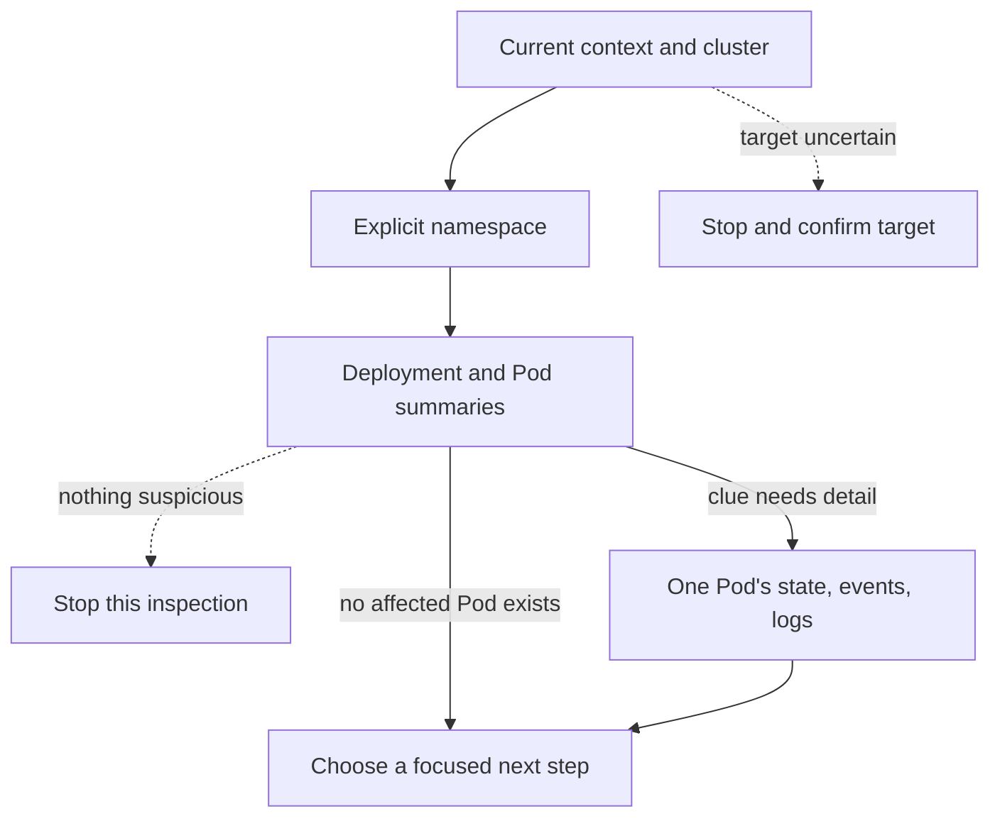

# Begin a safe kubectl inspection session

## What you will do

Use a short, repeatable sequence to answer: **Am I looking at the
right cluster, and which workload needs a closer look?** You will
read the current context, use an explicit namespace, list workloads
and Pods, and inspect one Pod only if its summary points to a
problem. These commands do not apply, delete, scale, restart, or
enter a workload.[^current-context][^kubectl-get]

A kubeconfig **context** selects a cluster and an identity, and may
include a default namespace. Treat it like the address on an
envelope: if the address is wrong, even a perfect message goes to
the wrong place. The analogy has a limit: a context name is just
a local label, so confirm which cluster it maps to rather than
trusting a familiar-sounding name.[^kubeconfig-files][^get-contexts]



Text alternative: first confirm the context and its cluster; stop if
the target is uncertain. Use the intended namespace explicitly and
scan Deployment and Pod summaries. If a clue needs more detail,
inspect one affected Pod and choose a focused next guide. If no
affected Pod exists, choose the next guide from the summaries.
Otherwise, stop this inspection.

## Before you start

- Know the intended environment and namespace from your team or
  exercise instructions. This page uses `shop` as an **invented
  example**.
- Have `kubectl` configured with permission to read the target
  namespace. A `Forbidden` result is an access signal, not a
  reason to try another cluster at random.
- Handle logs as potentially sensitive application output. Read
  only what you need and avoid posting secrets into a ticket.

### 1. Confirm the target

```bash
kubectl config current-context
kubectl config get-contexts
```

The first command names the active context. In the context list,
find the `*` in the **CURRENT** column and compare that row's
**CLUSTER** with your team's expected kubeconfig mapping. The
cluster name is another local label; if it is ambiguous, confirm
its server address through your trusted environment instructions.
Stop if the target is uncertain. **NAMESPACE** shows the context's
default, but this guide uses `-n shop` on each namespaced command so
the target is visible at the point of use.
[^current-context][^get-contexts][^kubeconfig-files]

> [!WARNING]
> Reading from the wrong cluster can expose data. Before any later
> change, repeat this target check and follow the review process
> for that environment.

### 2. Scan the namespace

```bash
kubectl get deployments -n shop
kubectl get pods -n shop -o wide
```

The Deployment list shows desired and available replica summaries.
The Pod list shows readiness, status, restart counts, and, with
`-o wide`, placement. Here is **abridged illustrative output** from
an invented two-replica Deployment; no cluster was inspected for it:

```text
NAME   READY   UP-TO-DATE   AVAILABLE   AGE
web    1/2     2            1           5m

NAME                      READY   STATUS    RESTARTS   AGE   IP          NODE
web-7c8d9f-a1b2c          1/1     Running   0          5m    10.0.1.11   worker-a
web-7c8d9f-d3e4f          0/1     Running   0          5m    10.0.2.12   worker-b
```

In the Deployment's **READY** value, the first number is ready and
the second is desired. The `0/1` Pod is the first one to inspect;
`Running` does not mean its container is ready. `Pending`,
`CrashLoopBackOff`, `ErrImagePull`, and `ImagePullBackOff` are other
clues. A rising restart count requires comparing observations over
time. These are clues, not diagnoses; a ready Pod also does not
prove that a user request succeeds.[^kubectl-get][^debug-pods]

The Deployment list does not include StatefulSets, DaemonSets, or
Jobs. Their Pods can still appear in the Pod list, so do not assume
every Pod must have a Deployment above it.

If a named resource returns `NotFound`, check the spelling, context,
and namespace. An empty list also needs a target check before you
conclude that nothing runs there. If your access allows it,
`kubectl get namespace shop` can confirm that the namespace exists;
otherwise confirm its name through your team. If the API returns
`Forbidden`, ask for appropriate read access; changing context to
evade a permission error is not a fix.[^kubectl-get][^kubernetes-rbac]

### 3. Inspect one affected Pod

Copy an exact Pod name from the list:

```bash
kubectl describe pod <pod-name> -n shop
kubectl logs <pod-name> -n shop --tail=100
```

The description shows container states, conditions, and related
events. Logs show what one container wrote, if it has started. For
a Pod with several containers, choose the relevant container from
the description and add `-c <container-name>` to the log command. If the
container restarted, the [CrashLoopBackOff guide](../troubleshooting/crashloopbackoff.md)
explains when to request `--previous` logs.
[^kubectl-describe][^kubectl-logs][^debug-pods]

Events and logs can be incomplete or absent. Record what they
actually say and the time you observed it; do not infer a root
cause from a status word alone.

## Choose a next path

| Observation | Next route |
| --- | --- |
| Deployment has missing or unready replicas | [Inspect a Deployment with kubectl](kubectl-basics.md) to follow its ReplicaSet to candidate Pods and confirm ownership. |
| Pod is `Pending` or `Running` but not Ready | [Find the first failing Kubernetes boundary](../troubleshooting/common-solutions.md) to read conditions and events before choosing a fix. |
| Pod repeatedly restarts | [Diagnose CrashLoopBackOff](../troubleshooting/crashloopbackoff.md) to read the last exit and previous logs. |
| Pod shows `ErrImagePull` or `ImagePullBackOff` | [Find the first failing Kubernetes boundary](../troubleshooting/common-solutions.md) to separate image reference, credentials, and network causes. |
| A Pod in kind cannot find a locally built image | [Diagnose a local image pull in kind](../troubleshooting/kind.md) for the host-versus-node image path. |
| Pods appear ready but requests fail | [Find the first failing Kubernetes boundary](../troubleshooting/common-solutions.md) to follow the request path. |
| A read returns `Forbidden` | [Find the first failing Kubernetes boundary](../troubleshooting/common-solutions.md) for the access route; do not bypass the denied permission. |
| Workload needs a reviewed change | [Review and apply a manifest change](common-commands.md); do not use a diagnostic symptom alone as the proposed fix. |

This routine is an opening check. It is not a complete incident
response, a security audit, or proof of application health.
For a broader command lookup, use the
[official kubectl quick reference](https://kubernetes.io/docs/reference/kubectl/quick-reference/).

## Explore further

- [kubectl get](https://kubernetes.io/docs/reference/kubectl/generated/kubectl_get/)
  covers selectors and output formats.[^kubectl-get]
- [Debug Pods](https://kubernetes.io/docs/tasks/debug/debug-application/debug-pods/)
  covers conditions, events, and container evidence.[^debug-pods]
- [Back to Kubernetes commands](index.md).

[^current-context]: [Kubernetes, kubectl config current-context](https://kubernetes.io/docs/reference/kubectl/generated/kubectl_config/kubectl_config_current-context/), source record `current-context`.
[^get-contexts]: [Kubernetes, kubectl config get-contexts](https://kubernetes.io/docs/reference/kubectl/generated/kubectl_config/kubectl_config_get-contexts/), source record `get-contexts`.
[^kubeconfig-files]: [Kubernetes, Organizing Cluster Access Using kubeconfig Files](https://kubernetes.io/docs/concepts/configuration/organize-cluster-access-kubeconfig/), source record `kubeconfig-files`.
[^kubectl-get]: [Kubernetes, kubectl get](https://kubernetes.io/docs/reference/kubectl/generated/kubectl_get/), source record `kubectl-get`.
[^kubectl-describe]: [Kubernetes, kubectl describe](https://kubernetes.io/docs/reference/kubectl/generated/kubectl_describe/), source record `kubectl-describe`.
[^kubectl-logs]: [Kubernetes, kubectl logs](https://kubernetes.io/docs/reference/kubectl/generated/kubectl_logs/), source record `kubectl-logs`.
[^debug-pods]: [Kubernetes, Debug Pods](https://kubernetes.io/docs/tasks/debug/debug-application/debug-pods/), source record `debug-pods`.
[^kubernetes-rbac]: [Kubernetes, Using RBAC Authorization](https://kubernetes.io/docs/reference/access-authn-authz/rbac/), source record `kubernetes-rbac`.
