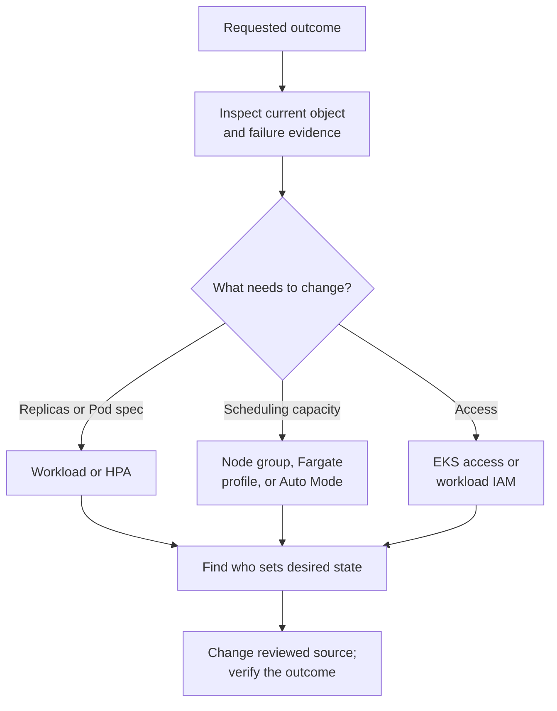

# Choose the right control path for an EKS change

## What you will do

Before changing an Amazon EKS application, collect evidence for the
problem, identify **which object needs to change**, then find **who
sets its desired state**. A command that can reach an object is not
necessarily the right way to change it. A team's reviewed application
repository may set Deployment replicas; an HPA may set replicas, and
a compute autoscaler may add nodes within its configured limits.
Check the actual owner before editing either value.
[^kubernetes-deployments][^kubernetes-hpa][^eks-autoscaling]



Text alternative: begin with the requested outcome and inspect the
current object and failure evidence. Decide whether a workload,
compute path, or access path needs to change. Identify the system
that sets its desired state, change that reviewed source, and verify
the outcome. `kubectl` talks to the Kubernetes API; `eksctl` can
manage EKS and related AWS resources.[^eksctl-overview] Neither
tool proves that an application works for a user.

## Map the request to its owner

| Request | First object or boundary | Where to learn the procedure |
| --- | --- | --- |
| Run more copies of one application | A Deployment's replicas or autoscaling configuration, plus Pod scheduling evidence. | [Kubernetes Deployments](https://kubernetes.io/docs/concepts/workloads/controllers/deployment/) and [inspect a Deployment](kubectl-basics.md). |
| Add EC2 worker capacity | The cluster's node-group and autoscaling design, if it uses node groups. | [eksctl node groups](https://docs.aws.amazon.com/eks/latest/eksctl/general-nodegroups.html). |
| Investigate missing managed node groups | First identify whether this cluster uses EKS Auto Mode, Fargate, or another compute path. | [EKS Auto Mode](https://docs.aws.amazon.com/eks/latest/eksctl/auto-mode.html) and [Kubernetes on AWS](../../cross-topic-guides/kubernetes-on-aws.md). |
| Let a person use `kubectl` | EKS authentication and authorization, which may include an access entry and Kubernetes RBAC. | [EKS human identity and RBAC](../../security/identity-federation/eks-human-identity-and-rbac.md). |
| Let a Pod call an AWS API | The Pod's service account, the selected Pod Identity or IRSA path, and IAM permission. | [EKS workload identity](../../cross-topic-guides/eks-workload-identity.md). |
| Change an EKS add-on or the control plane | EKS-managed component and its compatibility with the cluster and workloads. | [eksctl add-ons](https://docs.aws.amazon.com/eks/latest/eksctl/addons.html) or [cluster upgrades](https://docs.aws.amazon.com/eks/latest/eksctl/cluster-upgrade.html). |

`eksctl` can create clusters, manage node groups, and configure
several EKS capabilities, sometimes creating related CloudFormation
or IAM resources. It is not the universal owner of every EKS
installation. The cluster or component may instead be declared
through another infrastructure system; follow that system's review
and deployment path.[^eksctl-overview] A kubeconfig entry lets
`kubectl` locate a cluster and obtain credentials; it is not itself
a grant of authorization to change it. Human cluster access and
Pod-to-AWS credentials solve different problems.[^eks-human-access]
[^eksctl-pod-identity]

## Example: lesson Pods are Pending

This is an **invented** incident. No AWS account, EKS cluster,
node group, Pod, or user request was inspected.

A reviewed application change raises the `lesson-api` Deployment's
desired replicas from two to four. Four Pods exist, but two are
Pending. Pending alone does not identify a capacity shortage: first
check whether a Pod has a node and read its events.
[^kubernetes-debug-pods]

### Read the target before proposing a change

For the invented cluster `learning-lab` in `eu-west-1`, first verify
the target with these **read-only** commands. Replace the values with
the environment you have permission to inspect:

```bash
aws sts get-caller-identity
eksctl get cluster --region eu-west-1
aws eks describe-cluster --name learning-lab --region eu-west-1 --query 'cluster.endpoint'
kubectl config current-context
kubectl config view --minify
```

The `eksctl` listing must include `learning-lab` in the intended
Region. Compare the AWS-reported API endpoint with the server shown
by `kubectl config view --minify`.[^eks-describe-cluster] The tools can
use different credentials and targets;
an empty regional cluster listing can simply mean the wrong Region.
If a read is denied, resolve identity, access, and network
reachability before interpreting the result. Do not paste account
identifiers or full output into a public issue.

Next inspect the workload. Replace `POD_NAME` with one of the Pending
names returned by the Pod listing:

```bash
kubectl get deployment lesson-api -n lessons
kubectl get hpa -n lessons
kubectl get pods -n lessons -o wide
kubectl describe pod POD_NAME -n lessons
```

In this invented result, no HPA targets `lesson-api`. The Deployment
wants four replicas, and four Pods exist. The two Pending Pods show
`<none>` in the `NODE` column. The
[safe kubectl inspection guide](daily-usage.md) explains these
views in more detail. `kubectl describe pod` can expose environment
values, so review its output before sharing it.

Suppose the invented Pending Pod has **no node assigned** and its
`kubectl describe pod` events include this **abbreviated** signal:

```text
Warning  FailedScheduling  0/2 nodes are available: 2 Insufficient cpu.
```

`Insufficient cpu` is about the Pod's **requested CPU** versus what
each eligible node can still allocate after existing requests; low
live CPU use alone would not disprove it.[^kubernetes-resources]
If one Pod's request exceeds what a fresh node of this size can
allocate, review the workload request or node type first. Adding
more same-size nodes would not fit that Pod.

Here the team checks the Pod's requests in `kubectl describe pod` and
compares them with node allocatable and existing Pod requests in
`kubectl describe node NODE_NAME`, replacing `NODE_NAME` with a name
from `kubectl get nodes`. They confirm that one more node of
the same type could fit the Pod after system Pods' requests. A node
label then points to the managed group; a missing label needs more
investigation before choosing it.[^kubernetes-resources]

These **read-only** commands identify the nodes and managed-group
limits. Replace `NODEGROUP_NAME` with the observed label value:

```bash
kubectl get nodes -L eks.amazonaws.com/nodegroup,eks.amazonaws.com/compute-type
eksctl get nodegroup --cluster learning-lab --region eu-west-1
aws eks describe-nodegroup --cluster-name learning-lab --nodegroup-name NODEGROUP_NAME --region eu-west-1 --query 'nodegroup.scalingConfig'
```

The invented scaling configuration reports `desiredSize: 2` and
`maxSize: 2`. The team's platform inventory and current deployment
show that Cluster Autoscaler covers this group and is healthy. It
can change desired size within the group's bounds, but cannot raise
its maximum. The team also checks the Pod's placement rules and
other compute paths before concluding that this group is the
eligible one.[^eks-managed-node-labels][^eks-describe-nodegroup]
[^eks-autoscaling]

Search the team's infrastructure source for the exact cluster and
node-group names. In this invented case, its reviewed configuration
sets `maxSize: 2`. That repository's owner should review a higher
maximum and its cost and capacity limits. An `eksctl` listing or AWS
tag can help locate the source, but does not prove which system owns
it. If no autoscaler covers the group, a higher maximum alone adds
no nodes: the reviewed desired-size setting or a different compute
path must also be addressed. A direct `kubectl scale` would ask for
more Pods, not fix their placement.[^eks-describe-nodegroup]
[^eksctl-nodegroups]
After the approved change, check `kubectl get pods -n lessons -o wide`
for node assignment, `kubectl get deployment lesson-api -n lessons`
for four available replicas, and the application's own health check.
These are example decisions, not observed cluster results.

The same request can lead elsewhere. If fewer than four Pod objects
exist, inspect `kubectl describe deployment lesson-api -n lessons`
and its ReplicaSet events; a namespace quota can reject Pod creation
rather than leave an existing Pod unscheduled.[^kubernetes-quotas]
If an HPA owns replicas, review its target and limits rather than
repeatedly setting the Deployment's replica count.[^kubernetes-hpa]
If a managed group is below its maximum, check its autoscaler and
why it did not add capacity before changing the maximum. If a Pod
is already assigned to a node, investigate its startup events before
adding capacity. EKS
clusters can combine managed or self-managed nodes, Fargate, and
Auto Mode; an empty managed node-group listing does not identify the
Pod's compute path. For Fargate, inspect the profile's namespace and
label selectors; for Auto Mode, inspect its NodePool and capacity
rules. Follow the reviewed owner for that path.[^eks-compute]
[^eks-fargate][^eks-auto-compute][^eksctl-auto-mode] For a workload-source change, use
the [manifest-change guide](common-commands.md). The
[resource-pressure guide](workflows.md) explains other scheduling
signals.

## What a dry run can tell you

`eksctl create cluster --dry-run` produces a `ClusterConfig` from
CLI options or a supplied config file. It helps you inspect the
configuration that `eksctl` would use; it is **not** a preview of
every AWS resource change, bill, permission outcome, or workload
effect. It also differs from
[`kubectl apply --dry-run=server`](advanced-commands.md), which
submits a Kubernetes API request without persisting it.
[^eksctl-dry-run][^kubernetes-apply] Use the review mechanism of the actual
infrastructure owner before creation, deletion, or upgrade.

## Explore further

- [What is eksctl?](https://docs.aws.amazon.com/eks/latest/eksctl/what-is-eksctl.html)
  lists the tool's EKS management capabilities.[^eksctl-overview]
- [Creating and managing clusters](https://docs.aws.amazon.com/eks/latest/eksctl/creating-and-managing-clusters.html)
  covers creation, kubeconfig effects, and deletion considerations.
- [Non-eksctl-created clusters](https://docs.aws.amazon.com/eks/latest/eksctl/unowned-clusters.html)
  records which commands AWS documents for clusters made elsewhere.
- [EKS operations](../../cross-topic-guides/eks-operations.md)
  starts from a symptom rather than a proposed command.
- [Back to Kubernetes commands](index.md).

[^eksctl-overview]: [AWS, What is eksctl?](https://docs.aws.amazon.com/eks/latest/eksctl/what-is-eksctl.html), source record `eksctl-overview`.
[^eksctl-nodegroups]: [AWS, Work with node groups](https://docs.aws.amazon.com/eks/latest/eksctl/general-nodegroups.html), source record `eksctl-nodegroups`.
[^eksctl-auto-mode]: [AWS, EKS Auto Mode with eksctl](https://docs.aws.amazon.com/eks/latest/eksctl/auto-mode.html), source record `eksctl-auto-mode`.
[^eks-compute]: [AWS, Compute options for Amazon EKS](https://docs.aws.amazon.com/eks/latest/userguide/eks-compute.html), source record `eks-compute`.
[^eks-auto-compute]: [AWS, Configure compute and scaling](https://docs.aws.amazon.com/eks/latest/userguide/auto-configure-compute.html), source record `eks-auto-compute`.
[^eks-managed-node-labels]: [AWS, Understand each phase of node updates](https://docs.aws.amazon.com/eks/latest/userguide/managed-node-update-behavior.html), source record `eks-managed-node-labels`.
[^eks-describe-nodegroup]: [AWS CLI, describe-nodegroup](https://docs.aws.amazon.com/cli/latest/reference/eks/describe-nodegroup.html), source record `eks-describe-nodegroup`.
[^eks-describe-cluster]: [AWS CLI, describe-cluster](https://docs.aws.amazon.com/cli/latest/reference/eks/describe-cluster.html), source record `eks-describe-cluster`.
[^eks-autoscaling]: [AWS, Scale cluster compute with Karpenter and Cluster Autoscaler](https://docs.aws.amazon.com/eks/latest/userguide/autoscaling.html), source record `eks-autoscaling`.
[^eks-fargate]: [AWS, EKS Fargate support with eksctl](https://docs.aws.amazon.com/eks/latest/eksctl/fargate.html), source record `eks-fargate`.
[^eks-human-access]: [AWS, Grant access to Kubernetes APIs](https://docs.aws.amazon.com/eks/latest/userguide/grant-k8s-access.html), source record `eks-human-access`.
[^eksctl-pod-identity]: [AWS, EKS Pod Identity associations with eksctl](https://docs.aws.amazon.com/eks/latest/eksctl/pod-identity-associations.html), source record `eksctl-pod-identity`.
[^eksctl-dry-run]: [AWS, eksctl dry run](https://docs.aws.amazon.com/eks/latest/eksctl/dry-run.html), source record `eksctl-dry-run`.
[^kubernetes-deployments]: [Kubernetes, Deployments](https://kubernetes.io/docs/concepts/workloads/controllers/deployment/), source record `kubernetes-deployments`.
[^kubernetes-hpa]: [Kubernetes, Horizontal Pod Autoscaling](https://kubernetes.io/docs/concepts/workloads/autoscaling/horizontal-pod-autoscale/), source record `kubernetes-hpa`.
[^kubernetes-debug-pods]: [Kubernetes, Debug Running Pods](https://kubernetes.io/docs/tasks/debug/debug-application/debug-running-pod/), source record `kubernetes-debug-pods`.
[^kubernetes-quotas]: [Kubernetes, Resource Quotas](https://kubernetes.io/docs/concepts/policy/resource-quotas/), source record `kubernetes-quotas`.
[^kubernetes-resources]: [Kubernetes, Resource Management for Pods and Containers](https://kubernetes.io/docs/concepts/configuration/manage-resources-containers/), source record `kubernetes-resources`.
[^kubernetes-apply]: [Kubernetes, kubectl apply](https://kubernetes.io/docs/reference/kubectl/generated/kubectl_apply/), source record `kubernetes-apply`.
