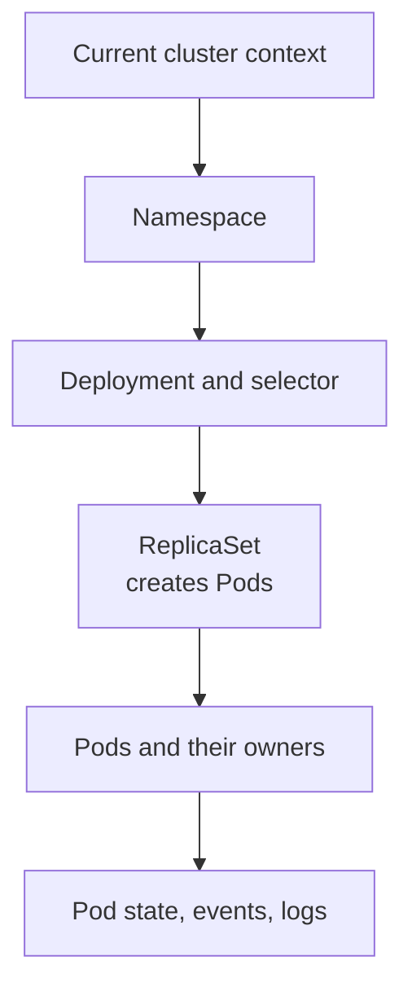

# Inspect a Kubernetes Deployment with kubectl

## What you will do

Use `kubectl` to answer one question: **where does a Deployment stop
matching the result you expect?** You will confirm the cluster, read
the Deployment, find its Pods, and inspect one Pod's events and logs.
The commands in this guide read information; they do not apply,
delete, scale, or restart resources.[^kubectl-reference]
[^current-context][^kubectl-get]

A **Deployment** declares how many application Pods Kubernetes
should keep running. It manages **ReplicaSets**, which create and
replace the **Pods** that run the application's containers. Think
of a staffing target, a roster, and the people on the shift. The
analogy stops at the roster: Kubernetes controllers keep correcting
the actual state as Pods change. The Deployment's status is a
summary; ReplicaSet and Pod details help explain why a replica is
missing or unready.
A green Deployment count still does not test the user's request
path.[^deployments][^debug-pods]



Text alternative: identify the current cluster and namespace, then
read the Deployment, its selector, and its ReplicaSet. Use the
selector to find candidate Pods, then confirm their owner. Inspect
Pod state, events, and logs to choose the next
investigation.

## Before you start

- Install `kubectl` and use credentials that can read the target
  namespace, Deployment, Pods, events, and logs.
- Know the intended environment and namespace. This guide uses
  `shop` as an **invented example**; replace it with your own.
- Have the Deployment name. The example uses `web`.

> [!WARNING]
> A valid command can read the wrong cluster. Confirm the context
> before inspecting a production workload. Logs may contain secrets
> or personal data printed by the application; handle their output
> accordingly.

## 1. Confirm the target

```bash
kubectl config current-context
kubectl config get-contexts
kubectl get deployment web -n shop
```

The first command prints the active kubeconfig context. In the second
command's output, find its row and compare the **CLUSTER** column with
your intended target. Both names are local labels; if the mapping is
ambiguous, confirm the cluster's server address through your trusted
environment instructions. Stop if the target is uncertain. The third
command reads the `web` Deployment in namespace `shop`; `NotFound` can
mean the name, namespace, or cluster is wrong.
[^current-context][^get-contexts][^kubectl-get]

This is **illustrative output**, not a result from a cluster used for
this page:

```text
NAME   READY   UP-TO-DATE   AVAILABLE   AGE
web    1/2     2            1           5m
```

The second number in **READY** is the desired two replicas; the
first says one is ready. **UP-TO-DATE** says two Pods use the current
template, while **AVAILABLE** says one has met availability rules.
These columns describe Kubernetes workload state, not whether a
customer can complete a request.[^deployments]

## 2. Find the Pods that belong to it

```bash
kubectl describe deployment web -n shop
kubectl get pods -n shop -l 'app=web'
```

Read the **Selector**, **NewReplicaSet**, and **OldReplicaSets** lines
in the Deployment description. The `-l 'app=web'` part is only
correct if the complete selector is `app=web`; otherwise quote and
use the full selector shown, for example
`-l 'app=web,tier=frontend'`. Do not assume a Pod's label equals the
Deployment name. The Pod list shows each candidate Pod's readiness,
status, restart count, and age. During a rollout, old and new
ReplicaSets may both have matching Pods.[^deployments][^kubectl-get]

This is another **illustrative output** from that two-replica example.
The first lines come from `describe deployment`; the table comes from
`get pods`:

```text
Selector:        app=web
NewReplicaSet:   web-7c8d9f (2/2 replicas created)

NAME                      READY   STATUS    RESTARTS   AGE
web-7c8d9f-a1b2c          1/1     Running   0          5m
web-7c8d9f-d3e4f          0/1     Running   0          5m
```

The selector finds matching Pods; it does **not** prove ownership if
another controller uses overlapping labels. In each Pod description,
the **Controlled By** line should name a ReplicaSet shown by this
Deployment. A Pod can be `Running` while one or more containers are
not ready. The Deployment description can show rollout or
replica-creation conditions and events; scheduling failures appear
on a Pending Pod's events.
[^deployments][^owners-dependents][^kubectl-describe][^debug-pods]

## 3. Read one Pod's evidence

Copy one exact Pod name from the previous result:

```bash
kubectl describe pod <pod-name> -n shop
kubectl logs <pod-name> -n shop --tail=100
```

The Pod description shows its owner, container states, conditions,
and related events. Logs show what the selected container wrote. If
the Pod has more than one container, add `-c <container-name>` to the
logs command; choose the container named in the Pod description. A
container that has not started may have no logs yet. These commands
can also fail if your identity lacks permission to read Pods or
logs.[^debug-pods][^kubectl-logs]

For the illustrative unready Pod above, an event might look like
this. It points to a probe failure; it does not establish the
underlying cause:

```text
Type      Reason      Message
Warning   Unhealthy   Readiness probe failed: HTTP probe failed with statuscode: 503
```

Events have limited retention. If none remain, use current Pod
conditions and container state before deciding what happened.
[^debug-pods][^kubernetes-events]

If the container has restarted, the [CrashLoopBackOff guide](../troubleshooting/crashloopbackoff.md)
shows when to request the previous container's logs.

## Read the evidence before choosing a fix

Imagine the `web` Deployment wants two replicas but has only one
available. One matching Pod is `0/1` ready. Its description reports
readiness-probe failures, while the log says it cannot reach a
backend. This is an **illustrative observation**, not output from
a cluster tested for this page.

That evidence tells you where to investigate next: the backend
connection and readiness behavior. It does not justify changing
the probe immediately; the application might really be unable to
serve requests. After an actual fix, repeat the read-only checks
and test a representative user request. A ready Pod is only part
of that verification.

## If the path stops early

| Result | Next check |
| --- | --- |
| Unexpected context | Stop and select the intended cluster through your team's normal kubeconfig procedure. |
| Deployment `NotFound` | Confirm cluster, namespace, and name before searching other namespaces. |
| Pods do not match `-l 'app=web'` | Read the Deployment's actual selector and use that label set. |
| No candidate Pods exist | Read the Deployment conditions and **NewReplicaSet**. If a ReplicaSet exists, run `kubectl describe rs <replicaset-name> -n shop` to check for creation failures such as quota or admission denial. |
| Pod is `Pending` | Read that Pod's conditions and events for scheduling or image setup evidence. |
| `Forbidden` on a read | Ask for the least privilege needed; do not change context to bypass a denied permission. |
| Pod is restarting | Follow [Diagnose CrashLoopBackOff](../troubleshooting/crashloopbackoff.md). |
| Pods look ready but users still fail | Continue with [Find the first failing Kubernetes boundary](../troubleshooting/common-solutions.md). |

## Explore further

- [Kubernetes Deployments](https://kubernetes.io/docs/concepts/workloads/controllers/deployment/)
  explains the controller and status fields.[^deployments]
- [Debug Pods](https://kubernetes.io/docs/tasks/debug/debug-application/debug-pods/)
  explains conditions and events.[^debug-pods]
- [kubectl get reference](https://kubernetes.io/docs/reference/kubectl/generated/kubectl_get/)
  explains selectors and output choices.[^kubectl-get]
- [kubectl describe reference](https://kubernetes.io/docs/reference/kubectl/generated/kubectl_describe/)
  explains how to inspect one resource and its related events.[^kubectl-describe]
- [Back to Kubernetes commands](index.md).

[^kubectl-reference]: [Kubernetes, kubectl reference](https://kubernetes.io/docs/reference/kubectl/), source record `kubectl-reference`.
[^current-context]: [Kubernetes, kubectl config current-context](https://kubernetes.io/docs/reference/kubectl/generated/kubectl_config/kubectl_config_current-context/), source record `current-context`.
[^get-contexts]: [Kubernetes, kubectl config get-contexts](https://kubernetes.io/docs/reference/kubectl/generated/kubectl_config/kubectl_config_get-contexts/), source record `get-contexts`.
[^kubectl-get]: [Kubernetes, kubectl get](https://kubernetes.io/docs/reference/kubectl/generated/kubectl_get/), source record `kubectl-get`.
[^kubectl-describe]: [Kubernetes, kubectl describe](https://kubernetes.io/docs/reference/kubectl/generated/kubectl_describe/), source record `kubectl-describe`.
[^deployments]: [Kubernetes, Deployments](https://kubernetes.io/docs/concepts/workloads/controllers/deployment/), source record `deployments`.
[^owners-dependents]: [Kubernetes, Owners and Dependents](https://kubernetes.io/docs/concepts/overview/working-with-objects/owners-dependents/), source record `owners-dependents`.
[^debug-pods]: [Kubernetes, Debug Pods](https://kubernetes.io/docs/tasks/debug/debug-application/debug-pods/), source record `debug-pods`.
[^kubernetes-events]: [Kubernetes, Events](https://kubernetes.io/docs/reference/kubernetes-api/events/), source record `kubernetes-events`.
[^kubectl-logs]: [Kubernetes, kubectl logs](https://kubernetes.io/docs/reference/kubectl/generated/kubectl_logs/), source record `kubectl-logs`.
