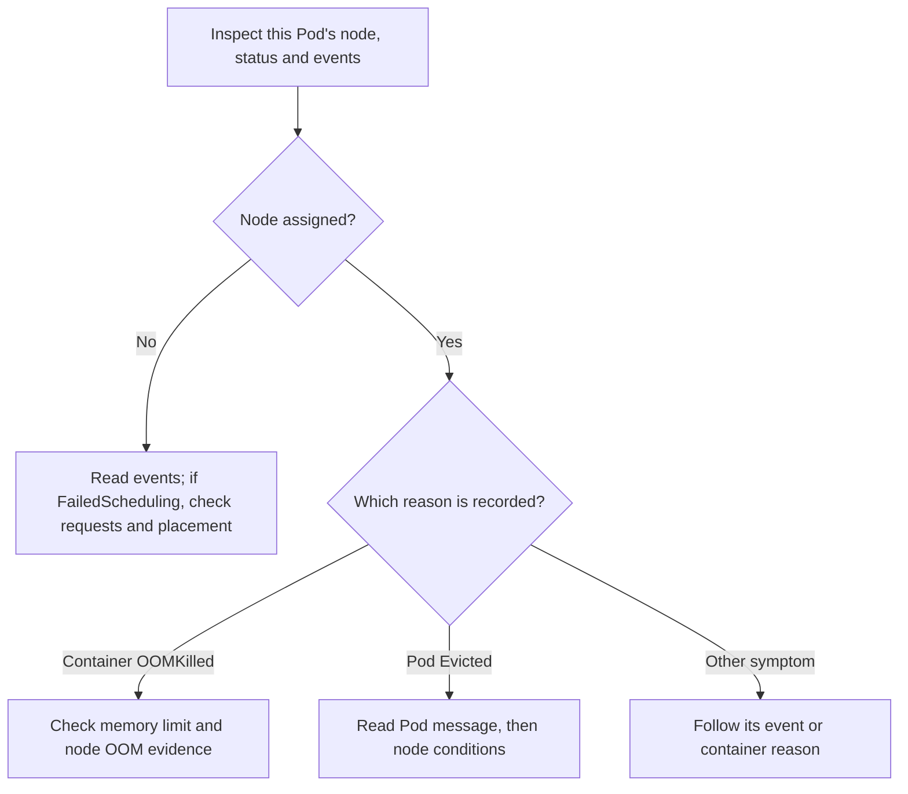

# Investigate Kubernetes resource pressure

## What question are you answering?

A Pod is Pending, has a container marked `OOMKilled`, or was
evicted by the kubelet because of node pressure.
Before adjusting CPU or memory, determine which **resource
boundary** produced the observation:

- A **request** is the amount the scheduler counts when deciding
  whether the whole Pod fits on one node.
- A **limit** constrains a running container. CPU can be throttled;
  memory overuse can lead to an out-of-memory (OOM) kill.
- **Node pressure** can cause the kubelet to evict a Pod when the
  node runs short of memory, disk space, process IDs, or other
  monitored resources.[^resource-management][^node-pressure]

Think of a request as a booking the scheduler counts, a limit as
a rule for a container already using its place, and node pressure
as the whole building running short. The analogy stops here:
a request does not cap actual use. For memory pressure, usage above
requests helps determine which Pods the kubelet evicts; priority
also matters. A node-wide OOM kill can happen before the kubelet
evicts a Pod. CPU shortage by itself is not a kubelet eviction
signal.[^resource-management][^node-pressure]



Text alternative: first ask whether the Pod has a node. If not,
read scheduling events and compare requests and placement rules
on candidate nodes. If it has a node and a container was OOM-killed,
read that container's current or last termination reason, memory
limit, and node evidence. If the Pod reason is `Evicted`, read
its message, then its node's conditions. Other
symptoms need their own evidence path.

## 1. Identify the observed state

This guide uses `shop` and a Pod name as **illustrative
placeholders**. Confirm the target context and namespace first,
following the [safe opening routine](daily-usage.md).

```bash
kubectl config current-context
kubectl get pod <pod-name> -n shop -o wide
kubectl describe pod <pod-name> -n shop
```

Read the Pod's **Node**, container states, last termination
reason, conditions, and events. If there is no assigned node
and an event says `FailedScheduling`, begin with request-versus-
allocatable capacity. If a container's last state says
`OOMKilled`, inspect its memory limit, workload behavior, and
node-level evidence; the reason alone does not prove the limit
was exceeded. If there is no applicable container or Pod memory
limit in the admitted Pod, check for node-wide OOM evidence. If the
Pod reason is `Evicted`, read its message
to identify the resource, then inspect the assigned node's
conditions. A Pod status alone is too broad to choose a fix.
These commands only read cluster state.
[^resource-management][^node-pressure][^debug-pods]

| Evidence | What happens to the Pod | First place to look |
| --- | --- | --- |
| No node and `FailedScheduling` | The same Pod waits for a place; `Pending` alone can have other causes. | The Pod's `Events` and the candidate nodes.[^resource-management][^pod-lifecycle] |
| A container's current or last termination reason is `OOMKilled` | That container may restart in the same Pod, depending on its restart policy. | Container `State` or `Last State`, memory limit, previous logs, and node evidence.[^memory-task][^node-pressure] |
| Pod reason is `Evicted` and message names a scarce node resource | The old Pod fails. A workload controller may create a replacement Pod with a different UID. | Pod reason and message, then node conditions and events.[^node-pressure][^pod-lifecycle] |

If a controller already replaced an evicted Pod, its new Pod is
not evidence of why the old one failed. List failed Pods in the
same namespace while they are still available, then check the
`STATUS` column for `Evicted`; other failures also appear here.
A replacement may even reuse a name, so compare Pod UIDs when
the original is available.[^pod-lifecycle]

```bash
kubectl get pods -n shop --field-selector=status.phase=Failed
```

## 2. Compare the configured resources

```bash
kubectl get pod <pod-name> -n shop -o yaml
```

In each container under `spec.containers`, read `resources.requests`
and `resources.limits`. Also inspect `spec.initContainers`, any
`spec.resources` at Pod level if your cluster version supports it,
and `spec.overhead` when present.
These can change the effective request. A container limit without
an explicit request can become its request; a namespace
`LimitRange` can inject defaults. Read the admitted Pod, not only
the file in the repository.
[^resource-management][^limit-range][^pod-overhead]

For `FailedScheduling`, the scheduler compares the Pod's effective
request with **each eligible node's** allocatable resources and
the requests of Pods already there. Free capacity spread over several
nodes cannot fit one Pod. Read the entire event: taints,
`nodeSelector`, affinity, and other constraints may rule out
nodes before memory or CPU is the deciding issue. An idle-looking
node may still have too little capacity after those requests. Do not lower a
request solely to make the Pod schedule; measure the
application's real demand and decide whether capacity,
placement, or the request is wrong.[^resource-management]

For `OOMKilled`, ask whether the memory limit is below the
application's real peak, whether a recent change increased
memory use, or whether the node itself ran out of memory.
The kernel can kill a process in a container during node-wide
OOM before the kubelet evicts a Pod; do not diagnose a limit
solely from `OOMKilled`.[^resource-management][^node-pressure]
Raising a limit without understanding the growth may turn a
container OOM into node memory pressure, node OOM, or eviction,
or merely delay the failure.

If the container restarted and you have access to its logs,
read the previous instance before it is replaced again:

```bash
kubectl logs <pod-name> -n shop -c <container-name> --previous
```

The logs may show application work near the failure, but a
missing log or one snapshot does not establish the memory peak.

## 3. Read node pressure when relevant

If the Pod has an assigned node, copy its exact name from
the step 1 `kubectl get pod <pod-name> -n shop -o wide` output:

```bash
kubectl describe node <node-name>
```

Read the node's conditions, allocatable resources, allocated
requests, and events. A `MemoryPressure`, `DiskPressure`, or
`PIDPressure` condition directs you to node-level investigation.
An eviction is distinct from a container being killed for its own memory
limit or by node-wide OOM. Node pressure can come from Pods or
from system use. A node condition shows the state when you read
it and may have cleared since the eviction; the Pod's eviction
message and node events are better evidence of the earlier event.
[^node-pressure]

If the Pod never received a node assignment, inspect scheduling
events plus its `nodeSelector`, affinity, and tolerations in the
Pod YAML. If allowed, list nodes with `kubectl get nodes` and
describe the ones eligible for this Pod. Ask a cluster operator for
capacity when node reads are unavailable; do not describe a
guessed node.
[^resource-management]

If reading Node objects is `Forbidden`, keep the Pod event
and ask a cluster operator for the node evidence. Do not
switch identities just to bypass the denied read.

## 4. Use live metrics as supporting evidence

Where a resource metrics pipeline is available:

```bash
kubectl top pod <pod-name> -n shop --containers
```

This reports recent CPU and memory usage by container. Metrics
may be unavailable for a few minutes after Pod creation or
when the cluster has no functioning Metrics API. A missing
`top` result is not proof that usage is zero. One `top`
snapshot cannot establish a peak, a leak, or CPU throttling;
after a restart it describes the current container, not the
killed one's peak. Compare with time-series metrics and
application behavior when those claims matter.
[^top-pod][^metrics-pipeline]

## Example: why low usage does not solve Pending

Imagine an **invented** `video-api` Pod requesting `2Gi` of
memory. In a one-node cluster, the node has `7.5Gi` allocatable
and already has `6Gi` of Pod requests: only `1.5Gi` remains for
another request. Even if the node's current memory use is only
`3Gi`, this Pod cannot fit there. The numbers are teaching
arithmetic, not cluster measurements. An abbreviated
`kubectl describe pod` event might look like:

```text
Warning  FailedScheduling  12s  default-scheduler  0/1 nodes are available: 1 Insufficient memory.
```

The scheduler checks each eligible node's request budget;
`kubectl top` shows recent usage, a different measurement.
No cluster produced this example.[^resource-management]

The next decision is to verify the request against measured
workload demand and examine allocatable capacity and placement
rules. Depending on evidence, the reviewed correction may be
capacity, placement, or a request adjustment. Recheck the
Pod's scheduling event and the application request after any
approved change.

Two other **illustrative** snippets show why the evidence
location matters:

```text
Last State:  Terminated
  Reason:    OOMKilled
  Exit Code: 137
```

This is a container's previous state. It does not by itself
identify whether its limit or node-wide OOM was responsible.
An evicted Pod instead has a Pod-level reason and message,
which must name the resource before you call it node pressure:

```text
Status:   Failed
Reason:   Evicted
Message:  The node was low on resource: memory.
```

These are simplified examples, not command output recorded
from this repository. Real event messages may contain more
detail.[^memory-task][^node-pressure]

## Choose the next investigation

| Evidence | Next path |
| --- | --- |
| `FailedScheduling` mentions insufficient CPU or memory. | Compare Pod requests with node allocatable capacity and existing reservations.[^resource-management] |
| Container state or last state is `OOMKilled`. | Inspect the memory limit, peak-memory and node-level OOM evidence. For a restarting container, read [previous logs](../troubleshooting/crashloopbackoff.md) and the CrashLoopBackOff path.[^resource-management][^node-pressure] |
| Pod was evicted and its message names node resource pressure. | Inspect node conditions and events, and the [node-pressure guide](https://kubernetes.io/docs/concepts/scheduling-eviction/node-pressure-eviction/).[^node-pressure] |
| `kubectl top` has no data. | Check the [resource metrics pipeline](https://kubernetes.io/docs/tasks/debug/debug-cluster/resource-metrics-pipeline/) and continue with Pod/node events.[^metrics-pipeline] |

Do not apply a resource change from this page alone. Use the
[reviewed manifest-change guide](common-commands.md) once the
cause and desired correction are understood.

This guide does not diagnose Pods removed by a drain, preemption,
or another non-pressure disruption. Follow their own events and
the cluster's disruption procedure.

## Explore further

- [Resource Management for Pods and Containers](https://kubernetes.io/docs/concepts/configuration/manage-resources-containers/)
  explains requests, limits, scheduling, and OOM behavior.
  [^resource-management]
- [Node-pressure Eviction](https://kubernetes.io/docs/concepts/scheduling-eviction/node-pressure-eviction/)
  explains node-level resource signals.[^node-pressure]
- [kubectl top pod](https://kubernetes.io/docs/reference/kubectl/generated/kubectl_top/kubectl_top_pod/)
  documents the metrics view and its delay.[^top-pod]
- [Pod Lifecycle](https://kubernetes.io/docs/concepts/workloads/pods/pod-lifecycle/)
  explains Pod phases, container states, and replacement Pods.[^pod-lifecycle]
- [Back to Kubernetes commands](index.md).

[^resource-management]: [Kubernetes, Resource Management for Pods and Containers](https://kubernetes.io/docs/concepts/configuration/manage-resources-containers/), source record `resource-management`.
[^node-pressure]: [Kubernetes, Node-pressure Eviction](https://kubernetes.io/docs/concepts/scheduling-eviction/node-pressure-eviction/), source record `node-pressure`.
[^top-pod]: [Kubernetes, kubectl top pod](https://kubernetes.io/docs/reference/kubectl/generated/kubectl_top/kubectl_top_pod/), source record `top-pod`.
[^metrics-pipeline]: [Kubernetes, Resource metrics pipeline](https://kubernetes.io/docs/tasks/debug/debug-cluster/resource-metrics-pipeline/), source record `metrics-pipeline`.
[^debug-pods]: [Kubernetes, Debug Pods](https://kubernetes.io/docs/tasks/debug/debug-application/debug-pods/), source record `debug-pods`.
[^pod-lifecycle]: [Kubernetes, Pod Lifecycle](https://kubernetes.io/docs/concepts/workloads/pods/pod-lifecycle/), source record `pod-lifecycle`.
[^memory-task]: [Kubernetes, Assign Memory Resources to Containers and Pods](https://kubernetes.io/docs/tasks/configure-pod-container/assign-memory-resource/), source record `memory-task`.
[^limit-range]: [Kubernetes, Limit Ranges](https://kubernetes.io/docs/concepts/policy/limit-range/), source record `limit-range`.
[^pod-overhead]: [Kubernetes, Pod Overhead](https://kubernetes.io/docs/concepts/scheduling-eviction/pod-overhead/), source record `pod-overhead`.
