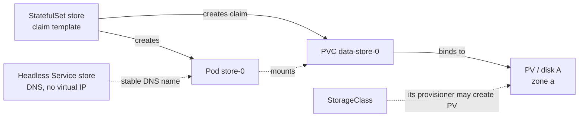

# Stateful workloads

## Purpose

Use this page to decide whether a workload needs stable Pod identities and to
understand how those identities connect to storage. You should be able to
explain what survives a Pod replacement, what can be deleted by policy, and
which data-safety responsibilities remain yours. This is a conceptual guide;
it does not deploy a database.

## The simple model

A **Deployment** keeps a desired number of interchangeable Pods running. A
**StatefulSet** keeps a desired set of Pods with stable names and identities,
creates them in order and scales them down in reverse order by default, and
can give each one a persistent storage claim. Under the default `OrderedReady`
policy, each earlier Pod must be Running and Ready before the next is created.
Deleting the whole StatefulSet does not guarantee an orderly Pod shutdown.
The `Parallel` Pod management policy also relaxes creation and scale-down
ordering.[^kubernetes-deployment][^kubernetes-statefulset]

For a database-like workload, that difference matters because `store-0`
may have different local data from `store-1`. Replacing `store-0` should not
turn it into an anonymous replica with `store-1`'s disk. A StatefulSet can
recreate `store-0` and reconnect it to its own claim. The application still
has to know how to use or recover that data.[^kubernetes-statefulset]

Think of each Pod as a named desk with an assigned filing cabinet. The desk
can be replaced while the same cabinet remains assigned. The analogy ends
there: a filing cabinet does not copy its contents to other cabinets, repair
corrupt records, or keep a safe copy elsewhere.

## The four storage pieces

| Object | Plain meaning | What it does not promise |
| --- | --- | --- |
| StatefulSet | Controller that manages named Pods such as `store-0`, `store-1`, and `store-2`; a volume claim template can create a separate claim for each Pod. | Application replication, backups, or consistent writes. |
| PersistentVolumeClaim (PVC) | A request for storage with a size, access mode, and a StorageClass choice. It binds to one suitable PersistentVolume. | A copy of the data or a guarantee that the underlying storage survives deletion. |
| PersistentVolume (PV) | The cluster's representation of a storage asset, provisioned in advance or dynamically. | A particular recovery objective. Its reclaim policy matters when the claim is deleted. |
| StorageClass | A storage offering that identifies a provisioner and settings such as binding mode and reclaim policy for new volumes. | That every node or zone can use every resulting volume. |

The usual flow is: a StatefulSet's claim template creates one PVC for each
Pod; a suitable PV binds to each PVC; a StorageClass can ask a provisioner to
create the PV and underlying storage when needed.[^kubernetes-statefulset][^kubernetes-pv][^kubernetes-dynamic-provisioning]
When a claim omits the StorageClass name, the cluster's default class may be
used if one exists.[^kubernetes-storageclass]

Text alternative: one of the three illustrative Pods is shown. The StatefulSet
creates `store-0` and its separate `data-store-0` PVC from a template; the Pod
mounts the claim, which binds to a PV. A StorageClass may provision a new PV
through its named provisioner. Zone a is an illustrative result, not automatic
spreading across zones. The headless Service gives the Pod a DNS name. Solid
arrows mean creation or binding; dashed arrows mean mounting, provisioning,
or DNS. The same pattern repeats separately for `store-1` and `store-2`;
replacing one Pod does not copy data between volumes.

The claim template in this example is named `data`, so each PVC name combines
the template, StatefulSet, and ordinal: `data-store-0`, `data-store-1`, and
`data-store-2`.[^kubernetes-statefulset]

For stable peer names, you create a **headless Service** (`clusterIP: None`),
selecting the Pods' labels, then name it in the StatefulSet's `serviceName`.
Unlike a normal Service, it has no single virtual IP. If the Service is
`store` in namespace `lessons`, `store-0` can have the DNS name
`store-0.store.lessons.svc.cluster.local` in a
cluster with that default domain. The name stays tied to the Pod identity;
its IP can change after replacement. By default, a Pod needs to be Ready for
its DNS record to appear. `publishNotReadyAddresses: true` changes that rule
for peer discovery, so use it only when the application expects unready peers.
An early failed DNS lookup can also be cached. A stable name is therefore not
an instant recovery signal. Peer discovery does not make the application form
a healthy cluster.[^kubernetes-statefulset][^kubernetes-service-dns]

## Example: three database-like Pods

This is an illustrative model, not an observed cluster or a ready-to-run
database. A StatefulSet called `store` has three Pods: `store-0`, `store-1`,
and `store-2`. Its claim template gives each Pod its own PVC and volume.

Suppose the node running `store-1` becomes unreachable. Its old Pod object
may remain `Terminating` or `Unknown`; the StatefulSet does not create another
`store-1` while that object still exists. The volume can also remain attached
to the old node. This differs from the interchangeable replacement in a
[Deployment](../fundamentals/kubernetes-fundamentals.md): a second writer with
the same StatefulSet identity could corrupt data. The old Pod can clear when
its kubelet returns or when a confirmed-dead Node object is deleted. If an
operator considers force deletion, they must first establish that the old
process cannot keep running; deleting the Pod object alone does not stop it.
Once the old Pod is safely gone and storage can detach and reattach, the
replacement can keep the `store-1` name and reuse its claim. Neither that
identity nor visible files prove that the database has recovered or that all
writes survived.
[^kubernetes-statefulset][^kubernetes-force-delete-statefulset-pod]

If the volume is restricted to one availability zone and no suitable node is
available there, the replacement may stay `Pending`: the PV's node affinity
limits where its Pod can run. For **new** topology-dependent storage, a
StorageClass with `WaitForFirstConsumer` delays provisioning and binding until
the scheduler considers the first Pod's placement. It cannot relocate an
already provisioned zonal volume after failure.[^kubernetes-storageclass]

The database must implement its own replication and consistency rules if the
three Pods are to share data safely. A StatefulSet and three PVCs do not create
a three-copy database. Backups, restore testing, and a recovery plan remain
separate requirements.

## Two deletion policies to keep apart

Removing a Pod is different from removing its claim, and removing a claim is
different from deleting the storage asset.

1. **StatefulSet PVC retention** decides whether claims created from the
   template remain after scale-down or StatefulSet deletion. Its
   `persistentVolumeClaimRetentionPolicy.whenScaled` and `.whenDeleted` fields
   each default to `Retain`; either can request claim deletion instead.
   [^kubernetes-statefulset]
2. **PV reclaim policy** decides what happens to the PV and underlying storage
   after its PVC is deleted. `Retain` leaves the PV `Released` for an
   administrator to reclaim; a new PVC cannot automatically reuse it.
   `Delete` requests removal of the backing asset through the storage
   provider. Dynamically provisioned PVs inherit the StorageClass reclaim
   policy, which defaults to `Delete` if unspecified.
   [^kubernetes-pv][^kubernetes-storageclass]

Both policies say `Retain`, but the first keeps a **claim** and the second
keeps a **volume after its claim is gone**. For example, scaling `store` from
three Pods to two keeps `data-store-2` by default. Scaling back to three
reuses that claim and its old data, which may now be stale. If `whenScaled` is
`Delete`, scaling down removes that claim. On scale-up, the controller creates
a new claim without the old data; dynamic provisioning can create a new volume
for it. If the old PV's reclaim policy was `Retain`, its data still requires a
separate manual recovery decision.
[^kubernetes-statefulset][^kubernetes-pv]

That two-stage chain is why "the StatefulSet keeps my data" is unsafe as a
general rule. Before scaling down or deleting a workload, inspect the claim
retention setting, the bound PV's reclaim policy, and the tested backup or
restore path. See [Velero storage and volume backups](../../migrations/velero/storage-and-volume-backups.md)
for Kubernetes volume recovery choices; database-native backup may still be
needed for application consistency.

## When to choose it

- Use a StatefulSet when each replica needs a stable name, its own persistent
  claim, or default ordered creation and scale-down as part of the
  application's design.[^kubernetes-statefulset]
- Use a Deployment when replicas can be replaced interchangeably. A stateful
  application is not forbidden from using a Deployment; what matters is
  whether its identity and storage needs fit that controller's behavior.
- Choose storage and recovery by the data's failure model: zone availability,
  attach constraints, data replication, backup frequency, and tested restore.
  A controller choice alone cannot satisfy these requirements.
- A broken template can stall the default `OrderedReady` rolling update.
  Reverting the template alone may not clear already attempted broken Pods;
  follow the official forced-rollback procedure if this occurs.
  [^kubernetes-statefulset]

## Check your understanding

- If `store-1` is replaced, which names and storage relationship should
  remain stable? What still needs application-level recovery?
- If a StatefulSet is deleted with default PVC retention, are its underlying
  disks guaranteed to exist forever?
- Why does `WaitForFirstConsumer` help with initial zonal placement but not
  fix an unavailable zone later?

Answer hints: the replacement gets the `store-1` name and claim only after the
old Pod is safely removed; application recovery is separate. Default PVC
retention does not make disks permanent: a later claim deletion invokes the
PV reclaim policy. `WaitForFirstConsumer` chooses placement for a **new**
volume; it cannot move an existing one.

## Official documentation for deeper study

- [StatefulSets](https://kubernetes.io/docs/concepts/workloads/controllers/statefulset/) covers identity, ordering, volume claim templates, and PVC retention.
- [Persistent Volumes](https://kubernetes.io/docs/concepts/storage/persistent-volumes/) explains claims, binding, and reclaim policies.
- [Storage Classes](https://kubernetes.io/docs/concepts/storage/storage-classes/) explains provisioning settings and `WaitForFirstConsumer`.
- [Dynamic Volume Provisioning](https://kubernetes.io/docs/concepts/storage/dynamic-provisioning/) follows a storage request to a new volume.
- [Deployments](https://kubernetes.io/docs/concepts/workloads/controllers/deployment/) describes the interchangeable-Pod controller.
- [Force Delete StatefulSet Pods](https://kubernetes.io/docs/tasks/run-application/force-delete-stateful-set-pod/) explains the failed-node identity and force-deletion risk.
- [DNS for Services and Pods](https://kubernetes.io/docs/concepts/services-networking/dns-pod-service/) explains readiness and DNS publication.

## Related links

- [Kubernetes fundamentals](../fundamentals/kubernetes-fundamentals.md)
- [Velero storage and volume backups](../../migrations/velero/storage-and-volume-backups.md)
- [Stateful vs. stateless on AWS](../../cloud/aws/architecture/stateful-vs-stateless.md)
- [Back to Kubernetes core objects](index.md)
- [Back to Kubernetes index](../index.md)
- [Back to knowledge index](../../index.md)

[^kubernetes-statefulset]: [Kubernetes - StatefulSets](https://kubernetes.io/docs/concepts/workloads/controllers/statefulset/), source record `kubernetes-statefulset`.
[^kubernetes-pv]: [Kubernetes - Persistent Volumes](https://kubernetes.io/docs/concepts/storage/persistent-volumes/), source record `kubernetes-pv`.
[^kubernetes-storageclass]: [Kubernetes - Storage Classes](https://kubernetes.io/docs/concepts/storage/storage-classes/), source record `kubernetes-storageclass`.
[^kubernetes-dynamic-provisioning]: [Kubernetes - Dynamic Volume Provisioning](https://kubernetes.io/docs/concepts/storage/dynamic-provisioning/), source record `kubernetes-dynamic-provisioning`.
[^kubernetes-deployment]: [Kubernetes - Deployments](https://kubernetes.io/docs/concepts/workloads/controllers/deployment/), source record `kubernetes-deployment`.
[^kubernetes-force-delete-statefulset-pod]: [Kubernetes - Force Delete StatefulSet Pods](https://kubernetes.io/docs/tasks/run-application/force-delete-stateful-set-pod/), source record `kubernetes-force-delete-statefulset-pod`.
[^kubernetes-service-dns]: [Kubernetes - DNS for Services and Pods](https://kubernetes.io/docs/concepts/services-networking/dns-pod-service/), source record `kubernetes-service-dns`.
