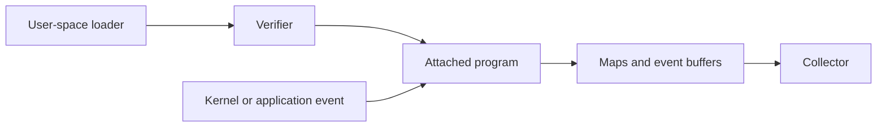

# eBPF architecture and Kubernetes uses

## Purpose

Understand what eBPF enables and the constraints of operating tools built on it.

Sources reviewed: 2026-10-29. See the [validation record](../../../knowledge-base-audit.md) for executed checks and unexecuted runtime labs.

## How it works

eBPF allows programs to run at supported hooks, commonly in the Linux kernel. A loader submits bytecode; the verifier checks constraints before execution. Maps exchange state with user space. JIT compilation may produce native code depending on platform configuration.[^ebpf-introduction][^linux-bpf][^pixie-ebpf]

Hooks include tracepoints, kprobes, uprobes, networking paths, and security attachment points. Uprobes observe user-space code, so eBPF tooling is not limited to packet inspection.



## Kubernetes uses

Networking tools implement connectivity, load balancing, and policy. Observability tools inspect flows, latency, system calls, and profiles. Security tools detect or enforce selected behavior. Cilium, Hubble, Pixie, and Falco have different goals and deployment assumptions.

## Safety and compatibility

Verifier checks reduce invalid-program risks, but loaders and collected data still need protection. Kernel vulnerabilities and tool defects remain possible. Check kernel configuration, architecture, BTF/CO-RE requirements, runtime, security policy, and node-type support for the particular product.

```bash
uname -r
uname -m
```

What it does: reports release and architecture on a Linux node. A Windows terminal does not inspect a Kubernetes node's kernel. Use `bpftool feature probe` only with appropriate node privileges and controls.

## Limitations

Encrypted-payload visibility depends on attachment points and supported libraries/protocols. Capturing traffic does not guarantee complete distributed tracing. Sampling, buffer pressure, and short retention create gaps.

Trial a compatible disposable cluster, measure overhead/dropped events under representative load, and review privileges, upgrades, and removal before production.

## Related links

- [eBPF introduction](https://ebpf.io/what-is-ebpf/)
- [Linux BPF](https://docs.kernel.org/bpf/)
- [Pixie eBPF](https://docs.px.dev/about-pixie/pixie-ebpf/)
- [Back to parent index](index.md)
- [Back to major area](../index.md)
- [Back to root index](../../../README.md)

[^ebpf-introduction]: [eBPF introduction](https://ebpf.io/what-is-ebpf/).
[^linux-bpf]: [Linux BPF](https://docs.kernel.org/bpf/).
[^pixie-ebpf]: [Pixie eBPF](https://docs.px.dev/about-pixie/pixie-ebpf/).
