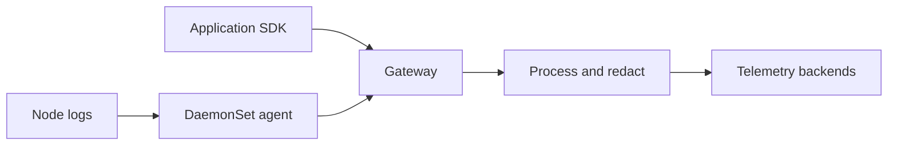

# Telemetry collection and aggregation

## Purpose

Separate collection, processing, routing, and durable storage.

Sources reviewed: 2026-10-29. See the [validation record](../../../knowledge-base-audit.md) for executed checks and unexecuted runtime labs.

## Collection versus aggregation

A collector gathers records. Processing may enrich, filter, redact, sample, batch, or mathematically aggregate them. A backend stores and queries them. Batching spans into a network request does not calculate a latency percentile.[^agent-pattern][^gateway-pattern][^fluent-bit][^vector]

OpenTelemetry Collector uses receivers -> processors -> exporters, explicitly enabled in signal pipelines. Fluent Bit offers lightweight collection/routing, particularly for logs. Vector provides sources, transforms, and sinks. Check which components your exact distribution includes.

## Agent and gateway patterns

A DaemonSet can collect node-local logs/metadata. SDKs or sidecars send application signals. A gateway Deployment centralizes export policy and routing. Multiple gateways improve availability, but stateful processing such as tail sampling needs deliberate partitioning.

## Failure and capacity

Set memory limits, batching, queues, retries, and backpressure behavior. In-memory queues lose data on restart; persistent queues add disk/recovery responsibilities. Receiver availability does not prove export. Monitor dropped/refused data, exporter errors, queue occupancy, and freshness.

Avoid duplicate file readers and high-cardinality labels. Restrict receivers, use TLS/authentication across trust boundaries, and redact before broader export. Define how gateway failures affect application latency and data loss.

For traces, start with OTLP to a gateway. For container log files, use a node agent with checkpointing. For business-event aggregates, use stream-processing semantics rather than treating a telemetry Collector as a transactional engine.

## Related links

- [Agent pattern](https://opentelemetry.io/docs/collector/deploy/agent/)
- [Gateway pattern](https://opentelemetry.io/docs/collector/deploy/gateway/)
- [Fluent Bit](https://docs.fluentbit.io/manual/concepts/data-pipeline)
- [Vector](https://vector.dev/docs/architecture/)
- [Data aggregation](../../databases/data-aggregation.md)
- [Back to parent index](index.md)
- [Back to major area](../index.md)
- [Back to root index](../../../README.md)

[^agent-pattern]: [Agent pattern](https://opentelemetry.io/docs/collector/deploy/agent/).
[^gateway-pattern]: [Gateway pattern](https://opentelemetry.io/docs/collector/deploy/gateway/).
[^fluent-bit]: [Fluent Bit](https://docs.fluentbit.io/manual/concepts/data-pipeline).
[^vector]: [Vector](https://vector.dev/docs/architecture/).
